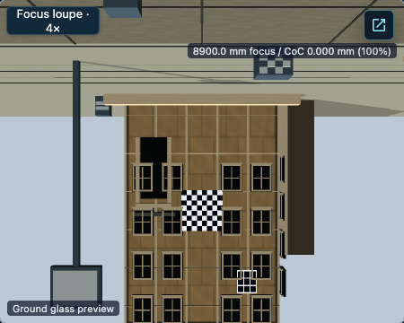
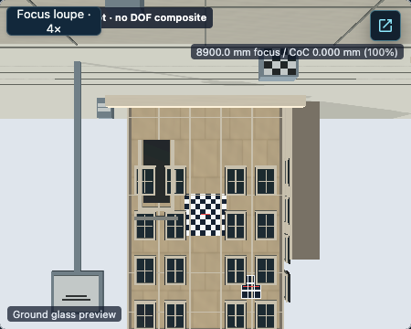

# M7X — WebGPU Development Readiness Closure

## Decision

**X1 — Development-ready, limited native WebGPU.** RQ1 may start now with the registered Architecture Rise M3 Raw RTT pilot on Three.js r187. This is a development capability decision only. It does not qualify the full Ground Glass pipeline, M7, M8, M9, or production WebGPU.

The bounded native application smoke passed on this checkout: Chrome 157.0.8103.39 mounted `webgpu-renderer` with `executionApi=webgpu`, `internalFallback=none`, matched policy and mounted evidence revision `m3-architecture-rise-raw-rtt-native-r187-v1`, produced contentful Raw output, accepted a Focus/aperture update, and cleaned up on a client-side scene transition before the next scene used WebGL. This run establishes actual WebGPU API execution on the captured macOS arm64 host. It does not establish hardware acceleration or spontaneous/external device-loss handling.

## Capability boundary

“Implemented”, “authorized”, “verified”, and “ready for visual work” are separate claims.

| Capability | Implemented | Current authorization | Runtime evidence | Ready for visual work |
| --- | --- | --- | --- | --- |
| WebGPU Raw RTT | Yes, M3 | Yes, only the trusted development pilot for `architecture-rise`, exact registered bounds, `raw-rtt`, and r187 evidence | Native application smoke on Chrome 157 / Three r187; actual API `webgpu`, no internal fallback, application fallback status `not-observed`, contentful Raw frame | **Yes**, for scene-color/Raw-stage investigation in that registered scene. This is not photographic Ground Glass readiness. |
| Physical CoC / footprint | Yes, M4 | Research-only; not authorized by the M3 Raw record | Separate native r187 research evidence exists; disabled in the M7X smoke | No for general visual acceptance. Reserve for RQ3 and its feature-specific gates. |
| Far/Near gather and B1 | Yes, M5 | Research-only and separately gated | Native research evidence exists; M5Q remains partially qualified, with only its exact Q3 signed-boundary case bounded-qualified | No as general scene or photographic quality support. |
| Far/Near composite | Yes, M5 research path | Only in its separately gated research/M6 experiments | Native output-contract/conformance evidence exists for scoped Architecture Rise cases; disabled in the M7X smoke | No as broad photographic qualification. |
| Final M6 presentation | Yes, M6 | Development-only, separately gated Architecture Rise experiment; not general renderer eligibility | Scoped native conformance evidence exists; M6 remains architecture-partially-implemented and quality-unqualified | No as a general final Ground Glass quality reference. |
| Material families | Registered Architecture Rise Raw subject materials are supported by the M3 scene record | Only the materials and subject inputs represented by that exact compatibility record | Verified within the M3 Raw scene scope | Yes for changes that remain within the registered subject/Raw scope; a material or scene-source change must not silently reuse stale compatibility evidence. |
| Scene compatibility | Yes, through the explicit registry | Only `architecture-rise`, its exact registered bounds, `raw-rtt`, and the recorded r187 evidence | Verified on the current host for Architecture Rise only | No generalization to another scene, material set, renderer revision, or optical feature. Unsupported combinations must remain fail-closed. |

M4/M5/M6 implementation and research evidence do not widen M3 authorization. The M7X runtime capture used Raw mode; Physical CoC, gather, M6 presentation, and their qualification flags were off.

## Reproduce the development pilot

Prerequisites for the verified environment are Node.js 24.3.0, the repository-installed Three.js r187, and a headed Chrome with a native WebGPU runtime. The capture reports Chrome `157.0.8103.39`, Darwin arm64, and Node's `os.release()` value `27.0.0`. The browser user-agent reports `MacIntel`; host architecture comes from the Node process. No hardware-acceleration claim is made.

From the repository root:

```bash
nvm use 24.3.0
npm ci
VITE_BASE_PATH=/ VITE_GROUND_GLASS_WEBGPU_RAW_PILOT=true \
  npm run dev -- --host 127.0.0.1 --port 4173 --strictPort
```

Open `http://127.0.0.1:4173/simulator/free/architecture-rise?rttDiagnostics=1` in headed Chrome. In Developer Tools, enable **Raw RTT — bypass DOF**. The URL or browser API preflight does not authorize WebGPU. Confirm the mounted Ground Glass element reports all of:

```text
data-policy-selected-backend="webgpu"
data-mounted-renderer-family="webgpu-renderer"
data-actual-execution-api="webgpu"
data-policy-evidence-revisions="m3-architecture-rise-raw-rtt-native-r187-v1"
data-mounted-verification-evidence-revision="m3-architecture-rise-raw-rtt-native-r187-v1"
data-rtt-raw-contentful="true"
```

Also confirm the nested pilot adapter reports `data-internal-fallback="none"`, the host is `ready`, and the frame request ID matches the last completed request. A `webgpu-renderer` family alone is insufficient if the actual API reports WebGL2 compatibility. If WebGPU is unavailable or initialization fails, the established application fallback is WebGL; it is not a native pass. Restart without `VITE_GROUND_GLASS_WEBGPU_RAW_PILOT=true` to return to the ordinary WebGL development profile. Do not set M4, M5, or M6 research flags for this workflow.

The retained, public-safe normalized application record is [`native-m3-raw-smoke.json`](ground-glass-m7x-development/runtime/native-m3-raw-smoke.json). It contains the native runtime and cleanup event chain and records the digest of the temporary raw Playwright attachment from which it was derived; the original attachment was not committed because it included local process paths. The smoke used the existing native-required Playwright test, one worker and zero retries:

```bash
nvm use 24.3.0
GROUND_GLASS_NATIVE_WEBGPU_REQUIRED=1 \
GROUND_GLASS_WEBGPU_FAILURE_INTEGRATION=1 \
GROUND_GLASS_M7C_TEST_INVOCATION='M7X bounded native M3 Raw RTT application pilot smoke with existing diagnostic seam gate' \
VITE_GROUND_GLASS_WEBGPU_RAW_PILOT=true \
npm run test:e2e -- --project=chrome-native-webgpu --workers=1 --retries=0 \
  --reporter=list,json \
  src/tests/e2e/ground-glass-webgpu-r187-app-pilot.spec.ts
```

`GROUND_GLASS_WEBGPU_FAILURE_INTEGRATION` enables the existing test-only lifecycle observation seam used by this test; it is not an application backend selector. The test verifies the public Raw control, real renderer identity after initialization, contentful output, a Focus and aperture update, navigation, confirmed native-generation cleanup, and the next scene's WebGL renderer. A browser `navigator.gpu` probe alone is not sufficient.

## Visual baseline

Two application captures were made from the same source (`69fcd6227e6a3ddf629ece88fd80124158b22d98`) in headed Chrome 157, viewport 1280×900 at device scale factor 1, Three.js r187, and the `architecture-rise` route `/simulator/free/architecture-rise?rttDiagnostics=1`. Both enabled Raw RTT and reached a contentful 900×720 internal scene-color target. The displayed Ground Glass captures are 450×360.

| Capture | Runtime identity | Focus / aperture | PNG SHA-256 |
| --- | --- | --- | --- |
| [WebGL reference](ground-glass-m7x-development/visual-baseline/webgl-raw-architecture-rise-focus-step-f8.png) | `webgl-renderer` / `webgl2` | 8,900 mm / f/8 | `2dd8143cdf4303f8a083f0c2a453f1352154ec73ffc89b220e52486800252432` |
| [Native WebGPU Raw candidate](ground-glass-m7x-development/visual-baseline/webgpu-raw-architecture-rise-focus-step-f8.png) | `webgpu-renderer` / `webgpu`, internal fallback `none` | 8,900 mm / f/8 | `c4fc8919a429000b77c4fca37efc1d1f2e5a76535bf2b85cd6091e6c68ba0a2e` |

The captures use the same scene-color/Raw RTT display stage, not WebGL's final photographic Ground Glass composite against WebGPU's Raw pre-composite output. The screenshots visibly differ in tone/color; the native capture appears lighter. This is a review baseline, not a parity result and not evidence that either image is optically correct or that a particular subsystem caused the difference. Both include application overlays. The public slider changed Focus from 8,890 to 8,900 mm and the aperture was set to f/8. The remaining route-preset state is 150 mm focal length, zero front rise/shift/tilt/swing, and zero rear rise/shift/tilt/swing. Those exact values come from the Architecture Rise preset and are recorded in the capture metadata. Raw mode bypasses DOF, so this capture does not demonstrate focus-blur quality.





The capture metadata is in [`webgl-reference.json`](ground-glass-m7x-development/visual-baseline/webgl-reference.json) and [`webgpu-native-candidate.json`](ground-glass-m7x-development/visual-baseline/webgpu-native-candidate.json). Their request IDs equal their last-completed request IDs; raw output was contentful, page errors were empty, and logical/internal sizes matched. No elaborate pixel-diff system was introduced.

## Safety and remaining blockers

The smoke and existing lifecycle contract preserve distinct native and WebGL2-compatibility identities, separate application and renderer-internal fallback fields, accepted-frame freshness, generation-owned cleanup, sticky failure/retry behavior, and no recursive fallback. The application smoke observed confirmed cleanup during SPA scene navigation. Existing M7G/M7C evidence remains responsible for broader failure, retirement, and lifecycle controls; M7X does not relabel their evidence. Production preview must remain WebGL-only, including when URL-shaped backend requests, browser WebGPU support, development flags, or test seams are present. Relevant records are [M7G lifecycle consolidation](GROUND_GLASS_M7G_R187_LIFECYCLE_CONSOLIDATION.md), [M7C r187 Raw lifecycle](GROUND_GLASS_M7C_R187_RAW_LIFECYCLE.md), [M5Q qualification summary](GROUND_GLASS_M5Q_QUALIFICATION_SUMMARY.json), [M6 presentation](GROUND_GLASS_M6_PRESENTATION.md), [M7V lane governance](GROUND_GLASS_M7V_E2E_QUALIFICATION_LANES.md), and [M7W WebGL qualification](GROUND_GLASS_M7W_WEBGL_QUALIFICATION.md).

Remaining work is grouped by what it blocks:

- **Does not block Raw-stage RQ1:** The authorized Architecture Rise Raw pilot is available on the tested native host. RQ1 can define visual states, record exact public inputs and renderer identities, capture WebGL and authorized native Raw at the same stage, and compare changes within this boundary.
- **Blocks specific photographic features:** M5Q reference convergence and far/near quality; broader material parity; M6 final presentation and quality; image-circle/vignetting and physical CoC quality. These belong in feature-specific RQ3 work, not as a prerequisite for all visual work.
- **Blocks formal qualification or production:** M7 remains partial; M7W's ordinary lane had 117 passes and 84 unexpected outcomes among 201 mandatory identities, and broad E2E remains not-qualified. Its renderer-serial lane passed 4/4 locally but lacks complete M7V provenance. M7V has 75 owner approvals pending; spontaneous/external device loss remains blocked; M8 is denied; M9 is unauthorized; production Ground Glass remains WebGL-only and production WebGPU disabled.

No current M7X observation established a defect requiring a renderer change, so this PR adds no runtime code or authorization. The initial passing native run with an incomplete diagnostic seam was retained as an invalid test attempt; the passing seam-enabled run is the accepted smoke evidence. No full 278-test E2E run, native lane suite, or device-loss experiment was run.

## RQ handoff

### RQ1 — Render Quality Baseline and Comparison

Start with the exact Architecture Rise Raw pilot above. Record exact slider/control values and all backend/evidence attributes per capture; use a stable viewport and headed native Chrome; keep a WebGL reference from the same checkout and same scene-color/Raw stage. The current pilot state is 150 mm focal length, Focus 8,900 mm, f/8, and zero front/rear movements. Add deterministic representative off-axis/Rise states only after recording their actual public control values. Do not call the Raw captures full Ground Glass quality or compare them against a different final-presentation stage. Raw mode bypasses DOF, so focus-blur comparisons wait for an eligible path. Record basic frame completion and duration, but do not promote that to M8 performance qualification. Negative controls should keep production requests, unsupported scene/features, WebGL2 compatibility, and incomplete renderer initialization from being counted as native success.

### RQ2 — Lighting, Materials and Scene Quality

Use Architecture Rise as the first bounded teaching scene. Candidate work can adjust directional/ambient balance, soft contact shadows, physically meaningful roughness, deterministic normal/roughness texture, and material response as viewing direction changes. Keep each change attributable to its scene source and do not reuse the current M3 compatibility record after modifying registered scene/material inputs: changed inputs must fail closed until their native Raw eligibility is re-established. Do not expand the scene catalog or add DOF/presentation work to RQ2.

### RQ3 — Photographic Ground Glass

Treat far reconstruction, near coverage, edge leakage/disocclusion, physical CoC quality, Image Circle/vignetting, color handling and final presentation as a later feature-specific phase. Start from existing partially-qualified M5Q evidence and its frozen thresholds; do not retune thresholds from favorable candidate output.

## Formal authorization remains unchanged

```text
Broad E2E: not-qualified
M7: partially-qualified
M7V owner approvals: pending
Spontaneous/external GPU device loss: blocked
M8 formal entry: denied
M9: not authorized
Production Ground Glass: WebGL-only
Production WebGPU: disabled
```

The M7X X1 decision is limited development readiness for the already authorized M3 Raw Architecture Rise path. It is not a formal milestone transition.
