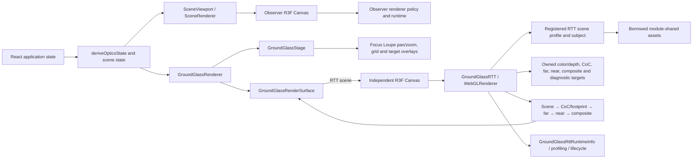
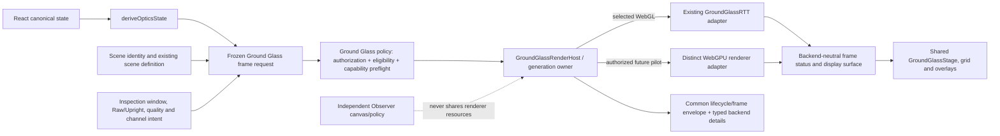
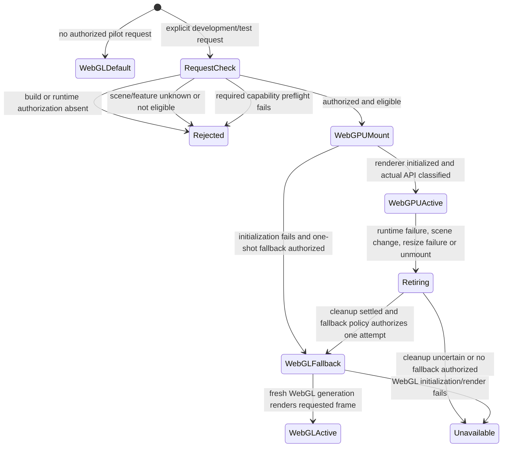
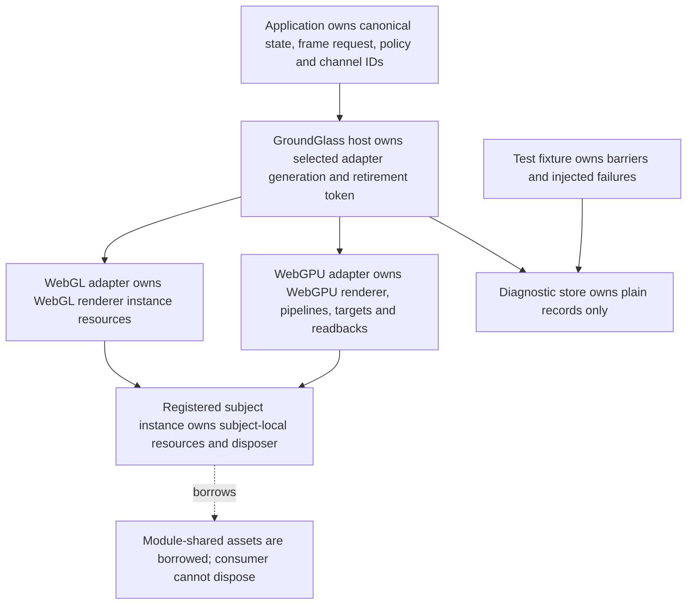
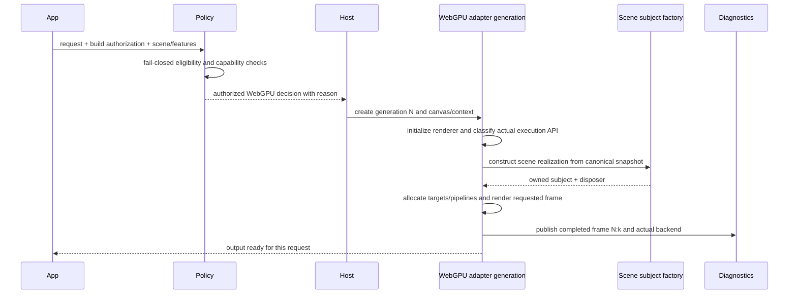
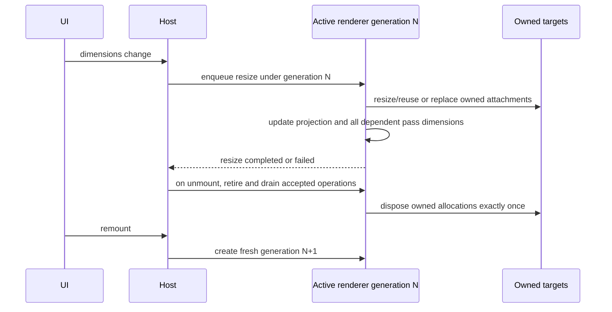

# Ground Glass WebGPU Integration Blueprint

**Status:** Architecture design only; no production integration is implemented by this document.

**Decision:** Keep the validated WebGL renderer and add a distinct WebGPU renderer behind a small Ground Glass host seam.

**Base:** Phase L merge `a9114a791e8c6790221c6d6732e0b2872020211a`.

This blueprint translates the [ADR](GROUND_GLASS_WEBGPU_INTEGRATION_ADR.md) into implementation boundaries, contracts, lifecycle rules, and acceptance gates. Source and test references are linked in [Evidence traceability](#evidence-traceability).

## 1. As-is architecture



**Implemented boundaries:** canonical optics are above the renderer; Observer and Ground Glass have separate canvas/renderer lifetimes; RTT subjects use registered mount/dispose ownership; Ground Glass targets and post resources belong to the RTT instance; shared stage/overlays sit outside the RTT shader passes.

**Not implemented:** a Ground Glass backend selector, host abstraction, backend-neutral renderer API, executable pass graph, or production WebGPU renderer. `groundGlassPassGraph.ts` describes semantic order only.

## 2. To-be architecture



The host selects and owns an adapter generation; it does not own or reinterpret GPU targets. The WebGL adapter should initially wrap existing behavior with minimal change. The WebGPU adapter owns its own implementation. The shared display/stage boundary is not a promise that the backend output representation or textures are interchangeable.

## 3. Application-facing contract

The first shared value should be an immutable **frame request snapshot**. A future implementation should reuse existing domain types rather than duplicate optical fields. The sketch below communicates lifetimes and exclusions; it is not a Phase M API proposal to implement verbatim.

```ts
type GroundGlassFrameRequest = Readonly<{
  requestId: string;
  opticsState: DerivedOpticsState;
  scene: SceneDefinition;
  view: Readonly<{
    inspectionWindow: GroundGlassInspectionWindow;
    previewMode: "raw" | "upright";
    rawDebug: boolean;
    channel: GroundGlassRttChannel;
  }>;
  renderQuality: RenderQualityProfile;
  // Include scalar controls only when an existing renderer consumer needs them
  // and they are not already represented by canonical state.
}>;
```

| Lifetime/contract | Purpose | Must not contain |
|---|---|---|
| Frame request snapshot | One coherent set of canonical inputs and presentation intent for a render/update | Renderer handles, mutable target state, command objects |
| Renderer initialization input | Backend, authorized feature set, dimensions, scene compatibility evidence, owner/channel identity | Per-frame mutable optical state unless initialization needs an immutable initial snapshot |
| Renderer generation | One initialized adapter and its exclusively owned resources | Resources from another generation or Observer |
| Frame result | Generation token, request ID, frame ID, status, failure/quality diagnostics | A claim of success before all required passes/display work complete |
| Diagnostic envelope | Common lifecycle, active backend identity, frame and failure state | An untyped catch-all replacing backend-specific fields |

`GroundGlassDofRenderState` and `GroundGlassPhysicalRenderState` are useful semantic building blocks. Their current existence does not mean they already constitute a complete renderer request: camera projection configuration and presentation/scene intent have additional consumers. The M1 contract should identify and reuse exact source values before freezing a public type.

## 4. Backend selection state machine

Selection is Ground Glass-specific. Observer functions may inform design but must not be reused as the Ground Glass selection mechanism.



`navigator.gpu` is only a preflight signal. Runtime evidence must report actual renderer family and execution API after initialization. Keep distinct fields for a WebGPURenderer running with WebGL2 fallback and for application-level selection of a WebGL renderer.

| Situation | Decision | Required observable result |
|---|---|---|
| Default production request | WebGL | Existing production behavior and WebGL runtime evidence |
| Development WebGPU explicitly requested, scene/features eligible | Attempt WebGPU | Request, policy reason, generation, actual renderer family/API |
| Scene not evaluated or only fixture-researched | Reject request; choose authorized WebGL | Fail-closed reason; no WebGPU mount |
| Required feature/capability absent | Reject; choose authorized WebGL | Missing capability/feature, actual final backend |
| WebGPU initialization failure | Roll back; one fresh WebGL attempt if authorized | Attempted WebGPU, init error, cleanup, app fallback reason |
| WebGPU internal WebGL2 fallback | Report non-native execution; policy decides whether acceptable | Renderer family and execution API are separate |
| WebGPU runtime failure | Retire generation; one WebGL fallback only if explicitly authorized and cleanup completes | Failed frame; failure stage; retirement and fallback generation IDs |
| Cleanup failure or uncertain ownership | Fail closed | Cleanup failure; no overlapping replacement GPU generation |
| Neither backend available | Unavailable | Explicit error; no successful frame claimed |
| Public request for WebGPU before promotion | Reject/ignore according to public API contract; retain WebGL | No public selector and no WebGPU production path |
| Scene switch during accepted async frame | Retire old generation, block stale publication, then mount next eligible generation | Old and new generation IDs; stale operation state |
| Comparison mode | Two independent renderer channels with matched immutable request | Separate owner IDs, capabilities, completion IDs, and memory accounting |

## 5. Pass contracts and migration choices

Current production order is scene render, physical CoC/footprint, far gather, near gather, composite. Raw Debug bypasses CoC and both gathers, then composites scene color. Presentation follows the semantic passes. Current `groundGlassPassGraph.ts` is descriptive, not an execution scheduler.

| Stage | Production WebGL today | Research WebGPU evidence | Integration contract still required | Ownership and checks |
|---|---|---|---|---|
| Scene color/depth | Full-resolution scene target and depth; WebGL camera/material realization | Phase C actual target render/display; later depth inputs in bounded fixtures | Production scene factory parity; color/depth formats, clear/depth convention, material support | Backend owns target; registered subject owns its local assets; asymmetric geometry and depth validity |
| Physical CoC/footprint | GLSL physical inputs, storage capability path, diagnostics | Phases D–E native storage/classification and physical footprint comparisons | Exact sign, units, validity, finite range, ellipse orientation/axis parity across adapters | Backend owns target/pipeline; CPU physical kernel is oracle |
| Far gather | GLSL aperture gather | Phases F–L gather and reconstruction tests | Gather sampling, radius cap, source fallback, alpha, edge and quality-profile behavior | Backend owns gather buffers; matched ROI/reference metrics and edge cases |
| Near gather | GLSL aperture gather and near alpha behavior | Native aperture gather research, limited feature states | RGB/alpha and foreground-spread parity across quality profiles | Backend owns target; explicit RGB and alpha invariants |
| Composite | WebGL GLSL combines scene, near/far and coverage/presentation effects | Research stages, not full production equivalence | Blending/boundary, image circle, illumination, output color-space parity | Backend-owned composite material/pipeline and output target |
| Display | Existing output/display transform and shared stage presentation | Phase C separate TSL sample/display, Raw/Upright/crop evidence | Production host output, overlay alignment, CSS/client sizing and comparison channels | Surface/host owns DOM placement; backend owns source texture until display completes |

Do not introduce a generic render graph now. For initial WebGPU work use explicit ordered passes with semantic IDs in diagnostics. Revisit a small scheduler only when a concrete dependency, cancellation, or lifetime problem requires it.

### Shader strategy

- Use Three.js r186 `WebGPURenderer` for scene rendering where supported.
- Use Node/TSL materials for WebGPU passes where the necessary texture/storage/math operations are supported and validated.
- Use WebGPU-specific code only for a demonstrated missing operation; contain it in the WebGPU adapter.
- Keep the existing GLSL implementation unchanged as the independent WebGL reference.
- Each pass port requires independent numeric/semantic tests; similar code or shared constants do not prove equivalence.
- Establish backend-specific color-space, tone-mapping, depth, filtering, sampler-origin, and output conventions explicitly.

## 6. Resource allocation and disposal

| Resource | Production WebGL owner today | Future WebGPU owner | Disposal authority and resize contract |
|---|---|---|---|
| Renderer/canvas/context | R3F Canvas lifecycle mounted by `GroundGlassRTT` | One host-owned WebGPU generation/canvas | Adapter teardown through host retirement; do not share with Observer |
| Scene/camera/quads | `OffscreenRenderer` instance and its effects | WebGPU adapter generation | Generation disposes instance-owned objects; module shared geometry/material remains borrowed |
| Registered scene subject | `GroundGlassSceneProfile` mount result and registered disposer | Matching WebGPU scene realization/factory | Subject disposer owns subject-local resources exactly once |
| Scene color/depth targets | `GroundGlassRttResources` bundle | WebGPU generation target bundle | Backend-specific bundle disposes owned targets; resize reuses or replaces only by explicit policy |
| CoC/far/near/composite/diagnostic targets | `GroundGlassRttResources` bundle | WebGPU generation target bundle | Owning backend generation disposes; no cross-context texture transfer |
| Shader materials/post resources | `GroundGlassRTT` instance | WebGPU pipeline/material owner | Owning adapter only; partial-init rollback is required |
| Readback buffers | No generic shared target; readback is diagnostics-specific | WebGPU operation/generation | Generation tracks accepted reads; retire waits or safely invalidates before release |
| Scene module assets | Module registry/cache or explicit shared owner | Borrowed by renderer subject where safe; otherwise instantiated locally | Consumer must not dispose borrowed assets |
| Diagnostic records | Runtime owner/channel store | Host + backend-specific diagnostic record | Records survive generation teardown for review, but do not retain GPU handles |
| Test-only barriers/fault injection | Test fixture | Test fixture only | Fixture owns and removes; never production registry |

### Ownership diagram



The shared subject-factory boundary may require backend-specific construction. Never pass a live WebGL `THREE.Scene`, camera, framebuffer, `WebGLRenderTarget`, or GL texture into a WebGPU context. Reuse canonical state and stable asset descriptions; instantiate backend-owned scene resources.

## 7. Startup and failure sequences

### Successful WebGPU startup



### Initialization failure and WebGL fallback

```mermaid
sequenceDiagram
  participant Host
  participant WG as WebGPU generation N
  participant GL as Fresh WebGL generation N+1
  participant Diag
  Host->>WG: initialize authorized attempt
  WG-->>Host: initialization or pipeline error
  Host->>WG: retire; dispose partial subject/targets/pipelines/context
  WG-->>Host: cleanup result
  Host->>Diag: record failed attempt, actual identity if known, cleanup and fallback reason
  alt cleanup safe and one-shot fallback authorized
    Host->>GL: initialize from same canonical request
    GL-->>Host: render a new frame
    Host->>Diag: publish applicationFallback=true and WebGL active identity
  else cleanup uncertain or fallback denied
    Host->>Diag: publish unavailable; no successful frame
  end
```

### Runtime failure and controlled retirement

```mermaid
sequenceDiagram
  participant Host
  participant WG as Active WebGPU generation N
  participant Ops as Accepted frame/readback operations
  participant Diag
  participant GL as Optional fresh WebGL generation N+1
  WG->>Host: device loss/pass/resize/readback failure
  Host->>Diag: mark frame failed; prevent stale success publication
  Host->>WG: retire N; reject new operations
  Host->>Ops: await settlement or invalidate by generation token
  Ops-->>Host: settled; late result cannot publish
  Host->>WG: dispose owned resources once
  WG-->>Host: cleanup result
  alt cleanup succeeds and explicit fallback policy permits one attempt
    Host->>GL: create replacement generation
    GL->>GL: render the same canonical request as a new frame
    GL->>Diag: publish WebGL identity and application fallback
  else
    Host->>Diag: publish unavailable/cleanup failure; no new generation
  end
```

### Scene switch or unmount during asynchronous work

```mermaid
sequenceDiagram
  participant UI
  participant Host
  participant Old as Generation N
  participant New as Generation N+1
  participant Ops as Accepted operations
  UI->>Host: scene switch or component unmount
  Host->>Old: increment/retire generation token; reject new work
  Host->>Ops: track all accepted work to settle or invalidate
  Ops-->>Host: completion tagged N; publication rejected as stale
  Host->>Old: dispose subject and owned GPU resources
  UI->>Host: mount next scene (if still mounted)
  Host->>New: create new independent generation
  New->>New: render only if current token and request still match
```

### Resize and remount



## 8. Coordinate, coverage, and presentation rules

Use [`GROUND_GLASS_COORDINATE_CONTRACT.md`](GROUND_GLASS_COORDINATE_CONTRACT.md) for existing physical-film and WebGL mappings. Preserve the distinct spaces rather than collapsing them into one UV:

1. Canonical world geometry (domain units are mm; Three.js scene coordinates use the established mm-to-m conversion).
2. Rig/film-local physical coordinates and ordered film-plane geometry.
3. Canonical physical film UV.
4. Source projection and inspection-window/crop coordinates.
5. Backend texture sampler coordinates.
6. Display UV for Raw/Upright output.
7. DOM grid/marker coordinates.

WebGPU must establish one global framebuffer, sampling, readback, crop, and overlay mapping with asymmetric physical landmarks. Do not apply WebGL sampler flips by assumption or calibrate each target independently. Test Raw, Upright, off-center Focus Loupe at 4×, pan, resize, paired panes, scene switch, and mirror/lateral-shift scenes.

| Physical/display responsibility | Existing canonical input | Current WebGPU research | Migration classification | Integration gate |
|---|---|---|---|---|
| Image Circle/lens coverage | Canonical coverage geometry; WebGL composite/coverage binding | Physical values available in research; output parity incomplete | Backend-independent input already available; WebGPU implementation required; production visual parity unverified | Off-axis/shifted physical circle, edge and crop output comparisons |
| Vignetting/natural illumination | Canonical illumination state and WebGL composite shader | Not established as full production WebGPU visual parity | Backend-independent input already available; WebGPU implementation required; production visual parity unverified | Numeric gain plus asymmetric output checks across film window |
| Physical film window/clipping | Inspection-window and projection helpers; WebGL camera/composite | Crop research exists; full presentation not established | Backend-independent input already available; WebGPU implementation required; production visual parity unverified | Crop, pan, resize, overlay and sampler same-feature correspondence |
| Boundary blur | WebGL composite/coverage behavior | Not production WebGPU parity | WebGPU implementation required; production visual parity unverified | Boundary-specific matched output; no false claim from CoC alone |
| Brightness/color/display | WebGL material/output pipeline and presentation | Raw display experiments only | Backend-specific behavior requires implementation; production visual parity unverified | Color-space/tone-map/output policy and browser capture comparisons |
| Shutter/ISO/exposure product features | Not a migration requirement | Not tested | Deferred future product feature | Do not add during renderer migration |

## 9. Scene compatibility and material matrix

Compatibility must be a Ground Glass-specific capability record, not an Observer scene flag. A useful feature-level progression is `not-evaluated` → `fixture-research-only` → `verified-for-feature` → `eligible-under-policy`. Human-readable reports may name the verified feature explicitly: “Verified for Raw RTT”, “Verified for Physical CoC”, “Verified for Far/Near Gather”, “Verified for Composite”, or “Verified for full Ground Glass presentation”. A stage is never implied by a later label: full presentation eligibility requires its dependency stages. Each verified claim is tied to scene ID, renderer/runtime revision, feature set, state matrix, test evidence, and browser/adapter. Eligibility requires all features needed by the requested mode. Unknown defaults to not evaluated.

| Representative scene ID/category | Why it is needed | Existing evidence boundary | Additional production evidence |
|---|---|---|---|
| `macro-depth-of-field` | Large physical CoC and Focus Loupe | Phases J–L include actual Macro states; L-A is one 8× crop/state | Multiple radii, near/far boundaries, cap overrun, fallback, sharp halo, profile sweep |
| `interior-corner` | Occlusion and interior depth boundaries | Selected scene/state evidence in later research | Production subject hooks, material/depth coverage, more focus/aperture states |
| `architecture-rise` | Off-axis lens/film and shifted Image Circle | Phase C raw RTT and later bounded feature checks | Full production materials, image-circle/vignette, crops, scene registration parity |
| `understanding-camera-movements` | Movement geometry and overlays | Existing RTT scene registration | Raw/Upright movement sweep and overlay-to-pixel browser evidence |
| `mirror-shift` | Mirror/reflection subject behavior | Registered WebGL-specific profile | WebGPU scene realization, reflection/material/depth/cleanup parity |
| `view-camera-anatomy` or another complex-lighting scene | Material/transparency variety | Observer investigations are separate; not Ground Glass compatibility evidence | Actual Ground Glass scene assets, transparency and lighting under WebGPU |

Scene ID availability does not imply the scene is eligible. Verify current public registration when implementing a future allowlist.

### Material and lighting compatibility

This matrix separates visual rendering issues from physical optical calculations. Severity scale: **Blocking** means do not enable the feature/scene; **High** means no broader pilot until corrected or excluded; **Moderate** means a bounded, documented limitation can be accepted in a scoped pilot.

| Feature | Current WebGL implementation | Current WebGPU evidence | Limitation / proposed remediation | Verification scene | Severity |
|---|---|---|---|---|---|
| Standard/PBR materials | RTT scene render uses registered production subject materials | Some actual registered subjects rendered in bounded fixtures | Full lighting and roughness/metalness parity unproven; compare actual subject pixels and material state | Architecture Rise, Interior Corner | High |
| Basic/unlit/line materials | Present in scene-specific assets/overlays | Raw RTT tests cover selected subject output | Verify line width, clipping, color and visibility at production target scale | Understanding Camera Movements | Moderate |
| Custom `ShaderMaterial` | Existing WebGL shaders may be used by subjects and post passes | GLSL is not assumed to run in WebGPU | Port/rewrite each required shader in TSL or supported WebGPU code; semantic test per shader | Scene inventory driven | Blocking for affected scene |
| Procedural textures | Existing Three.js/WebGL scene material path | Limited fixture asset evidence | Audit texture generation, sampler/UV, color space and update lifetime | Macro, Interior | High |
| Transparency/alpha blending | Current WebGL sorting/blend behavior | Not generally proven for Ground Glass | Validate color/depth/alpha composition and edge interactions; gate scenes with unsupported behavior | Complex lighting scene | Blocking where visually significant |
| Shadow maps | RTT profile configures subject shadow participation | No broad shadow-map parity claim | Match light/shadow state, bias, map format and depth output; otherwise exclude | Architecture/Interior | High |
| Environment maps | WebGL subject/lighting path | No production parity evidence | Verify environment asset format, PMREM/prefiltering, color space and ownership | Complex lighting scene | High |
| Tone mapping/color space | Existing WebGL renderer/material/shader contract | Raw GPU display evidence only | Match scene-linear and output transforms; add region/color tests | Architecture Rise | High |
| Depth and alpha test | WebGL scene target/depth configuration | Native depth and reconstruction tested in bounded fixtures | Test actual materials, near/far precision and depth validity for each scene | Interior Corner, Macro | High |
| Mirror/reflection effects | `mirror-shift` has a custom RTT scene profile/update | Not established for WebGPU | Reimplement scene hook and effect with owned resources, then test shifted/tilted geometry | Mirror Shift | Blocking for this scene |
| Scene-subject custom hooks | `GroundGlassSceneProfile` and registered factories | Research uses selected factory paths | Provide backend-specific realization with matched canonical inputs and disposer | Understanding, Mirror Shift | High |

Observer Anatomy transparency/compositing investigations do not establish Ground Glass compatibility; they remain a separate renderer concern.

## 10. Phase K/L B1 reconstruction readiness

**Decision:** B1 is suitable only for a controlled research/development pilot with quality gates. It is not ready as a production default or as an unqualified scene capability.

| Evidence | Bounded result | What it does not establish |
|---|---|---|
| Phase K large-CoC / scene correspondence | Maximum uncapped radius about 24.672 px; 12 px cap activates; capped pixels concentrated at raster boundaries; B1 improves measured reference agreement in tested states | General scene quality, fallback safety, or retained blur in every scene |
| Phase K fallback / blur | Source fallback and preservation of expected blur remain important | That B1 is always preferable to B0 |
| Phase L interior-frame stress | 47,058 interior capped pixels; 46 qualified interior high-contrast depth-edge pairs; selected 8× centered Macro crop; max uncapped radius about 12.336 px | Broad Macro behavior or other crops/scenes/profiles |
| Phase L selected L-A contract | B1/B0 identical in selected interior ROI; bounded reference criteria passed; no selected-ROI fallback; no strong cap overrun; no near/far CoC transition in selected edge | Robustness to strong CoC overrun, sign boundaries, fallback with meaningful blur, or material variety |

### Required B1 gates before broader pilot

1. Strong CoC overrun well beyond the active radius cap.
2. Interior near/far signed-CoC boundary.
3. B1 fallback activation where expected background blur is materially nonzero.
4. Sharp-halo and blur-suppression metrics.
5. Production scene materials and transparency.
6. Image Circle and natural-illumination parity.
7. Multiple render-quality profiles.
8. Representative browser and GPU adapter coverage.

The full gather pipeline additionally needs near gather RGB/alpha, aperture sampling, composite/boundary and failure/lifecycle checks. Phase K/L results are inputs to those gates, not certification.

## 11. Performance and memory plan

Measure WebGL reference and WebGPU candidate with the same immutable frame request and independently completed output. Do not infer FPS from a single operation wall time. Distinguish browser operation wall time, CPU submission, valid GPU timestamp duration, and readback cost.

| Measurement | Can existing evidence provide it? | Future instrumentation/contract |
|---|---|---|
| Time to first successful frame | Research operations expose initialization/render observations in fixtures | Separate adapter acquisition, renderer init, pipeline compile, first complete frame and fallback |
| Steady-state completed-frame cadence | Existing profiling supports production WebGL; research operations are serialized | Count only completed current-generation frames; report cadence separately from attempted frames |
| CPU submission time | Existing diagnostics cover WebGL and fixture submission phases | Same named boundaries per backend; do not label as GPU time |
| GPU time | Only when genuine reliable timestamp query is supported | Record unavailable/null and capability evidence otherwise |
| Readback overhead | Explicitly measured in research fixtures | Exclude or report separately from interactive rendering path |
| Target memory estimate/count | Target dimensions/formats/count are observable per backend | Compute bytes by format, dimensions, samples and mip count; label estimates, inventory actual owned targets |
| Compilation behavior | Native fixture startup evidence exists | Count compile/warm-up separately and report pipeline cache lifetime |
| Resize allocations | Bounded fixture resize exists | Record reuse/reallocation by generation and verify no leak/double disposal |
| Cleanup/device loss/fallback cost | Fixture lifecycle evidence is bounded | Time retire/drain/dispose/fallback; include cleanup failure and remount |
| Interaction latency | Not established as production comparison | Exercise focus, aperture, camera movement, Focus Loupe and scene switching end-to-end |
| Two-pane cost | Not established | Measure both independent renderer allocations and contention; no shared GPU texture assumption |

Set numeric performance and memory budgets only after measuring representative WebGL baselines and agreeing product requirements. Historical research timings are not budgets or production FPS.

## 12. Diagnostic envelope

Future diagnostics should keep common lifecycle fields and typed backend detail separate. Conceptual shape:

```ts
type GroundGlassRuntimeDiagnostics = Readonly<{
  requestId: string;
  channelId: string;
  rendererGeneration: number;
  requestedBackend: "webgl" | "webgpu";
  selectionReason: string;
  rendererAttempt: "not-started" | "webgl" | "webgpu";
  rendererFamily: string | null;
  executionBackend: "webgl2" | "webgpu" | "unknown" | null;
  applicationFallback: boolean;
  sceneCompatibility: string;
  frameState: "initializing" | "ready" | "rendering" | "failed" | "retiring" | "disposed";
  lastCompletedFrameId: number | null;
  failedPass: string | null;
  failureReason: string | null;
  logicalDimensions: Readonly<{ width: number; height: number }>;
  internalDimensions: Readonly<{ width: number; height: number }>;
  gatherDimensions: Readonly<{ width: number; height: number }>;
  storageFormats: readonly string[];
  physicalCocStatus: string;
  nearAlphaStatus: string;
  renderSanityStatus: string;
  capabilityEvidence: readonly string[];
  profilingStatus: string;
  backendDetails: WebGlGroundGlassDiagnostics | WebGpuGroundGlassDiagnostics;
}>;
```

This is a design sketch, not a fixed public interface. Keep `GroundGlassRttRuntimeInfo`'s WebGL-specific fields and DOM diagnostics intact until M2 defines which fields are truly common. For example, profiling backend/query status, storage format, pass details, capabilities, resource owner IDs, and renderer state must not be collapsed into generic strings without a typed detail. A request or `navigator.gpu` flag cannot prove actual execution.

| Diagnostic category | Candidate common values | Keep backend-specific |
|---|---|---|
| Request/channel/lifecycle | Request ID, channel ID, generation, state, dimensions, last completed frame, failure/pass identity | Renderer instance details and backend resource inventory |
| Selection/runtime identity | Requested backend, policy reason, attempted backend, renderer family, actual execution API, application fallback | WebGL context/capability facts versus WebGPU adapter/device/features and internal fallback |
| Physical/pass status | Physical CoC/footprint state, near alpha, sanity result, semantic pass completion | Actual target format, shader/pipeline status, GL query or WebGPU timestamp/readback evidence |
| Profiling | Named phase boundaries, count/status, timing provenance | WebGL timer-query availability/results versus WebGPU timestamp/query availability/results |

Common fields should be common in meaning, not forced into one representation when the APIs differ. Backend details should use a discriminated union with concrete types. Existing `GroundGlassRttRuntimeInfo` and `data-rtt-*` attributes are WebGL runtime contracts today; they should not be renamed or reinterpreted as backend-neutral facts until each field has an explicit cross-backend definition.

## 13. Rollout and comparison

```text
Production WebGL
  → isolated WebGPU research fixtures (C–L, evidence only)
  → development-only Ground Glass Raw pilot (scene-scoped)
  → scene/feature verification
  → matched-frame comparison
  → broader opt-in development pilot
  → production promotion decision (separate authorization)
```

No automatic promotion based on adapter availability. WebGL remains production default through M1–M8. Each pilot request is build/runtime authorized, scene-feature gated, and independently reported.

Start comparison with **offline matched-frame capture**: identical immutable request/fingerprint, independent renders, stored dimensions/formats/runtime metadata, and region-based comparisons. This minimizes simultaneous memory and device contention. If a later comparison mode mounts two live panes, each must have an independent renderer/context, targets, owner ID, lifecycle, and completion frame. Share only immutable canonical input values; do not share textures. Synchronize comparison by request/frame-state fingerprint, not by assuming completion order. Report the extra target memory and contention.

## 14. Acceptance-gate matrix

Statuses: `Implemented WebGL`, `Research evidence`, `Verified production integration`, `Missing implementation`, `Missing evidence`. “Research evidence” is fixture-scoped and does not imply production integration.

| Dimension | WebGL | WebGPU research | Production integration | Blocking stage / next gate |
|---|---|---|---|---|
| Optical-state parity | Implemented WebGL | Bounded CPU/GPU comparisons | No | M4; canonical state fingerprint and geometry sweep |
| Scene geometry | Implemented WebGL | Selected registered subject fixtures | No | M3/M8; scene-specific realization |
| Color/depth validity | Implemented WebGL | Native bounded depth/RTT evidence | No | M3/M4; real scene material and depth sweep |
| Physical CoC | Implemented WebGL | Research native | No | M4; units/sign/validity/range parity |
| Ellipse orientation | Implemented WebGL | Research native | No | M4; asymmetric rotations and storage decode |
| Radius cap | Implemented WebGL | Research gather | No | M5/M8; strong overrun/edge metrics |
| Near gather RGB/alpha | Implemented WebGL | Bounded native gather evidence | No | M5; RGB and alpha invariants |
| Far reconstruction | Implemented WebGL | B0/B1/C1 research and K/L state gates | No | M5/M8; fallback, sharp-halo, quality sweeps |
| Composite | Implemented WebGL | Partial research output | No | M6; boundary/blending/color parity |
| Raw/Upright | Implemented WebGL | Asymmetric fixture evidence | No | M6; production output and overlay parity |
| Focus Loupe | Implemented WebGL | Crop research | No | M6; pan/resize/display alignment |
| Image Circle | Implemented WebGL | Physical inputs only/partial bounded checks | No | M6; shifted/off-axis raster parity |
| Natural illumination | Implemented WebGL | No full visual parity | No | M6; gain/field output checks |
| Lighting/materials | Implemented WebGL | Selected fixtures only | No | M8; material inventory/representative scenes |
| Transparency | Implemented WebGL | Not established for all scenes | No | M8; alpha/depth tests |
| Mirror/reflection | Implemented WebGL hook | Not established | No | M8; Mirror Shift-specific port and lifecycle |
| Comparison channels | Independent WebGL channels | Fixture pairs, not production host | No | M6/M8; matched snapshots and ownership |
| Failure fallback | WebGL failure handling exists | Fixture lifecycle evidence | No | M7; production host and fault injection |
| Device loss | WebGL lifecycle differs | Bounded fixture experience; not broad | No | M7/M8; loss, retirement, recovery tests |
| Resize | Implemented WebGL reuse/update | Bounded native fixture resize | No | M2/M7; resource inventory and output parity |
| SPA unmount/remount | Implemented WebGL ownership | Fixture-only native SPA evidence | No | M2/M7; host integration and no stale output |
| Performance | WebGL profiling exists | Research operation measurements | No | M8; representative interaction benchmarks |
| Adapter compatibility | Browser-dependent WebGL | One/few native research environments | No | M8; supported browser/adapter matrix |

## 15. Risk register

Scales: severity `Critical` means threatens production correctness/safety; `High` blocks enabling an affected feature/scene; `Moderate` allows a scoped pilot with clear disclosure. Likelihood `High/Medium/Low` is a qualitative chance under current evidence, not a measured probability.

| Risk | Severity / likelihood | Current evidence | Mitigation and detection | Owner stage | Residual uncertainty |
|---|---|---|---|---|---|
| Separate renderer ownership leaks or double-disposes | High / Medium | WebGL bundle and fixture handles have ownership contracts | One owner per generation/resource; failed init, resize, unmount/remount and idempotent disposal tests | M2, M3, M7 | Adapter-specific driver reclamation is not observable directly |
| Backend selection reports wrong runtime | High / Medium | Observer distinguishes requested/family/API; fixture native identity checks exist | Separate Ground Glass policy; assert renderer family and execution API after mount; negative fallback test | M1, M3 | New Three/browser combinations may classify differently |
| GLSL-to-WebGPU semantic divergence | High / High | Research ports cover selected passes | Per-pass CPU/reference, sign/orientation, negative controls, no source-code similarity claims | M4–M6 | Uncovered values/adapters and raster differences |
| CoC units/sign/half-float range mismatch | Critical / Medium | Phases D/E provide bounded native measurements | Canonical oracle, boundary/saturation/sign tests, fail-closed unsupported range | M4 | Full application range and all adapters |
| UV/crop/orientation inversion | High / Medium | Phase C asymmetrical tests and coordinate contract | Physical landmarks in Raw/Upright/crop/pan/resize; one global mapping | M3/M6 | Other canvas formats/browser paths |
| B1 sharp halo or blur suppression | High / High | K/L narrow quality evidence | Strong-overrun, fallback, halo and quality-profile gates; restrict eligibility | M5/M8 | Broad scene and perceptual behavior |
| Near gather alpha or foreground-spread mismatch | High / Medium | Bounded aperture tests | Separate RGB/alpha invariants and boundary/occlusion tests | M5 | Complex transparency/geometry |
| Image Circle/illumination parity fails | High / Medium | Canonical inputs and WebGL consumer known | Shifted/off-axis coverage visual and numerical tests | M6 | Full display and adapter variation |
| Material/transparency incompatibility | High / High | Research fixtures cover selected registered subjects; Observer evidence separate | Material inventory, scene-feature allowlist, alpha/depth tests; exclude unsupported scenes | M3/M8 | Complex materials may require substantial scene work |
| Async stale frame publishes after scene switch | Critical / Medium | Fixture generation/operation ownership evidence | Generation tokens; drain/invalidate all accepted work; stale-publication negative control | M2/M7 | Device loss races across browser implementations |
| Device loss recovery loops or overlaps resources | Critical / Medium | Isolated lifecycle research only | One-shot policy, retire-before-fallback, cleanup proof; fail closed on uncertain cleanup | M7 | Browser/driver-specific loss behavior |
| Side-by-side comparison exhausts memory/contention | High / Medium | No production two-pane evidence | Offline captures first; independently estimate both target sets before live compare | M8 | Driver allocation overhead not fully visible |
| Perceived performance regresses | High / Medium | Research wall times are not production FPS | End-to-end interaction benchmark with WebGL baseline and valid GPU timers only | M8 | Device classes and workload variation |
| Untested scene is accidentally eligible | Critical / Medium | Observer compatibility is separate; scene RTT registrations exist | Feature-scoped fail-closed registry and evidence binding; unknown default | M1/M3/M8 | Registry staleness after asset changes |
| Production rollback becomes dependent on WebGPU | Critical / Low if staged | Existing WebGL implementation remains independent | Keep WebGL path default and tested until separate promotion decision | All; M9 gate | Future code coupling must be reviewed continuously |

## 16. Implementation acceptance criteria

Before any WebGPU Ground Glass path is production-visible:

- Canonical optics remain single-source and unchanged by render backend.
- The active backend is proven from mounted runtime identity, not request/capability hints.
- WebGL remains default and usable after every intermediate PR.
- Unknown scene/feature combinations fail closed.
- Each renderer generation owns and disposes every local GPU allocation exactly once; shared borrowed resources survive consumers.
- Accepted asynchronous operations cannot publish after generation retirement.
- Initialization and runtime failures have separate observable outcomes and bounded fallback.
- Every pass has explicit units, dimensions, format, color/depth, validity, coordinates, owner, resize and error contract.
- Raw/Upright, Loupe, overlays and shifted coverage use independent asymmetric physical references.
- B1 stays behind scene/feature quality gates until all required large-CoC/fallback/edge cases pass.
- Browser/adapter and performance evidence is labeled by actual tested runtime and does not claim universal parity.
- M9 is a decision gate. Production promotion requires an explicitly authorized, separately reviewable change.

## 17. Evidence traceability

Classification labels: **Implemented fact**, **Native-tested research fact**, **Documented contract**, **Design inference**, **Proposed future behavior**, **Unresolved**.

| Claim | Classification | Source/evidence |
|---|---|---|
| Production Ground Glass is an independent WebGL RTT path | Implemented fact | [`GroundGlassRTT.tsx`](../../src/render/GroundGlassRTT.tsx), [`GroundGlassRenderSurface.tsx`](../../src/render/GroundGlassRenderSurface.tsx), [`GroundGlassRenderer.tsx`](../../src/render/GroundGlassRenderer.tsx) |
| Pass-order list is descriptive; normal and Raw Debug sequences differ | Implemented fact | [`groundGlassPassGraph.ts`](../../src/render/groundGlassPassGraph.ts) |
| Ground Glass target bundle owns WebGL targets and fallback depth texture | Implemented fact | [`groundGlassRttResources.ts`](../../src/render/groundGlassRttResources.ts) |
| Registered RTT subjects have scene-profile mount/dispose behavior | Implemented fact | [`groundGlassSceneProfiles.ts`](../../src/render/groundGlassSceneProfiles.ts), [`sceneSubjectRegistry.tsx`](../../src/render/sceneSubjectRegistry.tsx) |
| Current Ground Glass scene RTT allowlist and profiles are explicit | Implemented fact | [`groundGlassRttScenes.ts`](../../src/render/groundGlassRttScenes.ts), [`groundGlassSceneProfiles.ts`](../../src/render/groundGlassSceneProfiles.ts) |
| Existing runtime diagnostics are Ground Glass RTT-specific | Implemented fact | [`groundGlassRttDimensions.ts`](../../src/render/groundGlassRttDimensions.ts), [`GroundGlassRenderSurface.tsx`](../../src/render/GroundGlassRenderSurface.tsx) |
| Observer has separate backend policy and actual runtime classification | Implemented fact | [`observerBackend.ts`](../../src/render/backend/observerBackend.ts), [`observerRendererInitialization.ts`](../../src/render/backend/observerRendererInitialization.ts), [`observerOutputPolicy.ts`](../../src/render/backend/observerOutputPolicy.ts) |
| Observer policy is not Ground Glass policy | Design inference from independent ownership | Observer and Ground Glass component/renderer paths above; implement a separate policy |
| WebGL film/source/display coordinate mappings have distinct conventions | Documented contract | [`GROUND_GLASS_COORDINATE_CONTRACT.md`](GROUND_GLASS_COORDINATE_CONTRACT.md) |
| Renderer boundary/resource ownership and frame cleanup expectations | Documented contract | [`RENDERER_STABILIZATION_CONTRACT.md`](RENDERER_STABILIZATION_CONTRACT.md) |
| Canonical physical state remains authoritative | Implemented fact / documented contract | [`groundGlassDofRenderState.ts`](../../src/render/groundGlassDofRenderState.ts), [`groundGlassPhysicalRenderState.ts`](../../src/render/groundGlassPhysicalRenderState.ts), core optics under [`src/core/optics`](../../src/core/optics) |
| Coverage and natural illumination are supplied to the WebGL composite from canonical state | Implemented fact | [`groundGlassCoverage.ts`](../../src/render/groundGlassCoverage.ts), [`groundGlassNaturalIllumination.ts`](../../src/render/groundGlassNaturalIllumination.ts), [`groundGlassDofShaderSources.ts`](../../src/render/groundGlassDofShaderSources.ts) |
| Native raw WebGPU render/display works in an isolated bounded fixture | Native-tested research fact | [`GROUND_GLASS_WEBGPU_RAW_RTT_FEASIBILITY.md`](GROUND_GLASS_WEBGPU_RAW_RTT_FEASIBILITY.md) |
| Storage, physical CoC, gather, B1 and lifecycle results exist for bounded cases | Native-tested research fact | [Phase D](GROUND_GLASS_WEBGPU_COC_FOOTPRINT_STORAGE_FEASIBILITY.md), [Phase E](GROUND_GLASS_WEBGPU_PHYSICAL_COC_CLASSIFICATION_FEASIBILITY.md), [Phase F](GROUND_GLASS_WEBGPU_APERTURE_GATHER_FEASIBILITY.md), [Phase G](GROUND_GLASS_WEBGPU_GATHER_QUALITY_PERFORMANCE_FEASIBILITY.md), [Phase H](GROUND_GLASS_WEBGPU_FAR_RECONSTRUCTION_FEASIBILITY.md), [Phase I](GROUND_GLASS_WEBGPU_SURFACE_AWARE_FAR_RECONSTRUCTION_FEASIBILITY.md) |
| Actual optical-state cases and B1 remain bounded to tested states | Native-tested research fact | [Phase J](GROUND_GLASS_WEBGPU_B1_OPTICAL_STATE_VALIDATION.md), [Phase K](GROUND_GLASS_WEBGPU_SCENE_CORRESPONDENCE_LARGE_COC_FEASIBILITY.md), [Phase L](GROUND_GLASS_WEBGPU_B1_INTERIOR_LARGE_COC_FEASIBILITY.md) |
| Separate adapters behind a small host are preferable now | Design inference | ADR decision; rationale in alternatives and ownership sections |
| Development-only compatibility registry and one-shot runtime fallback | Proposed future behavior | This blueprint; not currently implemented for Ground Glass |
| Full WebGPU material, image-circle, adapter, and public-route parity | Unresolved | No production Ground Glass WebGPU integration evidence |

## 18. Review checklist

- **Architecture choice:** separate WebGPU adapter behind a small host is explicit; broad framework deferred.
- **Optical authority:** canonical state and calculations remain shared inputs; no duplicate optics.
- **Backend separation:** WebGL and WebGPU resource/shader lifetimes remain concrete and separate; Observer independent.
- **Resource ownership:** renderer, scene subject, targets, pipelines, readbacks, borrowed assets, diagnostics and test barriers have named owners.
- **Fallback:** initialization and runtime failure are separately handled, bounded and observable.
- **Coordinate correctness:** current WebGL contract is respected; WebGPU establishes its own globally tested orientation.
- **DOF quality:** Phase K/L findings are explicitly limited; B1 remains gated.
- **Scene compatibility:** feature-specific, evidence-bound, unknown-fail-closed.
- **Production isolation:** M1–M8 preserve production WebGL; no public WebGPU path.
- **Incrementality:** M1–M9 are ordered and independently gated.
- **Testability:** each contract has behavioral and negative controls.
- **Reversibility:** a pilot can be disabled without rewriting canonical optics or WebGL.
