# Ground Glass WebGPU Migration Roadmap

**Status:** Proposed dependency plan; no stage implementation is part of this architecture PR.

**Production invariant:** Ground Glass remains WebGL-only/default until an explicit later promotion decision.

**Promotion sequence:** M1–M8 remain research/development-only with no public WebGPU activation, regardless of authorization associated with those stages. M9 records an evidence-based go/no-go only. A go decision still requires explicit product/release authorization, a separate production-promotion implementation PR, production validation and independent review, then a controlled rollout with WebGL rollback.

**Architecture decision:** [ADR](GROUND_GLASS_WEBGPU_INTEGRATION_ADR.md) · [Blueprint](GROUND_GLASS_WEBGPU_INTEGRATION_BLUEPRINT.md)

Each stage is a separate, reviewable PR. Unless called out otherwise, every stage must preserve the current WebGL path, have a feature-off rollback, and be safe to merge to `main` without exposing an incomplete WebGPU feature.

**Smallest useful first implementation PR: M1.** It creates a tested, fail-closed Ground Glass selection and runtime-identity contract without mounting WebGPU or changing production rendering. M2 then puts the current WebGL implementation behind the host seam before any candidate renderer is introduced.

## Dependency graph

```mermaid
flowchart LR
  M1[M1 Policy + diagnostics] --> M2[M2 Host + WebGL lifecycle seam]
  M2 --> M3[M3 Development Raw WebGPU]
  M3 --> M4[M4 Physical CoC + footprint]
  M4 --> M5[M5 Far/Near + B1]
  M5 --> M6[M6 Composite + presentation + Image Circle]
  M6 --> M7[M7 Complete dev pilot + failure recovery]
  M7 --> M8[M8 Scene/material + performance gate]
  M8 --> M9[M9 Promotion decision]
```

No circular dependency is intended. A stage may be split further if a discovered scope cannot meet its gate without a releasable intermediate. M9 is a decision/review gate, not permission to promote automatically.

## M1 — Ground Glass Backend Policy and Diagnostic Contract

**Objective:** Define and test a pure Ground Glass-specific policy and typed runtime identity/diagnostic contract without creating a WebGPU renderer path.

**Dependencies:** None beyond current production WebGL policy and repository types.

**Scope:** Request authorization; development/test gating; scene-feature eligibility; required capability preflight representation; fail-closed decisions; separation of requested/attempted/mounted family/execution API/application fallback; policy unit tests. Define immutable accepted-request identity (`requestId` for the complete frame-state snapshot), channel and scene identity, pilot-session identity, and per-session retry state. No public UI selector.

**Explicit exclusions:** WebGPU rendering, Observer policy reuse, production route changes, `navigator.gpu` as execution proof, unqualified scene `webgpuSupported` flags.

**Expected touched subsystems:** New Ground Glass-specific policy/diagnostic types under `src/render/backend/` or a clearly named Ground Glass policy module; focused unit tests; no change to `observerBackend.ts` or Ground Glass render behavior.

**Acceptance criteria:** WebGL default; unknown scenes/features fail closed; unauthorized or unsupported requests cannot select WebGPU; internal WebGL2 fallback and app fallback are separate; mounted identity fields cannot be inferred from requested state.

**Negative controls:** Unknown scene; production request for WebGPU; `navigator.gpu` present but initialization not established; renderer family WebGPU with execution API WebGL2; missing format/feature.

**Validation:** Focused unit tests, typecheck, lint, `git diff --check`; verify production bundle/routes remain unchanged if any import boundary changes.

**Rollback:** Remove unused policy/types/tests; production remains unchanged because no renderer consumes the policy.

**Merge gate:** M1 can merge independently with production WebGL unchanged.

**M1 implementation note:** The types expose `raw-rtt`, `physical-coc`, `aperture-gather`, `composite`, and `full-presentation` as provisional feature-gate vocabulary for M1 contract tests. M1 declares no verified scene records. Every verified feature's source revision must exactly match the scene compatibility record's declared `sourceRevision`, and its tested renderer revision must exactly match the trusted expected candidate renderer revision. Missing or mismatched revisions deny WebGPU authorization. These equalities establish record consistency only: `compatibility.sourceRevision` is declared compatibility evidence, not a revision read from the currently mounted scene, and the candidate renderer revision does not prove the mounted renderer family or execution API. M2 remains WebGL-only and does not consume compatibility evidence. M3 must bind candidate renderer/source revisions to trusted application/build configuration and the accepted scene request; M3+ must verify actual execution and scene compatibility against mounted runtime evidence before claiming WebGPU execution.

**Open blockers:** Final names and capability granularity should be fixed from actual consumers, not copied from Observer types.

## M2 — Ground Glass Renderer Host and Lifecycle Seam

**Objective:** Place the existing WebGL implementation behind the smallest application-facing host and prove no visual or lifecycle change, while separating renderer-generation authority from accepted-request publication authority.

**Dependencies:** M1 policy and diagnostic semantics; if M1 changes only pure types, it remains production-dark.

**Scope:** Introduce a host/adapter lifecycle boundary; make current `GroundGlassRTT` the WebGL adapter with minimal movement; assign generation/owner identities; accept immutable frame snapshots with new request IDs for every render-relevant canonical/view change; route common frame request and diagnostics; preserve Stage, overlay, comparison channel, Raw/Upright and Raw Debug behavior. A generation ID alone must never authorize a frame publication.

**Explicit exclusions:** WebGPU implementation, shader move for cleanliness, render graph, generic renderer adapter framework, optics changes, public selector.

**Expected touched subsystems:** `GroundGlassRenderSurface.tsx`, a small host module, adapter wrapper around `GroundGlassRTT`, typed diagnostics, focused Stage/RTT lifecycle E2E and unit tests.

**Acceptance criteria:** Existing browser output and diagnostics remain equivalent; one generation owns the current renderer/resources; resize/remount/scene switch cleanup is attributable and idempotent; stale generation callbacks and stale request completions are rejected both on completion and at the publication boundary. After fallback cleanup, the host rereads and renders the latest accepted request.

**Negative controls:** Forced adapter init failure; focus/aperture/crop/pan change during cleanup, WebGL initialization, and render; scene switch or unmount during cleanup; late WebGPU readback; old callback after remount; repeated dispose; resize while current; two channels have independent owner IDs; retry latch survives update/resize/remount and resets only after an explicit authorized retry/new pilot session.

**Validation:** Ground Glass unit tests, representative Raw/Upright/DOF/scene-switch E2E, typecheck/lint/build, production-only route smoke test.

**Rollback:** Host has a single WebGL adapter and can be bypassed back to current surface mounting if regressions occur; no WebGPU dependency is introduced.

**Merge gate:** Production remains WebGL-only and existing RTT behavior stays default.

**Open blockers:** M2 does not bind M1 compatibility/candidate revision evidence to the mounted scene implementation. M3 must add trusted application/build revision and scene-source binding before any WebGPU attempt; actual runtime evidence must still be populated only after mount.

**M2 implementation note:** The production host owns channel request/generation state above `RouterProvider`; it assigns request IDs only after a React commit, based on a bounded semantic fingerprint, and passes a cloned, deeply frozen snapshot to the existing WebGL RTT implementation. It reuses the immutable scene snapshot while its current Ground Glass scene ID and bounds stay the same, so crop and resize requests do not remount the scene subject. Each mounted adapter has a separate generation identity. Mounted renderer evidence comes from the live WebGL context, and frame completion is reported only after the final display render and renderer-state restoration succeed; the host checks freshness both when results arrive and immediately before publication. Confirmed cleanup means the adapter-owned cleanup callback completed, not that the browser driver reclaimed every GPU allocation. M2 exposes no WebGPU activation path and keeps pilot retry state in the application-lifetime per-channel owner for future authorized-policy use. M3+ must bind any verified scene and renderer revisions to trusted application/build inputs and validate actual mounted execution before reporting WebGPU runtime identity.

## M3 — Development-Only WebGPU Raw Ground Glass

**Objective:** Mount a separate native WebGPU renderer for Raw Ground Glass on an explicitly gated scene and prove scene/camera/target/display parity boundaries.

**Dependencies:** M2 host/lifecycle seam; Phase C research reports as baseline.

**Scope:** Separate WebGPU renderer/target ownership; actual mounted execution identity; canonical scene and off-axis camera inputs; color/depth render target; separate display operation; development/test allowlist; safe initialization rollback and at most one WebGL fallback attempt per explicit pilot session. Once an authorized WebGPU initialization/runtime attempt fails and cleanup permits fallback, keep that channel/session sticky on WebGL; do not retry automatically.

**Explicit exclusions:** Physical CoC, footprint, gather, composite DOF, production selector/default, using Observer renderer, sharing GL textures or live scene/render-target resources.

**Expected touched subsystems:** New `GroundGlassWebGPU` adapter area, Ground Glass-specific compatibility/policy data, host selection, asymmetric raw raster and lifecycle tests.

**Acceptance criteria:** Native runtime identity verified after mount; actual production scene factory/subject is constructed or a precisely documented adapter is used; Raw output uses canonical camera/film geometry; asymmetric physical landmarks and target resize pass; cleanup/remount attributable; internal fallback is not counted as native; WebGL stays default; runtime fallback uses the latest accepted immutable request and checks request, channel, scene, and generation before publication; automatic retry stays disabled for the failed pilot session.

**Negative controls:** WebGL2 internal fallback; app fallback; missing adapter/format; wrong X/Y origin; partial initialization throw; stale frame after scene switch; scene not allowlisted.

**Validation:** Native-required headed browser plus ordinary fallback control; Raw/Upright-as-applicable orientation, crop, resize, failure injection, production-isolation test; standard code checks.

**Rollback:** Disable development authorization/allowlist or remove the adapter; host selects existing WebGL. No production request can activate it.

**Merge gate:** Development/test-only path and strict WebGL production default.

**M3 implementation note:** The development pilot authorizes only the registered `architecture-rise` scene's `raw-rtt` feature. The verification record is pinned to Three.js `r186`; candidate revision is read from the installed `three` package's `REVISION` at runtime, so another package revision fails the M1 exact-match gate. The scene source revision (`architecture-rise-raw-rtt-v1`) is a trusted, manually maintained build-side attestation, not a generated source hash. Before changing any input that can alter this Raw raster, maintainers must advance the revision and rerun the native-required gate. The covered inputs include `src/scenes/definitions/architecture-rise.ts`, `src/scenes/architectureRiseGeometry.ts`, `src/scenes/presentation/architectureRise.ts`, `src/render/ArchitectureRiseSubjectFactory.tsx`, the Architecture Rise registration/hooks in `src/render/groundGlassSceneProfiles.ts`, and the scene's relevant material, texture, presentation-lighting, and world-illumination definitions. Adapter-side changes to scene realization, camera setup, target creation, orientation, crop, or display also invalidate the evidence. The native app-host gate covers the registered subject, canonical off-axis camera, RGBA8 color plus depth target, separate display, Raw/Upright orientation, asymmetric landmarks, crop, resize, and cleanup in the tested headed Chrome/macOS environment. Same-stage WebGL/native Raw target-display patch parity remains established by the Phase C paired fixture gate; its report records mean RGB patch difference `0.0009` and wrong-axis negative controls. A separate exploratory comparison of the M3 visible canvas against the public WebGL Raw Debug canvas measured `44.34` mean RGB difference across nine patches, but these are different pipeline stages: `GroundGlassRTT` still applies global throughput, natural-illumination, and coverage factors during its final Raw Debug composite, while M3 displays the raw scene target before those presentation operations. This value is not a parity metric, and the M3 canvas is not a drop-in replacement for the full WebGL Raw Debug presentation. The native app-host run does not establish general device/browser compatibility, material or lighting parity beyond the bounded Raw checks, or any CoC, gather, composite, image-circle, illumination-composite, or full-presentation support. The target stores unencoded color (`NoColorSpace`), the renderer outputs sRGB with tone mapping disabled, clear uses the configured sky color (with the renderer's default depth clear of 1), and the TSL display converts the WebGPU top-origin target sampling convention before applying the existing Raw/Upright transform. The compatibility record remains manually reviewed; matching revision strings alone do not detect source drift.

**Remaining blockers:** Broader browser/adapter coverage and full scene/material/lighting parity remain open. M4 must preserve the Raw-only feature boundary and cannot infer DOF support from this evidence.

## M4 — Physical CoC and Footprint Integration

**Objective:** Add GPU physical CoC/ellipse classification to the development WebGPU path using canonical physical inputs and bounded storage semantics.

**Dependencies:** M3 native Raw/depth and scene gate; Phase D/E evidence.

**Scope:** Convert canonical optics/depth into physical millimetre values; TSL/kernel classification and ellipse footprint; explicit storage format/range/validity; CPU kernel comparison; diagnostics.

**Explicit exclusions:** Changes to CPU optics, physical sharpness/task threshold, image-circle behavior, far/near gather, production path, unsupported silent clamping.

**Expected touched subsystems:** WebGPU adapter CoC pass, storage format policy, numerical diagnostics, CPU/GPU comparison tests, native depth boundary E2E.

**Acceptance criteria:** Signed CoC, physical units, local affine ellipse axes/orientation, validity and binary16 range match the CPU oracle within separately derived tolerances; exact focal boundary and finite virtual/real cases behave; unsupported values fail closed/reported; normalized orientation storage contract preserved.

**Negative controls:** Sign inversion; focal branch widening; over-range input; invalid depth/lens basis; axis swap; incorrect angle encoding; physical unit scale mutation.

**Validation:** Native-required boundary suite, CPU physical-footprint unit suite, Phase D storage regression, depth and scene geometry regression.

**Rollback:** Feature-gate CoC pass and return to Raw WebGPU output or existing WebGL adapter; do not alter canonical optical code.

**Merge gate:** Research-only capability remains opt-in; production uses WebGL.

**M4 implementation note:** The development WebGPU adapter adds a separate physical pass enabled only by the trusted Vite build flag `VITE_GROUND_GLASS_WEBGPU_PHYSICAL_COC_RESEARCH=true` inside the already-authorized Architecture Rise Raw pilot. It attaches a sampleable depth texture to the existing scene target, reconstructs native WebGPU [0,1] depth with `getViewPosition`, and records the observed depth format before producing an RGBA16F physical target plus an independent RGBA8 validity target. The TSL kernel converts world metres to millimetres once, computes signed CoC and local affine ellipse data, uses exact finite `U-f` branches, and accepts the exact parallel limit only for controlled vectors that carry explicit test identity. Clear depth, invalid geometry, unrepresentable binary16 values, and unresolved depth-derived focal equality keep separate validity codes. Bounded native application probes compare actual registered Architecture Rise near/far/off-axis/asymmetric surfaces and clear background against independently projected plane intersections and `computePhysicalBlurFootprint`; the same kernel also runs controlled focal-boundary vectors. The physical outputs do not feed the Raw display or the canonical WebGL renderer. `physical-coc` is recorded as `research-only` and cannot qualify for renderer selection; the native evidence is limited to the tested r186 headed Chrome/macOS environment and this scene/configuration.

**M4 review-fix note:** The existing validity codes retain their meanings (`0` no depth, `1` valid physical computation/storage, `2` outside binary16 range, `3` invalid geometry, `4` unresolved focal boundary); code `1` does not certify canonical near/far confidence. Depth confidence is a separate probe-only diagnostic: `resolved`, `depth-limited`, or `not-assessed`. It records the independently known surface identity, canonical and reconstructed object distance and `U-f`, signed and absolute reconstruction error, and canonical/reconstructed/kernel branch. The evidence is not propagated to arbitrary texture pixels. A paired probe is depth-limited when its observed focal interval crosses or touches `U=f` or the kernel branch disagrees with the canonical branch; exact `U=f` remains an explicit controlled-vector identity and is never inferred from a raster-depth threshold. The Phase E focal inversion example (canonical `U-f = +0.001 mm`, reconstructed approximately `-0.000488 mm`) remains a documented depth-resolution limitation; the reconstructed-point physical result and its validity are retained without silently correcting its sign. M5 must treat validity and confidence independently and establish a supported policy for uncertain signs before gathering.

The M4 application-kernel gate evaluates the same `createGroundGlassPhysicalCocNodes()` TSL output on bounded controlled circular, tilt, swing, compound, off-axis, orientation-boundary, and binary16-boundary vectors, using `computePhysicalBlurFootprint()` as the independent CPU oracle. It reports calculated Float output separately from actual RGBA16F half-float bits/decoded storage and a GPU-sampled decode. Kernel arithmetic uses per-value `max(0.0005 mm, 0.002% of magnitude)` bounds; orientation is compared modulo pi with a `0.003 rad` bound; storage is checked against Three.js binary16 conversion, and representability rejects overflow rather than accepting saturation. Paired scene-depth comparisons retain their separate reconstruction-error evidence and are not treated as arithmetic tolerance. Development-only adapter-host fault injection covers optional physical writer/validity failures and unsupported physical storage while Raw remains usable; controlled scene-render failure remains on the M3 whole-renderer cleanup/fallback path. Held probe readbacks are checked across resize and unmount before publication. These tests establish bounded behavior in the tested native environment, not general device/driver support or runtime confidence for every pixel.

**Remaining blockers:** Broader adapter/driver precision and format variation, full scene-depth/material parity, public scene revision binding, and production compatibility review remain open. M5 gather/composite work must not start from the M4 research record alone.

## M5 — Far/Near Gather and B1 Integration

**Objective:** Integrate Phase H **B1 center-compatible far reconstruction** and the existing near gathering on WebGPU behind the development gate, with B1 limited to states that pass reference-quality gates. C1 remains a separate Phase I comparative algorithm and is not an M5 substitute.

**Dependencies:** M4 physical CoC/footprint; Phases F–L evidence.

**Scope:** GPU far/near gather passes; the exact Phase H B1 selected reduced-resolution gather-center identity/provenance, Phase H center/source compatibility and signed-CoC/far-eligibility checks, declared full-resolution source-color fallback/reason, edge and validity behavior; target resolutions; radius cap; physical CoC invariance; unchanged near RGB/alpha semantics; diagnostics. Require a separate independent CPU B1 oracle. Do not use the Phase I C1 3×3 neighbor-search algorithm or its CPU oracle to implement or validate B1.

**Explicit exclusions:** Broad production default, claiming L-A generality, loosening thresholds, changing B1 to hide poor output, image-circle composite or broad scene eligibility.

**Expected touched subsystems:** WebGPU gather resources/passes, scene-feature capability records, native ROI/reference metrics and fallback/edge tests.

**Acceptance criteria:** R1 canonical optical inputs remain independently checked; R2 independent CPU B1 oracle verifies center mapping/provenance, compatibility/validity, CoC sign and far eligibility, fallback selection/reason, far gather, edges, unchanged near RGB/alpha, and relevant composite semantics; R3 matched native Full ×32/×64 references verify bounded image quality through RGB MAE/RMSE, interior far/edge ROIs, spread, fallback halos, contamination and blur suppression; R4 production WebGL comparison establishes application-visible/teaching parity. Keep those evidence claims distinct. Run near RGB/alpha checks, cap and overrun behavior, B1 fallback with meaningful expected blur, strong-CoC and signed near/far edges, quality-profile dimensions; no false claim from a single ROI or finite-sample renderer reference as photographic truth.

**Negative controls:** Wrong gather-center ID/provenance; invert signed CoC; select incorrect source fallback/reason; create foreground leak; force unjustified sharp fallback where defocus is expected; exceed radius cap; move CoC sign boundary into interior; suppress blur; inject sharp halo; mutate near alpha; mismatch reference provenance.

**Validation:** Native gather quality matrix across Macro/Interior/Architecture where available; Phase J–L tests; crop and lifecycle cases; numerical reference report.

**Rollback:** Disable gather capability and use Raw path for research, or select existing WebGL renderer. B1 remains a scene/feature gate.

**Merge gate:** WebGL production remains unchanged; WebGPU DOF remains development-only.

**Open blockers:** B1 quality across fallback, large overrun, materials, profiles and adapter matrix.

**C1 boundary:** C1 remains a Phase I research comparison. Reconsider it only through a separate algorithm proposal/review that addresses the Phase I limitations, uses matched reference comparisons and its independent CPU oracle, and records a decision before changing M5 or this roadmap.

## M6 — Composite, Presentation and Image Circle

**Objective:** Match final composite and user-visible Ground Glass presentation, including coverage and overlays, without changing physical authority.

**Dependencies:** M5 outputs; coordinate contract; canonical coverage and illumination states.

**Scope:** WebGPU composite; Raw/Upright transforms; Focus Loupe mapping; Image Circle/coverage/vignetting/natural illumination; overlay and grid alignment; comparison channel presentation.

**Explicit exclusions:** Optics recalibration, new exposure model, public production selector, assuming raw RTT parity establishes composite parity.

**Expected touched subsystems:** WebGPU composite/presentation adapter, common host/display seam, coordinate tests, shifted coverage and browser visual tests.

**Acceptance criteria:** Asymmetric film points match physical landmarks in Raw/Upright; Focus Loupe pan/zoom/crop and resize align; image-circle offset/falloff and natural illumination match canonical/WebGL outputs; overlays align; color/tone/output transform is documented and tested.

**Negative controls:** Horizontal/vertical flip, crop-origin shift, circle offset sign, gain field inversion, overlay-only flip, stale size after resize.

**Validation:** Actual GPU raster capture on supported native browser; Architecture Rise, Macro, Understanding Movements, shifted coverage and representative scene; pixel-region and physical coordinate oracle.

**Rollback:** Disable composite/presentation feature and return to WebGL adapter; retain existing Stage/overlays.

**Merge gate:** If pilot is incomplete, remains development-only and can be disabled.

**Open blockers:** Full material and color pipeline parity; adapter-level presentation differences.

## M7 — Development Pilot and Failure Recovery

**Objective:** Connect complete Raw/DOF/presentation WebGPU stages behind the development-only host with robust recovery, request-safe fallback and lifecycle behavior.

**Dependencies:** M3–M6; M1/M2 policy and lifecycle contracts.

**Scope:** Development-only authorization/session; scene-feature allowlist; generation retirement; init/runtime failure, device loss, resize, scene switch, async stale work, remount; a sticky WebGL fallback latch per channel/pilot session; explicit retry/new-session flow only after fresh authorization, scene eligibility, capability preflight and safe cleanup.

**Explicit exclusions:** Production default or promotion; indefinite retry; sharing observer resources; broad public scene registration.

**Expected touched subsystems:** Host/policy integration, diagnostic UI/test surface, WebGPU lifecycle controls, client-side route and interaction E2E.

**Acceptance criteria:** Actual renderer family/API is exposed; no stale output is reported successful; all accepted operations settle/invalidate; resources are instance-owned and disposed; after failure the host rereads the latest accepted request after cleanup and checks generation/request/channel/scene immediately before publication; a failed session stays on WebGL across frame, focus, aperture, crop, pan, resize, scene change, renderer replacement and incidental remount; only an explicit retry/new session can reset it; fallback is bounded and separate from internal fallback; WebGL failure or uncertain cleanup becomes unavailable; development path can be disabled.

**Negative controls:** Device loss or injected equivalent; failed target/pipeline initialization; readback rejection; cleanup throw; focus/aperture/crop/pan update during retirement and during WebGL init/render; scene switch or unmount during cleanup; late old GPU readback; reject stale WebGL completion and render the latest request; repeated update/resize/remount must not retry WebGPU; explicit authorized retry resets only that session; a failed retry returns to sticky WebGL; independent channel remains unaffected; cleanup failure becomes unavailable; WebGL failure does not recurse.

**Validation:** Native-required headed E2E plus ordinary fallback; real SPA transitions; resize/remount; failure/cleanup evidence; production path static/route isolation.

**Rollback:** Disable pilot authorization and unmount WebGPU host; WebGL path remains intact.

**Merge gate:** No public production activation.

**Open blockers:** Browser/device loss behavior and incomplete cleanup must fail closed.

## M8 — Broader Scene/Material Parity and Performance Gate

**Objective:** Establish explicit scene-by-scene and adapter-by-adapter readiness, including material, quality, interaction, memory, and performance evidence.

**Dependencies:** M7 complete pilot.

**Scope:** Macro Depth of Field, Interior Corner, Architecture Rise, Understanding Camera Movements, Mirror Shift/reflection, complex lighting scene; materials/transparency; render-quality profiles; interaction latency; target memory; browser/GPU matrix; feature registry.

**Explicit exclusions:** Automatic scene eligibility from a single test; automatic production promotion; unbounded platform promises.

**Expected touched subsystems:** Scene compatibility records, per-scene tests/evidence reports, benchmark harness/report, targeted shader/material fixes in the WebGPU adapter only.

**Acceptance criteria:** Each scene/feature status is evidence-bound; unsupported combinations fail closed; performance/memory budgets are based on representative measured baselines and product requirements; all quality gates pass or are explicitly excluded; WebGL comparison remains available.

**Negative controls:** Unknown scene, unsupported material, unsupported adapter, poor quality metric, memory budget violation, slow first frame, stale comparison fingerprint.

**Validation:** Native-required browser matrix, ordinary fallback controls, full relevant Ground Glass E2E, independent quality review, memory/lifecycle report.

**Rollback:** Remove scene-feature eligibility or disable pilot globally; retain existing WebGL.

**Merge gate:** Research/development only. M8 cannot activate a public route, public backend selector, production default, or production Ground Glass WebGPU path, regardless of authorization associated with M8.

**Open blockers:** Acceptance thresholds must be agreed before measurement, not selected to fit results.

## M9 — Production Promotion Decision

**Objective:** Make a documented go/no-go recommendation based on M1–M8 evidence. M9 itself does not authorize or implement production activation.

**Dependencies:** M8 complete; independent review of quality, compatibility, lifecycle, performance and support matrix.

**Scope:** ADR/report update; scene-by-feature readiness; residual risk; rollback plan; explicit approval boundary. A “go” recommendation may be followed only after explicit product/release authorization by a separate production-promotion implementation PR, with its own validation, independent review and controlled rollout.

**Explicit exclusions:** Automatic promotion, merging WebGPU into production as an incidental roadmap step, claims outside tested hardware/scenes.

**Expected touched subsystems:** Architecture/research docs and release-facing decision record; no renderer changes required for a no-go or defer result.

**Acceptance criteria:** Decision has concrete evidence; current WebGL remains a viable rollback; support matrix and user impact are explicit; any later production change follows explicit authorization and is a separate reviewable unit with production validation/review before controlled rollout.

**Negative controls:** Missing scene evidence; unresolved Critical/High risks; no performance baseline; unsupported fallback/cleanup; no independent reviewer.

**Validation:** Verify evidence traceability, base/head, CI and reviewer dispositions; for a separate promotion PR use the relevant full validation gate.

**Rollback:** A no-go/defer decision leaves WebGL production unchanged. If a later authorized promotion regresses, use the separately documented WebGL fallback/revert.

**Merge gate:** M9 is not itself production promotion. A “go” recommendation is not authorization.

**Open blockers:** Explicit release authorization and any residual high-severity risk.

## Stage-wide implementation guardrails

- Keep `deriveOpticsState()` and canonical physical functions authoritative.
- Keep Observer and Ground Glass policy, canvases, renderers, targets, and compatibility data separate.
- Preserve the current WebGL implementation as a runnable production path after every PR.
- Do not infer actual WebGPU execution from browser capability or request state.
- Bind scene eligibility to feature, scene, evidence revision, and test environment.
- Give every owned resource one disposal owner; borrowed assets remain valid.
- Reject late completion from retired generations.
- Keep current coordinate spaces distinct and prove WebGPU orientation with asymmetric references.
- Treat research fixture findings as bounded evidence, not production compatibility.
- Keep M1–M8 development/research-only with no public WebGPU activation, even if a stage has its own authorization.
- Make any product-visible selector or default change a post-M9, explicitly authorized, separately reviewed production-promotion PR; validate before controlled rollout.
- Keep accepted request IDs/version checks separate from renderer generations; reject stale results immediately before publication.
- Keep WebGPU failure sticky on WebGL per pilot session; incidental state updates/remounts do not retry, and channels have independent latches.
- M5 means Phase H B1 only. C1 and its CPU oracle remain a separate research comparison; B1 requires its own independent CPU oracle and R1–R4 evidence.
