# Ground Glass WebGPU Migration Roadmap

**Status:** Proposed dependency plan; no stage implementation is part of this architecture PR.

**Production invariant:** Ground Glass remains WebGL-only/default until an explicit later promotion decision.

**Architecture decision:** [ADR](GROUND_GLASS_WEBGPU_INTEGRATION_ADR.md) · [Blueprint](GROUND_GLASS_WEBGPU_INTEGRATION_BLUEPRINT.md)

Each stage is a separate, reviewable PR. Unless called out otherwise, every stage must preserve the current WebGL path, have a feature-off rollback, and be safe to merge to `main` without exposing an incomplete WebGPU feature.

**Smallest useful first implementation PR: M1.** It creates a tested, fail-closed Ground Glass selection and runtime-identity contract without mounting WebGPU or changing production rendering. M2 then puts the current WebGL implementation behind the host seam before any candidate renderer is introduced.

## Dependency graph

```mermaid
flowchart LR
  M1[M1 Policy + diagnostics] --> M2[M2 Host + WebGL lifecycle seam]
  M2 --> M3[M3 Development Raw WebGPU]
  M3 --> M4[M4 Physical CoC + footprint]
  M4 --> M5[M5 Far/Near + B1]
  M5 --> M6[M6 Composite + presentation + Image Circle]
  M6 --> M7[M7 Complete dev pilot + failure recovery]
  M7 --> M8[M8 Scene/material + performance gate]
  M8 --> M9[M9 Promotion decision]
```

No circular dependency is intended. A stage may be split further if a discovered scope cannot meet its gate without a releasable intermediate. M9 is a decision/review gate, not permission to promote automatically.

## M1 — Ground Glass Backend Policy and Diagnostic Contract

**Objective:** Define and test a pure Ground Glass-specific policy and typed runtime identity/diagnostic contract without creating a WebGPU renderer path.

**Dependencies:** None beyond current production WebGL policy and repository types.

**Scope:** Request authorization; development/test gating; scene-feature eligibility; required capability preflight representation; fail-closed decisions; separation of requested/attempted/mounted family/execution API/application fallback; policy unit tests. No public UI selector.

**Explicit exclusions:** WebGPU rendering, Observer policy reuse, production route changes, `navigator.gpu` as execution proof, unqualified scene `webgpuSupported` flags.

**Expected touched subsystems:** New Ground Glass-specific policy/diagnostic types under `src/render/backend/` or a clearly named Ground Glass policy module; focused unit tests; no change to `observerBackend.ts` or Ground Glass render behavior.

**Acceptance criteria:** WebGL default; unknown scenes/features fail closed; unauthorized or unsupported requests cannot select WebGPU; internal WebGL2 fallback and app fallback are separate; mounted identity fields cannot be inferred from requested state.

**Negative controls:** Unknown scene; production request for WebGPU; `navigator.gpu` present but initialization not established; renderer family WebGPU with execution API WebGL2; missing format/feature.

**Validation:** Focused unit tests, typecheck, lint, `git diff --check`; verify production bundle/routes remain unchanged if any import boundary changes.

**Rollback:** Remove unused policy/types/tests; production remains unchanged because no renderer consumes the policy.

**Merge gate:** M1 can merge independently with production WebGL unchanged.

**Open blockers:** Final names and capability granularity should be fixed from actual consumers, not copied from Observer types.

## M2 — Ground Glass Renderer Host and Lifecycle Seam

**Objective:** Place the existing WebGL implementation behind the smallest application-facing host and prove no visual or lifecycle change.

**Dependencies:** M1 policy and diagnostic semantics; if M1 changes only pure types, it remains production-dark.

**Scope:** Introduce a host/adapter lifecycle boundary; make current `GroundGlassRTT` the WebGL adapter with minimal movement; assign generation/owner identities; route common frame request and diagnostics; preserve Stage, overlay, comparison channel, Raw/Upright and Raw Debug behavior.

**Explicit exclusions:** WebGPU implementation, shader move for cleanliness, render graph, generic renderer adapter framework, optics changes, public selector.

**Expected touched subsystems:** `GroundGlassRenderSurface.tsx`, a small host module, adapter wrapper around `GroundGlassRTT`, typed diagnostics, focused Stage/RTT lifecycle E2E and unit tests.

**Acceptance criteria:** Existing browser output and diagnostics remain equivalent; one generation owns the current renderer/resources; resize/remount/scene switch cleanup is attributable and idempotent; stale generation callbacks are rejected.

**Negative controls:** Forced adapter init failure; scene switch during frame; old callback after remount; repeated dispose; resize while current; two channels have independent owner IDs.

**Validation:** Ground Glass unit tests, representative Raw/Upright/DOF/scene-switch E2E, typecheck/lint/build, production-only route smoke test.

**Rollback:** Host has a single WebGL adapter and can be bypassed back to current surface mounting if regressions occur; no WebGPU dependency is introduced.

**Merge gate:** Production remains WebGL-only and existing RTT behavior stays default.

**Open blockers:** Determine common diagnostics from actual shared fields; do not flatten WebGL-specific runtime info.

## M3 — Development-Only WebGPU Raw Ground Glass

**Objective:** Mount a separate native WebGPU renderer for Raw Ground Glass on an explicitly gated scene and prove scene/camera/target/display parity boundaries.

**Dependencies:** M2 host/lifecycle seam; Phase C research reports as baseline.

**Scope:** Separate WebGPU renderer/target ownership; actual mounted execution identity; canonical scene and off-axis camera inputs; color/depth render target; separate display operation; development/test allowlist; safe initialization rollback and one-shot authorized WebGL fallback.

**Explicit exclusions:** Physical CoC, footprint, gather, composite DOF, production selector/default, using Observer renderer, sharing GL textures or live scene/render-target resources.

**Expected touched subsystems:** New `GroundGlassWebGPU` adapter area, Ground Glass-specific compatibility/policy data, host selection, asymmetric raw raster and lifecycle tests.

**Acceptance criteria:** Native runtime identity verified after mount; actual production scene factory/subject is constructed or a precisely documented adapter is used; Raw output uses canonical camera/film geometry; asymmetric physical landmarks and target resize pass; cleanup/remount attributable; internal fallback is not counted as native; WebGL stays default.

**Negative controls:** WebGL2 internal fallback; app fallback; missing adapter/format; wrong X/Y origin; partial initialization throw; stale frame after scene switch; scene not allowlisted.

**Validation:** Native-required headed browser plus ordinary fallback control; Raw/Upright-as-applicable orientation, crop, resize, failure injection, production-isolation test; standard code checks.

**Rollback:** Disable development authorization/allowlist or remove the adapter; host selects existing WebGL. No production request can activate it.

**Merge gate:** Development/test-only path and strict WebGL production default.

**Open blockers:** Production scene materials may require WebGPU-specific subject realization; fixture success alone cannot satisfy this gate.

## M4 — Physical CoC and Footprint Integration

**Objective:** Add GPU physical CoC/ellipse classification to the development WebGPU path using canonical physical inputs and bounded storage semantics.

**Dependencies:** M3 native Raw/depth and scene gate; Phase D/E evidence.

**Scope:** Convert canonical optics/depth into physical millimetre values; TSL/kernel classification and ellipse footprint; explicit storage format/range/validity; CPU kernel comparison; diagnostics.

**Explicit exclusions:** Changes to CPU optics, physical sharpness/task threshold, image-circle behavior, far/near gather, production path, unsupported silent clamping.

**Expected touched subsystems:** WebGPU adapter CoC pass, storage format policy, numerical diagnostics, CPU/GPU comparison tests, native depth boundary E2E.

**Acceptance criteria:** Signed CoC, physical units, local affine ellipse axes/orientation, validity and binary16 range match the CPU oracle within separately derived tolerances; exact focal boundary and finite virtual/real cases behave; unsupported values fail closed/reported; normalized orientation storage contract preserved.

**Negative controls:** Sign inversion; focal branch widening; over-range input; invalid depth/lens basis; axis swap; incorrect angle encoding; physical unit scale mutation.

**Validation:** Native-required boundary suite, CPU physical-footprint unit suite, Phase D storage regression, depth and scene geometry regression.

**Rollback:** Feature-gate CoC pass and return to Raw WebGPU output or existing WebGL adapter; do not alter canonical optical code.

**Merge gate:** Research-only capability remains opt-in; production uses WebGL.

**Open blockers:** Adapter precision/range variation and full scene-depth/material parity.

## M5 — Far/Near Gather and B1 Integration

**Objective:** Integrate far reconstruction and near gathering on WebGPU behind the development gate, with B1 limited to states that pass reference-quality gates.

**Dependencies:** M4 physical CoC/footprint; Phases F–L evidence.

**Scope:** GPU far/near gather passes; B1 center-compatible/surface-aware reconstruction contract as applicable; target resolutions; radius cap and fallback; physical CoC invariance; near RGB/alpha semantics; diagnostics.

**Explicit exclusions:** Broad production default, claiming L-A generality, loosening thresholds, changing B1 to hide poor output, image-circle composite or broad scene eligibility.

**Expected touched subsystems:** WebGPU gather resources/passes, scene-feature capability records, native ROI/reference metrics and fallback/edge tests.

**Acceptance criteria:** Matched Full references and independent CPU C1 oracle; near RGB/alpha checks; cap and overrun behavior; B1 fallback with meaningful expected blur; strong-CoC and signed near/far edges; quality profile dimensions; no false claim from a single ROI.

**Negative controls:** Force B1 fallback, exceed radius cap, move CoC sign boundary into interior, suppress blur, inject sharp halo, alter alpha independently.

**Validation:** Native gather quality matrix across Macro/Interior/Architecture where available; Phase J–L tests; crop and lifecycle cases; numerical reference report.

**Rollback:** Disable gather capability and use Raw path for research, or select existing WebGL renderer. B1 remains a scene/feature gate.

**Merge gate:** WebGL production remains unchanged; WebGPU DOF remains development-only.

**Open blockers:** B1 quality across fallback, large overrun, materials, profiles and adapter matrix.

## M6 — Composite, Presentation and Image Circle

**Objective:** Match final composite and user-visible Ground Glass presentation, including coverage and overlays, without changing physical authority.

**Dependencies:** M5 outputs; coordinate contract; canonical coverage and illumination states.

**Scope:** WebGPU composite; Raw/Upright transforms; Focus Loupe mapping; Image Circle/coverage/vignetting/natural illumination; overlay and grid alignment; comparison channel presentation.

**Explicit exclusions:** Optics recalibration, new exposure model, public production selector, assuming raw RTT parity establishes composite parity.

**Expected touched subsystems:** WebGPU composite/presentation adapter, common host/display seam, coordinate tests, shifted coverage and browser visual tests.

**Acceptance criteria:** Asymmetric film points match physical landmarks in Raw/Upright; Focus Loupe pan/zoom/crop and resize align; image-circle offset/falloff and natural illumination match canonical/WebGL outputs; overlays align; color/tone/output transform is documented and tested.

**Negative controls:** Horizontal/vertical flip, crop-origin shift, circle offset sign, gain field inversion, overlay-only flip, stale size after resize.

**Validation:** Actual GPU raster capture on supported native browser; Architecture Rise, Macro, Understanding Movements, shifted coverage and representative scene; pixel-region and physical coordinate oracle.

**Rollback:** Disable composite/presentation feature and return to WebGL adapter; retain existing Stage/overlays.

**Merge gate:** If pilot is incomplete, remains development-only and can be disabled.

**Open blockers:** Full material and color pipeline parity; adapter-level presentation differences.

## M7 — Development Pilot and Failure Recovery

**Objective:** Connect complete Raw/DOF/presentation WebGPU stages behind the development-only host with robust recovery and lifecycle behavior.

**Dependencies:** M3–M6; M1/M2 policy and lifecycle contracts.

**Scope:** Development UI/flag only if needed; scene-feature allowlist; generation retirement; init/runtime failure, device loss, resize, scene switch, async stale work, remount, one-shot fallback.

**Explicit exclusions:** Production default or promotion; indefinite retry; sharing observer resources; broad public scene registration.

**Expected touched subsystems:** Host/policy integration, diagnostic UI/test surface, WebGPU lifecycle controls, client-side route and interaction E2E.

**Acceptance criteria:** Actual renderer family/API is exposed; no stale output is reported successful; all accepted operations settle/invalidate; resources are instance-owned and disposed; fallback is one-shot and separate from internal fallback; development path can be disabled.

**Negative controls:** Device loss or injected equivalent; failed target/pipeline initialization; readback rejection; cleanup throw; scene transition while pending; repeated failure does not loop.

**Validation:** Native-required headed E2E plus ordinary fallback; real SPA transitions; resize/remount; failure/cleanup evidence; production path static/route isolation.

**Rollback:** Disable pilot authorization and unmount WebGPU host; WebGL path remains intact.

**Merge gate:** No public production activation.

**Open blockers:** Browser/device loss behavior and incomplete cleanup must fail closed.

## M8 — Broader Scene/Material Parity and Performance Gate

**Objective:** Establish explicit scene-by-scene and adapter-by-adapter readiness, including material, quality, interaction, memory, and performance evidence.

**Dependencies:** M7 complete pilot.

**Scope:** Macro Depth of Field, Interior Corner, Architecture Rise, Understanding Camera Movements, Mirror Shift/reflection, complex lighting scene; materials/transparency; render-quality profiles; interaction latency; target memory; browser/GPU matrix; feature registry.

**Explicit exclusions:** Automatic scene eligibility from a single test; automatic production promotion; unbounded platform promises.

**Expected touched subsystems:** Scene compatibility records, per-scene tests/evidence reports, benchmark harness/report, targeted shader/material fixes in the WebGPU adapter only.

**Acceptance criteria:** Each scene/feature status is evidence-bound; unsupported combinations fail closed; performance/memory budgets are based on representative measured baselines and product requirements; all quality gates pass or are explicitly excluded; WebGL comparison remains available.

**Negative controls:** Unknown scene, unsupported material, unsupported adapter, poor quality metric, memory budget violation, slow first frame, stale comparison fingerprint.

**Validation:** Native-required browser matrix, ordinary fallback controls, full relevant Ground Glass E2E, independent quality review, memory/lifecycle report.

**Rollback:** Remove scene-feature eligibility or disable pilot globally; retain existing WebGL.

**Merge gate:** Research/development pilot only unless separately authorized.

**Open blockers:** Acceptance thresholds must be agreed before measurement, not selected to fit results.

## M9 — Production Promotion Decision

**Objective:** Make a documented go/no-go decision based on M1–M8 evidence and explicit product/release authorization.

**Dependencies:** M8 complete; independent review of quality, compatibility, lifecycle, performance and support matrix.

**Scope:** ADR/report update; scene-by-feature readiness; residual risk; rollback plan; explicit approval boundary. If decision is “go,” prepare a separate implementation PR for production selector/default/promotion only after authorization.

**Explicit exclusions:** Automatic promotion, merging WebGPU into production as an incidental roadmap step, claims outside tested hardware/scenes.

**Expected touched subsystems:** Architecture/research docs and release-facing decision record; no renderer changes required for a no-go or defer result.

**Acceptance criteria:** Decision has concrete evidence; current WebGL remains a viable rollback; support matrix and user impact are explicit; production change is a separate reviewable unit.

**Negative controls:** Missing scene evidence; unresolved Critical/High risks; no performance baseline; unsupported fallback/cleanup; no independent reviewer.

**Validation:** Verify evidence traceability, base/head, CI and reviewer dispositions; for a separate promotion PR use the relevant full validation gate.

**Rollback:** A no-go/defer decision leaves WebGL production unchanged. If a later authorized promotion regresses, use the separately documented WebGL fallback/revert.

**Merge gate:** M9 is not itself production promotion. A “go” recommendation is not authorization.

**Open blockers:** Explicit release authorization and any residual high-severity risk.

## Stage-wide implementation guardrails

- Keep `deriveOpticsState()` and canonical physical functions authoritative.
- Keep Observer and Ground Glass policy, canvases, renderers, targets, and compatibility data separate.
- Preserve the current WebGL implementation as a runnable production path after every PR.
- Do not infer actual WebGPU execution from browser capability or request state.
- Bind scene eligibility to feature, scene, evidence revision, and test environment.
- Give every owned resource one disposal owner; borrowed assets remain valid.
- Reject late completion from retired generations.
- Keep current coordinate spaces distinct and prove WebGPU orientation with asymmetric references.
- Treat research fixture findings as bounded evidence, not production compatibility.
- Make any product-visible selector or default change a separately authorized, reviewable decision.
