# Ground Glass WebGPU Migration Roadmap

**Status:** Proposed dependency plan; no stage implementation is part of this architecture PR.

**Production invariant:** Ground Glass remains WebGL-only/default until an explicit later promotion decision.

**Promotion sequence:** M1–M8 remain research/development-only with no public WebGPU activation, regardless of authorization associated with those stages. M9 records an evidence-based go/no-go only. A go decision still requires explicit product/release authorization, a separate production-promotion implementation PR, production validation and independent review, then a controlled rollout with WebGL rollback.

**Architecture decision:** [ADR](GROUND_GLASS_WEBGPU_INTEGRATION_ADR.md) · [Blueprint](GROUND_GLASS_WEBGPU_INTEGRATION_BLUEPRINT.md)

Each stage is a separate, reviewable PR. Unless called out otherwise, every stage must preserve the current WebGL path, have a feature-off rollback, and be safe to merge to `main` without exposing an incomplete WebGPU feature.

**Smallest useful first implementation PR: M1.** It creates a tested, fail-closed Ground Glass selection and runtime-identity contract without mounting WebGPU or changing production rendering. M2 then puts the current WebGL implementation behind the host seam before any candidate renderer is introduced.

## Dependency graph

```mermaid
flowchart LR
  M1[M1 Policy + diagnostics] --> M2[M2 Host + WebGL lifecycle seam]
  M2 --> M3[M3 Development Raw WebGPU]
  M3 --> M4[M4 Physical CoC + footprint]
  M4 --> M5[M5 Far/Near + B1]
  M5 --> M6[M6 Composite + presentation + Image Circle]
  M6 --> M7[M7 Complete dev pilot + failure recovery]
  M7 --> M8[M8 Scene/material + performance gate]
  M8 --> M9[M9 Promotion decision]
```

No circular dependency is intended. A stage may be split further if a discovered scope cannot meet its gate without a releasable intermediate. M9 is a decision/review gate, not permission to promote automatically.

## M1 — Ground Glass Backend Policy and Diagnostic Contract

**Objective:** Define and test a pure Ground Glass-specific policy and typed runtime identity/diagnostic contract without creating a WebGPU renderer path.

**Dependencies:** None beyond current production WebGL policy and repository types.

**Scope:** Request authorization; development/test gating; scene-feature eligibility; required capability preflight representation; fail-closed decisions; separation of requested/attempted/mounted family/execution API/application fallback; policy unit tests. Define immutable accepted-request identity (`requestId` for the complete frame-state snapshot), channel and scene identity, pilot-session identity, and per-session retry state. No public UI selector.

**Explicit exclusions:** WebGPU rendering, Observer policy reuse, production route changes, `navigator.gpu` as execution proof, unqualified scene `webgpuSupported` flags.

**Expected touched subsystems:** New Ground Glass-specific policy/diagnostic types under `src/render/backend/` or a clearly named Ground Glass policy module; focused unit tests; no change to `observerBackend.ts` or Ground Glass render behavior.

**Acceptance criteria:** WebGL default; unknown scenes/features fail closed; unauthorized or unsupported requests cannot select WebGPU; internal WebGL2 fallback and app fallback are separate; mounted identity fields cannot be inferred from requested state.

**Negative controls:** Unknown scene; production request for WebGPU; `navigator.gpu` present but initialization not established; renderer family WebGPU with execution API WebGL2; missing format/feature.

**Validation:** Focused unit tests, typecheck, lint, `git diff --check`; verify production bundle/routes remain unchanged if any import boundary changes.

**Rollback:** Remove unused policy/types/tests; production remains unchanged because no renderer consumes the policy.

**Merge gate:** M1 can merge independently with production WebGL unchanged.

**M1 implementation note:** The types expose `raw-rtt`, `physical-coc`, `aperture-gather`, `composite`, and `full-presentation` as provisional feature-gate vocabulary for M1 contract tests. M1 declares no verified scene records. Every verified feature's source revision must exactly match the scene compatibility record's declared `sourceRevision`, and its tested renderer revision must exactly match the trusted expected candidate renderer revision. Missing or mismatched revisions deny WebGPU authorization. These equalities establish record consistency only: `compatibility.sourceRevision` is declared compatibility evidence, not a revision read from the currently mounted scene, and the candidate renderer revision does not prove the mounted renderer family or execution API. M2 remains WebGL-only and does not consume compatibility evidence. M3 must bind candidate renderer/source revisions to trusted application/build configuration and the accepted scene request; M3+ must verify actual execution and scene compatibility against mounted runtime evidence before claiming WebGPU execution.

**Open blockers:** Final names and capability granularity should be fixed from actual consumers, not copied from Observer types.

## M2 — Ground Glass Renderer Host and Lifecycle Seam

**Objective:** Place the existing WebGL implementation behind the smallest application-facing host and prove no visual or lifecycle change, while separating renderer-generation authority from accepted-request publication authority.

**Dependencies:** M1 policy and diagnostic semantics; if M1 changes only pure types, it remains production-dark.

**Scope:** Introduce a host/adapter lifecycle boundary; make current `GroundGlassRTT` the WebGL adapter with minimal movement; assign generation/owner identities; accept immutable frame snapshots with new request IDs for every render-relevant canonical/view change; route common frame request and diagnostics; preserve Stage, overlay, comparison channel, Raw/Upright and Raw Debug behavior. A generation ID alone must never authorize a frame publication.

**Explicit exclusions:** WebGPU implementation, shader move for cleanliness, render graph, generic renderer adapter framework, optics changes, public selector.

**Expected touched subsystems:** `GroundGlassRenderSurface.tsx`, a small host module, adapter wrapper around `GroundGlassRTT`, typed diagnostics, focused Stage/RTT lifecycle E2E and unit tests.

**Acceptance criteria:** Existing browser output and diagnostics remain equivalent; one generation owns the current renderer/resources; resize/remount/scene switch cleanup is attributable and idempotent; stale generation callbacks and stale request completions are rejected both on completion and at the publication boundary. After fallback cleanup, the host rereads and renders the latest accepted request.

**Negative controls:** Forced adapter init failure; focus/aperture/crop/pan change during cleanup, WebGL initialization, and render; scene switch or unmount during cleanup; late WebGPU readback; old callback after remount; repeated dispose; resize while current; two channels have independent owner IDs; retry latch survives update/resize/remount and resets only after an explicit authorized retry/new pilot session.

**Validation:** Ground Glass unit tests, representative Raw/Upright/DOF/scene-switch E2E, typecheck/lint/build, production-only route smoke test.

**Rollback:** Host has a single WebGL adapter and can be bypassed back to current surface mounting if regressions occur; no WebGPU dependency is introduced.

**Merge gate:** Production remains WebGL-only and existing RTT behavior stays default.

**Open blockers:** M2 does not bind M1 compatibility/candidate revision evidence to the mounted scene implementation. M3 must add trusted application/build revision and scene-source binding before any WebGPU attempt; actual runtime evidence must still be populated only after mount.

**M2 implementation note:** The production host owns channel request/generation state above `RouterProvider`; it assigns request IDs only after a React commit, based on a bounded semantic fingerprint, and passes a cloned, deeply frozen snapshot to the existing WebGL RTT implementation. It reuses the immutable scene snapshot while its current Ground Glass scene ID and bounds stay the same, so crop and resize requests do not remount the scene subject. Each mounted adapter has a separate generation identity. Mounted renderer evidence comes from the live WebGL context, and frame completion is reported only after the final display render and renderer-state restoration succeed; the host checks freshness both when results arrive and immediately before publication. Confirmed cleanup means the adapter-owned cleanup callback completed, not that the browser driver reclaimed every GPU allocation. M2 exposes no WebGPU activation path and keeps pilot retry state in the application-lifetime per-channel owner for future authorized-policy use. M3+ must bind any verified scene and renderer revisions to trusted application/build inputs and validate actual mounted execution before reporting WebGPU runtime identity.

## M3 — Development-Only WebGPU Raw Ground Glass

**Objective:** Mount a separate native WebGPU renderer for Raw Ground Glass on an explicitly gated scene and prove scene/camera/target/display parity boundaries.

**Dependencies:** M2 host/lifecycle seam; Phase C research reports as baseline.

**Scope:** Separate WebGPU renderer/target ownership; actual mounted execution identity; canonical scene and off-axis camera inputs; color/depth render target; separate display operation; development/test allowlist; safe initialization rollback and at most one WebGL fallback attempt per explicit pilot session. Once an authorized WebGPU initialization/runtime attempt fails and cleanup permits fallback, keep that channel/session sticky on WebGL; do not retry automatically.

**Explicit exclusions:** Physical CoC, footprint, gather, composite DOF, production selector/default, using Observer renderer, sharing GL textures or live scene/render-target resources.

**Expected touched subsystems:** New `GroundGlassWebGPU` adapter area, Ground Glass-specific compatibility/policy data, host selection, asymmetric raw raster and lifecycle tests.

**Acceptance criteria:** Native runtime identity verified after mount; actual production scene factory/subject is constructed or a precisely documented adapter is used; Raw output uses canonical camera/film geometry; asymmetric physical landmarks and target resize pass; cleanup/remount attributable; internal fallback is not counted as native; WebGL stays default; runtime fallback uses the latest accepted immutable request and checks request, channel, scene, and generation before publication; automatic retry stays disabled for the failed pilot session.

**Negative controls:** WebGL2 internal fallback; app fallback; missing adapter/format; wrong X/Y origin; partial initialization throw; stale frame after scene switch; scene not allowlisted.

**Validation:** Native-required headed browser plus ordinary fallback control; Raw/Upright-as-applicable orientation, crop, resize, failure injection, production-isolation test; standard code checks.

**Rollback:** Disable development authorization/allowlist or remove the adapter; host selects existing WebGL. No production request can activate it.

**Merge gate:** Development/test-only path and strict WebGL production default.

**M3 implementation note:** The development pilot authorizes only the registered `architecture-rise` scene's `raw-rtt` feature. The verification record is pinned to Three.js `r186`; candidate revision is read from the installed `three` package's `REVISION` at runtime, so another package revision fails the M1 exact-match gate. The scene source revision (`architecture-rise-raw-rtt-v1`) is a trusted, manually maintained build-side attestation, not a generated source hash. Before changing any input that can alter this Raw raster, maintainers must advance the revision and rerun the native-required gate. The covered inputs include `src/scenes/definitions/architecture-rise.ts`, `src/scenes/architectureRiseGeometry.ts`, `src/scenes/presentation/architectureRise.ts`, `src/render/ArchitectureRiseSubjectFactory.tsx`, the Architecture Rise registration/hooks in `src/render/groundGlassSceneProfiles.ts`, and the scene's relevant material, texture, presentation-lighting, and world-illumination definitions. Adapter-side changes to scene realization, camera setup, target creation, orientation, crop, or display also invalidate the evidence. The native app-host gate covers the registered subject, canonical off-axis camera, RGBA8 color plus depth target, separate display, Raw/Upright orientation, asymmetric landmarks, crop, resize, and cleanup in the tested headed Chrome/macOS environment. Same-stage WebGL/native Raw target-display patch parity remains established by the Phase C paired fixture gate; its report records mean RGB patch difference `0.0009` and wrong-axis negative controls. A separate exploratory comparison of the M3 visible canvas against the public WebGL Raw Debug canvas measured `44.34` mean RGB difference across nine patches, but these are different pipeline stages: `GroundGlassRTT` still applies global throughput, natural-illumination, and coverage factors during its final Raw Debug composite, while M3 displays the raw scene target before those presentation operations. This value is not a parity metric, and the M3 canvas is not a drop-in replacement for the full WebGL Raw Debug presentation. The native app-host run does not establish general device/browser compatibility, material or lighting parity beyond the bounded Raw checks, or any CoC, gather, composite, image-circle, illumination-composite, or full-presentation support. The target stores unencoded color (`NoColorSpace`), the renderer outputs sRGB with tone mapping disabled, clear uses the configured sky color (with the renderer's default depth clear of 1), and the TSL display converts the WebGPU top-origin target sampling convention before applying the existing Raw/Upright transform. The compatibility record remains manually reviewed; matching revision strings alone do not detect source drift.

**Remaining blockers:** Broader browser/adapter coverage and full scene/material/lighting parity remain open. M4 must preserve the Raw-only feature boundary and cannot infer DOF support from this evidence.

## M4 — Physical CoC and Footprint Integration

**Objective:** Add GPU physical CoC/ellipse classification to the development WebGPU path using canonical physical inputs and bounded storage semantics.

**Dependencies:** M3 native Raw/depth and scene gate; Phase D/E evidence.

**Scope:** Convert canonical optics/depth into physical millimetre values; TSL/kernel classification and ellipse footprint; explicit storage format/range/validity; CPU kernel comparison; diagnostics.

**Explicit exclusions:** Changes to CPU optics, physical sharpness/task threshold, image-circle behavior, far/near gather, production path, unsupported silent clamping.

**Expected touched subsystems:** WebGPU adapter CoC pass, storage format policy, numerical diagnostics, CPU/GPU comparison tests, native depth boundary E2E.

**Acceptance criteria:** Signed CoC, physical units, local affine ellipse axes/orientation, validity and binary16 range match the CPU oracle within separately derived tolerances; exact focal boundary and finite virtual/real cases behave; unsupported values fail closed/reported; normalized orientation storage contract preserved.

**Negative controls:** Sign inversion; focal branch widening; over-range input; invalid depth/lens basis; axis swap; incorrect angle encoding; physical unit scale mutation.

**Validation:** Native-required boundary suite, CPU physical-footprint unit suite, Phase D storage regression, depth and scene geometry regression.

**Rollback:** Feature-gate CoC pass and return to Raw WebGPU output or existing WebGL adapter; do not alter canonical optical code.

**Merge gate:** Research-only capability remains opt-in; production uses WebGL.

**M4 implementation note:** The development WebGPU adapter adds a separate physical pass enabled only by the trusted Vite build flag `VITE_GROUND_GLASS_WEBGPU_PHYSICAL_COC_RESEARCH=true` inside the already-authorized Architecture Rise Raw pilot. It attaches a sampleable depth texture to the existing scene target, reconstructs native WebGPU [0,1] depth with `getViewPosition`, and records the observed depth format before producing an RGBA16F physical target plus an independent RGBA8 validity target. The TSL kernel converts world metres to millimetres once, computes signed CoC and local affine ellipse data, uses exact finite `U-f` branches, and accepts the exact parallel limit only for controlled vectors that carry explicit test identity. Clear depth, invalid geometry, unrepresentable binary16 values, and unresolved depth-derived focal equality keep separate validity codes. Bounded native application probes compare actual registered Architecture Rise near/far/off-axis/asymmetric surfaces and clear background against independently projected plane intersections and `computePhysicalBlurFootprint`; the same kernel also runs controlled focal-boundary vectors. The physical outputs do not feed the Raw display or the canonical WebGL renderer. `physical-coc` is recorded as `research-only` and cannot qualify for renderer selection; the native evidence is limited to the tested r186 headed Chrome/macOS environment and this scene/configuration.

**M4 review-fix note:** The existing validity codes retain their meanings (`0` no depth, `1` valid physical computation/storage, `2` outside binary16 range, `3` invalid geometry, `4` unresolved focal boundary); code `1` does not certify canonical near/far confidence. Depth confidence is a separate probe-only diagnostic: `resolved`, `depth-limited`, or `not-assessed`. It records the independently known surface identity, canonical and reconstructed object distance and `U-f`, signed and absolute reconstruction error, and canonical/reconstructed/kernel branch. The evidence is not propagated to arbitrary texture pixels. A paired probe is depth-limited when its observed focal interval crosses or touches `U=f` or the kernel branch disagrees with the canonical branch; exact `U=f` remains an explicit controlled-vector identity and is never inferred from a raster-depth threshold. The Phase E focal inversion example (canonical `U-f = +0.001 mm`, reconstructed approximately `-0.000488 mm`) remains a documented depth-resolution limitation; the reconstructed-point physical result and its validity are retained without silently correcting its sign. M5 must treat validity and confidence independently and establish a supported policy for uncertain signs before gathering.

The M4 application-kernel gate evaluates the same `createGroundGlassPhysicalCocNodes()` TSL output on bounded controlled circular, tilt, swing, compound, off-axis, orientation-boundary, and binary16-boundary vectors, using `computePhysicalBlurFootprint()` as the independent CPU oracle. It reports calculated Float output separately from actual RGBA16F half-float bits/decoded storage and a GPU-sampled decode. Kernel arithmetic uses per-value `max(0.0005 mm, 0.002% of magnitude)` bounds; orientation is compared modulo pi with a `0.003 rad` bound; storage is checked against Three.js binary16 conversion, and representability rejects overflow rather than accepting saturation. Paired scene-depth comparisons retain their separate reconstruction-error evidence and are not treated as arithmetic tolerance. Development-only adapter-host fault injection covers optional physical writer/validity failures and unsupported physical storage while Raw remains usable; controlled scene-render failure remains on the M3 whole-renderer cleanup/fallback path. Held probe readbacks are checked across resize and unmount before publication. These tests establish bounded behavior in the tested native environment, not general device/driver support or runtime confidence for every pixel.

**Remaining blockers:** Broader adapter/driver precision and format variation, full scene-depth/material parity, public scene revision binding, and production compatibility review remain open. M5 gather/composite work must not start from the M4 research record alone.

## M5 — Far/Near Gather and B1 Integration

**Objective:** Integrate Phase H **B1 center-compatible far reconstruction** and the existing near gathering on WebGPU behind the development gate, with B1 limited to states that pass reference-quality gates. C1 remains a separate Phase I comparative algorithm and is not an M5 substitute.

**Dependencies:** M4 physical CoC/footprint; Phases F–L evidence.

**Scope:** GPU far/near gather passes; the exact Phase H B1 selected reduced-resolution gather-center identity/provenance, Phase H center/source compatibility and signed-CoC/far-eligibility checks, declared full-resolution source-color fallback/reason, edge and validity behavior; target resolutions; radius cap; physical CoC invariance; unchanged near RGB/alpha semantics; diagnostics. Require a separate independent CPU B1 oracle. Do not use the Phase I C1 3×3 neighbor-search algorithm or its CPU oracle to implement or validate B1.

**Explicit exclusions:** Broad production default, claiming L-A generality, loosening thresholds, changing B1 to hide poor output, image-circle composite or broad scene eligibility.

**Expected touched subsystems:** WebGPU gather resources/passes, scene-feature capability records, native ROI/reference metrics and fallback/edge tests.

**Acceptance criteria:** R1 canonical optical inputs remain independently checked; R2 independent CPU B1 oracle verifies center mapping/provenance, compatibility/validity, CoC sign and far eligibility, fallback selection/reason, far gather, edges, unchanged near RGB/alpha, and relevant composite semantics; R3 matched native Full ×32/×64 references verify bounded image quality through RGB MAE/RMSE, interior far/edge ROIs, spread, fallback halos, contamination and blur suppression; R4 production WebGL comparison establishes application-visible/teaching parity. Keep those evidence claims distinct. Run near RGB/alpha checks, cap and overrun behavior, B1 fallback with meaningful expected blur, strong-CoC and signed near/far edges, quality-profile dimensions; no false claim from a single ROI or finite-sample renderer reference as photographic truth.

**Negative controls:** Wrong gather-center ID/provenance; invert signed CoC; select incorrect source fallback/reason; create foreground leak; force unjustified sharp fallback where defocus is expected; exceed radius cap; move CoC sign boundary into interior; suppress blur; inject sharp halo; mutate near alpha; mismatch reference provenance.

**Validation:** Native gather quality matrix across Macro/Interior/Architecture where available; Phase J–L tests; crop and lifecycle cases; numerical reference report.

**Rollback:** Disable gather capability and use Raw path for research, or select existing WebGL renderer. B1 remains a scene/feature gate.

**Merge gate:** WebGL production remains unchanged; WebGPU DOF remains development-only.

**Open blockers:** B1 quality across fallback, large overrun, materials, profiles and adapter matrix.

**M5 implementation note (research-only):** The development adapter now runs M5 after the current M4 physical and validity passes, while leaving the existing M3 Raw display and public WebGL Ground Glass output unchanged. Activation is nested under the development-only M5 build flag and the authorized Architecture Rise Raw pilot, requires mounted native WebGPU, matching r186 research evidence, the current completed M4 request, and exact observed input/output formats. The adapter checks those formats before submitting an M5 pass. Gather targets use the actual source target size and inspection-window film dimensions; deterministic golden-angle samples map physical ellipse axes with separate X/Y pixel scales and a largest-singular-value radius cap. The cap changes sampling extent only and does not write to M4 CoC, ellipse, orientation, or validity data.

Far and near gathers are separate adapter-owned RGBA16F targets. Near RGB and coverage alpha retain the Phase F candidate-footprint, foreground-ordering, and area-compensation semantics. Phase H B1 uses the GPU-observed selected gather ID and its observed source-center provenance; only center validity code `1` with signed CoC greater than `0.00001 mm` can select the far result. Every rejected path copies the destination's full-resolution source color and records an explicit reason. The independent CPU gather and B1 references use native readbacks and do not import the TSL implementations or Phase I C1 oracle. Exact nominal source-to-gather mapping conformance is reported separately; a mapping mismatch does not itself alter B1's fallback decision. Capture-only depth readback storage is allocated on demand and remains adapter-owned.

**Evidence status:** R1's pure mapping tests cover anisotropic scales, radius capping, signed CoC, and validity without mutating physical inputs. R2 unit tests cover observed center identity, provenance, eligibility, exact source fallback, and negative controls. The independent CPU gather reference consumes the GPU-observed gather-center source identity and its exact continuous top-origin UV; using only ideal mathematical center UVs produced proposal-selection differences on native WebGPU because of fullscreen interpolation. Native Architecture Rise app-host captures at Half ×32, Full ×32, and Full ×64 pass the CPU far RGB reference at maximum error and RMSE no greater than `0.001`, with no pixels above the declared maximum-error tolerance. The same captures pass B1 selection/fallback, near coverage and invariance, target-format, and unchanged-physical-input checks. A native lifecycle regression confirms request-specific M5 diagnostics advance with the accepted frame, stale held captures are rejected, and a local gather failure recovers without changing the Raw display path. The review-fix R3 evaluator adds matched source/depth/physical/validity fingerprints, Full32/Full64 convergence, B0 and B1 metrics, geometry-derived ROIs, blur/fallback/halo metrics, and separate GPU/CPU and before/after-B1 near RGBA checks. On its one confirmatory Architecture Rise f/8 state, Full32 and Full64 converged exactly; Half32 B1 full-frame RMSE was `0.0368` versus B0 `0.0953`, and depth-edge RMSE was `0.0373` versus B0 `0.2427`. The state remains `insufficient-roi-support`, not quality-qualified: interior reference blur averaged `0.000086` source-target RGB, the largest uncapped physical radius was `1.127 px` against a `60 px` cap, and the near target had no fractional-coverage pixels. Its fallback-boundary mean relative gradient error was `6.05`; these results do not establish satisfactory blur preservation or halo quality. R4 remains incomplete until the M6 presentation comparison. M4 validity code `1` still means representable physical computation, not independently established near/far confidence; the M5 raster gather does not turn probe-only confidence into per-pixel evidence.

**M5 review-fix note:** GPU and CPU B1 now share the binary16 accepted range `[-65504, +65504]` for signed physical CoC and all far-gather RGBA inputs; NaN and infinities fail closed. A headed native test runs the actual B1 TSL node on controlled textures in the already-mounted WebGPU renderer and confirms the stored `+65504` value has half bits `0x7bff`, is eligible, and matches CPU decisions and output. Out-of-range physical input is represented with the maximum finite stored value plus authoritative M4 validity code `2`; M5 rejects it without rewriting M4 validity semantics. The native probe also covers the negative sign, largest value below the maximum, nonfinite inputs, and unusable gather channels.

**M5 review-fix follow-up:** The independent R3 decision now requires positive integer support floors for each ROI, dedicated Half32 B1 error against the valid signed near/far boundary, near coverage and spread at that boundary, and measured fallback-boundary halo pairs. Missing fallback-boundary data cannot qualify. Strong-overrun recomputation uses only gathered centers with M4 validity code `1` and positive signed CoC; the independent gather reference reports the same valid-far population, so validity-code-2 saturation and near-side radii cannot inflate far cap evidence. Synthetic negative controls cover a signed-boundary-only error, missing fallback-boundary support, zero support floors, and an over-cap invalid pixel.

R3 thresholds are frozen as `architecture-rise-f8-r3-review-fix-v2` for this single captured state after the decision-gate correction. They require nonempty geometry-aware ROIs, meaningful Full32-versus-source blur signal, at least `4 px` of radius-cap overrun, fractional near coverage, signed-boundary and fallback-boundary evidence, and bounded convergence/quality errors. The confirmatory run still does not meet blur-signal, overrun, or fractional-coverage support, so the report correctly withholds qualification. Full32/Full64 converge exactly; Half32 B1 signed-boundary RMSE is `0.0848` under the dedicated `0.1` limit, and the fallback-boundary region contains `5,472` adjacent pairs with mean relative gradient error `6.05` (above its `0.25` limit). The valid-far maximum uncapped radius is `0.186 px` against a `60 px` cap, so cap overrun is zero. This is not a universal threshold, photographic ground truth, or evidence for other scenes/adapters. R3 captures run only on explicit development test requests, release retained arrays after copying them for evaluation, and attach compact machine-readable reports; ordinary rendering does not read full targets back to the CPU.

The normal M5 adapter owns nine render targets, their fullscreen materials/scenes, and one fullscreen geometry. With `N = sourceWidth × sourceHeight` and `G = gatherWidth × gatherHeight`, the declared formats require approximately `52N + 48G` attachment bytes, excluding driver allocation overhead and the existing M3/M4 targets; an explicit CPU-oracle capture adds one full-source RGBA32F depth-readback target (`16N` bytes). During capture the test seam reports ten M5-owned targets, ten fullscreen materials/scenes, and one geometry; ordinary M5 operation has nine targets. The observed M5 formats are RGBA32F for the four identity/provenance attachments, RGBA16F for far, near, B1, and research composite, RGBA8 for the B1 decision, plus capture-only RGBA32F depth readback. Scene color is RGBA8, M4 physical data RGBA16F, and M4 validity RGBA8.

**Performance evidence:** A development-only seam reports synchronous `renderer.render()` CPU time, wall time awaiting `GPUQueue.onSubmittedWorkDone()`, and total wall time around each pass. It also reports the combined async pixel-read wait, readback conversion CPU time, CPU-reference/conformance wall time, per-target dimensions/formats/estimated attachment bytes, and adapter cleanup wall time. Queue completion wait is not GPU execution time. No WebGPU timestamp queries were collected. The CPU oracle, pixel readback, and conversion run only on explicit test capture; they are not part of ordinary M5 frames. Cleanup timing covers adapter retirement through its confirmed owned-resource cleanup and does not prove driver memory reclamation.

The following are single-run observations from headed native Chrome/macOS on the Architecture Rise Raw pilot at 474×379 source resolution and f/8. The no-M5 row is a warmed M3/M4 request with the M5 gate disabled. Times are milliseconds; `CPU/wait/wall` means synchronous render-call CPU / queue-completion wait / total pass wall time. M5 pass entries show wall time for far, near, B1 reconstruction, B1 decision, and research composite, respectively.

| Run | Gather size / proposals | Scene CPU/wait/wall | M4 footprint CPU/wait/wall | M4 validity CPU/wait/wall | M5 far / near / B1 / decision / composite wall | Capture readPixels / conversion / CPU reference | M5 target estimate with capture |
|---|---:|---:|---:|---:|---:|---:|---:|
| M3/M4 Raw, M5 disabled | — | 4.5 / 5.1 / 9.7 | 0.1 / 1.3 / 1.5 | 0.0 / 0.6 / 0.8 | — | — | — |
| M5 Half32 | 237×190 / 32 | 2.1 / 1.0 / 3.2 | 0.1 / 0.5 / 0.6 | 0.0 / 0.3 / 0.4 | 1.0 / 1.5 / 0.3 / 0.3 / 0.2 | 4.8 / 34.7 / 509.6 | 14,377,368 bytes (13.71 MiB) |
| M5 Full32 | 474×379 / 32 | 2.0 / 1.1 / 3.2 | 0.2 / 0.4 / 0.6 | 0.0 / 0.3 / 0.3 | 2.2 / 4.3 / 0.5 / 0.6 / 0.6 | 5.3 / 43.4 / 1,837.2 | 20,838,936 bytes (19.87 MiB) |
| M5 Full64 | 474×379 / 64 | 1.5 / 0.9 / 2.4 | 0.1 / 0.3 / 0.4 | 0.1 / 0.5 / 0.6 | 2.5 / 2.7 / 0.7 / 0.4 / 0.4 | 3.5 / 38.5 / 3,352.7 | 20,838,936 bytes (19.87 MiB) |

The capture-only depth projection pass took 2.4 / 0.4 / 0.3 ms for Half32 / Full32 / Full64. Confirmed SPA adapter cleanup took 2.7 ms in one run. These are bounded diagnostic observations, not a performance budget or an overhead conclusion: they are individual samples, not a repeated controlled benchmark, and render/queue warm-up varies. The baseline is retained so a later performance study can run repeated matched trials. No production FPS or speedup is claimed. No device-memory reclamation, cross-adapter qualification, strong-overrun halo result, signed near/far boundary result, or broad material support is claimed. M6 still owns final composite/presentation, Focus Loupe and Image Circle integration, and the user-visible parity gate.

### M5Q — Native R3 optical-state qualification (research-only)

The M5Q report and frozen thresholds are recorded in `GROUND_GLASS_M5Q_QUALIFICATION_SUMMARY.json`, `GROUND_GLASS_M5Q_FROZEN_THRESHOLDS.json`, and the durable confirmatory report `GROUND_GLASS_M5Q_CONFIRMATORY_REPORT.json`. This separate native qualification exercise does not rewrite the historical f/8 result above. The reproducible app-adapter candidate search used eight reachable registered Architecture Rise states at 474×379, the public f/5.6 aperture, focus stations from 3,200–13,000 mm, front rise 0/20 mm, and 1×/4× crop. It ranked candidates using geometry and Full32-versus-source blur signal before B0/B1 quality was examined. The selected confirmatory states were 3,200 mm at 4× crop (Q1/Q5/Q6), 3,200 mm at 1× (Q2/Q7), and 5,200 mm at 1× (Q3/Q4). Twelve matched native captures are retained in the report. The tested path reported `webgpu-renderer`, `actualExecutionApi=webgpu`, no internal or application fallback, Three.js revision `r186`, and scene source revision `architecture-rise-raw-rtt-v1`.

M5Q froze a distinct `m5q-architecture-rise-r186-v3` threshold contract before confirmatory captures. Full32/Full64 convergence remained a required gate. The original v3 report classified every Q1–Q7 dimension as unqualified: Q1 and Q6 have meaningful far blur support but do not converge to the declared Full32/Full64 reference bounds; Q2 has 57,598 fallback pixels but only six with meaningful expected blur, and its 1,436-pair fallback boundary gradient relative error is `20.0595` against a `0.25` maximum; Q3 has 540 signed near/far pairs but fails the original depth-edge reference and B1 edge gates; Q4 has 7,225 nonzero near-coverage pixels but zero fractional pixels against a 32-pixel minimum; Q5's test-only 2 px cap activates on 45,030 pixels with a 4.2946 px maximum overrun and matched physical-input fingerprints, but same-cap Full32/Full64 convergence fails; Q7 also fails reference convergence and its Half32 B1 profile errors exceed the frozen limits. Q5's earlier implementation required full-frame and interior-far ROI support for each cap reference and bound stress capture IDs, fingerprints, RMSEs and pixel counts to the exact R3 matrix; the review-fix report adds direct stressed-cap B1 quality gates. Full32/Full64 is a finite-sample reference, not photographic ground truth. B1 is not broadly quality-qualified.

The registered Architecture Rise application adapter supplied all confirmatory Q1–Q7 evidence. Phase J–L native research fixtures are also reported separately in `GROUND_GLASS_M5Q_QUALIFICATION_SUMMARY.json`: Phase J ran four Macro and seven Interior/Architecture states; Phase K covered seven correspondence states and a 16× Macro crop with 24.671875 px maximum uncapped radius and 218 pixels affected by its 12 px cap; Phase L searched 12 centered/panned Macro crops and selected one centered 8× candidate that passed Phase L's own L-A criteria. These remain `native-research-fixture` observations: the fixture uses its own TSL graph and does not mount `GroundGlassWebGPUAdapter`, so it does not establish app-adapter routing or merge into Q1–Q7. The L-A result is not an M5Q dimension pass. Canonical surface CoC and projected points are reported separately from reconstructed raster depth; sampled raster points with validity code `0` are not claimed as signed pixel correspondence. No M5Q-thresholded controlled fixture was added for signed-boundary or fractional-Near support; Q3’s narrow signed-boundary result comes from the registered app-adapter state, while controlled-fixture evidence and a qualifying fractional-Near population remain unavailable. The synthetic N1–N24 evaluator controls are test-contract checks, not native scene evidence.

**Candidate-search boundary:** The M5Q ranking is limited to the eight registered Architecture Rise app-adapter states. The summary enumerates the Phase J optical states, Phase K correspondence cases, and all twelve Phase L Macro crop dispositions separately as fixture-context records; they were not ranked against M5Q thresholds or used to select the app confirmatory states. This keeps native fixture evidence visible without combining it with app-adapter Q1–Q7 results.

**Q3 selection and Q5 provenance:** The selected 5,200 mm full-film state has 540 valid raster sign pairs and an interior Full32/source signal of `0.004029`. The 8,890 mm full-film alternatives have 5,213/5,851 pairs and roughly `0.209` boundary contrast, but the canonical façade point is only `+0.000517 mm` from focus and their expected-blur signal is about `0.000086`; the 4× 8,890 mm crop has 4,834 pairs but no reconstructed-depth edge pixels. Q3 selection therefore favors canonical sign separation, measurable blur, and depth-edge support over pair count alone. Q5 paired-cap invariance includes the reconstructed-depth fingerprint together with physical CoC, validity, source color, and camera identity; the dimension remains unqualified because same-cap references do not converge.

**M6 recommendation:** A narrowly gated research composite/presentation implementation may proceed as an architectural step if it retains explicit development-only status and does not imply quality promotion. M6 must not promote B1 output as broadly qualified. M5U closes the planned numerical-reference sequence; do not create an automatic M5V follow-up. Fallback halo/blur preservation, registered-app fractional Near coverage, broader depth confidence/material coverage, and adapter/driver variation remain quality blockers. Any further M5 research requires a concrete new hypothesis, new evidence, or a demonstrated production blocker. Keep all existing WebGL behavior and the public renderer default. M5Q does not authorize production WebGPU.

**M5Q Review-Fix Round 1:** The original `GROUND_GLASS_M5Q_CONFIRMATORY_REPORT.json` remains the historical v3 report. Corrected decisions and metrics are recorded separately in `GROUND_GLASS_M5Q_REVIEW_FIX_1_REPORT.json` under evaluator revision `m5q-r3-review-fix-1`; the frozen numeric threshold revision remains `m5q-architecture-rise-r186-v3`. Q5 now requires stressed-matrix B1 full-frame and interior-far quality plus meaningful blur-spread evidence; edge and fallback/halo quality is evaluated only when its ROI has sufficient support, with absent coverage recorded as unavailable. Q1/Q6 use their own Full32/Full64 interior-far ROI convergence instead of the aggregate status, and Q3 uses Full32/Full64 convergence computed from the validity-one, opposite-signed CoC boundary mask also used for its B1 comparison. The reported Q3 signed-boundary Full32/Full64 RMSE and maximum-channel error are both zero for 1,072 participating pixels (540 adjacent pairs); B1 signed-boundary RMSE is `0.062708` under the frozen `0.1` limit. Q3 is now `bounded-qualified` only for that signed-boundary claim and tested state. Its separate geometric depth-edge B1 RMSE remains `0.181073`; it is not qualified by this decision. The corrected Q1–Q7 decisions are Q1 `reference-not-converged`, Q2 `insufficient-support`, Q3 `bounded-qualified`, Q4 `insufficient-support`, Q5 `reference-not-converged`, Q6 `reference-not-converged`, and Q7 `reference-not-converged`. The one narrow Q3 result does not establish universal B1 quality, R4 presentation parity, production readiness, or production authorization.

**M5Q Review-Fix Round 2:** The Round 1 fields `signedNearSidePixels` and `signedFarSidePixels` were populated from the general depth-edge ROI (3,024 and 3,118), not from its 1,072-pixel signed-boundary ROI. R3 now counts each source pixel once from the already-constructed signed-boundary mask, using the existing validity-code-1 and signed-CoC epsilon rules. Adjacency-pair count (540) is reported separately from unique pixels (536 Near + 536 Far = 1,072); the conservation invariant is required for a valid result. General depth-edge totals and side counts remain separately named (6,142 total; 3,024 Near and 3,118 Far). M5Q evaluator revision `m5q-r3-review-fix-2` independently gates each side at the unchanged 100-pixel frozen minimum, plus the existing 100-pair and total-pixel support, signed Full32/Full64 reference convergence, and B1 signed-boundary RMSE. The native registered-app run for `ar-f5200-f5p6-full-rise0` on Three.js r186 native WebGPU confirmed 540 pairs, 536 unique pixels on each side, reference RMSE/max-channel error 0, B1 signed-boundary RMSE `0.062708`, and a passing population invariant. Q3 therefore remains `bounded-qualified`; the Round 1 Q3 decision is preserved as historical evidence and independently confirmed with the corrected counts. Q1, Q2, Q4, Q5, Q6 and Q7 decisions remain unchanged. Details, capture IDs, per-dimension outcomes, controls and limitations are recorded in `GROUND_GLASS_M5Q_REVIEW_FIX_2_REPORT.json`. These matching native counts do not qualify general depth-edge quality, universal B1 quality, production use, or M6 presentation. Full reference convergence, fallback halo/blur support, fractional Near coverage, strong-overrun same-cap reference quality, broader depth-edge quality, and wider scene/device coverage remain unresolved; quality-dependent M6 presentation remains blocked.

### M5R — Native reference convergence and reconstruction quality investigation

**Objective:** Diagnose M5Q's Full32/Full64 divergence, B1 fallback boundary signal, and missing registered-app fractional Near coverage using bounded native captures. M5R is diagnostic; it does not change the M5 gather/B1 algorithms, frozen M5Q thresholds, or R1–R4 qualification rules.

**A — Reference convergence:** The initial investigation recorded exact Full32/Full64 repeats but did not assert that unexpected differences would fail the native test. Review-Fix Round 1 now requires exact A/B and A/C Far and Near equality for both profiles before publishing conclusions, and independently requires matching input fingerprints. On the full 474×379 target, Full32/Full64 Far differed by RGB RMSE `0.007858` in RGBA16F and `0.007859` in RGBA32F, with maximum channel errors `0.118652` (RGBA16F) and `0.118653` (RGBA32F); Near was exact. The 128-pixel valid-far blur ROI showed GPU RGBA32F versus same-count CPU RMSE `6.52e-8` for Full32 and `1.34e-7` for Full64, while CPU32/64, CPU64/128, and CPU128/256 RMSE were `0.011647`, `0.005748`, and `0.004157`. The diagnostic matched-count GPU/CPU limit remains `0.001` RGB RMSE. The corrected native run passed both profile conformance gates. CPU256 is therefore still an unconverged numerical candidate, not optical ground truth. The current golden-angle formula produces zero shared positions between 32 and 64 proposals. A CPU-only nested 64-master alternative shares all 32 lower proposals, but did not improve its comparison to CPU256 and remains unpromoted. RGBA16F storage contributed about `0.000117` RMSE versus a same-shader RGBA32F target; the Full32/Full64 difference persisted in RGBA32F, and all 512 selected CPU32 half channels matched native stored half bits. The corrected evidence supports deterministic finite-sampling/reference behavior for this tested capture matrix only. CPU128/CPU256 remains above the `0.001` reference convergence target, so a validated high-accuracy reference has not been established. Scene-discontinuity stratification and accumulation-precision sensitivity remain unmeasured.

**M5R Review-Fix Round 1:** The pure evidence evaluator now owns the top-level convergence decision and H-A1/H-A5/H-A6 matrix classifications. It requires matching provenance, all four exact Far/Near repeat comparisons, finite GPU32/CPU32 and GPU64/CPU64 measurements at or below `0.001`, and finite high-sample convergence evidence. Missing or non-finite evidence cannot pass. N1 is recorded as passed only after the native exact-repeatability assertion completes. The initial M5R numeric measurements are unchanged; the corrected native capture IDs, buffer metrics, input fingerprints, decision, and negative controls are recorded in [GROUND_GLASS_M5R_REVIEW_FIX_1_REPORT.json](GROUND_GLASS_M5R_REVIEW_FIX_1_REPORT.json).

The same-cap 2 px Q5 probe still differed: Full32/Full64 Far RMSE was `0.003996` over RGBA (including the equal constant alpha channel), or `0.004614` over RGB only; maximum channel error was `0.062744`. The meaningful-defocus Q1 comparison likewise reports its channel scope explicitly: Full32/Full64 RGBA16F RMSE was `0.006805` (RGB `0.007858`), and RGBA32F RMSE was `0.006806` (RGB `0.007859`). M5Q remains `reference-not-converged` for Q1, Q5, Q6 and Q7; M5R does not promote an alternative sequence or a finite result as truth.

**B — B1 fallback boundary:** In the Q2 state, the GPU reason surface recorded 57,598 fallback pixels: 57,158 invalid/unresolved centers (99.24%) and 440 not-far-eligible centers (0.76%); missing provenance, center mismatch, and unusable gather counts were zero. Only six fallback pixels met the separate `0.01` diagnostic meaningful-blur floor. Across 1,436 fallback boundary pairs, the historical relative-gradient mean was `20.059`; its denominator floor applied to 75.84% of pairs. Absolute gradient error remained material (mean `0.2035`, p90 `0.6259`, maximum `0.7762`), so the ratio cannot be dismissed as only a denominator artifact. Full32/B1 difference support at the diagnostic `0.01` threshold reached the 8 px analysis limit; that bounds neither a halo's exact extent nor its perceptual visibility, and Full32 is unconverged. A directional comparison found B1 closer to the adjacent near-side source at about 64.7% of 3,307 depth-edge pairs, but the 65 signed-boundary pairs had a near-zero mean directional difference. This is a contamination signal for controlled follow-up, not proof of a visible foreground leak or a general B1 defect. The current state lacks enough valid-far meaningful-blur fallback support to qualify blur preservation.

**C — Near fractional coverage:** The registered Q4 application capture had 28,500 center-Near pixels with the explicit alpha-one center override and no accepted proposals; its 151,146 off-center pixels had no accepted proposals or nonzero membership. GPU and CPU alpha matched exactly; GPU/CPU Near RGB RMSE was `0.00007293`; raw RGBA16F alpha bits matched readback with zero round-trip mismatches. Thus the captured app state does not exercise proposal-derived fractional coverage, and binary16 loss or a GPU/CPU discrepancy was not observed. A separate 96×96 native research fixture rendered the actual Near TSL node on a sharp disc with near/far signed-CoC and depth boundaries. Its selected non-Near center accepted 5 of 64 proposals and stored alpha `0.110535` from a diagnostic estimate `0.110582`; 1,896 pixels simultaneously lay outside the silhouette, carried foreground color, and had fractional alpha. This demonstrates that the current kernel and RGBA16F target can produce fractional coverage. Fixture evidence is not registered-app scene evidence, so Q4 remains `insufficient-support`.

**Decision and qualification boundary:** No M5Q threshold changed. Q1–Q7 remain respectively `reference-not-converged`, `insufficient-support`, `bounded-qualified`, `insufficient-support`, `reference-not-converged`, `reference-not-converged`, and `reference-not-converged`. The bounded Q3 signed-boundary outcome remains limited to its exact tested ROI. Keep `physical-coc`, `aperture-gather`, and `far-reconstruction-b1` research-only; do not automatically adopt C1. M5U now closes the planned independent sampling/reference sequence with bounded registered-pixel support and six remaining disagreements; it does not establish global reference authority. Do not begin an automatic M5V sequence. Revisit B1 only with converged reference and controlled valid-far meaningful-blur fallback support. For Near, first obtain registered-app support with accepted off-center proposals. M6 architecture-only work may proceed, but quality-dependent presentation remains blocked; R4 presentation parity and production WebGPU authorization remain incomplete/disabled. Full capture IDs, fingerprints, metrics, negative controls, classifications, and recommendations are in [GROUND_GLASS_M5R_INVESTIGATION_SUMMARY.json](GROUND_GLASS_M5R_INVESTIGATION_SUMMARY.json); large readback artifacts remain in ignored Playwright output.

### M5S — Independent aperture reference and convergence feasibility

**Objective:** Test whether a bounded sparse Far reference can converge independently of the current count-dependent golden-angle sampler, without changing M5 or the frozen M5Q contract.

**Implementation:** M5S adds a pure CPU diagnostic engine with explicit finite-estimator and limiting-integral outputs, three proposal families (golden-angle baseline, progressive Halton, and seeded stratified), proposal audits, six predeclared source/physical/depth/cap ROI strata, analytic controls, seed and method comparisons, and explicit evaluation budgets. Native evidence reuses four Architecture Rise capture roles: the primary 4× state, full-frame state, a second-focus state, and a 2 px cap stress state. The implementation and measured result are in [GROUND_GLASS_M5S_REFERENCE_CONVERGENCE.md](GROUND_GLASS_M5S_REFERENCE_CONVERGENCE.md) and [GROUND_GLASS_M5S_REFERENCE_CONVERGENCE_REPORT.json](GROUND_GLASS_M5S_REFERENCE_CONVERGENCE_REPORT.json).

**Decision and boundary:** Analytic controls passed. Only the exact primary-state S1 smooth-Far ROI and the second-focus S4 depth-edge ROI met cross-method and tier gates; other supported ROIs remain one-method-only or unresolved, and S2 had insufficient support. The overall experiment does not establish a scene-wide or photographic reference. M5R values remain historical and unchanged, including CPU128/CPU256 RMSE `0.0041571304` above `0.001`, 57,598 fallback pixels with six meaningful-blur pixels, and the Near coverage findings. M5Q Q1–Q7 remain unchanged, including bounded Q3. This supplementary evidence does not promote Q1/Q6, broaden B1 or Near qualification, enable M6 quality-dependent presentation, or authorize production WebGPU. The planned adaptive/quadrature work is completed by M5U; further research requires a concrete new hypothesis, evidence, or a demonstrated blocker.

**M5S Review-Fix Round 1:** The previous test generator reused one Halton analytic PASS across Golden-angle and both stratified seeds. M5S now evaluates the actual 1024-sample Golden-angle sequence, Halton sequence, seed `104729`, and seed `130363` independently, and binds each result to its method, sequence, sample count, seed, algorithm revision, and canonical proposal-coordinate fingerprint before per-stratum analysis. Structural proposal audits remain distinct from analytic validity. The fixed equal-area disk second-moment tolerance is `0.03` around `E[r²] = 0.5`; it rejects center-biased (`0.125`) and uniform-radius (`about 0.333`) controls. The native run passed all four method/seed analytic suites. Primary 4× S1 and Focus-distance S4 still pass their exact ten-pixel convergence gates; these results remain bounded and do not establish a converged independent ground truth. The test generator writes full proposal coordinates and raw per-pixel RGB vectors only to ignored Playwright attachments. The tracked report retains descriptors, seeds, audits, checksums, measured comparisons, accepted counts, capture identity, and fingerprints; its review-fix summary records the prior classifications and report compaction. See [GROUND_GLASS_M5S_REVIEW_FIX_1_REPORT.json](GROUND_GLASS_M5S_REVIEW_FIX_1_REPORT.json). Method agreement is not reference correctness, and reproducible proposals are not analytic validation. M5Q thresholds and Q1–Q7 remain unchanged; M6 quality-dependent presentation and production WebGPU remain blocked.

**C1 boundary:** C1 remains a Phase I research comparison. Reconsider it only through a separate algorithm proposal/review that addresses the Phase I limitations, uses matched reference comparisons and its independent CPU oracle, and records a decision before changing M5 or this roadmap.

### M5T — Independent adaptive quadrature and spatial blur reference validation

M5T adds a CPU deterministic midpoint quadtree over the unit aperture disk and an independently traversed 512 × 512 midpoint grid. Both preserve M5's finite estimator separately from the limiting conditional integral, and reuse the captured physical ellipse, radius cap, observed source-center identity/UV, top-origin and nearest-texel semantics, physical/depth validity, signed-CoC Far test, and depth rejection. Refinement is bounded to initial levels 32/64/128/256, depth 12, 250,000 evaluations per pixel, and 128 selected pixels per study; budget exhaustion is unresolved, and successive-level differences are diagnostics rather than certified error bounds. The controlled analytic and CPU mutation suite passes.

The native Chrome r186 capture used the M5S Architecture Rise roles and retained exact S1/S4 anchor IDs and input provenance. It selected the Primary 4× S1 anchor, Primary S3, Full-frame S5, Focus-distance S4 anchor, and stressed-cap S6. At every adaptive level, all 10 pixels in each selected ROI hit the per-pixel evaluation ceiling. The five results are `budget-limited-unresolved`; adaptive RGB/area authority and M5S cross-method RMSEs are withheld. The independent 512-grid produced estimates but was not promoted as converged from one resolution. M5S historical S1/S4 `converged-and-cross-validated` evidence remains unchanged.

S2 still has zero registered-app candidates across all four roles; synthetic texture controls remain fixture-only. The primary app state had no qualifying contiguous spatial line. A focus-distance nine-pixel source/depth-selected line had no meaningful ESF transition, so registered-app ESF/LSF widths and halo attribution remain unresolved. The controlled synthetic profile measures ESF 10–90% width 4.0 px, 20–80% width 2.5 px, and LSF FWHM 3.0 px, including a sharp-source substitution negative control; it does not qualify registered-app blur. See [GROUND_GLASS_M5T_QUADRATURE_SPATIAL_VALIDATION.md](GROUND_GLASS_M5T_QUADRATURE_SPATIAL_VALIDATION.md) and [GROUND_GLASS_M5T_QUADRATURE_SPATIAL_VALIDATION_REPORT.json](GROUND_GLASS_M5T_QUADRATURE_SPATIAL_VALIDATION_REPORT.json) for capture identities, ROI support, fingerprints, per-level costs, limitations, and evidence classifications.

M5Q remains frozen at `m5q-architecture-rise-r186-v3` with Q1/Q5/Q6/Q7 `reference-not-converged`, Q2/Q4 `insufficient-support`, and Q3 `bounded-qualified`; M5T does not update its thresholds or report fields. M5, B1, public WebGL behavior, and production WebGPU activation are unchanged. M6 quality-dependent presentation remains blocked. M5U below completes the planned discontinuity-aware reference refinement under the existing budget; its bounded results do not infer general M5/B1 quality. Suitable contiguous registered-app edge support remains unresolved.

### M5U — Discontinuity-aware quadrature efficiency and reference research closure

M5U instruments the existing adaptive quadtree and evaluates one geometry-aware CPU strategy under the unchanged 250,000 charged-evaluation ceiling. In the preselected two-pixel diagnostic samples at initial resolution 32, source-texel boundary subdivision dominated S1/S3 work; disk boundaries were isolated in S5, while S4/S6 were mixed. Strategy A maps the actual Float32 nearest-source-texel regions into aperture coordinates and integrates each clipped disk/texel region once. It preserves source clamping, physical ellipse/cap, validity, signed-CoC Far eligibility, and depth checks. UV-dependent view-distance cases fail closed rather than inferring homogeneous depth eligibility. Strategy B was not attempted because Strategy A passed the predeclared cost and integration gates.

Native Chrome r186 WebGPU confirmation reused five preselected Architecture Rise strata and ten pixels per stratum. All 50 pixels exhausted M5T at each of 32/64/128/256; M5U integrated all 50. It recorded 42,395,885 M5T actual point evaluations and 49,999,612 charged point calls versus 3,607 M5U integrand evaluations (99.9915% fewer actual evaluations). In repeated matched two-pixel trials, Strategy A reduced actual integrand evaluations by 99.930–99.999%; the median candidate/baseline CPU elapsed ratio across strata was 0.001647. These are bounded CPU research timings, not FPS claims.

Against the finite 512 midpoint grid and all four M5S 1024-sample methods/seeds, 44 of 50 pixels met the per-pixel diagnostic gates; six remain unresolved, and all ten selected S5 signed-CoC boundary pixels are supported. Maximum accepted-area difference from the 512 grid was `0.001308` against a `0.005` diagnostic limit; maximum RGB RMSE was `0.000530`. The 512 grid and M5S methods remain finite approximations, not validated high-accuracy ground truth. The result does not establish scene-wide or photographic reference authority and does not change M5Q.

**M5U Review-Fix Round 1:** The initial 44/50 labels were provisional because required M5S results were not all identity-gated. A new native run re-evaluated the same 50 IDs and now requires fixed-grid-512 plus all four exact M5S N=1024 identities per pixel; all 50 matrices were complete, with 44 supported, six unresolved, and zero invalid comparisons. Per-pixel efficiency uses matching M5T R256 actual evaluations versus M5U actual integrand evaluations: 10,844,440 versus 3,607 (99.9667%). The separate full R32/R64/R128/R256 workload comparison is 42,395,885 versus 3,607 (99.9915%), with 49,999,612 charged calls reported separately. The corrected native capture matrix and per-pixel evidence are in [GROUND_GLASS_M5U_REVIEW_FIX_1_REPORT.json](GROUND_GLASS_M5U_REVIEW_FIX_1_REPORT.json); the initial report remains preserved as historical measurement. M5Q stays unchanged; no scene-wide reference authority or production WebGPU authorization follows.

**Research decision:** `reference-efficiency-improved`, limited to the 44 supported selected pixels. The planned M5 numerical-reference sequence is closed; no automatic M5V follow-up is recommended. M6 architecture-only development may proceed independently. M6 quality-dependent presentation remains blocked, and production WebGPU remains disabled. See [GROUND_GLASS_M5U_QUADRATURE_EFFICIENCY.md](GROUND_GLASS_M5U_QUADRATURE_EFFICIENCY.md) and [GROUND_GLASS_M5U_QUADRATURE_EFFICIENCY_REPORT.json](GROUND_GLASS_M5U_QUADRATURE_EFFICIENCY_REPORT.json) for exact captures, fingerprints, ROI IDs and UVs, cost attribution, method comparisons, and validation evidence.

## M6 — Composite, Presentation and Image Circle

**Objective:** Match final composite and user-visible Ground Glass presentation, including coverage and overlays, without changing physical authority.

**Dependencies:** M5 outputs; coordinate contract; canonical coverage and illumination states.

**Scope:** WebGPU composite; Raw/Upright transforms; Focus Loupe mapping; Image Circle/coverage/vignetting/natural illumination; overlay and grid alignment; comparison channel presentation.

**Explicit exclusions:** Optics recalibration, new exposure model, public production selector, assuming raw RTT parity establishes composite parity.

**Expected touched subsystems:** WebGPU composite/presentation adapter, common host/display seam, coordinate tests, shifted coverage and browser visual tests.

**Acceptance criteria:** Asymmetric film points match physical landmarks in Raw/Upright; Focus Loupe pan/zoom/crop and resize align; image-circle offset/falloff and natural illumination match canonical/WebGL outputs; overlays align; color/tone/output transform is documented and tested.

**Negative controls:** Horizontal/vertical flip, crop-origin shift, circle offset sign, gain field inversion, overlay-only flip, stale size after resize.

**Validation:** Actual GPU raster capture on supported native browser; Architecture Rise, Macro, Understanding Movements, shifted coverage and representative scene; pixel-region and physical coordinate oracle.

**Rollback:** Disable composite/presentation feature and return to WebGL adapter; retain existing Stage/overlays.

**Merge gate:** If pilot is incomplete, remains development-only and can be disabled.

**Open blockers:** Full material and color pipeline parity; adapter-level presentation differences.

**M6 implementation evidence (2026-10-28):** `architecture-partially-implemented`; photographic quality remains `quality-unqualified`. A development-only exact Architecture Rise allowlist now displays the completed M5 research composite through a single fused WebGPU presentation draw. Native Chrome r186 evidence confirms actual `webgpu-renderer` / `webgpu` execution, Raw/Upright orientation, shared Focus Loupe crop and pan, canonical coverage/natural illumination, global throughput, and failure/stale-request controls. The linear NoColorSpace target values are multiplied in M6 and converted by the renderer to sRGB with tone mapping disabled. The run and screenshot comparisons are recorded in [GROUND_GLASS_M6_PRESENTATION_REPORT.json](GROUND_GLASS_M6_PRESENTATION_REPORT.json); WebGL screenshot differences are explicitly not a parity or quality result.

The Architecture Rise shared grid is decorative; the physical grid and physical target overlay are Macro-only and cannot be exercised on the exact M6 scene. The M6 presentation therefore remains partial until a physical-overlay fixture can verify alignment against the displayed image with native raster evidence. The native run's screenshot transform negative control proves an overlay-only error is visible, but does not establish physical target alignment. This bounded gap remains M6 work and is not deferred to M7. M5Q revision `m5q-architecture-rise-r186-v3` and Q1–Q7 are unchanged. M7 still owns the complete development-pilot lifecycle/failure recovery matrix; M8 still owns multi-scene/material/device and repeatable performance qualification. Production WebGPU stays disabled.

**M6 Review-Fix Round 1 (2026-10-29):** The Raw-first lifecycle defect is corrected by provisioning M4/M5 resources for an authorized M6-capable session at adapter initialization, independent of whether its first accepted frame is Raw Debug. Raw remains request-scoped M3 output with no M4/M5 optical pass execution; a later M6 request reuses that generation's resources and must complete matching M4/M5/M6 work before publication. M6 authorization now requires development mode plus both `VITE_GROUND_GLASS_WEBGPU_RAW_PILOT=true` and `VITE_GROUND_GLASS_WEBGPU_M6_PRESENTATION=true`; M6 Native configuration leaves separate M4/M5 research flags disabled. The Native Raw-first transition, stale held-request rejection, allocation-failure cleanup, and unsupported-scene denial passed on Chrome r186 WebGPU. Details and the nominal session-only M4/M5 allocation estimate are in [GROUND_GLASS_M6_REVIEW_FIX_1_REPORT.json](GROUND_GLASS_M6_REVIEW_FIX_1_REPORT.json). M6 remains partial and quality-unqualified, physical overlay alignment remains open, M5Q Q1–Q7 are unchanged, and production WebGPU remains disabled.

## M7 — Development Pilot and Failure Recovery

**Objective:** Connect complete Raw/DOF/presentation WebGPU stages behind the development-only host with robust recovery, request-safe fallback and lifecycle behavior.

**Dependencies:** M3–M6; M1/M2 policy and lifecycle contracts.

**Scope:** Development-only authorization/session; scene-feature allowlist; generation retirement; init/runtime failure, device loss, resize, scene switch, async stale work, remount; a sticky WebGL fallback latch per channel/pilot session; explicit retry/new-session flow only after fresh authorization, scene eligibility, capability preflight and safe cleanup.

**Explicit exclusions:** Production default or promotion; indefinite retry; sharing observer resources; broad public scene registration.

**Expected touched subsystems:** Host/policy integration, diagnostic UI/test surface, WebGPU lifecycle controls, client-side route and interaction E2E.

**Acceptance criteria:** Actual renderer family/API is exposed; no stale output is reported successful; all accepted operations settle/invalidate; resources are instance-owned and disposed; after failure the host rereads the latest accepted request after cleanup and checks generation/request/channel/scene immediately before publication; a failed session stays on WebGL across frame, focus, aperture, crop, pan, resize, scene change, renderer replacement and incidental remount; only an explicit retry/new session can reset it; fallback is bounded and separate from internal fallback; WebGL failure or uncertain cleanup becomes unavailable; development path can be disabled.

**Negative controls:** Device loss or injected equivalent; failed target/pipeline initialization; readback rejection; cleanup throw; focus/aperture/crop/pan update during retirement and during WebGL init/render; scene switch or unmount during cleanup; late old GPU readback; reject stale WebGL completion and render the latest request; repeated update/resize/remount must not retry WebGPU; explicit authorized retry resets only that session; a failed retry returns to sticky WebGL; independent channel remains unaffected; cleanup failure becomes unavailable; WebGL failure does not recurse.

**Validation:** Native-required headed E2E plus ordinary fallback; real SPA transitions; resize/remount; failure/cleanup evidence; production path static/route isolation.

**Rollback:** Disable pilot authorization and unmount WebGPU host; WebGL path remains intact.

**Merge gate:** No public production activation.

**Open blockers:** Browser/device loss behavior and incomplete cleanup must fail closed.

## M8 — Broader Scene/Material Parity and Performance Gate

**Objective:** Establish explicit scene-by-scene and adapter-by-adapter readiness, including material, quality, interaction, memory, and performance evidence.

**Dependencies:** M7 complete pilot.

**Scope:** Macro Depth of Field, Interior Corner, Architecture Rise, Understanding Camera Movements, Mirror Shift/reflection, complex lighting scene; materials/transparency; render-quality profiles; interaction latency; target memory; browser/GPU matrix; feature registry.

**Explicit exclusions:** Automatic scene eligibility from a single test; automatic production promotion; unbounded platform promises.

**Expected touched subsystems:** Scene compatibility records, per-scene tests/evidence reports, benchmark harness/report, targeted shader/material fixes in the WebGPU adapter only.

**Acceptance criteria:** Each scene/feature status is evidence-bound; unsupported combinations fail closed; performance/memory budgets are based on representative measured baselines and product requirements; all quality gates pass or are explicitly excluded; WebGL comparison remains available.

**Negative controls:** Unknown scene, unsupported material, unsupported adapter, poor quality metric, memory budget violation, slow first frame, stale comparison fingerprint.

**Validation:** Native-required browser matrix, ordinary fallback controls, full relevant Ground Glass E2E, independent quality review, memory/lifecycle report.

**Rollback:** Remove scene-feature eligibility or disable pilot globally; retain existing WebGL.

**Merge gate:** Research/development only. M8 cannot activate a public route, public backend selector, production default, or production Ground Glass WebGPU path, regardless of authorization associated with M8.

**Open blockers:** Acceptance thresholds must be agreed before measurement, not selected to fit results.

## M9 — Production Promotion Decision

**Objective:** Make a documented go/no-go recommendation based on M1–M8 evidence. M9 itself does not authorize or implement production activation.

**Dependencies:** M8 complete; independent review of quality, compatibility, lifecycle, performance and support matrix.

**Scope:** ADR/report update; scene-by-feature readiness; residual risk; rollback plan; explicit approval boundary. A “go” recommendation may be followed only after explicit product/release authorization by a separate production-promotion implementation PR, with its own validation, independent review and controlled rollout.

**Explicit exclusions:** Automatic promotion, merging WebGPU into production as an incidental roadmap step, claims outside tested hardware/scenes.

**Expected touched subsystems:** Architecture/research docs and release-facing decision record; no renderer changes required for a no-go or defer result.

**Acceptance criteria:** Decision has concrete evidence; current WebGL remains a viable rollback; support matrix and user impact are explicit; any later production change follows explicit authorization and is a separate reviewable unit with production validation/review before controlled rollout.

**Negative controls:** Missing scene evidence; unresolved Critical/High risks; no performance baseline; unsupported fallback/cleanup; no independent reviewer.

**Validation:** Verify evidence traceability, base/head, CI and reviewer dispositions; for a separate promotion PR use the relevant full validation gate.

**Rollback:** A no-go/defer decision leaves WebGL production unchanged. If a later authorized promotion regresses, use the separately documented WebGL fallback/revert.

**Merge gate:** M9 is not itself production promotion. A “go” recommendation is not authorization.

**Open blockers:** Explicit release authorization and any residual high-severity risk.

## Stage-wide implementation guardrails

- Keep `deriveOpticsState()` and canonical physical functions authoritative.
- Keep Observer and Ground Glass policy, canvases, renderers, targets, and compatibility data separate.
- Preserve the current WebGL implementation as a runnable production path after every PR.
- Do not infer actual WebGPU execution from browser capability or request state.
- Bind scene eligibility to feature, scene, evidence revision, and test environment.
- Give every owned resource one disposal owner; borrowed assets remain valid.
- Reject late completion from retired generations.
- Keep current coordinate spaces distinct and prove WebGPU orientation with asymmetric references.
- Treat research fixture findings as bounded evidence, not production compatibility.
- Keep M1–M8 development/research-only with no public WebGPU activation, even if a stage has its own authorization.
- Make any product-visible selector or default change a post-M9, explicitly authorized, separately reviewed production-promotion PR; validate before controlled rollout.
- Keep accepted request IDs/version checks separate from renderer generations; reject stale results immediately before publication.
- Keep WebGPU failure sticky on WebGL per pilot session; incidental state updates/remounts do not retry, and channels have independent latches.
- M5 means Phase H B1 only. C1 and its CPU oracle remain a separate research comparison; B1 requires its own independent CPU oracle and R1–R4 evidence.
