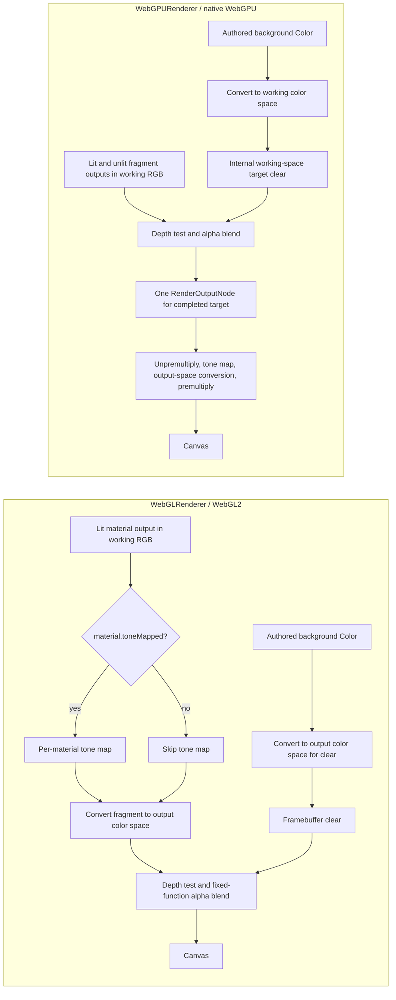
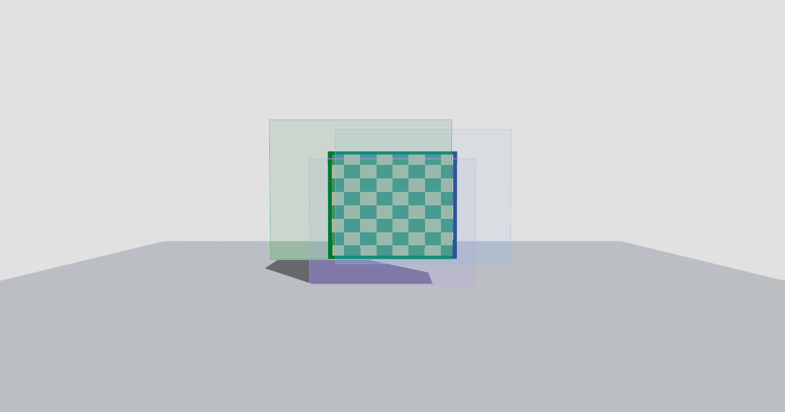
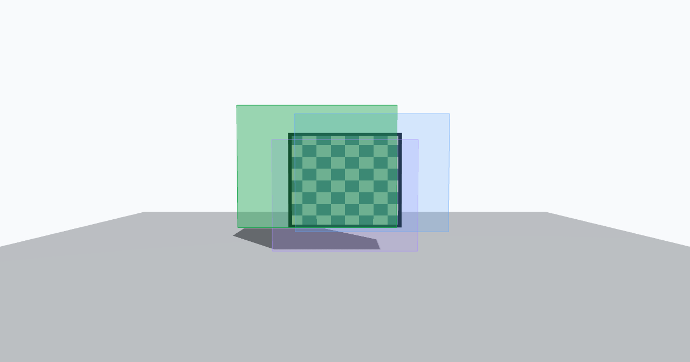

# Observer WebGPU Output and Compositing Architecture

## 1. Executive summary

PR #254's matched Architecture Rise diagnostic established a WebGL/WebGPU
background mismatch: the authored `#f8fafc` was sampled as `[248, 250, 252]`
with WebGL and `[225, 225, 226]` with native WebGPU. Its no-overlay façade
region differed by only 2.09 RGB levels. The discrepancy therefore pointed to
the output boundary, not a reason to retune the architecture materials or
lighting.

The installed Three.js version is **0.186.0 (r186)**. Source inspection found
that WebGL applies tone mapping according to each material's `toneMapped` flag
and converts fragment output before the fixed-function blend. The common
WebGPU renderer instead renders the scene into a working-space target and
applies one output transform after the scene's opaque and transparent content
has been combined. That later transform also reaches a `toneMapped={false}`
overlay and the scene background.

An isolated, native-required Chrome experiment tested a material-aware
`NodeMaterial.setupOutput()` approach. The prototype kept the lit scene in the
same 3D pass, applied ACES plus sRGB conversion to lit NodeMaterials, applied
only sRGB conversion to unlit teaching NodeMaterials, and wrote the background
in display sRGB while disabling the common final transform. The native run
matched the WebGL fixture's sampled light, gray, and dark backgrounds exactly;
matched the lit subject ROI to 0.17 RGB MAE; matched front and back-oblique
overlay response to at most 0.32 RGB MAE; and preserved the tested depth
occlusion.

**Decision: H2 — Architecture provisionally viable.** The native fixture
supports Option B, but it is not the actual Architecture Rise scene. Full
material-family coverage, real-scene occlusion and environment behavior,
application fallback, transparent-canvas alpha, and renderer lifecycle still
need a bounded integration experiment. This result does not authorize a wider
rollout.

## 2. Current architecture



These diagrams describe the installed r186 source path for an on-screen render
with tone mapping and output-color conversion enabled. A render target or
pipeline supplied by an application can select a different path.

## 3. Verified Three.js r186 behavior

The lockfile resolves `three@0.186.0`; the prototype also reports runtime
`REVISION === "186"`.

| Source path | Verified behavior |
| --- | --- |
| [`WebGLBackground.js`](https://github.com/mrdoob/three.js/blob/r186/src/renderers/webgl/WebGLBackground.js) and [`UniformsUtils.js`](https://github.com/mrdoob/three.js/blob/r186/src/renderers/shaders/UniformsUtils.js) | `WebGLBackground.setClear()` calls `Color.getRGB()` with `getUnlitUniformColorSpace(renderer)`. For the default output target this is `renderer.outputColorSpace`; the clear is not sent through a material tone-mapping shader. |
| [`WebGLState.js`](https://github.com/mrdoob/three.js/blob/r186/src/renderers/webgl/WebGLState.js) | Clear RGB is premultiplied when the drawing context requests it. Normal blending uses separate color and alpha factors; non-premultiplied material blending uses source alpha for RGB. |
| [`WebGLPrograms.js`](https://github.com/mrdoob/three.js/blob/r186/src/renderers/webgl/WebGLPrograms.js) and [`WebGLProgram.js`](https://github.com/mrdoob/three.js/blob/r186/src/renderers/webgl/WebGLProgram.js) | Renderer tone mapping is selected for a material only when `material.toneMapped` is true. The fragment output color-space chunk still runs after the tone-mapping choice. Thus `toneMapped=false` skips tone mapping, but does not skip output color-space conversion. The fragment shader completes before fixed-function blending. |
| [`Background.js`](https://github.com/mrdoob/three.js/blob/r186/src/renderers/common/Background.js) and [`Color.js`](https://github.com/mrdoob/three.js/blob/r186/src/math/Color.js) | A solid WebGPU scene background is read with `Color.getRGB()`'s default working color space. An opaque scene color requests a clear. A node background is instead drawn through a background mesh. |
| [`Renderer.js`](https://github.com/mrdoob/three.js/blob/r186/src/renderers/common/Renderer.js) | `needsFrameBufferTarget` is true if tone mapping is active or current output color space differs from `ColorManagement.workingColorSpace`. `_getFrameBufferTarget()` allocates a working-color-space target with depth. `_renderScene()` renders the background, opaque objects, and transparent objects there, then `_renderOutput()` processes the completed target. |
| [`NodeManager.js`](https://github.com/mrdoob/three.js/blob/r186/src/renderers/common/nodes/NodeManager.js) and [`RenderOutputNode.js`](https://github.com/mrdoob/three.js/blob/r186/src/nodes/display/RenderOutputNode.js) | The normal output node receives the renderer's tone-mapping and output-color-space settings. It clamps alpha, unpremultiplies, tone maps, converts from working to output color space, then premultiplies. It consumes the already-composited target. |
| [`WebGPUBackend.js`](https://github.com/mrdoob/three.js/blob/r186/src/renderers/webgpu/WebGPUBackend.js) | The WebGPU canvas context is configured with `alphaMode: "premultiplied"` when renderer alpha is enabled and a standard/extended canvas tone-mapping mode based on output type. The backend premultiplies clear RGB for alpha-enabled output. |
| [`WebGPUPipelineUtils.js`](https://github.com/mrdoob/three.js/blob/r186/src/renderers/webgpu/utils/WebGPUPipelineUtils.js) | The pipeline maps `Material` blending, depth, side, and premultiplied-alpha settings into WebGPU pipeline state. It does not replace the common renderer's later output pass. |
| [`NodeMaterial.js`](https://github.com/mrdoob/three.js/blob/r186/src/materials/nodes/NodeMaterial.js) | `setupOutput(builder, outputNode)` is a documented material extension point. The prototype overrides it; it does not patch a private renderer method. |
| [`DirectRenderPipeline.js`](https://github.com/mrdoob/three.js/blob/r186/src/renderers/common/DirectRenderPipeline.js) and [`RenderPipeline.js`](https://github.com/mrdoob/three.js/blob/r186/src/renderers/common/RenderPipeline.js) | Both are exported from the public `three/webgpu` entry. The direct pipeline applies output processing inline and its source documentation warns that it changes blending and does not support framebuffer-sampling materials such as transmission. The regular pipeline's fullscreen output processes its output node as a whole. |

The source ordering explains the observed distinction: WebGL's clear and each
material output reach the target under different per-material rules. The
WebGPU common output node sees one completed image. `toneMapped=false` can
affect a material's contribution before that pass; it cannot exempt the
composited pixel from the later global output transform.

This source explanation is supported by the native fixture measurements:
standard WebGPU sampled `[225, 225, 226]` for `#f8fafc`, `[141, 141, 141]` for
`#808080`, and `[6, 17, 30]` for `#172331`. Those measurements are consistent
with the source path; the numeric samples alone do not identify a transform.

## 4. Color and compositing contracts

| Contract | Required behavior | Prototype treatment |
| --- | --- | --- |
| Scene radiance | Lit materials, textures, exposure, ACES, shadows, and relevant environment response keep their scene role. | `MeshStandardNodeMaterial.setupOutput()` explicitly applies ACES Filmic at exposure 1, then converts to sRGB. The same textured box and shadow receiver are NodeMaterials in the candidate so no unconverted lit object is left behind. |
| Background | Authored display colors should reach the canvas as authored, without ACES applied to presentation background radiance. | A `Scene.backgroundNode` converts the authored color from working RGB to sRGB. Candidate renderer output is set to `NoToneMapping` and `LinearSRGBColorSpace`, disabling the common output transform under the r186 `needsFrameBufferTarget` condition. |
| Teaching graphics | Keep authored color, opacity, 3D geometry, depth test, overlap, and outline policy. | Basic and line NodeMaterials convert output to sRGB without tone mapping. Fill planes are transparent, `DoubleSide`, depth-tested, and do not write depth. Outlines retain their authored depth-test policy. |

The application overlay roles represented by the fixture are focus
`#16a34a / 0.42`, near DOF `#60a5fa / 0.24`, and far DOF `#a78bfa / 0.22`.
All use normal blending and straight-alpha material outputs
(`premultipliedAlpha=false`). Their RGB is converted in the material output
before the backend's fixed-function blend, as the WebGL baseline does. The
prototype uses an opaque scene background, so final canvas alpha is 1. It tests
transparent material blending, but not page composition of a transparent
canvas. WebGPU's premultiplied canvas mode and partially transparent canvas
clear behavior remain integration checks.

The renderer sorts the transparent work and retains the subject depth buffer.
The test separately renders a fill behind the opaque subject: the center ROI
does not change, while the projected plane outside the subject changes. The
plane's visible outline has `depthTest=false` by design, so the fill depth
control and outline policy are separate evidence.

## 5. Candidate solutions

Legend: **✓** shown to satisfy the criterion or supported by source; **△**
plausible but requires an integration proof; **✕** fails the current parity
need or is not a safe default; **—** outside the candidate's scope. A check in
the prototype column is not evidence for Architecture Rise.

| Criterion | A. Separate overlay pass | B. Material-aware NodeMaterial output | C. Explicit multi-target output/compositing | D. Keep current output |
| --- | --- | --- | --- | --- |
| Background display color | ✓ if output-corrected separately | ✓ native fixture: 0 MAE on three backgrounds | ✓ if display pass owns background | ✕ native baseline has 13–24.67 MAE |
| Transparent overlay semantics | ✓ after output, if blend contract is matched | ✓ native fixture: response MAE ≤0.16 front, ≤0.32 oblique | ✓ with dedicated display composite | ✕ PR #254 strict parity remains NO-GO |
| Scene depth occlusion | △ needs scene depth in overlay pass | ✓ same 3D draw; behind-plane center changed 0 pixels | △ needs shared/copied depth or depth-aware composite | ✓ current geometry path |
| Canonical 3D geometry | ✓ can retain it | ✓ same meshes and projection | ✓ can retain it | ✓ |
| Three.js r186 compatibility | △ no tested overlay-pass contract here | ✓ uses public NodeMaterial/TSL APIs, tested on native WebGPU | △ RenderPipeline is public; multi-target contract is not prototyped | ✓ current path |
| React Three Fiber integration | △ extra pass and lifecycle boundary | △ per-role material construction must be integrated | ✕ highest ownership and lifecycle cost | ✓ existing integration |
| Existing WebGL behavior | ✓ isolated to WebGPU | ✓ backend-specific and does not change WebGL factory | ✓ can be isolated to WebGPU | ✓ unchanged |
| Resource/lifecycle ownership | △ extra target and pass cleanup | △ materials and generated pipelines still need subject ownership | ✕ multiple targets and pass resources | ✓ unchanged |
| Upgrade maintainability | △ depends on pass/depth integration | △ public extension point, but NodeMaterial semantics need version tests | △ larger renderer surface | ✓ unchanged |
| Performance overhead | △ extra overlay pass | △ no added scene pass in fixture; shader and pipeline costs unmeasured | ✕ extra target/pass costs expected, unmeasured | ✓ no added cost |
| Regression test simplicity | △ needs depth and composition captures | ✓ one mounted renderer, framebuffer comparisons | △ multiple targets and composition state | ✓ but cannot pass parity gate |
| Future richer scenes | △ viable with a general depth policy | △ material families and transmission need coverage | ✓ broadest potential if lifecycle is justified | ✕ leaves known issue |
| Ground Glass relevance | — | — | — | — |

Option B is preferred for the next bounded integration experiment because the
native prototype meets the fixture's color, alpha-response, and depth tests
without a second scene pass. It has the least new renderer ownership. It still
requires a WebGPU-specific material path and is not validated across the
application's complete material catalog.

`DirectRenderPipeline` is a public r186 alternative, but not the selected
solution. Its documented inline output changes blending and cannot handle
framebuffer-sampling materials such as transmission. The experiment instead
uses the public `NodeMaterial.setupOutput()` hook to express separate lit and
unlit output semantics.

## 6. Bounded prototype

The test-only R3F fixture and browser test are:

- `src/tests/e2e/fixtures/observer-output-compositing.html`
- `src/tests/e2e/fixtures/observer-output-compositing.tsx`
- `src/tests/benchmarks/observer-output-compositing.spec.ts`
- `playwright.experiment.config.ts`

The dedicated Playwright config selects only this benchmark. The ordinary E2E
config remains pointed at `src/tests/e2e`, so this experiment is not part of
the regular development or production-preview suite.

It compares WebGLRenderer, standard WebGPURenderer output, and the
material-aware NodeMaterial candidate with the same box, checker texture,
directional and ambient lighting, shadow receiver, camera positions, colors,
opacity, and geometry. It captures three backgrounds; each individual plane
and their overlap on light and dark; overlap on gray; a behind-subject negative
control; front, oblique, and reverse-side oblique views; and a repeated capture.
Every capture is a screenshot of the actual mounted renderer's canvas. The
test asserts mounted renderer family/backend, exactly one WebGPU initialization
attempt, no initialization failure, background and material-response
tolerances, visible single and combined overlays, depth occlusion, shadow
contrast, and repeat consistency. Native-required mode cannot pass through
WebGL2 fallback.

Repeat on a native-capable headed Chrome installation:

```bash
npx playwright test \
  --config=playwright.experiment.config.ts \
  --list

OBSERVER_NATIVE_WEBGPU_REQUIRED=1 npx playwright test \
  --config=playwright.experiment.config.ts --workers=1
```

The first command lists only the experiment. Without the environment variable,
`--project=chromium` runs the ordinary automated baseline and may report
`webgl2-fallback`; that baseline is not native evidence. The test writes a JSON
report and six representative PNGs to ignored
`test-results/observer-output-compositing/` and attaches the report/screenshots
to its Playwright result. The `docs/architecture/observer-output-compositing/`
directory in this PR preserves the actual native run for review.

## 7. Experimental results

Native-required run: headed Chrome **155.0.8059.79**, macOS **Darwin 27.0.0**,
arm64, Node **v24.19.0**, Three.js **r186**, viewport **1280 × 720**, DPR 1.
`navigator.gpu` was present. The mounted standard and material-aware variants
both reported `webgpu-renderer / webgpu`, one renderer-factory attempt, no
application fallback, no initialization failure, and `rendererAlpha=true`.
The WebGL control
reported `webgl-renderer / webgl2`. No page or console errors occurred. Chrome
and the host did not provide independent evidence tying WebGPU to a hardware
adapter, so hardware acceleration is **unconfirmed**.

### Background samples

| Authored | WebGL2 | Standard native WebGPU | Material-aware native WebGPU | Standard MAE vs WebGL | Candidate MAE vs WebGL |
| --- | ---: | ---: | ---: | ---: | ---: |
| `#f8fafc` | `[248,250,252]` | `[225,225,226]` | `[248,250,252]` | 24.67 | 0.00 |
| `#808080` | `[128,128,128]` | `[141,141,141]` | `[128,128,128]` | 13.00 | 0.00 |
| `#172331` | `[23,35,49]` | `[6,17,30]` | `[23,35,49]` | 18.00 | 0.00 |

### Scene and overlay evidence

| Measurement | Native standard WebGPU vs WebGL | Material-aware native WebGPU vs WebGL |
| --- | ---: | ---: |
| Lit checker subject ROI | 8.52 RGB MAE | 0.17 RGB MAE; 26 color buckets in each |
| Shadow luminance contrast against adjacent ground | 63.61 vs 63.80 | 64.00 vs 63.80 |
| Single-plane response, front view, light/dark | Reported in attached JSON | Maximum 0.15 RGB response MAE |
| Overlapping-plane response, front view, all backgrounds | Reported in attached JSON | Maximum 0.17 RGB response MAE |
| Overlapping-plane response, oblique / reverse-side oblique | Reported in attached JSON | 0.29 / 0.32 RGB response MAE |
| Behind-plane occlusion | Center change 0 pixels | Center change 0 pixels; projected exposed strip changed 315 pixels |
| Repeated capture | 0 RGB MAE | 0 RGB MAE |

Overlay response MAE compares the per-backend on-minus-off response, which
removes a baseline background difference before comparing the overlay's
contribution. The response changed at four pixels for single light-background
planes, 0–22 pixels for front overlap states, and 517 / 556 pixels for the
oblique / reverse-side-oblique ROI under an 8-level per-channel threshold.
The small counts are antialiasing and edge-level response differences; the
full measurements and masks remain in the JSON report.

The captures below are the native Chrome run. They are synthetic fixture
images, not Architecture Rise evidence.

| WebGL reference | Standard WebGPU output | Material-aware WebGPU candidate |
| --- | --- | --- |
|  |  |  |

Additional native captures and the machine-readable report are in
[`observer-output-compositing/`](observer-output-compositing/). The test also
records the dark background, gray reverse-side oblique view, and behind-subject
negative control.

### Alpha, depth, and resources

The test uses normal blending, `premultipliedAlpha=false` on transparent
materials, WebGPU's alpha-enabled premultiplied canvas mode, an opaque
background, and the actual backend's blend implementation. The scene's
background leaves final alpha opaque; transparent-canvas page composition was
not tested. The candidate does not add a render pass or application-owned
render target. With `NoToneMapping` and `LinearSRGBColorSpace` matching r186's
working color space, the source condition for the common output target is
false; this is a source-based inference, not a measured allocation count.
NodeMaterial shader/pipeline compilation and browser GPU allocations were not
benchmarked.

## 8. Selected architecture

Proceed with **Option B as a bounded integration experiment**, not as a rollout:

1. Keep one canonical set of scene, teaching-color, opacity, depth, side, and
   visibility values.
2. For the WebGPURenderer family, construct material-aware NodeMaterials for
   the eligible Observer scene. Lit materials apply the selected scene tone
   map and sRGB output conversion; unlit teaching materials apply only output
   conversion.
3. Set the common renderer output transform off for this path, and explicitly
   present the background in sRGB.
4. Keep overlay geometry in the existing 3D scene so depth testing and normal
   transparent blending remain part of the same render.
5. Leave the WebGLRenderer path and application-level WebGL fallback on the
   current materials and settings.

The fixture shows that the output distinction can be implemented through
public r186 APIs and that a real native WebGPU backend can execute it. It does
not show that all Architecture Rise materials can be represented this way or
that the full scene passes the existing PR #254 visual-parity gate.

## 9. Integration design

| Concern | Current owner | Proposed bounded owner |
| --- | --- | --- |
| Renderer selection and async initialization | `SceneViewport` / Observer backend | Unchanged. Continue selecting only approved development pilots. |
| Renderer output settings | `SceneRenderer` Canvas setup and shared visual settings | A WebGPURenderer-family-specific output policy applied once during renderer mount. It must not alter WebGL or production settings. |
| Architecture Rise subject materials | `ArchitectureRiseSubjectFactory` and registered scene-subject ownership | A scene/material presentation adapter that creates the WebGPU NodeMaterial family from the same authored material roles. Existing subject disposer remains owner. |
| Teaching overlay colors and geometry | `SceneRenderer` optical geometry and shared overlay definitions | Keep canonical values and geometry; use Basic/Line NodeMaterial output variants only for WebGPU-family rendering. |
| Background | Scene/renderer setup | Explicit sRGB presentation background in the WebGPU path; preserve the WebGL clear path. |
| GPU resources | Current R3F/material/registered-subject ownership | Keep materials attached to their existing object/subject owner; no global GPU manager or second renderer. |
| Ground Glass | Independent WebGL RTT | No change and no dependency on this Observer output path. |

Before implementation, audit material types and custom shader hooks used by
Architecture Rise and its environment. `TeachingLighting` and subject
inspection code include material-class checks; replacing standard materials
with NodeMaterials will require updating those contracts deliberately. Avoid
generic runtime conversion of arbitrary materials. Use a narrow adapter that
preserves authored descriptors and makes the WebGPU-specific output role
explicit.

On a real Architecture Rise test, verify both native WebGPU and
`WebGPURenderer / webgl2-fallback`. The latter is still the WebGPURenderer
material pipeline and must not be confused with the application's separate
WebGLRenderer fallback. If a genuine initialization failure remounts
WebGLRenderer, the WebGL material path should be restored with the renderer
attempt, not retained from stale state.

## 10. Risks and rollback

- Architecture Rise uses more material and environment features than the
  fixture. NodeMaterial coverage for environment reflection, glazing,
  procedural maps, shadow participation, and any custom shader must be proven.
- Per-material output semantics become an explicit compatibility contract.
  Three.js upgrades can change NodeMaterial/TSL generation or output behavior;
  rerun the native fixture and the real-scene parity gate after upgrades.
- The prototype's opaque background does not cover transparent-canvas page
  composition, alternate `alpha` configurations, or partial clear alpha.
- Browser canvas alpha mode is premultiplied while the material's normal blend
  uses straight-alpha factors. The fixture tests overlay blending on an opaque
  destination, not every alpha-composition edge case.
- No GPU time, allocation count, shader warm-up cost, or memory cost was
  measured. There is no additional application render pass in the candidate,
  but NodeMaterial shader variants can have startup and maintenance costs.
- Native WebGPU API execution was verified; hardware acceleration is not.
- The real Architecture Rise scene was not rendered through the candidate.
- The experiment's fixture statically imports WebGPURenderer and therefore
  does not verify the app's lazy-import boundary.

Rollback is straightforward before integration: remove the isolated fixture
and keep current Observer rendering. If an integration attempt fails, retain
the existing production WebGL path and the current development-only pilot
policy; do not compensate with WebGPU-specific colors or opacity, and do not
weaken PR #254 thresholds.

## 11. Implementation plan

1. **Bounded Architecture Rise integration experiment:** adapt only the
   existing development pilot, create WebGPU-family NodeMaterials from the
   current Architecture Rise descriptors, and keep the normal WebGL path
   unchanged. No public scene or production default changes.
2. **Parity and lifecycle evidence:** run PR #254's existing native matched
   capture unchanged, including background, façade, overlays, depth, and
   restoration. Test application fallback, repeated mount/unmount, environment
   readiness, and the independent Ground Glass RTT. Keep its current strict
   thresholds.
3. **Review the resulting scene evidence:** if color, alpha, depth, environment,
   and lifecycle contracts hold, propose a separate rollout decision. If they
   do not, keep the candidate opt-in and report which material or pipeline
   feature blocks it.

Do not generalize to more scenes, migrate Ground Glass, or enable production
WebGPU as part of this architecture decision.

## 12. Acceptance and remaining uncertainty

| Claim | Status |
| --- | --- |
| Three.js revision and source pipeline | **Verified:** installed 0.186.0; pinned r186 source paths inspected. |
| API presence versus actual native execution | **Verified separately:** native-required run reports `navigator.gpu`; actual mounted renderer reports `webgpu-renderer / webgpu`. |
| Native material-aware fixture renders | **Verified:** headed Chrome 155, actual WebGPU backend, one init attempt, no app fallback or initialization failure. |
| Background, lit subject, overlays, shadows, and depth in fixture | **Verified within the bounded fixture:** values and screenshots are recorded in the adjacent evidence directory. |
| Native hardware acceleration | **Unconfirmed:** no independent adapter/driver evidence was collected. |
| Architecture Rise candidate output and PR #254 strict parity | **Not tested:** must be proven in the next bounded integration experiment. |
| Application fallback and SPA lifecycle with adapted materials | **Not tested:** no application renderer code changed in PR H. |
| Transparent page/canvas alpha | **Not fully tested:** fixture destination is opaque. |
| Ground Glass and optics | **Unchanged and outside this PR.** |

**Decision: H2 — ARCHITECTURE PROVISIONALLY VIABLE.** The next step is a
limited Architecture Rise integration experiment under the existing
development-only pilot. This PR does not authorize rollout or production
activation.
