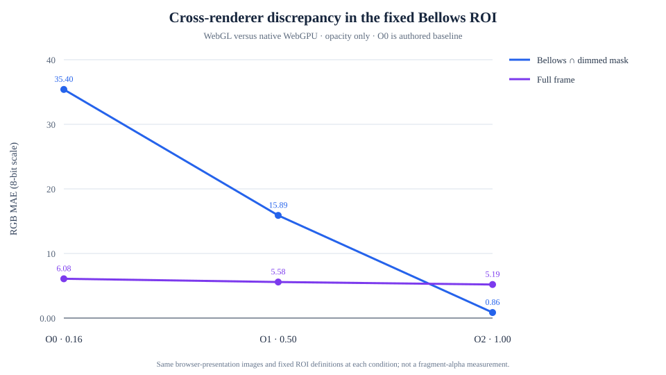
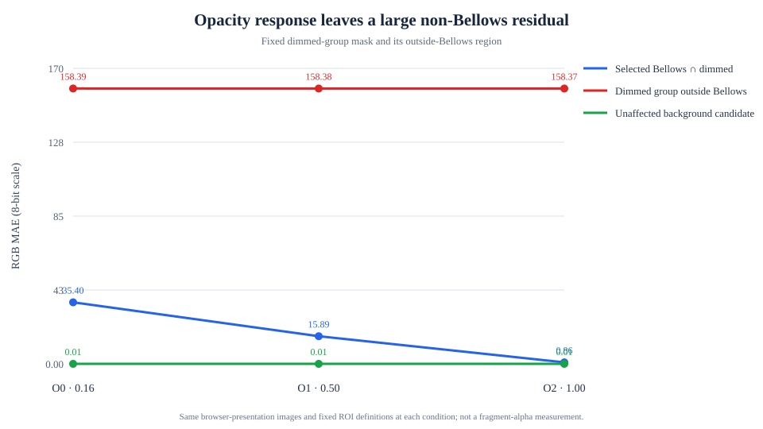
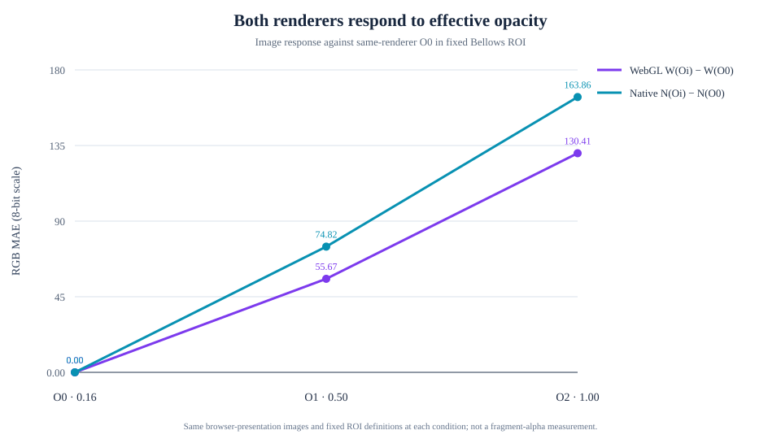
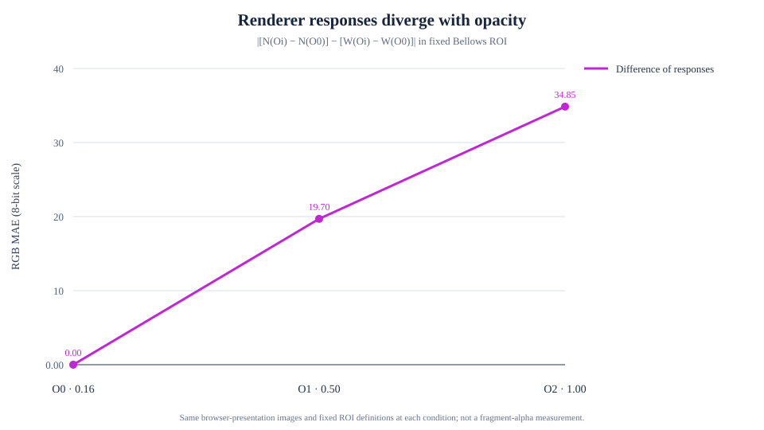

# M-INV9 — In-Situ Anatomy Bellows Opacity Response

## Result

**OAR-1 — Qualified opacity-dependent cross-renderer response.** The measured WebGL/native WebGPU discrepancy decreases monotonically as the selected Bellows output opacity rises from 0.16 to 0.50 to 1.00 in the fixed Bellows/dimmed ROI. Both renderers show a repeatable image response. This establishes sensitivity to the effective opacity intervention; it does not identify actual fragment alpha or establish opacity as the original cause of the larger Anatomy discrepancy.

The broad dimmed-group discrepancy remains large, and the region outside the selected Bellows remains highly discrepant. No rendering correction or native WebGPU promotion follows from this result.

## Research question and retained M-INV8 evidence

M-INV8 found **TCI-3 — PARTIAL CONTRIBUTION ONLY**: suppressing blending strongly reduced the Bellows-local difference, while the broad dimmed-group discrepancy persisted. Its authored baseline values are retained here: full-frame MAE 6.0819, fixed dimmed-group MAE 104.1277, Bellows visibility-response MAE 35.3978, and unaffected-background-candidate MAE 0.0091. The dimmed mask has 12,287 screenshot pixels; the Bellows visibility-response mask has 5,421.

M-INV8's Bellows region is an observed visibility-response mask, not an exact silhouette or fragment-coverage mask. It can include occlusion, revealed background, overlapping surfaces, and front/back face accumulation. M-INV8 measurements and report files were not rewritten by this study.

## Provenance and controlled state

| Item | Qualified value |
| --- | --- |
| Base | `ae68da5619f80794b4c686bec85c8b5836403538` (merged PR #268) |
| Measurement implementation | `6c63a9c80fa4cd2f853f84793fe0b469e2c41868` |
| Three.js | r186 |
| Browser | Chrome 155.0.8059.84 |
| Platform | macOS, arm64 |
| Native adapter | `navigator.gpu` available; `requestAdapter()` succeeded |
| Native renderer | `webgpu-renderer`, WebGPU execution, material-aware B0 active, no application fallback |
| Screenshot size | 514 × 411 browser-presentation pixels; 1× DPR |
| Canvas backing size | 1028 × 820 in both runs |

The WebGL and native captures used the same scene, Front Standard highlighted / Bellows dimmed presentation, camera position, quaternion, orbit target, viewport, and selected geometry. Projection matrices use the renderer's clip-space depth convention, so their depth entries differ while the camera pose and image framing remain matched.

The selected object was the mounted `bellows-folded-surface`, role `conceptual-camera/bellows`. Its authored source was a `MeshStandardMaterial` with opacity 0.16, `transparent: true`, `NormalBlending`, `premultipliedAlpha: false`, `DoubleSide`, `forceSinglePass: false`, depth test enabled and depth writes disabled. Source opacity and source properties remained unchanged throughout the trials.

## Intervention and native opacity path

| Condition | Requested and effective output opacity | Material path |
| --- | ---: | --- |
| O0 | 0.16 | Untouched authored WebGL source / native B0 baseline |
| O1 | 0.50 | Owned WebGL material clone / owned native material-aware output variant |
| O2 | 1.00 | Same owned variants; `transparent: true` remains active |

Only opacity varied. Transparency classification, blending, color, side, depth state, geometry, render order, lighting, other renderables, output policy, and Ground Glass remained fixed. O2 was not treated as opaque material or as `NoBlending`.

The pinned r186 `NodeMaterial.setupDiffuseColor()` path multiplies diffuse alpha by `materialOpacity`. `MaterialAwareStandardNodeMaterial.setupOutput()` applies the existing RGB display transform and delegates the vec4 to the r186 base output path. The experiment also observed the effective native output opacity on the active adapted material and measured a repeatable native screenshot response. These three pieces of evidence support that the intervention reaches the active native output path. They do not measure the fragment alpha written by the GPU.

## Draw and pipeline qualification

All six backend/condition trials qualified with two actual Bellows face draws in BackSide then FrontSide order. Blending was enabled for both draws. The native pipeline observer associated each actual selected draw with its bound render-pipeline creation descriptor. The descriptors retained `bgra8unorm`, color blend factors `src-alpha` / `one-minus-src-alpha` / `add`, alpha factors `one` / `one-minus-src-alpha` / `add`, `depth24plus`, depth writes disabled, `less-equal`, 4× multisampling, alpha-to-coverage disabled, and triangle-list topology. The two faces use their expected opposite `frontFace` values; culling remained back-face.

The same per-face pipeline identities were reused across O0, O1, and O2; opacity did not force a pipeline rebuild. Descriptor association is qualified metadata evidence from the M-INV8 read-only test-realm observer, not a compiled driver pipeline readback.

## Measurements

Primary comparisons use matched browser-presentation screenshots. Raw framebuffer evidence remains separate. Fixed regions were reused across all opacity conditions: the M-INV8 dimmed mask, O0 Bellows hide/show response, their intersection, the outside-Bellows residual, historical M3 Bellows masks, unaffected-background candidate, selected high-error samples, and nine M-INV5 samples mapped using the recorded framebuffer dimensions. No primary ROI was recomputed after O1/O2.

### Cross-renderer discrepancy by opacity

Values are RGB MAE on an 8-bit channel scale. The primary Bellows region is the fixed selected-Bellows visibility response intersected with the fixed dimmed mask.

| Fixed region | O0 0.16 | O1 0.50 | O2 1.00 |
| --- | ---: | ---: | ---: |
| Full frame | 6.0819 | 5.5809 | 5.1948 |
| Dimmed group | 104.1277 | 95.5144 | 88.8759 |
| Selected Bellows visibility response | 35.3978 | 15.8939 | 0.8580 |
| Selected Bellows ∩ dimmed group | 35.3978 | 15.8939 | 0.8580 |
| Dimmed group outside Bellows | 158.3929 | 158.3782 | 158.3698 |
| Unaffected-background candidate | 0.0091 | 0.0091 | 0.0091 |
| Historical M3 Bellows/dimmed intersection | 35.3142 | 15.8954 | 0.9233 |
| Nine fixed M-INV5 screenshot-mapped samples | 138.7407 | 99.5926 | 47.8889 |

The original broad dimmed-group discrepancy reproduced above the historical MAE gate of 50. The large outside-Bellows value persists at each opacity, so the Bellows response does not account for the broader dimmed-group difference.

Two representative RGB screenshot samples from the preselected high-error coordinates are:

| Fixed pixel | WebGL O0 → O1 → O2 | Native O0 → O1 → O2 |
| --- | --- | --- |
| (256, 157) | `[4, 7, 12]` → `[5, 8, 12]` → `[5, 8, 13]` | `[184, 186, 189]` → `[179, 181, 184]` → `[172, 173, 177]` |
| (247, 208) | `[3, 6, 10]` → `[2, 4, 7]` → `[0, 1, 2]` | `[157, 159, 162]` → `[94, 95, 97]` → `[0, 1, 2]` |

These are browser-presentation RGB samples, not source-alpha samples. The complete selected pixel list is retained in the machine report and attached comparison image.

### Within-renderer response from O0

Values compare each intervention image with the same renderer's O0 image in the fixed Bellows/dimmed intersection. Signed channel values are intervention minus O0. Repeat noise was zero in this region for all measured captures.

| Renderer / condition | Response MAE | Signed R | Signed G | Signed B | Changed ROI pixels |
| --- | ---: | ---: | ---: | ---: | ---: |
| WebGL O1 | 55.6705 | -54.0633 | -55.2618 | -56.4158 | 4,424 |
| Native O1 | 74.8165 | -73.9688 | -74.9122 | -75.5685 | 5,421 |
| WebGL O2 | 130.4141 | -126.5541 | -129.3169 | -131.8305 | 5,112 |
| Native O2 | 163.8558 | -161.7962 | -164.0683 | -165.7030 | 5,421 |

### Difference of responses and channel direction

The difference-of-responses calculation is `[N(Oi) − N(O0)] − [W(Oi) − W(O0)]`; the reported MAE is the magnitude of that image-response difference in the fixed Bellows/dimmed intersection.

| Intervention | Difference-of-responses MAE | Signed R | Signed G | Signed B |
| --- | ---: | ---: | ---: | ---: |
| O1 | 19.6975 | -19.9056 | -19.6504 | -19.1527 |
| O2 | 34.8498 | -35.2420 | -34.7513 | -33.8725 |

The negative signed channels mean the native image response from O0 was more negative than the WebGL response in this fixed region. They are image differences, not source-alpha or destination-color estimates.

The fixed sample values, per-channel cross-renderer differences, all region metrics, trial metadata, and qualification evidence are in the [machine-readable report](anatomy-bellows-opacity-response/report.json). The Playwright run also attaches the six condition images, repeats, restored O0 images, Ground Glass before/after captures, plots, and fixed-pixel comparison.

## Repeatability, restoration, and controls

The measured maximum same-condition screenshot repeat noise was 0, with a 0.5 RGB-MAE minimum noise gate. Both WebGL and native O1/O2 had qualified positive-control responses. The complete six-trial matrix qualified with no failed checks. Requested opacity matched effective output opacity for every trial; only opacity changed in the output state.

After each intervention, the exact baseline output material identity, visible state, geometry identity, and screenshot were restored. WebGL diagnostic clones and native output variants were released exactly once. Authored materials, geometry, textures, renderer/device, and Ground Glass resources remained borrowed and undisposed. The visibility exclusion control restored Bellows visibility, and a stale generation request was rejected. Baseline and final screenshots were exact in every fixed region.

An additional SPA-retirement regression applies O1 and navigates away while the intervention is active on both WebGL and native WebGPU. The renderer generation advances, the Anatomy probe hook is absent on the destination scene, and a late restore sent to the retired container receives no response. This exercises the probe's unmount cleanup path; exact owned-resource disposal counts are independently asserted by the successful O1/O2 restoration trials.

Ground Glass stayed contentful. Its repeat noise was 0.00111 MAE and baseline-to-final restoration was exact. Its separate WebGL2 RTT path was not adapted by the experiment.

## Classification and interpretation

The primary fixed Bellows-region cross-renderer MAE declines from 35.3978 to 15.8939 to 0.8580, each condition qualified and with a 0.5 noise gate. The dimmed group and other significant regions move in the same direction; the unaffected region and outside-Bellows residual remain within the noise gate. The measured result therefore meets **OAR-1** rather than OAR-2 or OAR-3.

Supported: the selected Bellows cross-renderer image difference has reproducible dependence on effective material opacity in this scene, renderer, teaching state, and capture representation.

Not established: actual GPU fragment alpha, a physical single-layer blend equation, source-versus-destination contributions, linearity with opacity, or opacity as the original root cause. O2 retains `transparent: true` and is not equivalent to `NoBlending`. The remaining broad dimmed-group difference is not attributable to the Bellows result.

The smallest justified next study is a separately bounded source-alpha/destination-context evidence measurement for the selected Bellows and its overlapping faces. It should directly qualify the relevant shader output or destination state if the pinned native path exposes a defensible measurement; screenshots alone are insufficient. No production rendering change is recommended.

## Validation

| Validation | Result |
| --- | --- |
| Focused M-INV9 qualification, intervention, and tracker tests | 31 passed |
| `npm test` | 2,465 passed |
| Typecheck, lint, CSS structure check, production build | Passed |
| M-INV9 native O0/O1/O2 browser experiment on measurement SHA | Passed; OAR-1 |
| Active O1 transaction followed by Anatomy SPA retirement (WebGL and native) | Passed; old probe hook removed and late restore suppressed |
| M-INV4 replay / M-INV5 / M-INV6 / M-INV7 / M-INV8 native studies | Passed. M-INV6 rerun supplied the two provenance SHAs required by its existing strict assertion; its historical report was not replaced. |
| Existing native pending-readback cancellation and overlap regressions | 4 passed |
| PR #263 four-state native output experiment | Passed |
| Native-required Anatomy 13-state audit | Passed |
| Architecture Rise strict visual parity | Passed; 81 criteria, zero failures |
| Production preview renderer-policy / Anatomy isolation | 2 passed |
| Production JavaScript asset scan | 10 loaded JS assets scanned; no M-INV9, Bellows intervention, Anatomy audit probe, or related capture event identifiers found |
| Ground Glass | Contentful before/after; exact baseline restoration |

The browser ran on Chrome 155.0.8059.84 with `navigator.gpu.requestAdapter()` succeeding and native WebGPU active without application fallback. Hardware acceleration was not independently established. Production isolation was verified separately by the production preview tests and asset scan; the M-INV9 capture itself does not claim to test production assets.

## Retained research decisions

- **M-INV8 TCI-3 — PARTIAL CONTRIBUTION ONLY** remains unchanged.
- **Q2 — MEASURABLE INSTRUMENTATION PERTURBATION** remains unchanged.
- **PBI-3 — PERTURBATION REPRODUCED BUT NOT UNIQUELY LOCALIZED** remains unchanged.
- **N2 — CONTROLLED PROXY IMPROVEMENT** remains unchanged.
- **G2 — PARTIAL STAGE ATTRIBUTION** remains unchanged.
- **M2 — OPT-IN IMPLEMENTATION INCOMPLETE** remains unchanged.
- M-INV5 native intermediate destination/post-draw pixel evidence remains **F2**.
- Production renderer behavior and native WebGPU eligibility are unchanged.
