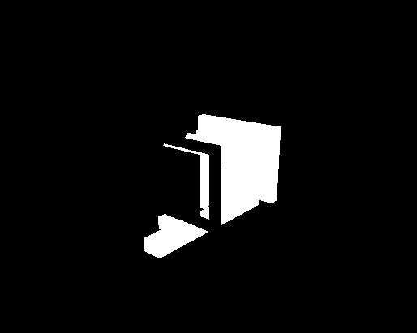
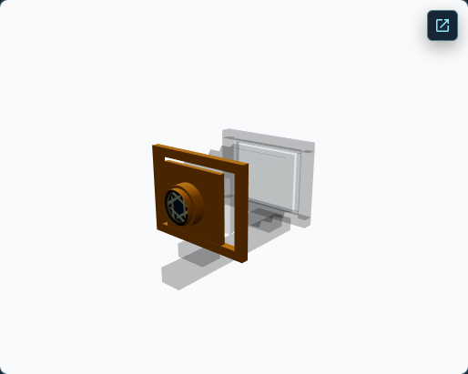
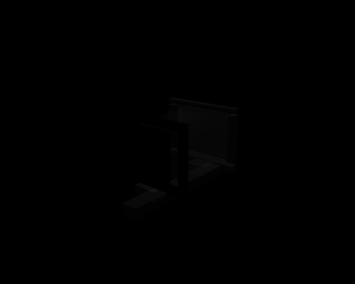

# View Camera Anatomy Dimmed Material Output Mechanism Investigation

**Decision: D2 — CONTRIBUTING MECHANISM IDENTIFIED.** Bypassing the per-material color-space conversion consistently lowers measured dimmed-response error across four real Anatomy states. Bypassing the complete per-material RGB transform also lowers it. Both changes leave a large residual. Tone-mapping-only bypass increases the error. Keep Anatomy at **M2 — OPT-IN IMPLEMENTATION INCOMPLETE**.

This is a controlled rendering investigation. It includes no production rendering correction, Anatomy promotion, or change to renderer eligibility.

## Objective and previous evidence

PR #261 established that per-material output-transform placement can change RGB values in a controlled transparent fixture. PR #262 then showed that excluding the mounted dimmed Anatomy camera parts greatly reduces the WebGL-versus-material-aware difference, while leaving the responsible output mechanism unresolved. Those visibility changes identify contributing renderables; they do not isolate a shader or compositing cause.

This investigation holds the authored scene, source materials, camera, lighting, geometry, render order, and presentation state fixed while changing only the adapted material's RGB output graph. The full 13-state PR #262 report remains the broader regression reference in [`anatomy-renderable-contribution-investigation/report.json`](anatomy-renderable-contribution-investigation/report.json).

## Intervention matrix

| Mode | RGB output intervention | Target |
| --- | --- | --- |
| B0 | Existing material-aware tone mapping and sRGB output conversion | All adapted materials; baseline |
| B1 | Bypass the custom per-material RGB output transform | Current dimmed renderables |
| B2 | Bypass tone mapping and retain color-space conversion | Current dimmed renderables |
| B3 | Bypass color-space conversion and retain tone mapping | Current dimmed renderables |
| B4 | Bypass the custom per-material RGB output transform | Current highlighted renderables; negative control |

The mechanisms are selectable only in development on the Anatomy material-aware Observer route, and they are disabled by default. B1–B4 use separately owned, scoped adapted outputs through the existing renderer-generation material tracker. The event handler resolves IDs against the mounted Anatomy presentation and current renderables. Stale-generation and wrong-group selections are rejected.

The intervention identity contributes to the generated output graph/cache key and triggers material recompilation when needed. Per-copy graph counts can be zero when Three.js reuses a compiled program for the same material family and output-transform key. The audit therefore records aggregate graph activation, scoped output identities and versions, output-mode identity, and repeated framebuffer response.

## Mounted presentation and material inventory

The audit resolves the current `ConceptualCameraAnatomyPresentation` and joins its semantic parts to the currently visible renderable IDs. Every visible camera renderable was classified; no visible renderable was left unclassified.

| State | Highlighted semantic presentation | Dimmed semantic presentation | Highlighted / dimmed renderables |
| --- | --- | --- | ---: |
| Front Standard | lens, lens board, front standard | bellows, rear standard, ground-glass back, film holder, camera support | 17 / 13 |
| Lens and Lens Board | lens, lens board | front standard, bellows, rear standard, ground-glass back, film holder, camera support | 13 / 17 |
| Smaller Aperture | lens, with the mounted aperture-iris element selected | lens board, front standard, bellows, rear standard, ground-glass back, film holder, camera support | 12 / 18 |
| Bellows Highlighted | bellows | lens, lens board, front standard, rear standard, ground-glass back, film holder, camera support | 1 / 29 |

The Front Standard count reproduces the corrected PR #262 presentation: 17 highlighted and 13 dimmed renderables. The report records the exact IDs for each state, along with each renderable's role, source-material identity, B0 adapted-output identity, family, color, tone-mapping flag, opacity, transparency, blend mode, premultiplied-alpha flag, depth settings, side, and render order.

Across the 30 distinct camera source materials in these states, 29 are `MeshStandardMaterial` and one is `MeshBasicMaterial`; their adapted outputs are the matching material-aware NodeMaterial families. Authored opacity ranges from 0.08 to 1.0. Fourteen source materials are transparent. Before each intervention, the dimmed group shared no source or adapted output material with highlighted or other renderables. No cross-group shared material needed an unsupported intervention mode.

The deduplicated inventory, state-to-renderable mapping, and source/output UUIDs are in [`anatomy-dimmed-output-mechanism/report.json`](anatomy-dimmed-output-mechanism/report.json).

## Matched baseline and measurement masks

The experiment captured WebGL standard, native WebGPU standard, and native WebGPU material-aware B0 with the same mounted teaching state, camera pose, orbit target, viewport, DPR, observer framebuffer size, and scene inputs. The browser viewport was 1440×1000 at DPR 1; the Observer framebuffer was 514×411 (211,254 RGB pixel samples). Repeated B0 captures measured zero pixel noise in all four priority states.

The dimmed and highlighted masks are within-renderer B0 visibility differentials using a per-channel threshold of 8/255. Their intersection marks pixels changed by exclusion of either group. The complement is an unaffected/background candidate. These are observed response masks, not exact silhouettes or additive color decompositions.

| State | WebGL vs B0, full frame | Standard WebGPU vs WebGL, full frame | Dimmed-response pixels | B0 vs WebGL in dimmed response | Highlighted-response pixels | B0 vs WebGL in highlighted response |
| --- | ---: | ---: | ---: | ---: | ---: | ---: |
| Front Standard | 6.082 | 25.221 | 12,287 | 104.128 | 9,877 | 2.273 |
| Lens and Lens Board | 9.046 | 25.221 | 16,900 | 112.848 | 5,093 | 3.790 |
| Smaller Aperture | 11.029 | 25.221 | 20,105 | 115.713 | 1,810 | 10.526 |
| Bellows Highlighted | 9.222 | 22.271 | 16,373 | 116.508 | 10,464 | 22.211 |

All MAE values are mean absolute 8-bit RGB levels over the named pixel population; the full-frame comparisons use 211,254 pixels. These B0 values reproduce the broad PR #262 direction. On the unaffected-candidate mask, B0 versus WebGL stayed between 0.009 and 0.012 MAE, which localizes most of the remaining measured error to pixels associated with the dimmed response.

The native standard-WebGPU discrepancy remains a separate issue. The PR #262 report measured the standard-WebGPU canvas-background patch at MAE 24.67 against WebGL. This focused run found the material-aware B0 top-left patch unchanged against both its repeat capture and WebGL. Hiding the dimmed group does not remove the standard-WebGPU full-frame difference. This investigation does not explain or change that background behavior.

### C1–C4 visibility ladder

The audit ran all four visibility conditions on WebGL standard, native WebGPU standard, and native WebGPU material-aware output in every priority state:

- **C1:** Keep one explicitly resolved dimmed renderable visible.
- **C2:** Keep two explicitly resolved dimmed renderables visible.
- **C3:** Keep the full current dimmed group visible (the B0 baseline).
- **C4:** Exclude the current dimmed group while retaining all other renderables.

For C1, C2, and C4, WebGL-versus-material-aware full-frame MAE across the four states was 0.098–1.063, 0.757–3.124, and 0.011–1.054, respectively. C3 measured 6.082–11.029. In the original dimmed-response mask, C1 measured 1.387–11.526 MAE; C2 measured 9.356–32.753. Exact state-by-state comparisons, sample counts, exclusion counts, and restoration results for all three backends are in the machine-readable report.

| State | C4 WebGL vs material-aware B0 | C4 WebGL vs standard WebGPU |
| --- | ---: | ---: |
| Front Standard | 0.023 | 23.430 |
| Lens and Lens Board | 0.013 | 23.955 |
| Smaller Aperture | 0.011 | 24.328 |
| Bellows Highlighted | 1.054 | 24.360 |

The material-aware C4 measurements reproduce PR #262's result that hiding dimmed parts largely removes the candidate/WebGL difference in three states and reduces it substantially in Bellows Highlighted. The standard-WebGPU difference persists when those same parts are hidden.

## Output-stage intervention results

Each intervention was captured twice per state. The table compares each mode with the matched WebGL reference inside the corresponding response mask. B1–B3 values use the dimmed-response mask; B4 uses the highlighted-response mask as its negative control.

| State | B0 dimmed response | B1 bypass RGB | B2 bypass tone mapping | B3 bypass color space | B4 highlighted control |
| --- | ---: | ---: | ---: | ---: | ---: |
| Front Standard | 104.128 | 103.119 | 108.125 | 102.763 | 28.641 |
| Lens and Lens Board | 112.848 | 110.386 | 117.485 | 109.837 | 29.585 |
| Smaller Aperture | 115.713 | 112.178 | 120.429 | 111.526 | 34.074 |
| Bellows Highlighted | 116.508 | 113.135 | 120.721 | 112.522 | 29.100 |

B1 reduced dimmed-response MAE by 1.009–3.535 levels in all four states. B3 reduced it by 1.365–4.187 levels in all four. The decision rule required improvement beyond repeat noise plus 0.5; repeat noise was zero. B3 was the larger improvement in each state. B2 increased the dimmed-response error by 3.997–4.716 levels, weakening the tone-mapping-only hypothesis.

The remaining B1/B3 dimmed-response error is still 102.763–113.135 MAE. The corresponding whole-frame B1/B3 results remain close to the B0 whole-frame values; whole-frame improvement does not account for the affected-region residual. B4 increases error in the selected highlighted response, demonstrating sensitivity in the negative-control region.

B1–B3 changed only scoped dimmed output assignments; highlighted and non-target assignments stayed on B0. B4 changed only the current highlighted group. The output graph response changed 0.1–3.9% of framebuffer pixels for B1–B3 and 0.7–4.9% for B4, while the unaffected candidate region remained near 0.01 MAE. The report preserves the per-state pixel counts and B0-versus-intervention comparisons.

## Alpha, source integrity, and negative controls

The interventions leave source and output opacity, `transparent`, `premultipliedAlpha`, blending, depth test/write, side, render order, geometry, lighting, and camera inputs unchanged. The captured audit reports these controls as passing:

- authored source properties remain equal across modes;
- source and adapted-output identities remain separate;
- B1–B3 preserve highlighted assignments, and all modes preserve non-target assignments;
- the selected intervention carries its output-transform identity and advances output material lifecycle state;
- stale-generation and highlighted-as-dimmed selections are rejected;
- visibility and output assignments restore after each transaction.

The browser screenshot PNGs contain three channels, so screenshot alpha was not comparable. The material-level opacity and alpha-related render flags were checked directly, but no renderer-context or browser-compositor alpha experiment was performed. The evidence therefore bounds RGB output-stage effects separately from material-property changes; it does not establish renderer-level alpha equivalence.

The ordinary development Anatomy route remains without the intervention hook, and the production preview asserts that the hook and event identifiers are absent. Production stays WebGL-only.

## Pairwise dimmed-part controls

For each state, the audit selected two current semantic parts whose independent visibility-response masks shared measured pixels. It then captured B1 first-part-only, second-part-only, and both-part interventions. The shared mask represents common measured response, not proof that two transparent surfaces were simultaneously visible at every pixel.

| State | Pair | Shared-response pixels | Mean absolute non-additivity | Pixels above per-channel threshold 8 |
| --- | --- | ---: | ---: | ---: |
| Front Standard | bellows + ground-glass back | 3,432 | 0.167 | 0 |
| Lens and Lens Board | bellows + ground-glass back | 4,050 | 0.180 | 0 |
| Smaller Aperture | bellows + ground-glass back | 4,050 | 0.180 | 0 |
| Bellows Highlighted | lens + lens board | 1,085 | 0.400 | 0 |

These tested pairs show no large non-additive B1 residual at the selected threshold. They do not reject all transparency or overlap interactions: exact visible-fragment intersections and renderer-context alpha remain unmeasured.

## Native runtime and lifecycle

The required native run mounted `webgpu-renderer / webgpu`, found an available adapter, initialized once, installed material-aware output as active and ready, and reported no application fallback. Hardware acceleration remains unconfirmed. WebGL controls mounted `webgl-renderer / webgl2`.

SPA navigation from the material-aware Anatomy route to normal WebGL preserved the same document, advanced renderer generation 1→2, removed the intervention hook and mode, and ignored a later intervention event. The controller created and disposed 1,363 owned NodeMaterials; teardown reported zero remaining managed materials and zero attachments. The source materials and module-shared geometry remained outside the experimental owner. Ground Glass stayed contentful on its separate WebGL2 RTT; its repeated capture measured zero difference across 211,768 pixels.

## Classification and recommendation

**D2 — contributing mechanism identified.** The real-scene interventions consistently implicate per-material RGB output staging, with color-space conversion the stronger of the two isolated contributions. Tone-mapping-only bypass moves the response in the wrong direction. The large residual, the limited pairwise evidence, and the unmeasured renderer-context alpha path prevent a complete mechanism diagnosis. Keep **M2 — OPT-IN IMPLEMENTATION INCOMPLETE**.

The smallest next experiment is a GPU blend-intermediate capture for the qualifying one-part and two-part B1 cases. Compare each selected fragment output before blending with the accumulated target after blending under the same WebGL and native WebGPU scene inputs. This can separate per-material RGB staging from interaction during the blend. No production correction is proposed by this investigation.

## Regression evidence and validation

- Native-required full 13-state Anatomy audit: 2 passed, 1 expected skip; the 13-state comparison and normal-route hook-absence check passed.
- Focused native Anatomy mechanism audit: 1 passed; four priority states, two repeats per baseline/intervention, full C1–C4 ladder, B1 pairwise controls, and SPA teardown. The committed source measurement is `16823df1fe625be3fed1fc03a104b2e693655619`.
- `npm test`: 255 files and 2,374 tests passed.
- `npm run typecheck`, `npm run lint`, `npm run check:css`, `npm run build`, and `git diff --check`: passed.
- Architecture Rise strict parity: 1 passed; all 81 contract criteria passed with zero failures.
- Production preview: 2 passed; WebGL-only policy remained in place, Anatomy material-aware WebGPU was denied, and the loaded production JavaScript assets contained no intervention event identifier.

The strict Architecture Rise gate and production preview ran on the final implementation source. The focused outputs, including repeated captures, remain under ignored `test-results/anatomy-dimmed-output-mechanism/`; this document and the compact report retain representative evidence only. `npm run ci:local:e2e` was not run because the change is limited to the development-only Anatomy audit path; the required native Anatomy, Architecture Rise strict parity, and production-preview gates were run directly.

The production renderer policy, standard WebGPU route, normal WebGL route, Architecture Rise behavior, Ground Glass pipeline, canonical optics, teaching-state definitions, source materials, and promotion state were not changed.
