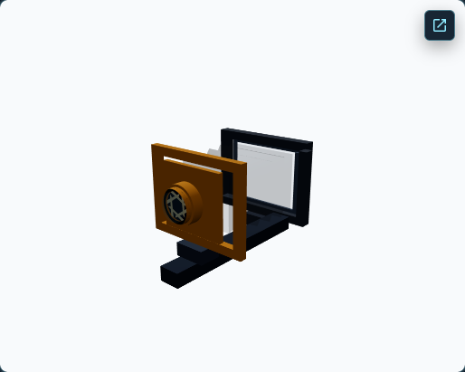
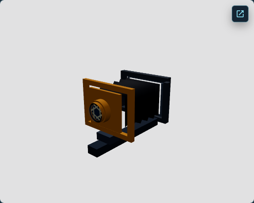

# View Camera Anatomy GPU Blend Intermediate Investigation

## 1. Objective and historical evidence

This research asks whether the remaining WebGL versus material-aware native WebGPU difference for dimmed Anatomy parts is visible before blending, in destination/blending behavior, or after framebuffer output. It is diagnostic only. Anatomy remains M2 — OPT-IN IMPLEMENTATION INCOMPLETE.

PR #262 associated the large error with dimmed renderables without identifying a mechanism. PR #263 found that B3 (bypass sRGB conversion on dimmed parts) improved the four-state dimmed-response RGB MAE, but the residual remained large. The current native rerun reproduced these 8-bit RGB MAE values inside existing visibility-response masks; they are not full-frame averages or exact silhouettes.

| Teaching state | B0 | B1 | B2 | B3 |
|---|---:|---:|---:|---:|
| Front Standard highlighted | 104.128 | 103.119 | 108.125 | 102.763 |
| Lens and Lens Board highlighted | 112.848 | 110.386 | 117.485 | 109.837 |
| Smaller Aperture | 115.713 | 112.178 | 120.429 | 111.526 |
| Bellows Highlighted | 116.508 | 113.135 | 120.721 | 112.522 |

## 2. Feasibility analysis

The pinned Three r186 source was inspected in WebGLRenderer, WebGLState, WebGPUBackend, WebGPUPipelineUtils, common Renderer, and WebGPUTextureUtils. WebGL exposes synchronous default-framebuffer readPixels. Three exposes asynchronous WebGPU render-target readback after a pass has written an attachment. The WebGPU backend encodes draws into a render pass and has no public readback point between those encoded draws.

| Mode | Classification | What it observes | Limitation |
|---|---|---|---|
| WebGL selected draw | F1 | Actual attachment immediately before and after each selected draw call, with active state | Source fragment values remain unavailable; readPixels can stall; browser composition is excluded |
| Isolated material replay | F2 | RGBA from a real selected renderable in a separate RGBA32F target | Other renderables are hidden, depth is cleared, blending is disabled on the clone, and original occlusion/order are not preserved |
| Screenshot/canvas interpretation | F3 | Final visible response and historical masks | Cannot reveal source RGB/alpha or isolate browser composition |
| Native per-draw boundary | F0 | Unsupported through the public r186 renderer API | No source/destination/post-draw values from the actual native pass |
| Native two-renderable draw pair | F0 / not run | Unsupported and not established | Visibility-response-mask overlap does not prove fragment overlap |

The active native scene attachment format at the selected production draw was not observed. F2 retains alpha as straight RGBA32F. Calibration uses a separate RGBA8 target. No shader instrumentation was added.

## 3. Exact capture and intervention methods

The development-only probe is mounted beside the existing Anatomy material audit and only responds while that audit is enabled. WebGL draw capture wraps actual context draw methods for the selected renderer object, reads the default drawing buffer before and after each call, records material and GL state, then restores the methods. The two actual draw calls are retained separately.

F2 replay selects the current generation-scoped semantic renderable ID, clones its active output material, sets NoBlending on the owned clone, hides other renderables, clears a separate target, and reads the result. The original material, geometry, visibility, scene background, render target, viewport, scissor, and clear state are restored before asynchronous WebGPU readback completes. The owned clone and target are disposed after readback.

## 4. Pipeline-stage diagram

~~~mermaid
flowchart LR
  subgraph W[WebGL original scene]
    W0[Earlier scene draws] --> WD[Destination before selected draw]
    WD --> WG[Actual Bellows draw with original depth and blend state]
    WG --> WO[Framebuffer after draw]
    WO --> WC[Canvas and browser composition]
    WD -. F1 readPixels .-> WR[Direct destination sample]
    WO -. F1 readPixels .-> WR2[Direct post-draw sample]
    WS[Fragment RGB and alpha] -. unavailable from readPixels .-> WG
  end
  subgraph N[Native WebGPU original scene]
    NP[Encoded render pass and draws] --> NA[Scene attachment]
    NA --> NC[Canvas presentation]
    NP -. no public per-draw readback boundary .-> NF0[F0]
  end
  subgraph R[Controlled F2 proxy]
    RS[Selected real material and renderable] --> RR[Other geometry hidden; blending disabled; cleared depth]
    RR --> RT[Separate RGBA32F target with straight alpha]
  end
~~~

This separates actual framebuffer samples from the isolated replay. F2 is not described as an unchanged production fragment.

## 5. Real-scene renderable and material selection

The selected renderable is the Front Standard bellows-folded-surface, semantic part Bellows. The geometry fingerprint, canonical scene inputs, transform, and authored material properties were matched across renderer mounts. Object and material UUIDs differ across mounts, so identities are mount-local.

The source is MeshStandardMaterial, color #111827, opacity 0.16, transparent, NormalBlending, premultipliedAlpha false, toneMapped true, depth test enabled, depth writes disabled, DoubleSide, roughness 0.88, metalness 0, renderOrder 0, and no shadow cast or receive. The authored source material is not edited.

## 6. Baseline results

The focused capture used a 1440×1000 viewport, DPR 1, and 1028×820 drawing buffer. Repeated A0, A1, and A2 frames had zero measured RGB noise. Against A0, A1 standard WebGPU had full-frame RGB MAE 25.221. A2 material-aware B0 had full-frame MAE 6.082, dimmed-response MAE 104.128, and unaffected-candidate MAE 0.0091. The unaffected region is a background-candidate control, not a stage decomposition.

- A0 WebGL standard: 
- A1 native WebGPU standard: 
- A2 native WebGPU material-aware B0: 

The eight points were selected before M-INV4 captures from the intersection of earlier PR #262/263 visibility-response masks, ranked by prior B0-versus-WebGL error with eight-pixel spacing. Screenshot points map to centers in the larger drawing buffer. Exact fixed coordinates and scores are in report.json.

## 7. Fragment-source findings

Direct source RGB and alpha are null for WebGL because readPixels observes the attachment after blending. Native source RGB/alpha at the original draw is unavailable (F0).

The F2 B0 replay uses the selected renderer output material with blending disabled on an owned clone. It captures eight fixed positions and reports five covered in both WebGL and native material-aware results. Both use sRGB-encoded RGBA32F straight-alpha values. Repeat RGB and alpha noise is zero in both. Mean absolute RGB difference is 0.02003 on a 0–1 scale (5.108 8-bit levels), with alpha difference zero. This is a small proxy difference, not proof that exact production source fragments differ by that amount.

B0 versus B1 is not numerically compared because the representations differ: sRGB-encoded versus linear-working. For B3, decoding B0 RGB with the IEC 61966-2-1 inverse sRGB transfer yields mean RGB difference 1.65e-7 across the five common covered proxy samples, with alpha unchanged. This confirms the expected output-stage mapping only within F2 replay.

## 8. Destination and post-blend findings

F1 observed the WebGL default drawing buffer around two real drawElements calls for the selected double-sided renderable. For the fixed 12,287-sample visibility mask, the first draw changed 4,910 samples (3,747 above per-channel threshold 8), with mean absolute RGB response 10.407 and maximum channel difference 49. The second changed 1,904 samples (652 above threshold), with mean response 1.958 and maximum channel difference 40. Sampled framebuffer alpha did not change.

Observed RGB blend factors were SrcAlpha / OneMinusSrcAlpha with Add; alpha factors were One / OneMinusSrcAlpha with Add. Depth test was LEQUAL, depth writes false, stencil disabled. Both framebuffer bindings were default. The data are RGBA unsigned-byte attachment values before browser composition. Fixed before/after samples are in report.json.

These measurements show that the actual WebGL draws contribute at selected mask points. They do not identify the native destination before the corresponding draw. The F2 source proxy is not substituted into a blend equation; no numeric cross-backend blend decomposition is claimed.

## 9. One-part versus two-part response

One real Bellows renderable was measured with F1 on WebGL and as an F2 proxy on both backends. No matched two-renderable native experiment was run. Earlier Bellows plus Ground Glass Back overlap evidence is a visibility-response-mask intersection; it does not establish simultaneous fragment coverage. No one-layer versus two-layer causal claim is made.

## 10. Color representation and alpha qualification

- WebGL F1: raw RGBA unsigned-byte default drawing-buffer values after each actual draw; output encoding metadata and context premultiplied-alpha setting recorded. Browser composition excluded.
- F2 B0 WebGL/native: sRGB-encoded RGBA32F, straight alpha.
- F2 B1: linear-working RGBA32F; incompatible with B0 without explicit transfer conversion.
- F2 B3: linear-working RGBA32F after bypassing output sRGB conversion.
- Native readback is asynchronous. Three r186 pads copy rows to 256-byte alignment; the probe removes padding and validates top-down orientation with an asymmetric quadrant fixture.

At covered proxy samples the authored alpha is 0.16. The actual WebGL framebuffer alpha remained 255 at the fixed sample points because the scene framebuffer was already opaque. These describe different stages and must not be equated.

## 11. Negative controls

- NC1 baseline restoration: WebGL and native restoration MAE both 0.
- NC2 opaque control: exact expected RGBA [191, 64, 26, 255] on both backends.
- NC3 transparent control: exact expected RGBA [48, 16, 6, 64] on both.
- NC4 disabling blending changed RGB by 70.333; NC5 reversing fixture draw order changed RGB by 14.
- Calibration confirmed WebGL bottom-up and native WebGPU top-down readback orientation.
- NC6 stale generation, stale renderable ID, and wrong semantic group were rejected. Native direct draw capture returned F0.
- NC7 original material/geometry and source properties were restored.
- NC8 owned targets and fixture resources were disposed; the SPA teardown listener produced no later response.

## 12. Native GPU and runtime provenance

The focused capture reports rendererFamily webgpu-renderer, executionBackend webgpu, material-aware policy installed, and no application fallback. The 13-state material-aware audit, PR #263 four-state study, blend calibration, and Architecture Rise strict parity used native-required settings. Hardware acceleration is unconfirmed and is not claimed.

## 13. Source and resource ownership

The probe owns only temporary material clones, its floating-point target, and calibration fixtures. It restores the original renderable material and geometry, source material properties, visibility, background metadata, render target, viewport, scissor, clear color, and clear alpha. It does not dispose scene textures, geometry, materials, or Ground Glass RTT resources. The probe is renderer-generation scoped and its listener is removed on SPA teardown.

## 14. Ground Glass, Anatomy, Architecture Rise, and production regressions

Ground Glass remained contentful with 124 color buckets. Repeat noise was 0.00111 RGB MAE and post-experiment restoration was 0. The probe created no RTT resources and retained original resource ownership.

- npm test: 256 files, 2,381 tests passed.
- npm run typecheck: passed.
- npm run lint: passed.
- npm run check:css: passed.
- npm run build: passed.
- Native-required Anatomy material-aware audit: matched candidate capture passed across all 13 states; the run reported 2 passed and 1 skipped.
- Existing PR #263 four-state native experiment: passed.
- Architecture Rise strict parity: passed with zero failing criteria under the existing 81-criterion contract.
- Production preview: both tests passed. Architecture Rise stayed WebGL for default and explicit WebGPU requests; Anatomy material-aware WebGPU remained denied.
- Production preview made no WebGPU module requests. The built asset scan found no Anatomy GPU blend probe component or event identifiers.

## 15. Decision and remaining unknowns

Decision: G2 — partial stage attribution.

Confirmed: the real WebGL Bellows draws contribute to framebuffer output under normal non-premultiplied source-over RGB blending; same-material F2 source proxies are repeatable and differ modestly at five common covered samples; B3 output conversion remains a small improvement against the large residual.

Unresolved: native actual-draw source, destination, and post-blend values; native active scene attachment format; exact cross-backend blend-stage contribution; browser presentation contribution; and genuine fragment overlap for a second real renderable. The report does not allocate percentages across stages.

## 16. Next recommended action

If the residual needs finer attribution, first evaluate one development-only hook at the Three r186 native WebGPU pass-encoding boundary for the selected Bellows draw. It must preserve real draw order and depth state, expose actual source and destination values or fail closed, and pass the existing calibration controls before any mechanism claim. This report authorizes no rendering correction, default policy change, promotion, or PR N.

See report.json for machine-readable measurements and fixed samples. Raw captures and logs remain under ignored test-results directories.
