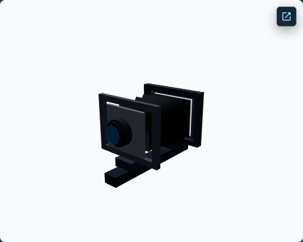
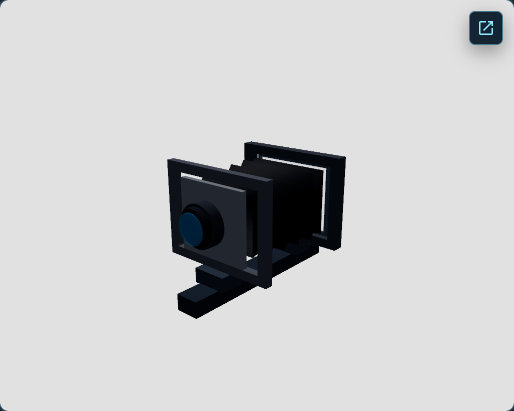
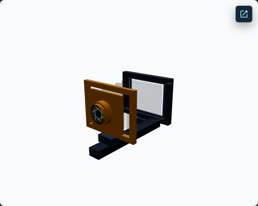
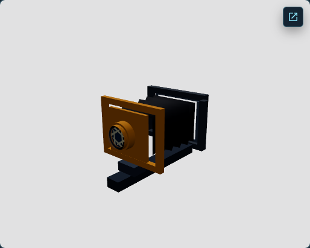
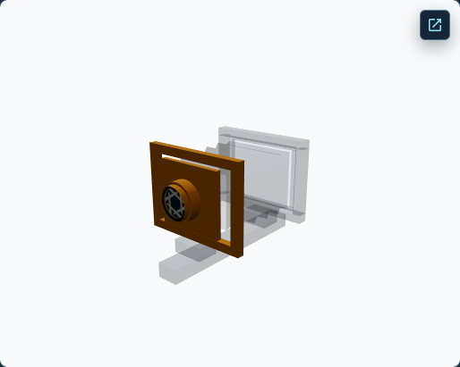
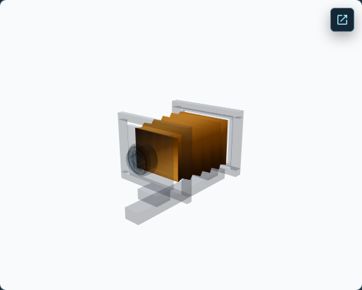
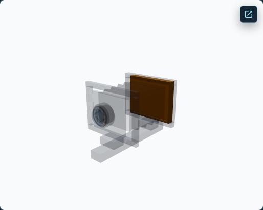
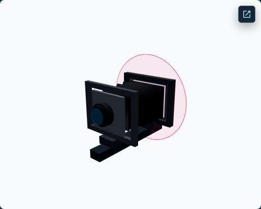

# View Camera Anatomy Material-Aware WebGPU Integration

**Decision: M2 — OPT-IN IMPLEMENTATION INCOMPLETE.**

The real View Camera Anatomy scene now has an explicit development-only
material-aware WebGPU candidate. The candidate initializes and renders on the
native WebGPU backend, adapts the currently mounted material assignments,
keeps the module-shared source resources intact, and leaves Ground Glass on its
independent WebGL2 render-to-texture path. Matched 13-state captures show
substantial output differences in highlighted, dimmed, aperture, bellows, and
rear-back states. The evidence therefore does not support default promotion or
a claim of visual parity.

PR M integrates the real scene. It does not change normal renderer selection,
the standard Anatomy WebGPU route, Architecture Rise behavior, production
policy, Ground Glass rendering, or canonical optics.

## 1. Purpose and scope

PR #258 established the real Anatomy material/geometry inventory and a matched
standard-output WebGL/native-WebGPU baseline. PR #259 extracted the shared
source-signature and NodeMaterial tracking core and validated its borrowed
source ownership boundary. PR M adds a scene-specific Anatomy adapter and an
explicit output-policy opt-in on top of that core.

The candidate uses the View Camera Anatomy scene and its actual Lesson 0
camera, registered target, teaching state, lighting, helpers, and Ground Glass
consumer. The isolated fixture and Architecture Rise adapter are not used as
substitutes for Anatomy evidence.

## 2. Renderer and output-policy matrix

| Route/request | Development result | Production result |
| --- | --- | --- |
| `/simulator/free/view-camera-anatomy` | WebGL / standard | WebGL / standard |
| `?observerRenderer=webgpu` | Approved WebGPU / standard | WebGL / standard |
| `?observerRenderer=webgpu&observerOutput=standard` | WebGPU / standard | WebGL / standard |
| `?observerRenderer=webgpu&observerOutput=material-aware` | WebGPU / material-aware candidate, if the native WebGPU mount and Anatomy readiness gate succeed | WebGL / standard; candidate denied by the development gate |
| Anatomy + explicit WebGL + `observerOutput=material-aware` | WebGL / standard | WebGL / standard |
| Architecture Rise + `observerRenderer=webgpu` | Existing material-aware development pilot | WebGL / standard |
| Architecture Rise + `observerRenderer=webgpu&observerOutput=standard` | Existing standard-output control | WebGL / standard |
| Other or unknown scene/output request | Existing fail-closed standard behavior | WebGL / standard |

The candidate is not selected by `observerRenderer=webgpu` alone for Anatomy.
Unknown output values select standard output with a diagnostic reason. The
scene compatibility registry and eligible-scene list are unchanged.

## 3. Shared core and Anatomy adapter

The output controller shell in
[`materialAwareObserverOutput.tsx`](../../src/render/backend/materialAwareObserverOutput.tsx)
owns renderer output/background setup, per-frame reconciliation, status and
failure reporting, renderer-generation cleanup, and the existing one-shot
application fallback callback. It uses PR #259's
[`MaterialAwareMaterialTracker`](../../src/render/backend/materialAwareMaterialTracker.ts)
and material signatures rather than defining another tracker or renderer
lifecycle.

Anatomy-specific behavior is supplied by
[`anatomyMaterialOutputAdapter.ts`](../../src/render/backend/anatomyMaterialOutputAdapter.ts)
and [`anatomyMaterialInventory.ts`](../../src/render/backend/anatomyMaterialInventory.ts):

- readiness resolves the actual `view-camera-anatomy-subject` and
  `camera-rig-placement` roots, presentation lighting, current inventory,
  adapted attachment coverage, and unsupported assignments;
- the controller waits up to 12 seconds for delayed scene composition, then
  fails closed if required content does not become ready;
- optional teaching helpers are inventoried when mounted but are not required
  in unrelated lessons;
- role labels distinguish the registered target and the conceptual camera's
  lens, lens board, front standard, bellows, rear standard, back, holder,
  support, and helpers;
- all adapted copies use the controller's renderer-generation-scoped owner.

Readiness evidence requires 17 registered-target renderables, a mounted
conceptual camera (30 renderables in the measured initial candidate state),
the installed background, 47 current material attachments, and zero
unsupported material instances. A candidate mount is not reported active
until those conditions and the current generation's material adaptation are
complete.

## 4. Module-shared source ownership

The Anatomy target's five Standard source materials and one BoxGeometry are
module-shared with the separate Ground Glass subject. The candidate adapts
Observer assignments into controller-owned NodeMaterials. It does not add the
copies to the registered subject disposer and does not own source geometry,
source materials, or textures.

The three-trial evidence confirms for every measured Anatomy target capture:

- Observer source-material UUIDs match Ground Glass source-material UUIDs;
- Observer source geometry UUIDs match Ground Glass geometry UUIDs;
- candidate NodeMaterial UUIDs are distinct from Ground Glass's source
  materials;
- source identity/properties remain stable through the teaching-state
  sequence;
- the candidate ended with 35 live adapted material copies, from 62 created
  and 27 disposed during the sequence; `62 - 27 = 35`.

The observed candidate attachment count was 47 at the measured initial state,
with a peak of 63 during state changes. The tracked set returned to 47 live
renderable attachments at the end of each run. R3F continues to own geometry
replacement and deformation.

## 5. Material inventory and output semantics

The initial candidate inventory contained 47 mesh/material assignments, 35
distinct source material instances, 35 adapted instances, and zero unsupported
instances. The observed source families and corresponding output families
were:

| Source family | Candidate family | Measured role coverage |
| --- | --- | --- |
| `MeshStandardMaterial` | `MeshStandardNodeMaterial` | Registered target and lit conceptual-camera parts, including transparent lens/back elements |
| `MeshBasicMaterial` | `MeshBasicNodeMaterial` | Unlit lens and teaching graphics |
| `LineBasicMaterial` | `LineBasicNodeMaterial` | Optical/helper linework |

The authored `toneMapped` value continues to choose the output transform:
tone-mapped materials receive ACES Filmic followed by sRGB conversion;
non-tone-mapped materials receive sRGB conversion only. The candidate uses
NodeMaterial `setupOutput()` graphs and disables a second renderer-level tone
mapping pass. It preserves the source transparency, opacity, blending, side,
depth-test, depth-write, and render-order properties. The implementation does
not alter authored colors or physical camera state.

The measured candidate reported renderer tone mapping `none`, output color
space `srgb-linear`, active presentation shadow maps with PCF, and exposure 1.
These settings describe the mounted candidate graph; they do not demonstrate
visual equivalence.

## 6. Dynamic teaching-state coverage

The matched comparison contains all 13 existing states:

1. Initial camera.
2. Registered target subject.
3. Highlighted front standard.
4. Highlighted lens and board.
5. Smaller aperture opening.
6. Highlighted bellows.
7. Highlighted rear standard.
8. Ground-glass back.
9. Film holder.
10. Highlighted camera support.
11. Image-circle lesson.
12. Front Rise adjusted to 12 mm.
13. Reset.

The state sequence also exercises dimmed components, aperture geometry,
deformable bellows vertices, rear-back replacement, image-circle visibility,
and reset. The audit keeps its precise projected-bound calculation for current
deformable geometry. The ghost camera has a separate development E2E pixel
visibility differential; it is not included in the 13-state matched triad.

## 7. Native qualification and visual comparison

The primary report was measured at commit
`da29db824cf4cbebe5fdf5016c0c6750c676dbe9`. Headed Chrome 155.0.8059.84 on
macOS Darwin 27.0.0 arm64, with Three.js r186, reported an available WebGPU
adapter. The mounted candidate reported `webgpu-renderer / webgpu`, one
initialization attempt, active/ready material-aware output, zero unsupported
materials, no application fallback, and no initialization failure. Hardware
acceleration remains **unconfirmed**.

Each run used a 1440 × 1000 viewport at DPR 1, with matched camera pose and
13 states. The Observer canvas captures were 514 × 411. Each backend/policy
pair contains 13 states and 138 non-empty object-aligned ROIs. RGB MAE is
descriptive; no cross-backend acceptance threshold is claimed.

| Matched comparison | Mean object-ROI RGB MAE | Maximum ROI RGB MAE |
| --- | ---: | ---: |
| WebGL vs standard native WebGPU | 19.7513 | 99.8079 |
| WebGL vs material-aware native WebGPU | 33.3534 | 114.1076 |
| Standard vs material-aware native WebGPU | 51.5763 | 157.6650 |

These values were identical across the three retained reports. Initial,
registered-subject, image-circle, and reset states were relatively close in
the material-aware comparison. Highlighted/dimmed, aperture, bellows, rear
back, and film-holder states retained large differences. In the highlighted
front-standard captures, the candidate's remaining camera parts are
substantially more transparent than the WebGL image. That is evidence for a
focused output/transparency investigation, not a reason to retune scene
materials inside this integration.

The same-mode initial repeat threshold remains RGB MAE ≤ 0.5. Across all three
runs and all three modes, repeat RGB MAE and changed-pixel count were zero.
This is noise calibration for repeated captures only, not a parity threshold.

### Representative captures

Initial states show the WebGL and candidate background samples aligning, while
the standard WebGPU background sample differs:

The highlighted front-standard state exposes a remaining transparency
difference:

The candidate also rendered the bellows-highlight and film-holder states and
the image-circle teaching overlay:

The machine-readable per-state/per-ROI values, runtime attributes, ownership
evidence, and representative artifact list are in
[`report.json`](view-camera-anatomy-material-aware/report.json). The three
independent run summaries and their timing ranges are in
[`repeat-trials.json`](view-camera-anatomy-material-aware/repeat-trials.json).

## 8. Negative controls and Ground Glass

The candidate E2E hides the actual Anatomy subject and the front-standard
object, then compares actual Observer framebuffer captures in their projected
regions. For the candidate subject control, hiding the subject changed 27,317
pixels; all changes were localized to its projected ROI. The unrelated scene
and background stayed contentful. Restoring the subject returned the image to
zero changed pixels. The front-standard control also changed pixels inside its
object-aligned region and restored the original image. These controls show
that readiness and parity evidence is sensitive to missing rendered content.

Ground Glass remained on `webgl-renderer / webgl2` in all three output modes.
Across all 13 states, its 211,768 sampled pixels (124 distinct color buckets)
were pixel-identical across the three WebGL RTT comparisons: RGB MAE 0,
changed pixels 0. Source material and geometry IDs matched the Observer's
borrowed sources on each capture, while candidate output materials remained
separate. Ground Glass was contentful for every capture and its optics/RTT
implementation is unchanged.

## 9. Lifecycle and performance

Three independently retained native runs reported 7.8–8.6 ms of
material-aware readiness work, 35 live adapted materials, and 47 ending
attachments. The candidate created 62 NodeMaterials and disposed 27 during
each lesson sequence; the 35 remaining copies were the live mounted inventory.
The observed peaks were 51 managed materials and 63 attachments. This is
bounded state churn in the measured sequence, not a long-duration leak test.

The candidate's navigation-to-renderer-ready measurements ranged from 1.225
to 1.933 seconds; navigation-to-first verified subject capture ranged from
1.851 to 2.604 seconds. Candidate rAF cadence had a 13.4–16.7 ms median and
14.3–17.5 ms p95 across these three runs. The instrumented controller callback
mean was 0.463–0.479 ms, with a 0.6 ms p95. These are JavaScript/controller
and browser scheduling measurements; GPU render time is not measured, and the
run sample is too small to support a general performance conclusion.

The focused failure-injection E2E still verifies one application-level
WebGLRenderer fallback, a single failed candidate initialization/policy path,
and no retry loop. Module-shared sources and the independent Ground Glass
consumer remain intact through the controlled failure. Renderer mount and
fallback identity remain owned by the existing Observer lifecycle.

## 10. Architecture Rise regression and production boundary

The original PR #254 Architecture Rise strict parity suite was run unchanged.
On the same Chrome/macOS/Three.js environment it reported 78 applicable
criteria passing, 0 failures, and 3 conditional checks not applicable, with
native `webgpu-renderer / webgpu`. Its output selection and scene adapter remain
unchanged. Anatomy's explicit opt-in is separate from Architecture Rise's
existing material-aware development default.

The production-preview test passed with the Anatomy candidate request denied:
production remains `webgl-renderer / webgl2`, standard output, no WebGPU module
request or initialization attempt, no development diagnostics, no application
fallback, and contentful Observer/Ground Glass. Ordinary Anatomy WebGL remains
the default, and explicit standard WebGPU remains standard.

## 11. Validation record

The complete full-unit, static, and build checks passed on implementation
commit `92c0223e9377fc8bcf8a3e3d2c3e0a5c76673d47`; the benchmark instrumentation
commit `da29db824cf4cbebe5fdf5016c0c6750c676dbe9` additionally passed
typecheck, lint, the native experiment, and the strict Architecture Rise parity
run. Documentation and evidence are added after those measurement commits.

| Validation | Result |
| --- | --- |
| `npm test` | 252 files, 2,343 tests passed |
| `npm run typecheck` | Passed on the final benchmark source |
| `npm run lint` | Passed using bundled Node 24.19 |
| `npm run check:css` | Passed; no CSS changed |
| `npm run build` | Passed |
| Native-required Observer pilot E2E | 7 passed, 3 intentional fallback-injection skips; a separate ordinary-run test exercised the controlled one-shot fallback |
| Anatomy material-aware benchmark | 3 passed / 3 standard-only skips in the repeated command; two additional single-run candidate trials passed (each 1 passed / 1 standard-only skip) |
| Architecture Rise validation | Focused suite passed; strict parity retained 78 pass / 0 fail / 3 conditional N/A |
| Production preview | 2 passed, including the explicit Anatomy candidate denial |
| `git diff --check` | Passed before publication |

The candidate report and summary were generated from the actual native run
outputs. Full Playwright JSON, traces, and unselected screenshots remain under
the ignored `test-results` directory; the committed report is a compact
machine-readable projection with the raw report SHA-256 recorded. Nine selected
screenshots are committed from the same run as `report.json`.

## 12. Limitations and promotion gate

The runtime and ownership integration is functioning, but the candidate does
not yet meet a visual-parity acceptance criterion. The three paired trial
reports measure the same ROI differences, and no approved cross-backend
tolerance exists. Hardware acceleration is unconfirmed. Ghost appearance is
covered by a separate test rather than the 13-state comparison. The candidate
has not been qualified across other browsers or GPUs, and the measured
workload does not establish long-duration behavior or GPU performance.

**M2 — OPT-IN IMPLEMENTATION INCOMPLETE.** Keep the route explicitly opted in
and experimental. A later PR N promotion decision requires an independently
reviewed Anatomy visual acceptance model, resolution of material-output and
transparency differences, and repeated native verification of the full
teaching-state sequence. PR M does not promote Anatomy material-aware output
to the development default.

## Review-Fix Round 1 — Post-Activation Readiness Timeout

The original controller measured its 12-second deadline from renderer mount for
both initial readiness and every later incomplete interval. Once the candidate
had been active for more than 12 seconds, a temporary attachment gap could
therefore trigger fallback immediately. This did not provide a fresh bounded
recovery interval.

The controller now tracks initial-pending, active, and recovery-pending phases
per renderer generation. Initial readiness keeps its existing 12-second
deadline. Each transition from active to incomplete starts a new fixed
12-second recovery deadline; a return to ready clears that recovery interval,
and a later incomplete transition starts another. A generation change starts
fresh initial timing. The existing readinessWaitMs diagnostic still reports
mount-to-first-ready time. Incomplete readiness continues to hide the scene,
while unsupported material and fatal reconciliation failures still use the
immediate one-shot application fallback.

The pure timing helper has deterministic coverage for initial timeout, initial
ready duration, a late transient loss after long active time, a persistent
recovery timeout, repeated recovery intervals, generation changes, and the
Architecture Rise timeout-disabled configuration. The native E2E keeps Anatomy
active for more than 12 seconds, changes actual Lesson 0 presentation states,
and observes ready → pending → ready on the same renderer generation without
fallback. A separate real native run injects persistent incomplete readiness
and confirms the recovery deadline falls back once; another injects an
unsupported material and confirms immediate failure. The fault hooks are
available only to the development audit route.

On headed Chrome 155.0.8059.84, macOS Darwin 27.0 arm64, Three.js r186, the
candidate mounted as webgpu-renderer / webgpu, with one initialization,
available adapter, no initialization failure, and no application fallback in
the transient-recovery case. The active interval was 12,103.2 ms; assignments
and tracked attachments changed from 47 to 48, adapted materials from 35 to 36,
the generation stayed 1, and Ground Glass remained contentful. Persistent
readiness loss fell back after 13,015.7 ms; all 35 candidate NodeMaterials were
disposed and attachment count reached zero. The unsupported-material path
fell back after 166.1 ms. Ground Glass stayed contentful and page errors were
empty in both failure cases. Hardware acceleration remains unconfirmed.

The same-run controller-callback sample was 0.9297 ms mean / 1.6 ms p95 before
the lesson transition and 0.9077 ms mean / 1.6 ms p95 afterward. This is a
bounded controller callback measurement, not GPU render time or a comparison
with the earlier benchmark workload. The active-ready path avoids an extra
clock read and timing-object allocation each frame. The M2 visual result does
not change: the candidate remains explicit and experimental because the
measured material-aware output differences still exceed the accepted parity
evidence.
