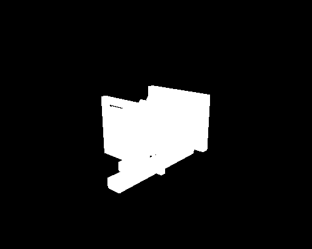
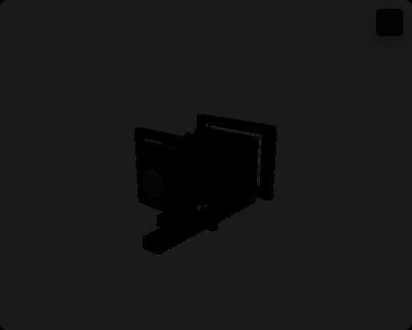

# View Camera Anatomy Renderable Contribution and Transparency Isolation

**Decision: I2 — PARTIAL ROOT CAUSE.** The real-scene experiment identifies
renderable groups associated with cross-backend differences, but it does not
isolate a complete alpha, material-output, depth, lighting, shadow, or browser
compositing mechanism. Keep the Anatomy material-aware path at **M2 — OPT-IN
IMPLEMENTATION INCOMPLETE**.

This follow-up to PR #261 uses the actual Anatomy Observer and the existing
13-state audit. It measures full, temporarily excluded, and restored
framebuffers on WebGL, standard native WebGPU, and native material-aware
WebGPU. A visibility differential is evidence that the changed renderable set
contributes pixels in that state. It is not an additive color decomposition:
removing renderables can reveal other geometry or background and change depth,
blending, and shadow results.

The complete machine-readable report, including all three 13-state source
inventories and per-condition metrics, is
[`anatomy-renderable-contribution-investigation/report.json`](anatomy-renderable-contribution-investigation/report.json).

## 1. Previous result and bounded question

PR #261 established that output-transform placement changes RGB in its
controlled transparency fixture. It did not explain the large real Anatomy
errors in highlighted and dimmed Lesson 0 states. Its corrected H3 tested only
`Material.premultipliedAlpha` under fixed renderer/context settings;
renderer/context premultiplication and browser canvas compositing remain
untested. This experiment does not change that classification.

The question here is narrower: which current Anatomy renderable sets make a
measurable contribution to the captured framebuffer, and how do WebGL,
standard WebGPU, and material-aware WebGPU respond to the same visibility
change?

## 2. Inventory and capture method

The initial capture inventory contains 47 visible mesh renderables: 30
conceptual-camera meshes and 17 registered target-subject meshes. The
machine-readable report carries the object IDs, names, hierarchy, semantic
part, world transform, geometry data and identity, projected regions,
visibility, shadow flags, render order, and source/adapted material-slot
properties for each of the 13 states in each mode. Material assignment counts
are grouped by state, camera part, transparency classification, and material
family.

The material classifications are independent flags:

| Class | Meaning |
| --- | --- |
| T0 | `transparent === false`; may still have `opacity < 1` |
| T1 | Explicit `transparent === true` |
| T2 | `opacity < 1`, regardless of T1 |
| T3 | Alpha test or alpha map present |
| T4 | A renderable has mixed transparency semantics across material slots |
| T5 | Visible explicit-transparent renderables whose projected rectangles intersect; candidate only |

In the initial state, two renderables use the explicit transparent path:
`lens-front-glass` (`opacity: 0.42`) and `ground-glass-screen`
(`opacity: 0.28`). Both are T1 and T2. Partial opacity on materials with
`transparent === false` remains classified separately; it is not assumed to
use Three.js's transparent render list. No initial T5 projected-rectangle
overlap candidates were found in any mode. This does not prove that no visible
transparent pixel interaction exists in other camera views or states.

The diagnostic controller is enabled only in development on View Camera
Anatomy while the explicit material-audit mode is active. Selectors resolve
against current scene-generation object IDs and semantic roles, not names
alone. The test snapshots each selected object's local visibility, excludes
only those Observer objects, captures, and restores the exact saved values in
`finally`. It does not change materials, geometry, canonical state, camera,
lighting, or Ground Glass visibility.

Each mode captured the same 13 teaching states and ran 16 bounded exclusion
transactions. The browser viewport was 1440×1000 at DPR 1; the Observer
framebuffer was 514×411 pixels. Camera position was
`[0.445574, 0.222787, 0.438166]`, with orbit target `[0, 0, -0.08167]`.
Each run independently repeated the initial capture and the aperture-selected
exclusion and restore. Measured same-mode RGB MAE was zero in this run.

## 3. Runtime qualification

The evidence was captured on Chrome 155.0.8059.84, macOS Darwin 27.0.0 arm64,
Three.js r186. The native standard and material-aware runs mounted
`webgpu-renderer / webgpu`, each with one initialization attempt, no
initialization failure, and no application fallback. The standard run used
standard output. The candidate reported material-aware output active and
ready, 47 tracked attachments, and zero unsupported materials. The bounded
adapter probe reported `available` in both native runs. Hardware acceleration
remains **unconfirmed**.

The WebGL reference reported `webgl-renderer / webgl2` and standard output.
All modes produced 13 captures with no page errors. Ground Glass stayed on its
independent WebGL2 RTT and remained contentful during all exclusions.

## 4. Initial-state contribution and background controls

The initial full-frame comparisons contain 211,254 RGB pixels. Hiding all 47
audited renderables changed 21,833 pixels in the WebGL reference, 21,741 in
standard WebGPU, and 21,829 in material-aware WebGPU. The M1 mask marks these
observed changes; its complement is recorded as an **unaffected/background
candidate**, not an exact background segmentation.

| Cross-backend pair | DFull MAE | DExcluded MAE | DResponse MAE | Interpretation |
| --- | ---: | ---: | ---: | --- |
| WebGL vs standard WebGPU | 22.0981 | 24.5180 | 2.6534 | The disagreement grows after all audited renderables are hidden; the canvas background remains a major unresolved contributor. |
| WebGL vs material-aware WebGPU | 0.0458 | 0.0000 | 0.0458 | The tested initial candidate matches the hidden-scene background; the remaining initial difference is localized to the observed renderable response. |
| Standard vs material-aware WebGPU | 22.0833 | 24.5180 | 2.6499 | Standard-versus-candidate disagreement is also dominated by the hidden-scene result in this state. |

`DResponse` compares each renderer's full-minus-excluded response; it is not
the change in MAE alone and does not attribute a material mechanism. For the
standard WebGPU path, the 32×32 top-left canvas probe records a different mean
RGB from WebGL, while remaining unchanged when all audited renderables are
hidden. The current scene attaches `#f8fafc` as `Scene.background`; the
material-aware output controller clears that background and installs an
sRGB-converted background node for the same color. These source paths are
consistent with the measured difference, but the experiment does not separate
renderer background output from canvas alpha or browser-compositor behavior.
The exact samples and metrics are in the report's `backgroundProbe` field. The
all-renderables exclusion capture is supplementary evidence, not a proof of
which stage produced the pixels.

### Initial transparent surfaces

| Renderable set | WebGL change | Standard WebGPU change | Material-aware WebGPU change |
| --- | ---: | ---: | ---: |
| Both explicit-transparent renderables (2) | 1,012 px; MAE 0.1394 | 979 px; MAE 0.0995 | 1,015 px; MAE 0.1395 |
| `lens-front-glass` alone (1) | 639 px; MAE 0.0713 | 643 px; MAE 0.0786 | 640 px; MAE 0.0714 |

Every exclusion restored to the captured frame with zero changed pixels in
these samples. The transparent surfaces demonstrably contribute pixels in
this view, but their initial-state contribution is small relative to the
whole-canvas standard-WebGPU disagreement. This does not reject alpha blending
as a cause in the high-error teaching states.

## 5. Highlighted and dimmed states

The following MAEs are whole-frame comparisons over 211,254 pixels, not the
historical rectangular object-ROI values from PR #261. `DExcluded` is measured
after hiding the condition's named target set. The response metric compares
the two backends' visible-minus-hidden framebuffer response.

| State and excluded set | Targets | WebGL vs material-aware: DFull → DExcluded | DResponse MAE | Material-aware observed contribution |
| --- | ---: | ---: | ---: | ---: |
| Front Standard — dimmed parts | 26 | 6.082 → 0.018 | 6.077 | 17,244 changed pixels; within-renderer contribution MAE 8.5071 |
| Lens and Lens Board — dimmed parts | 17 | 9.046 → 0.013 | 9.040 | 16,900 changed pixels; within-renderer contribution MAE 5.8632 |
| Smaller Aperture — dimmed parts | 18 | 11.029 → 0.011 | 11.024 | 20,105 changed pixels; within-renderer contribution MAE 7.0634 |
| Bellows Highlighted — dimmed parts | 29 | 9.222 → 1.054 | 9.178 | 16,373 changed pixels; within-renderer contribution MAE 4.2538 |

These matched exclusions associate much of the tested candidate/WebGL
disagreement in these states with the dimmed camera-part set. The result does
not tell whether the mechanism is per-material output conversion, transparency
interaction, depth/sorting, or another effect. The standard-WebGPU comparison
remains substantially different in the same states; the report includes its
matched full, excluded, and response metrics as well.

The aperture control is especially discriminating: hiding the selected
aperture meshes barely changes the WebGL-versus-material-aware full-frame MAE
(11.029 to 11.035; DResponse 0.012), while hiding the dimmed parts reduces it
to 0.011. This makes the selected aperture geometry an unlikely explanation
for that measured full-frame difference by itself; it does not establish a
general material cause.

## 6. Masks, candidate overlap, and limitations

Observed differential masks mark a pixel if any RGB channel changes by more
than 8/255. The selected threshold is above measured same-mode repeat noise
(zero here); masks retain antialiased edges when a channel crosses it. The
minimum detector count is 32 pixels. M1 is the within-renderer
all-renderables visibility differential. M2 is its complement and means
“unchanged by this exclusion,” not “known background.” M3 masks localize the
transparent surface, target, aperture, and bellows exclusions. DFull,
DExcluded, and DResponse masks compare cross-backend full frames, excluded
frames, and visibility responses. Grayscale absolute-RGB heatmaps preserve
per-pixel max-channel difference magnitude; black pixels are equal.

No pairwise interaction mask was generated because the initial T5 projected
rectangle candidate lists were empty. A rectangular projected region is not
an exact silhouette, and exclusion masks can include revealed objects,
background, occlusion, depth, and shadow effects. The complement mask cannot
separate those cases either. No lighting, shadow, or depth setting was varied;
those inputs were held constant and inventoried. Renderer/context
premultiplication was also not varied; PR #261's material-level H3 finding
remains bounded to its tested fixture.

## 7. Restoration, resource ownership, and Ground Glass

The controller's visibility mutation preserved the live Object3D, geometry,
material references, material properties, and geometry contents. Renderer
identity and generation remained stable; original visibility was restored
exactly; material-aware output readiness stayed `ready`. Observer-only
exclusions left Ground Glass contentful and produced zero RTT pixel difference
in the measured transactions.

The registered target still uses its five module-shared Standard source
materials and shared source geometry. Observer and Ground Glass source UUIDs
matched throughout all 13 states; in material-aware mode, adapted Observer
output materials remained separate from the Ground Glass source materials.
The Ground Glass renderer remained WebGL2.

One separate lifecycle observation is recorded rather than hidden: six lens
aperture blade geometry UUIDs changed across some inventory snapshot
boundaries. The visibility transaction itself preserved the live references,
and the measured vertex/index content and material properties stayed equal.
This UUID churn is not attributed to the visibility controller and was not
changed in this investigation.

## 8. Root-cause classification and next step

**Confirmed contribution:** the registered target, conceptual camera, explicit
transparent group, known lens glass, and teaching-part groups all produced
measurable framebuffer changes when excluded.

**Associated with high-error candidate states:** hiding dimmed camera parts
greatly reduced WebGL-versus-material-aware full-frame disagreement in the
four states above. The standard-WebGPU background discrepancy remained large
after all renderables were hidden.

**Not confirmed:** a broken alpha-blending implementation, overlapping
transparent-layer interaction, renderer/context premultiplication, lighting,
shadow, depth/sorting, or a complete real-scene output-transform mechanism.

The bounded next investigation should isolate selected/dimmed material-output
response in the highlighted Anatomy states and explain the standard-WebGPU
canvas background in a separate controlled intervention. Pairwise transparent
overlap should be added only if another tested view or state yields an actual
candidate. Keep source materials, ownership, and output policy fixed while
varying one mechanism at a time.

**Final decision: I2 — PARTIAL ROOT CAUSE.** The evidence identifies renderable
contributors but not a complete mechanism. **M2 — OPT-IN IMPLEMENTATION
INCOMPLETE** remains. Do not promote the Anatomy material-aware path or begin
PR N.

## 9. Validation provenance

- Measurement/source commit: `bccddef` (see full SHA in `report.json`).
- Measurement run: `OBSERVER_NATIVE_WEBGPU_REQUIRED=1 OBSERVER_ANATOMY_AUDIT_MODE=material-aware PLAYWRIGHT_WEB_SERVER_PORT=4174 npm run test:e2e -- --config=playwright.anatomy-material-audit.config.ts --workers=1 --grep "candidate captures matched"` — 1 passed; this produced the committed report and selected images, with 13 captures per mode.
- Full audit file: `OBSERVER_NATIVE_WEBGPU_REQUIRED=1 OBSERVER_ANATOMY_AUDIT_MODE=material-aware PLAYWRIGHT_WEB_SERVER_PORT=4174 npm run test:e2e -- --config=playwright.anatomy-material-audit.config.ts --workers=1` — 2 passed, 1 expected skip. The legacy two-way audit is skipped in explicit material-aware mode; the three-way matched experiment and normal-route hook-absence check passed.
- Full unit suite: 254 files, 2,364 tests passed.
- Typecheck, lint, CSS structure check, and build are recorded in the PR handoff after final validation.
- Architecture Rise native strict parity and production-preview WebGL denial are separate regression gates; their final-head results are recorded in the PR handoff.

The committed report and selected evidence images are copied from that successful
native run. The remaining Playwright output stays under ignored `test-results/`.
