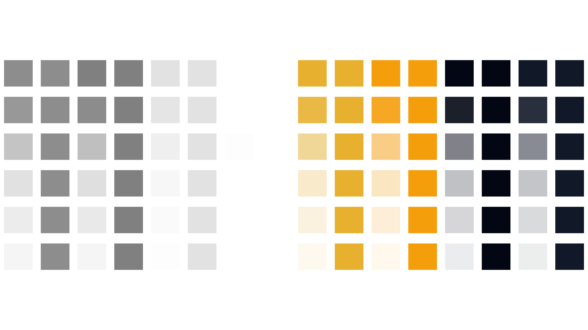
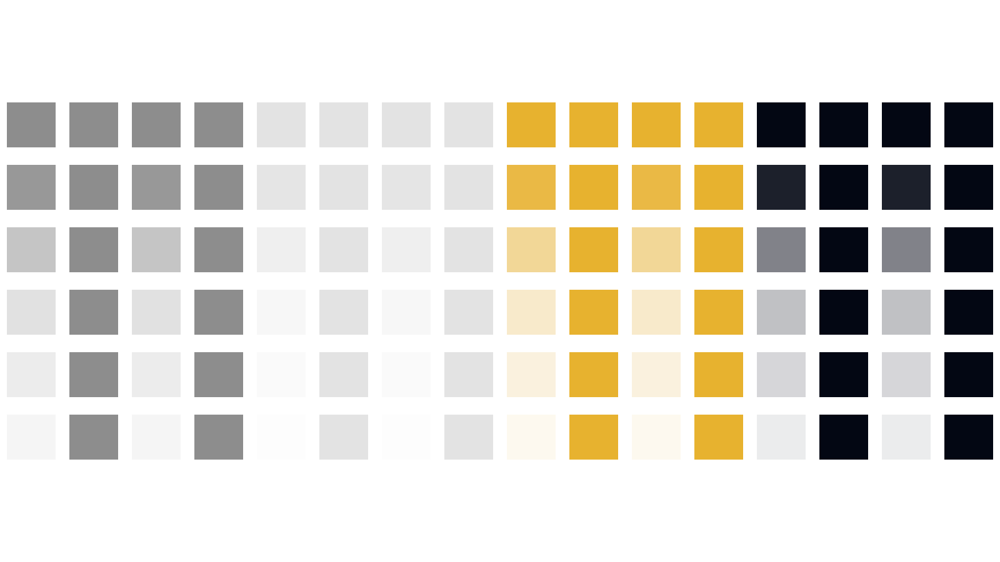
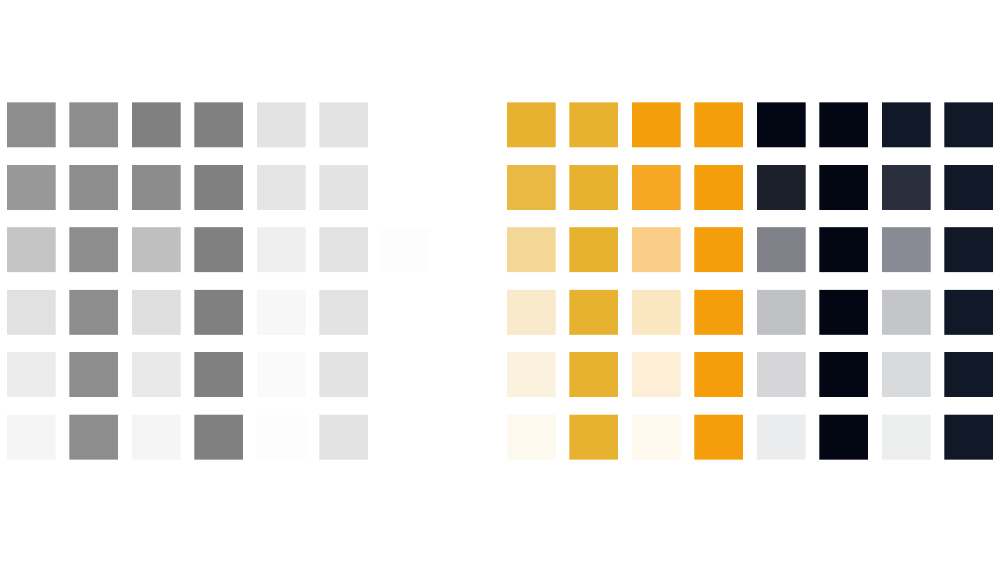
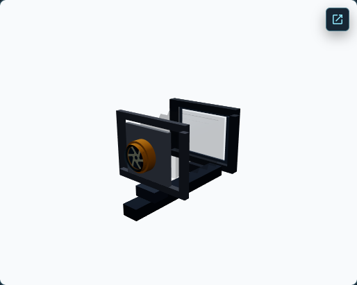
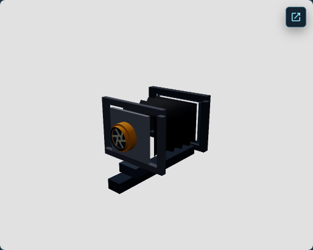
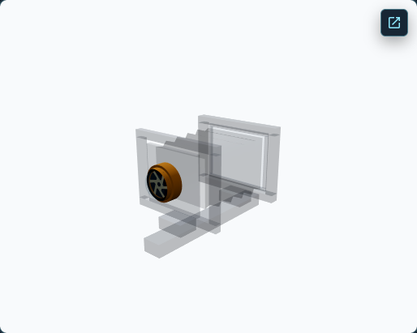

# View Camera Anatomy Transparency & Material Output Investigation

**Decision: I2 — PARTIAL ROOT CAUSE.** The controlled fixture isolates an output-stage difference that can contribute to WebGL/WebGPU RGB discrepancies, but it does not explain the large material-aware errors in the real Anatomy teaching states. Keep the candidate explicit and development-only. Do not promote it or implement a broad shared output change from this evidence alone.

This is an investigation report. It changes no authored camera materials, canonical geometry, renderer selection, Ground Glass implementation, or production rendering behavior.

## 1. Existing PR M discrepancy

PR #260 compared WebGL standard output, standard native WebGPU, and material-aware native WebGPU across 13 Lesson 0 states and 138 object-aligned regions. The metrics below are equal-weight means of per-region RGB MAE; regions can overlap and are not independent framebuffer samples. They are descriptive, not parity thresholds.

| Comparison | Mean RGB MAE |
| --- | ---: |
| WebGL vs standard WebGPU | 19.7513 |
| WebGL vs material-aware WebGPU | 33.3534 |
| Standard vs material-aware WebGPU | 51.5763 |

The candidate is close in Initial, Registered Target, Image Circle, and Reset. The highest-priority differences occur in Aperture Small Opening, Ground Glass Back, Film Holder, Camera Support, Bellows Highlighted, and the highlighted front/rear assembly states. The committed representative captures show the candidate camera assembly appearing substantially more translucent than WebGL.

## 2. Three.js r186 output pipeline

The installed implementation is Three.js `0.186.0` (`REVISION 186`). The source review used the pinned files recorded in [the machine-readable report](anatomy-transparency-investigation/report.json), especially `src/materials/nodes/NodeMaterial.js`, `src/nodes/display/{ToneMappingNode,ColorSpaceNode,RenderOutputNode}.js`, `src/renderers/common/Renderer.js`, `src/renderers/common/RenderList.js`, and the WebGL shader/state implementation.

Observed source behavior:

- `NodeMaterial.setupDiffuseColor()` applies material opacity to diffuse alpha; opaque materials force alpha to one.
- `ToneMappingNode` maps RGB and passes alpha through. `ColorSpaceNode` transforms RGB and preserves alpha.
- Base `NodeMaterial.setupOutput()` applies fog and optional premultiplication; it does not itself add renderer tone mapping or output color-space conversion.
- In the WebGL path, material tone mapping and output color conversion are applied to each fragment before fixed-function blending.
- In the common WebGPU screen path, transparent draws use the working-color-space framebuffer; the renderer's completed-image output pass clamps alpha, unpremultiplies, tone maps, converts color space, and premultiplies.
- The material-aware adapter moves tone mapping and sRGB conversion into each adapted material's `setupOutput()` before blend. Its conversion nodes are RGB-only and preserve alpha.
- The common and WebGL render lists both sort transparent items using group order, `renderOrder`, and depth. The controlled fixture also recorded actual draw callbacks.

This is a verified pipeline-stage difference, not proof by itself that the difference causes the real Anatomy candidate's errors.

## 3. Hypothesis matrix

| ID | Result | Evidence and confidence |
| --- | --- | --- |
| H1 — Alpha semantics | Rejected for the controlled clear-canvas samples | Across 288 matched samples per mode, cross-mode alpha difference was zero. Basic and Standard samples tracked source opacity within one 8-bit code value; the asserted bound was two. Line alpha includes raster coverage and was compared between modes. High confidence for these fixture materials and states. |
| H2 — RGB output stage | Confirmed contributing factor in the controlled fixture; incomplete real-scene cause | WebGL vs standard WebGPU produced RGB MAE 13.67–15.51 for the three transparent material families; material-aware output reduced that to at most 0.10 mean and at most 1 maximum. Tone-mapped and untone-mapped controls also show substantial RGB differences, including opaque controls. This proves output staging can change the measured pixels, not that it explains the Anatomy candidate's high errors. High confidence in the controlled fixture. |
| H3 — Premultiplied alpha | Rejected for tested normal-blending controls | Toggling renderer `premultipliedAlpha` changed the measured center RGB by zero in WebGL and material-aware WebGPU. This does not cover every blend mode or browser compositor. Medium confidence. |
| H4 — Depth test/write | Rejected as the candidate/WebGL mismatch in tested depth cases | Toggling `depthWrite` changed the WebGL control sample by RGB MAE 41.67, proving detector sensitivity. Across the tested depth cases, candidate pixels matched WebGL within MAE 1. High confidence for fixture cases. |
| H5 — Sorting/render order | Rejected as the mismatch in tested sort cases | Layer-count and explicit-order negative controls changed pixels and actual draw callbacks. Draw order matched across modes; candidate overlap pixels stayed within RGB MAE 1 of WebGL. High confidence for fixture cases. |
| H6 — Material copy | Rejected for tested property propagation | Source/output properties matched; adapted identity stayed stable through in-place changes; replacing a source material created a new adapted output. Real audit checked 9,420 adapted property values with zero mismatches. High confidence for covered properties. |
| H7 — Shader-state update | Rejected for tested transitions | Transparency and tone-mapping signature changes advanced adapted output versions; captured candidate pixels tracked WebGL in the fixture stages. High confidence for tested transitions. |
| H8 — Scene/camera input mismatch | Rejected as a general view-pose or source-property mismatch | Position, quaternion, orbit target, and horizontal/vertical projection terms matched for all 13 states. Renderable/source comparisons found no structural, transform, geometry, or source-property mismatch. WebGL and WebGPU depth projection terms differ according to renderer coordinate convention. This does not prove all scene interaction effects equivalent. High confidence for recorded inputs; real-scene pixel causality remains unresolved. |
| H9 — Measurement artifact | Repeat noise rejected; empty-ROI/background contribution remains unquantified | Repeats measured zero noise. The sampled canvas-background patch differs between WebGL and standard WebGPU by MAE 24.67, but matches between WebGL and the material-aware candidate. Object ROIs are rectangular and not foreground-masked, so any empty pixels within them are not separately quantified. This cannot by itself explain candidate-specific subject differences. High confidence for repeat stability; low confidence for foreground-only ROI attribution. |

## 4. Controlled fixture design

The isolated fixture runs the same test-authored material values in three separate renderer configurations: WebGL standard, native WebGPU standard, and native WebGPU material-aware. It uses a fixed orthographic camera (left/right ±8, top/bottom ±4.5, position `[0, 0, 10]`), a 1600×900 viewport at DPR 1, fixed geometry/light/background, and Basic, Standard, and Line materials. Colors include gray, white, amber, and dark; opacity includes `1`, `.90`, `.50`, `.25`, `.16`, and `.08`; `toneMapped` and `transparent` flags are varied independently.

The fixture also includes overlapping one/two/three-layer compositions, seven overlap/order/premultiplication cases, four depth-write cases, and seven source-material mutation stages. Each mode is checked against its actual mounted family/backend, output policy, attempt count, fallback/failure state, and viewport. Its test and page entry are isolated from ordinary application routes. Production build inspection found no fixture hook identifiers.

Native runs used Chrome `155.0.8059.84` on macOS Darwin `27.0.0` arm64, Three.js r186. Both WebGPU modes mounted `webgpu-renderer / webgpu`, had one initialization attempt, no application fallback or initialization failure, and an available adapter. Hardware acceleration remains unconfirmed.

## 5. Alpha, RGB, and color-output results

Across all three material families and 288 clear-canvas samples per mode, measured framebuffer alpha was identical between renderer modes. The six opacity values therefore do not support the simple explanation that the controlled material-aware adapter multiplies alpha twice or loses source opacity.

For transparent samples (48 per family), RGB MAE was:

| Material family | WebGL vs standard WebGPU | WebGL vs material-aware WebGPU |
| --- | ---: | ---: |
| Basic | 15.5069 (max 36.6667) | 0.0833 (max 1) |
| Standard | 13.6667 (max 33.6667) | 0.0417 (max 0.6667) |
| Line | 15.2083 (max 37.3333) | 0.0972 (max 1) |

With `toneMapped=false`, standard WebGPU also differed materially from WebGL in opaque controls. This separates the controlled RGB/output-stage issue from an alpha-only explanation. The fixture does not use a guessed sRGB blending equation; it compares actual framebuffer samples and records the specific source stages above.

Three independent same-mode repeat captures (first and repeat per renderer mode, same camera/view/viewport/DPR/backing size) measured RGB MAE 0, zero changed pixels, and zero changed-pixel fraction. This describes stability in this fixture; it is not cross-backend parity.

## 6. Overlap, depth, sorting, and material mutation

The seven overlap cases included layer-count changes, natural versus explicit render ordering, and premultiplication toggles; four additional cases varied depth-write/order. Actual draw callbacks matched the order expected across modes. A depth-write toggle changed the WebGL center sample by MAE 41.67, so the control can detect an occlusion change. The material-aware candidate matched WebGL within MAE 1 across the tested overlap/depth samples. Premultiplication toggles caused no measured center-pixel change in the tested normal-blending cases.

Negative controls were active in all modes. One-versus-two layer changes measured RGB differences of 23.00 (WebGL), 27.67 (standard WebGPU), and 23.00 (candidate). Natural-versus-explicit order measured 8.00, 6.33, and 7.67 respectively. Normal-versus-dimmed opacity measured 60.33, 73.67, and 60.33. These controls show the fixture can detect missing layers, changed order, and opacity mutations.

In-place material changes covered normal, highlighted, dimmed, ghost, aperture, return-to-normal, and rear-back material replacement. Source and output property values matched; output identity remained stable through in-place mutation; shader signatures/output versions advanced when shader-affecting flags changed; replacement created a fresh output. The candidate pixels followed the WebGL fixture at each measured stage. These results do not certify untested material features or all Anatomy combinations.

## 7. Real Anatomy state comparison

The final native-required audit produced 13 captures per mode (39 total) and 138 object-aligned ROIs per comparison. WebGL and standard WebGPU used standard output. The material-aware candidate was active. All three modes matched the same position, camera quaternion, orbit target, viewport, and x/y projection terms. Projection depth terms differed between WebGL and WebGPU as expected for their coordinate conventions; the view was not changed between captures.

| Teaching state | WebGL vs standard WebGPU | WebGL vs material-aware WebGPU |
| --- | ---: | ---: |
| Initial | 5.39 | 0.26 |
| Registered target subject | 4.31 | 0.41 |
| Highlighted front standard | 32.47 | 30.63 |
| Highlighted lens and board | 32.47 | 52.18 |
| Smaller aperture | 32.47 | 74.06 |
| Bellows highlighted | 6.83 | 59.40 |
| Rear standard highlighted | 29.15 | 62.14 |
| Ground-glass back | 28.50 | 77.33 |
| Film holder | 11.91 | 70.55 |
| Camera support highlighted | 34.59 | 66.48 |
| Image-circle lesson | 8.55 | 0.64 |
| Front Rise adjusted | 32.81 | 26.51 |
| After reset | 5.91 | 0.82 |

The values are state-level means of that state's projected object-region RGB MAE, rounded to two decimals. For high-error states, the candidate is worse than standard WebGPU in most cases. This is direct evidence that the controlled output-stage change does not, by itself, resolve the actual Anatomy discrepancy.

The audit found 26 normalized renderable-pair comparisons with no mismatch; 1,256 source material assignment comparisons had no property mismatch. The candidate's 628 adapted assignments passed 9,420 source/output property comparisons. Material-aware readiness was active/ready with 17 registered-subject renderables, 30 conceptual-camera renderables, 47 assignments/tracked attachments, and zero unsupported materials. No page errors were reported.

### Background and Ground Glass controls

The top-left canvas screenshot background patch sampled 1,073 pixels per state. WebGL measured mean RGB `[248, 250, 252]`; standard WebGPU measured `[225, 225, 226]`, for MAE 24.67 and every sampled pixel changed. Material-aware WebGPU matched WebGL exactly in this patch. The cause of this standard-mode canvas-background difference was not isolated. It must not be mistaken for an Anatomy material alpha measurement. Since object ROIs are not foreground-masked, any background pixels inside those rectangles remain an unquantified limitation; this report does not subtract or assign that contribution.

Ground Glass remained on its separate WebGL2 RTT. Its 211,768 measured pixels per state were identical across the compared modes for all 13 states, and its contentfulness and source-resource ownership checks passed. No Ground Glass pipeline or canonical optics code changed.

## 8. Root-cause classification and remaining unknowns

The evidence supports **H2 as a contributing factor in the controlled fixture**: the placement of tone mapping and color-space conversion relative to transparent blending changes RGB results while leaving measured alpha intact. The fixture's material-aware path corrects that isolated class of output difference to within one RGB code value.

The actual Anatomy candidate remains much worse than WebGL in key dynamic states. No single-layer alpha, premultiplication, depth, sorting, source-copy, or shader-update defect was isolated in the controls. The open questions are the real scene's combinations of material families, multilayer intersections, lighting/shadows, and output/compositing interaction. The top-left canvas-background difference in the standard mode also needs a targeted explanation, while the candidate matches that patch.

No complete actual-scene root cause is confirmed. There is no approved cross-backend visual parity threshold, and the rectangular ROI measurements may include empty pixels. The real candidate's high errors remain valid evidence of a visual discrepancy, but their detailed per-material attribution is unresolved.

## 9. Bounded correction proposal and test requirements

Do not change shared output behavior yet. The next investigation should isolate real-scene material/overlap contributions using per-renderable contribution captures or a narrowly scoped subject-visible/hidden differential. Re-run the affected high-error ROIs with meaningful foreground/overlap masks and explicitly account for panel-background pixels. Then test the predicted per-material output-stage correction against those same states.

If an actual-scene improvement is demonstrated, a follow-up correction should remain opt-in and be separately reviewed. It must retain the controlled alpha/RGB matrix, dynamic mutation tests, the matched 13-state Anatomy audit without relaxed thresholds, Architecture Rise's 81-criterion strict parity contract, module-shared source ownership, independent Ground Glass WebGL, and the production WebGL-only boundary. No correction is implemented by this PR.

## 10. Architecture Rise, Ground Glass, and production boundaries

No Architecture Rise output code, authored material, ownership/disposal behavior, parity threshold, or development pilot setting changed. The native Architecture Rise validation suite passed on this branch. The controlled fixture is a standalone test entry and the application instrumentation is read-only audit data. The production bundle excluded investigation fixture identifiers.

No Ground Glass RTT/shader, material, geometry, focus/DOF, CoC, optics, raw/upright orientation, or camera movement code changed. Ground Glass remains independently WebGL2-rendered and contentful.

Anatomy remains standard WebGPU unless the development-only material-aware mode is explicitly requested. The normal Observer and production remain WebGL. Hardware acceleration is not confirmed.

## 11. Runtime provenance and evidence

- Measurement/source commit: `ef596d81cb87b00190210bab682978c06920f42a`.
- Browser: Chrome `155.0.8059.84`; OS: macOS Darwin `27.0.0`, arm64; Three.js r186.
- Controlled fixture: 1600×900, DPR 1, orthographic camera `[0, 0, 10]`; native standard and candidate each initialized once with no application fallback/failure and adapter availability `available`.
- Real Anatomy audit: 1440×1000 browser viewport, DPR 1; 514×410.39 CSS canvas, 1028×820 backing canvas; 13 matched states and native candidate mounted `webgpu-renderer / webgpu`, one initialization, no fallback/failure, material-aware active/ready. The bounded adapter diagnostic timed out on the candidate during this run, so adapter status is unknown for that run; mounted backend evidence is native WebGPU. Standard native WebGPU separately reported adapter available.
- Hardware acceleration: unconfirmed; no independent system/browser GPU evidence was collected.
- Raw Playwright reports/screenshots are preserved locally under ignored `.test-results/anatomy-transparency-output-investigation/`. The committed compact summary and selected images are in [`anatomy-transparency-investigation/`](anatomy-transparency-investigation/).

Representative controlled fixture captures:

Representative real Anatomy aperture captures:

## 12. Validation and final decision

The following checks passed on the investigation branch:

- `npm run lint`
- `npm run typecheck`
- `npm test` — 253 files, 2,350 tests
- `npm run check:css`
- `npm run build`
- `git diff --check`
- Native controlled output/alpha/depth/sorting/mutation fixture — 1 passed.
- Native 13-state Anatomy material-aware audit — 1 passed, 1 existing standard-mode case skipped by the requested material-aware mode.
- Lesson 0 Anatomy E2E — 1 passed.
- Architecture Rise native scene validation — 2 passed.
- Architecture Rise strict native visual parity — 1 passed; 78 applicable criteria passed, 0 failed, 3 conditional not applicable. Chrome reported an available adapter and mounted `webgpu-renderer / webgpu`, with one initialization and no application fallback.
- Architecture Rise production preview — 2 passed.
- Production bundle fixture-identifier exclusion — passed.
- Hosted GitHub Actions CI — pass on initial PR head `3ca2547627c147b0ddd1f8dc4c392256d93f6f50` (CI job success; deploy job skipped); a documentation-only commit updates the handoff and triggers a final-head rerun.

The initial strict-parity attempt used the shell default Node 16.5 and stopped before Playwright because that version is unsupported. It was rerun with the workspace Node `v24.19.0` runtime and passed. The final native fixture command was `OBSERVER_NATIVE_WEBGPU_REQUIRED=1 npx playwright test --config=playwright.anatomy-transparency-investigation.config.ts --workers=1`. The real audit command was `OBSERVER_NATIVE_WEBGPU_REQUIRED=1 OBSERVER_ANATOMY_AUDIT_MODE=material-aware npm run test:e2e -- --config=playwright.anatomy-material-audit.config.ts --workers=1`.

**I2 — PARTIAL ROOT CAUSE.** Output-stage placement is a demonstrated contributor in the controlled fixture, but the material-aware candidate's high-error real Anatomy states remain unexplained. Continue with a bounded real-scene contribution/overlap investigation before implementing a shared-core correction. Keep PR M's **M2 — OPT-IN IMPLEMENTATION INCOMPLETE** decision. PR N default-promotion work is not authorized by this evidence.
