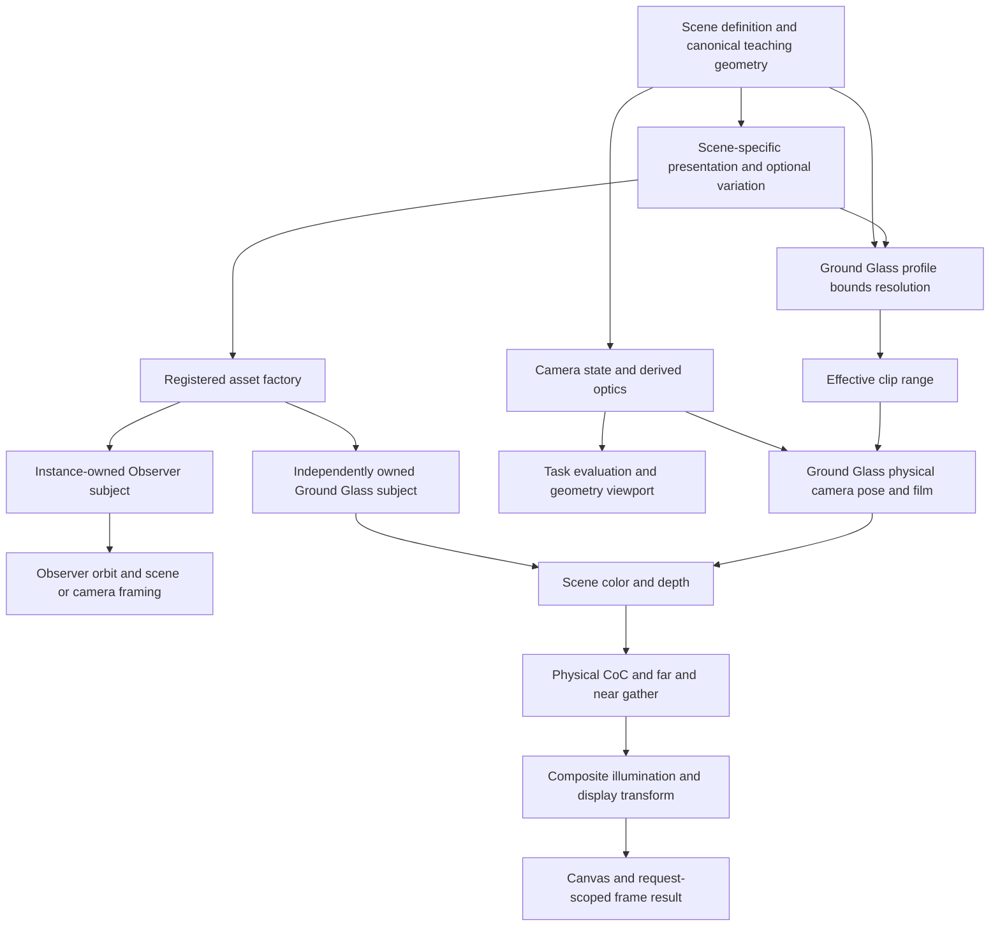

# Current architecture and evidence inventory

## Audit baseline

The research branch starts from `35212892d5a359213f68f984bc68ad47c4520886` on fetched `origin/main`. The accepted courtyard merge `9e5a71bee8e024a480acf17bb18763f3ef783039` is an ancestor. The head includes #350, which introduced Free Mode material variation for Architecture + Foreground and Table Tilt. Historical #369 replays therefore use their original revision and patches. Current A+F and Table Tilt measurements pin an explicit seed when using Free Mode. Guided/base measurements use the canonical presentation. [Wave 1 implementation and provenance](../../render-quality/FREE_MODE_SEEDED_MATERIALS_WAVE1.md)

Actual matched runtime used Three r187, WebGL2 ANGLE Metal on Apple M4 Pro, Chromium 149, Node 24.3.0 and standard quality. The current runtime also has narrowly gated Observer WebGPU and Ground Glass WebGPU research/pilot seams. These paths have per-scene and per-surface eligibility, fallback and lifecycle contracts. The audit’s runtime measurements use WebGL2. [Current visual ownership and renderer policy](../../VISUAL_PIPELINE_READINESS.md) · [Renderer families](../../../src/render/backend/rendererBackend.ts) · [Ground Glass backend boundary](../../../src/render/GroundGlassRenderer.tsx) · [Observer renderer boundary](../../../src/render/SceneRenderer.tsx)

## Current data and runtime ownership

- Canonical geometry feeds camera placement, composition, depth/focus cues, focus ranges and task evaluation. Scene bounds separately affect the 2D depth viewport, guide construction and, by default, physical clipping. [Scene contracts](../../../src/types/scene.ts) · [Derived state](../../../src/core/optics/deriveOpticsState.ts) · [Bounds consumer inventory](03-environment-and-render-bounds.md#current-bounds-consumers)
- The asset registry chooses scene implementations and owns paired disposal entry points. Observer and RTT construct independently owned instances from the registered presentation. The optional variations currently influence well-defined scope. Architecture Rise, A+F and Table Tilt material variation need explicit identity. Other variants can also change props or geometry, so material-only assumptions cannot be generalized. [Asset registry](../../../src/render/assets/sceneAssetRegistry.ts) · [Subject registry](../../../src/render/sceneSubjectRegistry.tsx) · [Asset consumers](../../../src/render/SceneAssetSubjects.tsx)
- The RTT scene profile resolves specialized bounds before the default scene bounds. The physical camera and current effective clip supply source color/depth and inverse projection to CoC/gather. The Observer retains its own camera and view controls. [RTT profiles](../../../src/render/groundGlassSceneProfiles.ts) · [Film camera](../../../src/render/configureGroundGlassCamera.ts) · [Observer framing](../../../src/render/sceneViewFraming.ts)
- Illumination has a represented-world source contract and an independent presentation-assist contract. Neither the environment factory nor the light rig owns optical blur or exposure calibration. [Lighting audit](07-lighting-gi-readiness.md)

## Historical evidence availability

| PR | Merged commit prefix | Recovered proof |
| --- | --- | --- |
| [#357](https://github.com/chau-hm/view-camera-simulator/pull/357) Table Tilt subject | `97908ec0` | Retained v2 evidence tree, 186 verified checksums. |
| [#362](https://github.com/chau-hm/view-camera-simulator/pull/362) Table Tilt studio | `bfa1c07d` | Retained v3A tree, 110 verified checksums. |
| [#364](https://github.com/chau-hm/view-camera-simulator/pull/364) Table Tilt refinement | `af680d7f` | v3B retained tree and Cycle 2 and aligned-target staging trees, 150 / 236 / 322 verified checksums. Original Table Tilt ZIP files were unavailable in the checked locations. |
| [#367](https://github.com/chau-hm/view-camera-simulator/pull/367) Rise urban street | `74aa4a22` | Original ZIP and outer digest, all 389 manifest entries verified. |
| [#368](https://github.com/chau-hm/view-camera-simulator/pull/368) Oblique industrial quarter | `8aeced5e` | Original ZIP and outer digest, all 313 manifest entries verified. |
| [#369](https://github.com/chau-hm/view-camera-simulator/pull/369) Foreground courtyard | `9e5a71be` | Original ZIP and outer digest, all 558 manifest entries verified. Stress readback, four coverage reports, original test failure/recovery logs and source checkpoints recovered. |

The inventory records full source identities, paths, archive hashes and counts in local `reports/historical-inventory.json`. Checked evidence comes from the original archive contents, recovered staging manifests, current source and controlled replays. Historical draw calls use different focus, seed or capture conditions and cannot substitute for a matched benchmark. There is a separate difference between the immutable original Table Tilt ZIP bytes and checksum-verified retained extracted evidence.

The #350 baseline has two seeded-fixture failures reproduced locally. The A+F test's fixed unseeded full-tree fingerprint predates the accepted courtyard. The current unseeded tree matches the #369 subject. Table Tilt's comparator serializes generated shape UUIDs. Its stable geometry streams match across independent same-input mounts and the sampled seeds. These are validation defects under investigation and the audit leaves those tests unchanged. [Fixture evidence and reproduction](04-procedural-consolidation.md)
