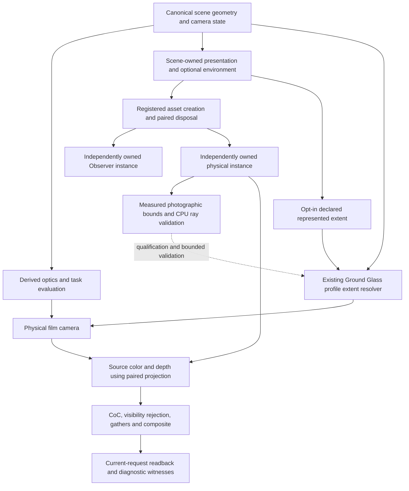

# Proposed architecture and compatibility

## Opt-in extent at the existing Ground Glass profile seam

The measured courtyard benefit justifies one reference opt-in after diagnostic qualification. Keep canonical teaching and task inputs in the scene layer. The scene presentation owns the identity and intended extent of additional represented geometry. The existing Ground Glass profile resolves a bounded, scene-authorized render requirement and retains the current override/registry/scene fallback for existing scenes. Begin with opt-in declared evidence checked against measured mounted subject geometry. Use this comparison to catch stale metadata or extent inflation before enabling any new runtime policy. [Source and extent trade-offs](03-environment-and-render-bounds.md)

| Owner | Future responsibility |
| --- | --- |
| Canonical scene and optics | Lens, film, focus and projection state, task/sample contracts, teaching bounds and composition. Units remain explicit in millimetres/degrees. |
| Scene presentation | Optional authored layout, semantic geometry roles, approved render-extent intent and stable variant identity. Render depth evidence belongs here or on the registered presentation technical profile. A2 should settle the smallest exact placement in the existing resolver contract. |
| Registered asset boundaries | Build and dispose one physical instance per consumer. Derived estimates use the declared photographic category and exact mounted state, with transforms and resource generation included. |
| Ground Glass profile and renderer | Resolve finite effective bounds for the active physical camera, apply a matched projection pair and update depth/CoC/rejection uniforms. Request and sanity identity cover the effective clip, seed and relevant resource generation. |
| Construction helpers | Accept a bounded caller-chosen bucket of compatible material and geometry data. Preserve ownership and useful cull/raycast bounds. |
| Observer | Own existing view framing and navigation. Keep audit pose selection independent of the physical lens and use scene-local hints only where needed. |
| Audit and qualification | Own classified first-hit and clipping evidence, stable test scenes and failure controls. Treat diagnostic coverage separately from optical scoring. |

Apply a finite verified envelope and fail closed to the accepted profile range on missing or invalid inputs. For any later measured assistance, keep classification explicit and exclude rig, overlays, reflections, helper-only geometry and accidental hidden content as appropriate to the path. Conservative local boxes can prefilter ray tests. Use actual triangles for apertures and occlusion. Use configuration and registration identity for seed, extent and rebuild invalidation. Mutable textures, materials and geometries remain owned by one registered instance. Immutable CPU recipes can be reused. Track disposal of temporary resources and failure-path allocations. [Procedural ownership](04-procedural-consolidation.md) · [Bounds decision](03-environment-and-render-bounds.md#alternatives-and-recommendation)

### Alternatives

- Current placement-only policy remains appropriate for small scenes and most tested environments. It preserves default behavior and avoids forcing an environment requirement. It limits the courtyard’s physical composition.
- Explicit extent alone is deterministic and easy to audit. An out-of-date authored value can mask a clipped object or inflate every depth calculation on the path.
- Live mounted bounds alone track seed and transformations. They introduce build order and classification dependencies, mutable invalidation, extra scanning and accidental unrelated extents. A broad object box also proves little about surface interception.
- The hybrid keeps determinism, validates authored intent against registered reality and reserves automatic adjustment for later evidence. The first proof should bind one scene and one policy in the existing renderer seam.

## Cross-scene migration

| Family | Compatibility and first migration boundary |
| --- | --- |
| Architecture | A+F is the first candidate for opt-in render extent. Rise and Oblique passed sampled current clipping checks. Use their canonical roof, facade, sign and depth-reference rays as equivalence controls before any broader opt-in. |
| Interior | Table Tilt and Interior Corner have visible openings or partial shells. Bounds should include photographic wall/cutout surfaces where appropriate. Masked diagnostic shell faces or camera obstructions need their own policy. Current physical range and control labels remain the default. |
| Tabletop | Keep calibrated tabletop and foreground samples fixed. Additional room context is optional. Count its real render requirement separately from object focus range. |
| Macro | Keep dedicated RTT bounds and the 4 m sampled far default. Preserve 10 mm near and the paired depth/projection contract during outdoor trials. Depth quantization and rejection matter at submillimetre scale. Validate near/far separation, layered geometry and narrow DOF with measured controls before any policy applies. |
| Camera Anatomy | The view can use articulated rig geometry and an intentionally separate presentation or camera-only path. An empty optional environment must preserve current standardized navigation and backend eligibility. |
| Mirror / reflection | Physical reflection mapping, apparent world positions and reflection/probe bounds have different owners. Treat the primary clip trial and reflected contribution visibility as independent validations. |
| Seeded scenes | Stable material-only identities preserve geometry in sampled A+F/Table/Rise cases. Prop-changing variants can change extent. Verify descriptor reuse, remount invalidation, same-document cleanup and intentional canonical Guided behavior. |

## Unresolved risks

Current WebGL evidence covers the tested outdoor material seeds, representative indoor/Macro geometry and selected request paths. Independent backend equivalence (including native or opt-in WebGPU), unseen material seeds, reflected visibility, depth-transition state changes and long-run performance remain qualification work. The controlled courtyard trial demonstrates why extent needs a depth gate even when ray coverage, film X/Y and physical sharpness remain stable. Stronger postprocessing signals should also prove that finite prepared uniforms and completed frame status belong to the intended render. [Diagnostic controls](02-ground-glass-regression-audit.md#controls-and-next-diagnostic-contract) · [Lighting scope and risks](07-lighting-gi-readiness.md)
