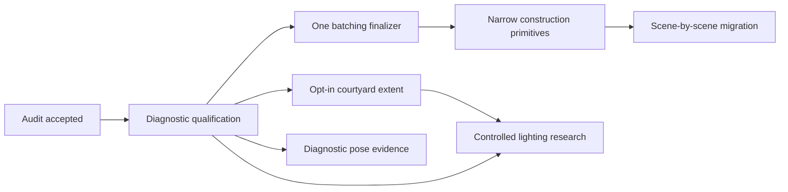

# Environment architecture implementation roadmap

Each slice must remain independently releasable. A0 supplies design decisions and evidence. All rows below require separate implementation authorization.

## A1 — Ground Glass diagnostic qualification

- **Objective and problem.** Qualify a current-request smoke signal and a fixed-scene optical test suite. The present global variance comparison responds to legitimate frame composition and misses an unexpected bypass or stale frame on its own.
- **Dependencies and ownership.** Accepted A0. Ground Glass test/diagnostic owners and a separate optics reviewer for physical expectations. Resolve the two inherited seeded-fixture failures through a targeted evidence/fixture maintenance slice before treating a global suite as qualification evidence.
- **Production scope and exclusions.** Start with isolated test fixtures, independent comparators and evidence. Use supported runtime callbacks and request fields. Preserve existing assumptions/thresholds through side-by-side proof. Scope narrowly to any observability seam a follow-up test cannot otherwise read. Exclude exposure, clipping, layout, calibration, renderer migration and visual retuning.
- **Complexity.** Level 2 while test-only, Level 3 if a shared runtime request/publication seam changes.
- **Validation and acceptance.** Require successful latest-generation frame and pass identity, finite optical preparation, independent blank/stale checks, known-reference local blur/CoC and rejection, and Raw/Upright orientation. Exercise intentional bypass and wrong CoC/blur, a wrong-axis frame, legacy rejection, malformed diagnostics and valid unrelated background changes. Use matched pins for camera, seed and backend. Keep whole-frame variance as a descriptive or fixture-specific signal only once the replacement catches the intended failures.
- **Migration and rollback.** Add supplemental checks and document comparison first. Retire or move only proven redundant assertions in a reviewed separate hunk. If controls are weak or results flake, retain current assertions and keep experimental checks isolated.

## A2 — Opt-in courtyard render extent

- **Objective and problem.** Bring a measured environment depth into the physical RTT where justified. Preserve canonical teaching bounds. The current courtyard trial recovers 395 calibrated cells and also changes paired depth/CoC and the stress ratio.
- **Dependencies and ownership.** A1 must qualify the signals. Scene presentation owns declared extent intent. The existing profile and physical renderer own the effective projection/depth contract. Require independent optics/renderer verification.
- **Production scope and exclusions.** One explicit courtyard opt-in with validated extent. Maintain backward-compatible fallbacks. Trace request and resource-generation invalidation, actual clip with inverse projection, depth convention and diagnostics. Exclude shared near-plane changes, Macro policy spread, broad room expansion, fade/hiding, artwork changes and shared generator work.
- **Complexity.** Level 3.
- **Validation and acceptance.** Show matched camera/film X/Y, canonical lens rays and focus scores. Partition visible, occluded, excluded and clipped first hits. Qualify depth reconstruction precision and local CoC/rejection under both clip policies and boundary motions. Verify raw/processed, relevant indoor, Macro, reflection and default-backend controls. Require the supported opt-out to reproduce the accepted result. Set release tolerances with the reviewer using fixed analytic depth/blur witnesses.
- **Migration and rollback.** Introduce dormant or compatible support, then enable only the independently qualified courtyard capability. If diagnostics or legacy clarity fail, disable the opt-in and retain the exact current clearance. Preserve existing scene settings and registry.

## A3 — Shared geometry bucket finalization

- **Objective and problem.** Extract the common verified finalization step for one local material-compatible geometry bucket. Provide deterministic failure and ownership handling without obscuring physical bounds.
- **Dependencies and ownership.** A1 evidence contract. Scene-render maintainer owns the leaf utility, with Architecture Rise's municipal environment as the first caller. A2 can proceed independently after A1.
- **Production scope and exclusions.** Migrate only `UrbanGeometry.mount()` bucket finalization. Cover compatible attributes, optional indexing, normal/UV retention, geometry groups as required by this caller, local bounds and disposal. Exclude layout, transform/UV generation, a public scene schema, universal city generation and merging an entire district.
- **Complexity.** Level 2.
- **Validation and acceptance.** The migrated scene preserves ordered geometry attributes, indices, matrices, material identity, texture policy, mounted bounds and focus rays. Confirm matched render/scene counts across representative seeds, both consumers and two SPA exits. Exercise incompatible inputs and dispose intermediate geometries exactly once on success/failure.
- **Migration and rollback.** Land the small helper with one equivalence-proven caller. If equivalence or measured readability suffers, revert that caller and leaf utility together.

## A4 — Narrow environment primitives

- **Objective and problem.** Reuse only proven common construction operations where source and evidence show the same semantics.
- **Dependencies and ownership.** A3 accepted with local invariants intact. Scene-construction maintainers own per-primitive specifications and reference fixtures.
- **Production scope and exclusions.** First evaluate rectangular aperture partitioning and nonoverlapping ground patch/UV continuation data. Keep each validation/releasable slice small. Defer arches, specialized roofs, glazing recipes, vegetation and a full layout schema until matching semantics and a second practical caller exist.
- **Complexity.** Level 2 per primitive. Escalate if an accepted optical surface changes.
- **Validation and acceptance.** Compare physical surface intersections, seams, UVs and normals, preserve window/shadow orientation, and check geometry/material ownership. Build one intentionally faulty opening or overlap to prove geometry comparisons catch it.
- **Migration and rollback.** Keep old authored descriptors and replace one construction operation at a time. Revert the caller and helper if exact or qualified equivalence fails.

## A5 — Controlled scene migration

- **Objective and problem.** Adopt qualified narrow mechanisms without losing differences between the street, industrial quarter, courtyard and studio.
- **Dependencies and ownership.** A3/A4 as relevant. Qualify the affected scene's fixtures before migration, including stable A+F fingerprints and exclusion of Table Tilt generator UUIDs from geometry equivalence. Each scene remains a distinct ownership boundary.
- **Production scope and exclusions.** One scene and one proven mechanism per reviewable PR. Include seed/canonical state checks. Exclude aesthetic/unrelated maintenance and help preserve prior architectures’ uniqueness.
- **Complexity.** Level 2 for exact asset construction parity. Level 3 if a protected film surface or a new resource ownership model is involved.
- **Validation and acceptance.** Compare source dimensions, complete rendered subject signatures, registered vs mounted resource ownership, depth targets, ray visibility, baseline render poses, seeded equivalence and current-head gate. Each migration should be safe to promote to production on its own.
- **Migration and rollback.** Use independent PRs. Stop at the first unexplained difference. Revert only the affected migration and retain previously accepted scene states.

## A6 — Diagnostic inspection evidence

- **Objective and problem.** Preserve useful audit views when accepted environments physically block old capture positions. Current evidence supports capture tooling and scene-local pose guidance.
- **Dependencies and ownership.** A1 enables state-matched capture validation. Observer capture/test owners hold scene-local poses. This can proceed independently of A2–A5.
- **Production scope and exclusions.** Prefer test/capture descriptors, visible target samples and actual pose readback. Exclude automatic collisions, wall hiding, reset changes and teaching lens changes from this slice.
- **Complexity.** Level 1 for scoped diagnostic configuration, level 2 if shared tooling changes.
- **Validation and acceptance.** Report actual mounted origin, frustum and first-hit visibility, along with same-pose comparative rendering. Prove practical public view and same-document return separately using an actual control. Compare the legacy blocked and corrected diagnostic poses.
- **Migration and rollback.** Preserve legacy captures and add proven descriptors incrementally. A public change requires separate evidence of degradation and authorization. Revert descriptors if they conceal an actual optical obstruction.

## Later controlled research

Gate performance optimization on measured construction or a particular GPU pass on a target device. Keep diagnostic readback separate from render cost. Evaluate GI first with bounded contact, aperture and colour-donor controls from the lighting audit, followed by one outdoor, one indoor and one Macro compatibility sample if useful. Require a wall/lighting/bounce negative control before interpreting improvements. Leave exposure, reflection, new material transmission and optional backend changes as independently approved slices. [Performance evidence](06-performance-and-lifecycle.md) · [Lighting fixtures and order](07-lighting-gi-readiness.md)
