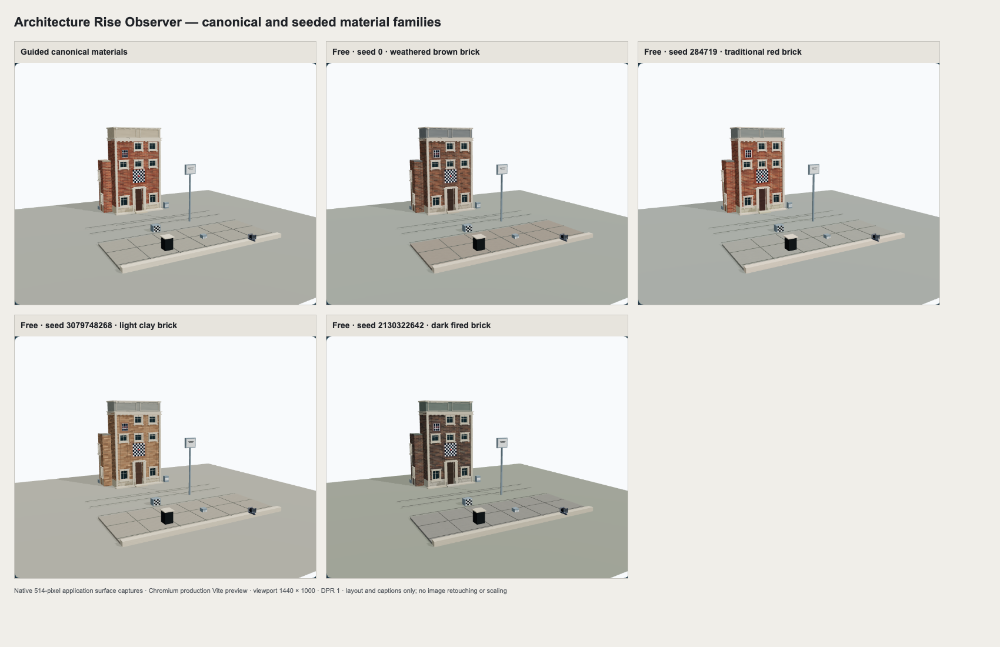
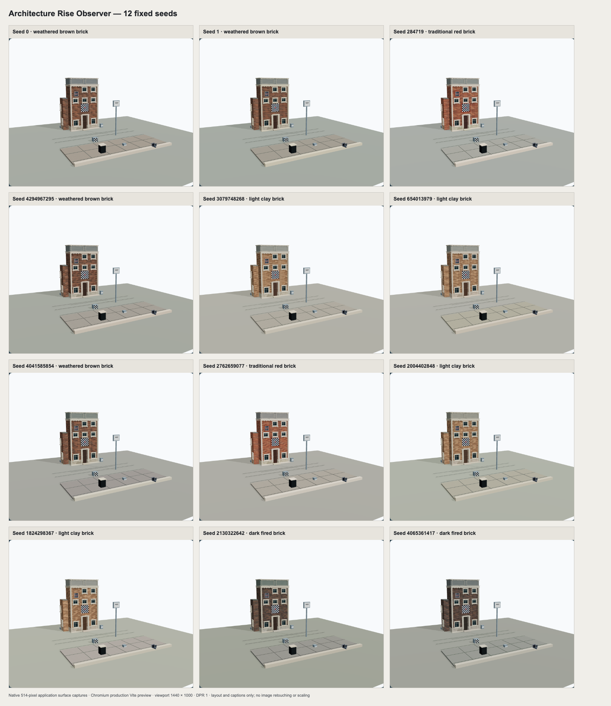

# Architecture Rise Seeded Materials — Wave 2

## Objective and scope

Architecture Rise Free Mode now uses the existing Scene Variation schema v1 contract to resolve deterministic, coordinated finishes for its existing modeled surfaces. Regenerate changes the material appearance family while the building geometry, teaching targets, lighting, and camera calibration remain fixed.

The scene previously had no Scene Variation capability, so Free Mode had no standard seed display or Regenerate Scene control. This work adds that existing UI path and threads the same descriptor through the registered Observer and Ground Glass subject factories. It does not modify scene publication configuration.

This work covers material appearance only. The rear and side elevations remain less developed than the front elevation. The missing architectural features are a separate geometry project; they are not filled in or implied by the new materials.

## Geometry baseline and protected contracts

The accepted Architecture Rise v2 presentation includes the segmented principal facade, world-aligned running-bond brick, front windows and surrounds, east service-return windows, stone base and joints, entrance, cornice, parapet, sidewalk, street details, focus chart, and fine-detail geometry. The existing [screen-space audit](../architecture/architecture-rise-v2-visual-gap-screen-space-audit.md) documents the front-facade detail and the remaining elevation-coverage gap.

Canonical and seeded subjects have the same mounted capacity:

| Per subject | Canonical | Seeded |
| --- | ---: | ---: |
| Meshes / renderable meshes | 465 / 465 | 465 / 465 |
| Unique geometries | 73 | 73 |
| Unique materials | 17 | 17 |
| Unique textures | 18 | 18 |
| Triangles / effective triangles | 6,242 / 6,242 | 6,242 / 6,242 |

The full mounted-geometry signature is unchanged. The canonical focus target remains `(0, 900, 8890) mm`; composition bounds remain fixed at building-top `(-900, 2920, 8500)–(900, 3730, 10500) mm` and main-body `(-1400, -1000, 8300)–(1400, 2600, 11500) mm`.

The existing physical-lens mounted-geometry suite passed: 111 of 111 samples visible in each of six camera states (666 rays total), with its intentional obstruction negative control detected. The procedural-detail suite also detected its separate obstruction negative control.

## Schema and deterministic resolver

`architecture-rise` advertises `{ enabled: true, schemaVersion: 1 }`. A seed resolves to an immutable, serializable scene material plan through the existing `SceneVariationDescriptor`; no second PRNG or global random state was added. The resolver has no React, Three.js object, camera, focus, or browser dependency.

The family is selected with the independent `materials / scene-style` substream. Supporting material roles use their own stable semantic substreams so adding a role does not reshuffle existing roles:

`scene-style`, `masonry-brick`, `masonry-mortar`, `stone-base`, `stone-joints`, `quiet-facade`, `window-trim`, `roof-surface`, `door-wood`, `sidewalk`, `pavement`, and `ground-plane`.

The 12 frozen browser seeds resolve as follows:

| Seed | Family | Seed | Family |
| ---: | --- | ---: | --- |
| 0 | Weathered brown brick | 1 | Weathered brown brick |
| 284719 | Traditional red brick | 4294967295 | Weathered brown brick |
| 3079748268 | Light clay brick | 654013979 | Light clay brick |
| 4041585854 | Weathered brown brick | 2762659077 | Traditional red brick |
| 2004402848 | Light clay brick | 1824298367 | Light clay brick |
| 2130322642 | Dark fired brick | 4065361417 | Dark fired brick |

Different seeds can share a family while still resolving deterministic role realizations. Reopening a fixed seeded URL reproduces the same material maps; the production-browser replay test also confirmed byte-identical Observer canvas output for seed `284719`.

## Material recipes and physical scale

The main facade and service return use four coordinated brick families: traditional red, weathered brown, light clay, and dark fired. Each family supplies a restrained brick palette, compatible mortar, quiet-facade tone, stone base, joints, trim, roof, door, sidewalk, pavement, and ground colors. The families use muted architectural colors; dark brick retains visible mortar and focus details.

The brick material accepts an optional appearance separate from its masonry geometry style. The existing seeded running-bond realization continues to use the fixed physical dimensions: 220 mm brick length, 68 mm brick height, 8 mm mortar joint, 8 pitches by 8 courses, and an 1824 × 608 mm periodic tile. Its existing approximately 2.4 mm texel spacing yields a 759 × 253 pixel tile. Brick, roughness, and normal maps retain the existing wrap and mipmap behavior.

Supporting roles reuse `createProceduralSurfaceMaterial()` with the existing `limestone` (base), `wood` (door), `cut-stone` (roof and trim), and `concrete` (sidewalk) patterns. Their repeat varies by at most 3%; role color channels vary by at most 3 RGB levels; roughness varies by at most 0.012; and normal strength varies by at most 0.008. Brick roughness is bounded around 0.91 and normal strength around 0.11. These bounded changes preserve stable material identity while making the selected families recognizable.

Glass and recess materials, reference objects and their markings, focus chart cells and bars, the focus crosshair, and fine-detail teaching geometry retain their canonical roles and colors.

## Canonical compatibility and material signatures

With no descriptor, the brick implementation follows its original palette, fixed style seed, texture dimensions, physical tile, color spaces, wrapping, filters, mipmaps, and UV interpretation. Guided Mode does not receive a variation descriptor; a seeded query on the Guided route is removed, and the route has no Scene Variation controls.

Canonical regression signatures remain:

- Mounted geometry SHA-256: `317e463d8abc79bdad6cb4eb2e8dd0b9bd32c77fa46fe2b220efd88801563490`
- Canonical material snapshot SHA-256: `5181f7188b35351e91c88af56b467bd94d41d1cbc1711ac4b6a52525f8b24a16`
- Brick albedo bytes SHA-256: `ebc0d5d6eea0c8ee4c5a74e29cbe514959361a87c9748a9fdcc78ee58ae2680d`
- Brick roughness bytes SHA-256: `12ec52ae47528dded4a86eaeddf6287acce3790de9c55ca7e9792339bbe9bc98`
- Brick normal bytes SHA-256: `a03c6cbb2779c57f1ad4f7f2c50a1d1cc2ddd367720c6d38ec9c6401eea00cb2`

The tests compare same-seed map bytes from independent material construction and verify distinct families resolve to different valid material snapshots. No shared procedural generator defaults or other scenes' seed contracts were changed.

## Observer, Ground Glass, and resource ownership

Observer and RTT receive the same descriptor and resolve matching material signatures. Each subject independently owns its materials and textures; meshes that share a role reuse that one role material within the subject. Subject disposal tests verify owned materials and maps are disposed once. The request wrapper is memoized by descriptor identity, so camera/focus rerenders with the same identity do not create another seeded subject.

Each mounted Architecture Rise subject has 17 materials and 18 texture objects. The five existing procedural-surface roles use three maps apiece; the brick role uses its albedo, roughness, and normal maps. Observer and RTT textures are separate owned instances by design. Ten consecutive Regenerate actions passed while Observer/RTT canvases, WebGL contexts, and RTT resource generation remained stable. Camera/focus/aperture changes in the browser qualification produced completed current-state RTT frames without changing the material identity.

Renderer texture memory was not used as a hardware performance benchmark. The evidence reports subject texture counts and stable renderer/RTT lifecycle; it does not claim measured GPU bytes or frame-rate performance.

## Browser visual qualification

Captures were taken from the production Vite preview using Chromium/WebGL2 at a 1440 × 1000 viewport and DPR 1, Standard render quality, fixed scene lighting, fixed front three-quarter Observer pose, and overlays disabled. Application surfaces are shown at their native 514-pixel display width. Contact sheets add captions and layout only; source captures were not retouched or resized.

### Canonical and representative material families

At normal Observer size, the red, brown, light-clay, and dark-fired families are perceptibly different. Seed `284719` remains close to the established red-brick identity, while the other representative families visibly shift the building palette. Seed `0` and seed `1` share the brown family as expected. Stone, trim, roof, and door colors remain coordinated; the family is not a set of independently randomized component colors.

### Existing east return and rear coverage

The east service-return capture shows the seeded masonry family continuing onto the existing side elevation and its modeled windows. The rear diagnostic shows the currently modeled rear surfaces, including its simpler wall treatment. No rear windows or other absent geometry were added; the sheet is evidence of existing material coverage, not a completeness claim.

### Ground Glass and focus detail

For seeds `284719` (traditional red), `3079748268` (light clay), and `2130322642` (dark fired), normal f/11 Raw and Upright captures used focus `8890 mm`, Front Rise `0 mm`, and DOF bypass disabled. The building facade and focus chart are visible; the chart remains distinguishable against all three material families. Request IDs matched completed-frame IDs for every saved frame. The existing raster-orientation regression sampled the Architecture Rise raster and passed the Raw/Upright X/Y mapping checks.

The f/5.6 Raw and Front Rise 20 mm Raw frames are supporting views for seed `284719`, not replacements for the neutral f/11 comparisons. The f/5.6 support image is noticeably brighter in the existing optical presentation; no lighting, exposure, optics, or shader changes were made to adjust it. Raw orientation is not Raw RTT DOF bypass: all saved qualification frames have DOF processing enabled and bypass disabled.

The capture manifest records source-image hashes, seed/schema identity, focus and aperture settings, preview orientation, DOF bypass state, request/completion identity, renderer generation where available, and capture viewport.

## Regenerate and URL behavior

Production Chromium checks passed for direct seeded URLs, seed/schema v1 identity, deterministic replay, Share URL, Regenerate, browser Back/Forward, Guided Mode query cleanup, and the `/view-camera-simulator/` deployment base. Regenerate changed the seed while preserving the measured Focus, Aperture, Rise, Observer camera position/orbit target, Ground Glass orientation, and live canvas/context identities. Ten successive Regenerate actions completed without replacing the renderer or RTT render-target generation.

## Validation and verdict

Focused evidence passed for material-family resolution, deterministic texture bytes, canonical geometry and material signatures, brick-tile seam continuity across representative seeds, independent Observer/RTT ownership and disposal, the 666-ray mounted-geometry visibility suite, Raw/Upright raster mapping, three-family Ground Glass capture, fixed-seed Observer replay, Regenerate lifecycle, Guided Mode, and root/subpath URL behavior.

**Technical qualification: PASS** — local regression and browser checks establish deterministic materials, unchanged geometry/teaching targets, canonical compatibility, and stable subject lifecycle. Final remote CI status is reported separately in the PR handoff.

**Visual qualification: IMPROVED** — representative families are recognizable at ordinary Observer size and remain inspectable through normal f/11 Ground Glass views. Material differences are restrained within any one family; not every seed is intended to look unique.

**Manual user acceptance: PENDING_USER_REVIEW** — automated checks and implementer inspection do not substitute for review of the linked captures.

## Known limitation and recommended follow-up

Architecture Rise still has much richer front-facade detail than rear detail. This is a geometry coverage gap, not a material issue. Recommended separate work: **Architecture Rise — Rear and Side Procedural Geometry Completion**, covering rear wall structure and window assemblies, side-wall continuity, corner masonry, all-elevation architectural detailing, and roof/parapet continuity. That work should preserve the established focus-chart visibility and mounted-geometry contracts.

Wave 2 does not complete the building's missing elevations and should not be described as doing so.
