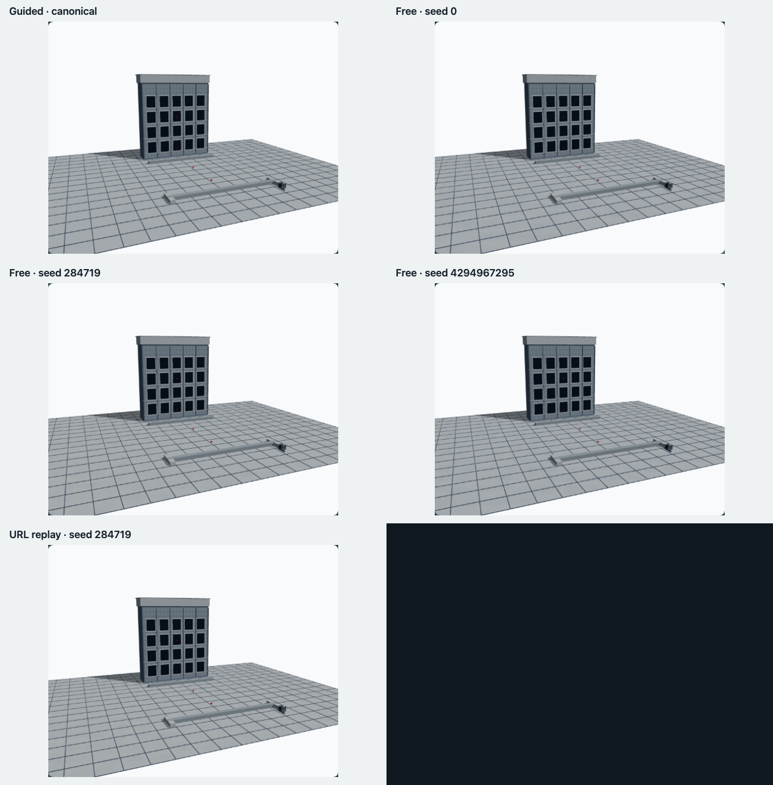
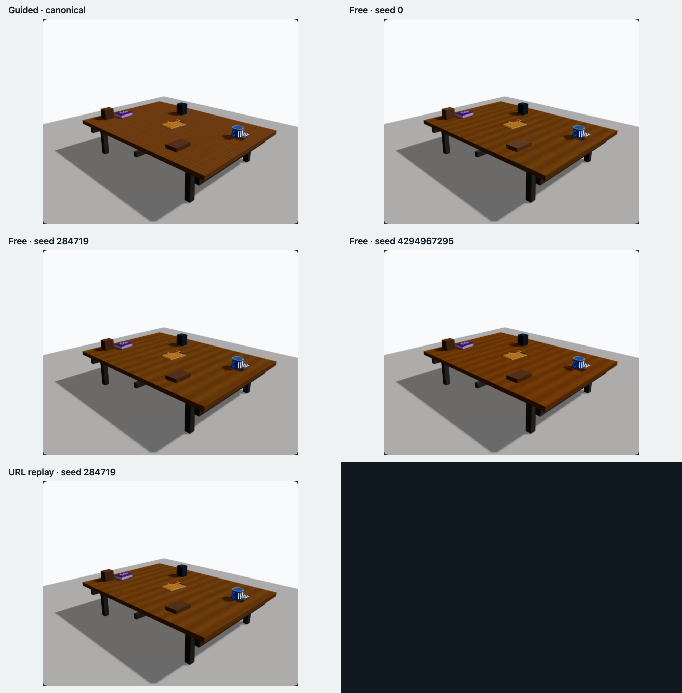
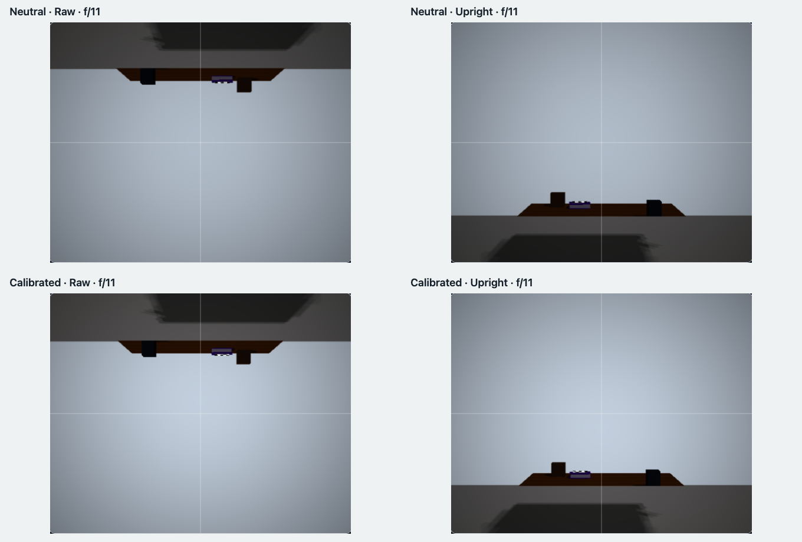
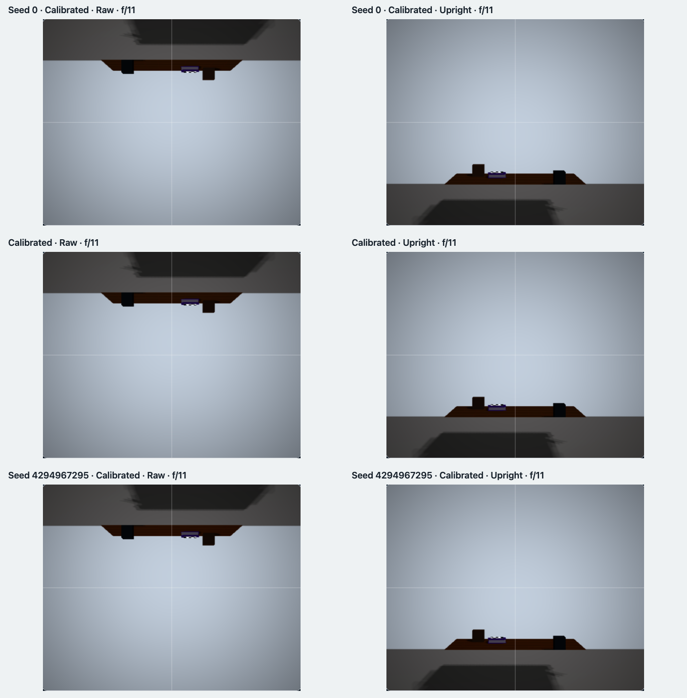

# Free Mode Seeded Materials — Wave 1

## Scope

Wave 1 adds schema-v1, seed-driven material variation to the existing **Architecture + Foreground** and **Table Tilt** scenes in Free Mode. It does not change scene geometry, object placement, lighting, camera controls, optical calibration, focus targets, or Ground Glass shaders. Architecture Rise and the unfinished Procedural Architecture Rise upgrade are out of scope.

The material work complements high-quality scene geometry; surface textures do not replace missing architectural detail or complete the separate Architecture Rise work.

## Scene and material-role inventory

| Scene | Stable role IDs | Seeded surface treatment |
| --- | --- | --- |
| Architecture + Foreground | `building-shell`, `roof-parapet`, `ground-concrete`, `forecourt-trim`, `window-frame` | Existing procedural plaster, concrete, and cut-stone patterns, each with a role seed, restrained palette choice, repeat, roughness, and normal strength. |
| Table Tilt | `tabletop-wood`, `table-frame`, `context-wood`, `context-accent` | Procedural wood maps on the tabletop and context tray; bounded palette and roughness variation on the frame and context accent. |

Each role resolves through `descriptor.createRandomStream("materials", roleId)`. Role streams are independent, so adding or resolving another role does not consume a shared sequence. Surface maps continue to come from `createProceduralSurfaceMaterial()` at its existing 128×128 resolution. There is no second generator or global texture cache.

Table Tilt reuses its seeded frame material across the table structure. Repeated architecture windows likewise share the role material and maps within each subject. Observer and Ground Glass create their own subjects and own their corresponding material and texture resources independently.

## Seed, schema, and canonical behavior

Both target scene definitions opt into `sceneVariation: { enabled: true, schemaVersion: 1 }`. Free Mode without an explicit seed keeps the existing implicit-seed workflow. A seed in the URL, such as `/simulator/free/table-tilt?seed=284719&sv=1`, replays the same role parameters and material maps; Regenerate requests another seed through the existing controls.

When no variation descriptor is supplied, both factories take their original canonical material path. Guided Mode uses that path and does not receive a seeded descriptor. The front facade's focus-friendly fine grid and the Table Tilt tabletop's original grain remain canonical. Scene definitions for Architecture Rise, Interior Corner, Shelf Swing, and Still-Life Studio retain their existing variation contracts.

Canonical subject signatures captured before the change are locked in the regression tests:

- Architecture + Foreground: `9df7d060bf087b997143dc8c21767455083f392879b79d59230a13d7be349061`
- Table Tilt: `f2a65b0dab19898cd2235a17b02c23f04f84982992b5ea909873d31de0291fdc`

The tests also hash each generated map's bytes, check repeated generation at seeds `0`, `1`, `284719`, and `4294967295`, verify distinct seeded realizations, and compare Observer and RTT material signatures. The test suite retains the existing Interior Corner and Shelf Swing contracts.

## Teaching detail preserved

Architecture + Foreground keeps its fine-grid front facade and all existing building, roof, window, ground, paving-seam, curb, and forecourt geometry. Ground focus-target coordinates, composition bounds, and Front Rise/Tilt calibration remain unchanged.

Table Tilt keeps its original Guided Mode grain. Seeded materials do not touch focus-card patterns, measurement stripes, focus probes, detail markers, panel markings, subject coordinates, tabletop inclination, or the canonical focusing solution. Focus, aperture, rise, and tilt adjustments do not recreate seeded material subjects.

## Browser qualification

Real Chromium captures use a 1440×1000 viewport, DPR 1, Standard quality, a fixed scene camera pose, and a clean Observer display. For each scene the evidence includes Guided canonical, Free seeds `0`, `284719`, and `4294967295`, same-seed URL replay, and Ground Glass Raw/Upright output at those three seeds. The browser run also checks representative Focus and Aperture settings, current-seed completed RTT frames, Raw RTT DOF bypass separately from normal Ground Glass processing, browser Back/Forward seed restoration, and ten successive Regenerate actions.

The Observer capture for seed `284719` has the same PNG SHA-256 as its same-seed URL replay in both scenes, and every report records capture hashes and subject/resource counts.

### Architecture + Foreground

### Table Tilt

The screenshots show restrained but visible material differences at ordinary Observer size. Table Tilt's cards and fine target graphics remain legible. Raw and Upright Ground Glass views show the same current seeded surfaces in their respective orientations; normal processing and the Raw DOF-bypass path remain separate.

## Resource and performance findings

Counts below are unique resources on one subject. Observer and RTT own separate subject resources. Each procedural surface role contributes three 128×128 maps to each seeded subject: color, roughness, and normal.

| Scene / mode | Objects | Meshes | Geometries | Materials | Textures | Triangles |
| --- | ---: | ---: | ---: | ---: | ---: | ---: |
| Architecture canonical Observer | 283 | 240 | 18 | 15 | 1 | 3,878 |
| Architecture seeded Observer | 283 | 240 | 18 | 15 | 16 | 3,878 |
| Architecture canonical RTT | 278 | 236 | 14 | 11 | 1 | 2,822 |
| Architecture seeded RTT | 278 | 236 | 14 | 11 | 16 | 2,822 |
| Table Tilt canonical Observer | 155 | 126 | 126 | 95 | 2 | 2,914 |
| Table Tilt seeded Observer | 155 | 126 | 126 | 91 | 6 | 2,914 |
| Table Tilt canonical RTT | 154 | 126 | 126 | 95 | 2 | 2,914 |
| Table Tilt seeded RTT | 154 | 126 | 126 | 91 | 6 | 2,914 |

Across ten Regenerate actions, per-subject counts stayed flat. Architecture stabilized at 15 renderer geometries and 27 renderer textures; Table Tilt stabilized at 106 renderer geometries and 17 renderer textures after the initial transition from the canonical subject. Subject generations changed while renderer and RTT-resource generations remained stable. Focus and movement changes also kept subject generation and texture counts stable. Disposal spies verify that subject-owned geometries, materials, and maps are disposed and that independent Observer and RTT subjects do not share GPU resources.

The available headless Chromium timing uses a CPU-fallback/software rendering path, so it is a lab observation rather than a hardware performance prediction. Captured Observer frame cadence was:

| Scene | Canonical p50 / p95 | Seeded p50 / p95 |
| --- | ---: | ---: |
| Architecture + Foreground | 166.8 / 187.7 ms | 169.1 / 184.0 ms |
| Table Tilt | 219.9 / 252.5 ms | 186.9 / 201.8 ms |

These sequential measurements are sensitive to software-renderer scheduling and are not sufficient to attribute the differences to the maps. The reports retain the raw samples and Ground Glass CPU-submit timing. No renderer-wide performance conclusion is made from these runs.

Full capture metadata and ten-action resource traces:

- [Architecture + Foreground report](evidence/free-mode-seeded-materials-wave1/architecture-foreground-report.json)
- [Table Tilt report](evidence/free-mode-seeded-materials-wave1/table-tilt-report.json)

## Known limitations

- Procedural maps provide subtle surface finish and grain; they do not add architectural geometry or detail.
- Headless CPU-fallback timings do not predict user-device frame rate.
- Seeded maps add up to 15 textures per Architecture subject and 4 per Table Tilt subject compared with the corresponding canonical subject; each renderer owns its own copies.
- The URL replay evidence is for the existing root and deployment-subpath route handling; it does not change URL normalization.

## Recommended Wave 2 candidates

Evaluate **Mirror Shift** as a small-scope candidate for restrained wall/floor finish variation, after separately protecting the mirror and reflected-subject teaching cues. **Oblique Tabletop** is another suitable candidate if its existing measurement and focus markings can be isolated from any wood treatment. Both should receive their own role inventory and canonical signatures before implementation. Architecture Rise remains excluded while its geometry work proceeds.

## Review-Fix Round 1 — Table Tilt Calibrated Ground Glass Qualification

### Why the original captures were insufficient

The original Wave 1 Ground Glass capture helper chose a generic reachable focus near the slider midpoint (approximately 4660 mm for Table Tilt), then selected f/11. It did not first apply the scene's calibrated Front Tilt. Those captures remain valid evidence of that original neutral-like test setup, but they are not calibrated Table Tilt photographs and do not establish that the tabletop material is useful through the simulated camera.

The focused rerun uses the exported `tableTiltCalibration` in `src/scenes/tableTiltGeometry.ts`. The raw calibrated values are Front Tilt 9°, focus `150 / sin²(9°)` = 6129.518728 mm, f/11, Front Rise 0 mm, and Front Swing 0°. The public Focus slider has a 10 mm step, so the helper requests 6129.518728 mm and verifies the actual reachable value is 6130 mm. Front Tilt has a 0.1° step; the actual value is 9.0°. The neutral comparison is kept distinct: 0° tilt, the existing Table Tilt scene camera-preset focus of 4600 mm, and f/11. Both states use seed 284719.

The helper verifies the active Free Mode route, scene ID and schema v1 identity, the selected Front standard / Tilt control, all relevant values, and neutral Rise and Swing. It waits for the completed current-state Ground Glass request and records the request and completion IDs, camera pose, projection, renderer generation, subject generation, and RTT resource generation. The viewport is 1440×1000 at DPR 1, Standard quality, and the Ground Glass canvas is inspected at its native 514×411 display size.

### Neutral and calibrated comparison

| State | Front Tilt | Focus requested → actual | Aperture | Result |
| --- | ---: | ---: | ---: | --- |
| Neutral | 0° | 4600 → 4600 mm (existing scene default) | f/11 | Reference Raw and Upright captures |
| Calibrated | 9° | 6129.518728 → 6130 mm (10 mm slider step) | f/11 | Raw and Upright captures |

Normal photographic output has DOF bypass disabled and normal derived-plane DOF processing enabled. Raw and Upright are orientation presentations of the current RTT image; they are not DOF modes. The separate Raw RTT diagnostic explicitly enables the raw/debug path and verifies `dofBypass=true` and `dofProcessingEnabled=false`; it is labelled as a diagnostic rather than a photographic Ground Glass result. An additional f/5.6 normal-processing capture is supporting evidence only because it has a very bright, washed-out background.

Every capture records the scene, preview orientation, seed, focus, tilt, aperture, bypass and DOF state, frame status, request/completion IDs, and renderer/subject/resource generations in the [calibrated qualification report](evidence/free-mode-seeded-materials-wave1/table-tilt-calibrated-ground-glass-report.json). Each requested frame completed with its request ID matching its completed request ID. Normal Raw/Upright frames were contentful and retained normal DOF processing. The bypass diagnostic completed independently with DOF disabled.

### Three-seed calibrated results and visibility

Seeds `0`, `284719`, and `4294967295` were each opened through their Free Mode schema-v1 URL and captured in calibrated Raw and Upright orientations at f/11. The URL identity was verified before applying the calibration. The same camera controls were reached for all three seeds, with current-seed RTT completion confirmed for every image.

At normal Ground Glass size, the tabletop appears as a narrow strip near the image edge. Its seeded wood grain and differences between seeds are not reliably inspectable. The near, middle, and far focus-detail points project inside the film, but their physical markings remain too small to read in these captures. The projection diagnostic places only two of the four tabletop top corners inside the film: the far pair is in frame while the near pair is clipped. This distinguishes target-point presence from useful subject framing and from readable detail.

The calibrated comparison does not show a meaningful framing improvement. Front Tilt changes the focus-plane orientation; it does not materially reframe the tabletop. Raw places the subject band near the top edge and Upright Assist near the bottom, as expected. The images do not establish an obvious improvement in focus-detail legibility, and the large empty portion of the photographic frame remains. Material texture visibility through Table Tilt Ground Glass is therefore **NEEDS_REVIEW**, and the existing photographic framing is **LIMITED**.

The camera pose and scene geometry were already present before this materials PR: `tableTiltGeometry.ts` is unchanged from the PR base, and the Table Tilt subject-factory changes replace material assignment while retaining the existing mesh dimensions, placements, and geometry. The scene-definition change enables the existing schema-v1 variation contract. This review-fix found no evidence that seeded materials cause the clipping or narrow tabletop coverage. Treat the framing limitation as inherited from the existing Table Tilt camera/scene composition; investigate any correction as a separate scene-framing task. No geometry, optics, material recipes, or camera controls were changed in this round.

The Focus and Tilt changes also leave the seeded material subject generation and texture counts stable: the Table Tilt Observer and RTT subjects each own 6 textures, with 17 renderer textures in the captured route. This focused run preserved the existing subject ownership and lifecycle assertions.

### Reviewer-visible evidence

The following contact sheets contain unretouched native-size Ground Glass captures. Each panel retains its original 514×411 image; the contact sheet only arranges the panels for comparison.

The report includes per-image hashes, actual controls, RTT identities, camera/projection diagnostics, projected tabletop corners and teaching-detail points, and material-resource stability. Raw full-size captures remain outside Git; only the compact contact sheets and machine-readable report were added here. The earlier Wave 1 Table Tilt images and capture history remain unchanged.

### Review-fix verdict

- **Materials implementation:** PASS. This round did not alter material recipes, generated maps, canonical outputs, or deterministic seed signatures.
- **Table Tilt Ground Glass evidence:** NEEDS_REVIEW. Correctly calibrated frames render, but they do not show enough readable tabletop surface to qualify seeded wood appearance photographically.
- **Existing scene photographic framing:** LIMITED. The near tabletop edge is clipped and the tabletop occupies only a narrow band. Since this composition predates the materials changes, any reframing needs a separate, explicitly scoped follow-up before public Ground Glass material qualification.

Validation: the calibrated Chromium Playwright qualification passed (1 test); `npm test` passed under Node 24.3.0 (345 files / 4,249 tests); `npm run typecheck`, `npm run lint`, `npm run check:css`, `npm run build`, and `git diff --check` passed. GitHub CI for the review-fix commit is reported in the updated PR handoff.
