# Free Mode Seeded Materials — Wave 1

> **Current integration status:** This report began as qualification for the original Wave 1 Architecture + Foreground building. PR #355 replaced that building with the current modular classical v2 scene. The original Architecture screenshots, signatures, and resource counts below are retained as pre-#355 history; they do not qualify the current v2 model. The final section records the current-main baseline and new v2 evidence.

## Scope

Wave 1 adds schema-v1, seed-driven material variation to **Architecture + Foreground** and **Table Tilt** in Free Mode. The final integration adopts the current-main Architecture + Foreground v2 geometry and adds variation to its existing materials; it does not change that geometry, object placement, lighting, camera controls, optical calibration, focus targets, or Ground Glass shaders. Architecture Rise and its separate materials work are outside the seeded-material port described here.

The material work complements high-quality scene geometry; surface textures do not replace missing architectural detail or complete the separate Architecture Rise work.

## Scene and material-role inventory

| Scene | Stable role IDs | Seeded surface treatment |
| --- | --- | --- |
| Architecture + Foreground v2 | `scene-style`, `plaster`, `rusticated-limestone`, `limestone-trim`, `limestone-cap`, `mullion`, `roof-slate`, `paving`, `curb`, `returns` | Coherent family palettes for existing plaster, limestone, roof, paving, and stone finishes. The current v2 geometry has no separate Wave 1 fine-grid facade mesh. |
| Table Tilt | `tabletop-wood`, `table-frame`, `context-wood`, `context-accent` | Procedural wood maps on the tabletop and context tray; bounded palette and roughness variation on the frame and context accent. |

The scene style resolves through `descriptor.createRandomStream("materials", "scene-style")`; each role continues through its own `descriptor.createRandomStream("materials", roleId)`. Role streams are independent, so adding or resolving another role does not consume a shared sequence. Surface maps continue to come from `createProceduralSurfaceMaterial()` at its existing 128×128 resolution. There is no second generator or global texture cache.

Table Tilt reuses its seeded frame material across the table structure. Repeated architecture windows likewise share the role material and maps within each subject. Observer and Ground Glass create their own subjects and own their corresponding material and texture resources independently.

## Seed, schema, and canonical behavior

Both target scene definitions opt into `sceneVariation: { enabled: true, schemaVersion: 1 }`. Free Mode without an explicit seed keeps the existing implicit-seed workflow. A seed in the URL, such as `/simulator/free/table-tilt?seed=284719&sv=1`, replays the same role parameters and material maps; Regenerate requests another seed through the existing controls.

When no variation descriptor is supplied, both factories take their canonical material path. Guided Mode uses that path and does not receive a seeded descriptor. Architecture + Foreground's current-main v2 materials and the Table Tilt tabletop's original grain remain canonical. The fine-grid facade mentioned in the earlier Wave 1 review was part of the superseded pre-#355 building and is preserved only as historical context below. Scene definitions for Architecture Rise, Interior Corner, Shelf Swing, and Still-Life Studio retain their existing variation contracts.

Original Wave 1 canonical subject signatures (the Architecture value is pre-#355 and historical) were:

- Architecture + Foreground: `9df7d060bf087b997143dc8c21767455083f392879b79d59230a13d7be349061`
- Table Tilt: `f2a65b0dab19898cd2235a17b02c23f04f84982992b5ea909873d31de0291fdc`

The tests also hash each generated map's bytes, check repeated generation at seeds `0`, `1`, `284719`, and `4294967295`, verify distinct seeded realizations, and compare Observer and RTT material signatures. The test suite retains the existing Interior Corner and Shelf Swing contracts.

## Teaching detail preserved

The original Wave 1 Architecture + Foreground checks protected the then-current fine-grid facade and scene geometry. After #355, the accepted detail contract is the current v2 plaster, limestone, trim, window, cornice, roof, and custom paving system documented in the final integration section. The seeded-material integration preserves current-main geometry and material structure. Ground focus-target coordinates, composition bounds, and Front Rise/Tilt calibration remain unchanged.

Table Tilt keeps its original Guided Mode grain. Seeded materials do not touch focus-card patterns, measurement stripes, focus probes, detail markers, panel markings, subject coordinates, tabletop inclination, or the canonical focusing solution. Focus, aperture, rise, and tilt adjustments do not recreate seeded material subjects.

## Browser qualification

Real Chromium captures use a 1440×1000 viewport, DPR 1, Standard quality, a fixed scene camera pose, and a clean Observer display. For each scene the evidence includes Guided canonical, Free seeds `0`, `284719`, and `4294967295`, same-seed URL replay, and Ground Glass Raw/Upright output at those three seeds. The browser run also checks representative Focus and Aperture settings, current-seed completed RTT frames, Raw RTT DOF bypass separately from normal Ground Glass processing, browser Back/Forward seed restoration, and ten successive Regenerate actions.

The Observer capture for seed `284719` has the same PNG SHA-256 as its same-seed URL replay in both scenes, and every report records capture hashes and subject/resource counts.

### Architecture + Foreground — original pre-#355 evidence

The following captures show the superseded simple building from the original Wave 1 branch. They remain in the repository as historical evidence and are not the visual qualification for Architecture + Foreground v2.

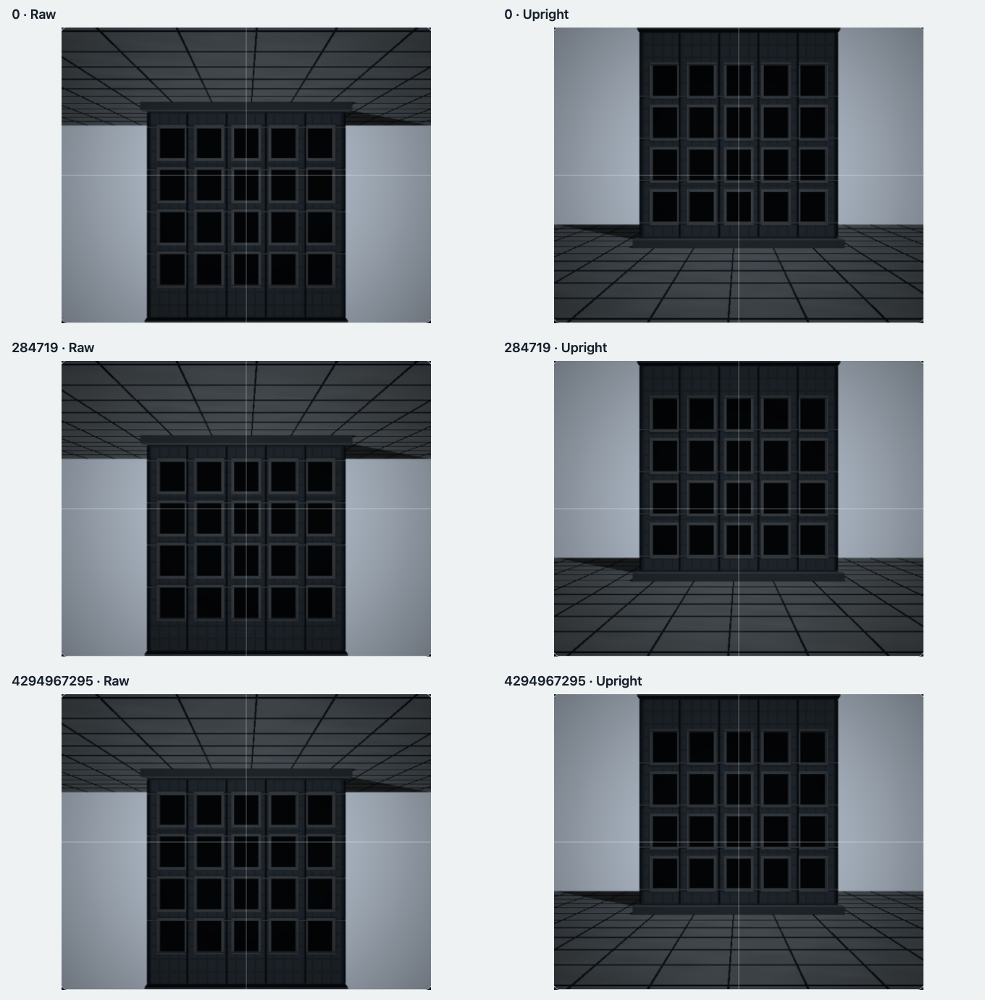

### Table Tilt

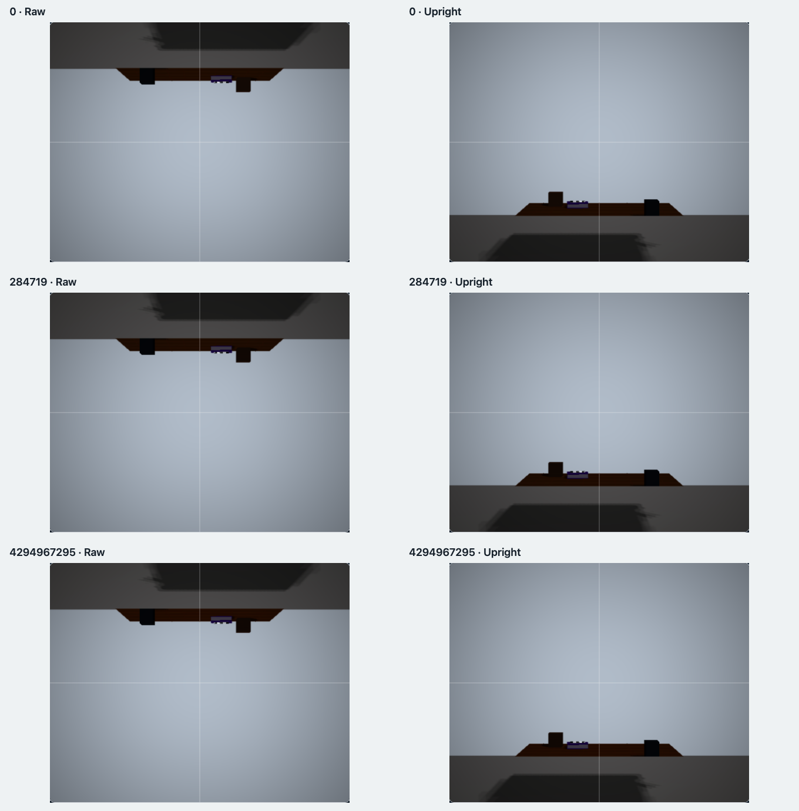

The screenshots show restrained but visible material differences at ordinary Observer size. Table Tilt's cards and fine target graphics remain legible. Raw and Upright Ground Glass views show the same current seeded surfaces in their respective orientations; normal processing and the Raw DOF-bypass path remain separate.

## Resource and performance findings

The Architecture counts below describe the superseded pre-#355 building and are retained as history, not as the current v2 baseline. Table Tilt remains the previously qualified scene. Counts are unique resources on one subject; Observer and RTT own separate subjects. Procedural surfaces use color, roughness, and normal maps at the existing resolution.

| Scene / mode | Objects | Meshes | Geometries | Materials | Textures | Triangles |
| --- | ---: | ---: | ---: | ---: | ---: | ---: |
| Architecture canonical Observer | 283 | 240 | 18 | 15 | 1 | 3,878 |
| Architecture seeded Observer | 283 | 240 | 18 | 15 | 16 | 3,878 |
| Architecture canonical RTT | 278 | 236 | 14 | 11 | 1 | 2,822 |
| Architecture seeded RTT | 278 | 236 | 14 | 11 | 16 | 2,822 |
| Table Tilt canonical Observer | 155 | 126 | 126 | 95 | 2 | 2,914 |
| Table Tilt seeded Observer | 155 | 126 | 126 | 91 | 6 | 2,914 |
| Table Tilt canonical RTT | 154 | 126 | 126 | 95 | 2 | 2,914 |
| Table Tilt seeded RTT | 154 | 126 | 126 | 91 | 6 | 2,914 |

Across ten Regenerate actions, per-subject counts stayed flat. Architecture stabilized at 15 renderer geometries and 27 renderer textures; Table Tilt stabilized at 106 renderer geometries and 17 renderer textures after the initial transition from the canonical subject. Subject generations changed while renderer and RTT-resource generations remained stable. Focus and movement changes also kept subject generation and texture counts stable. Disposal spies verify that subject-owned geometries, materials, and maps are disposed and that independent Observer and RTT subjects do not share GPU resources.

The available headless Chromium timing uses a CPU-fallback/software rendering path, so it is a lab observation rather than a hardware performance prediction. Captured Observer frame cadence was:

| Scene | Canonical p50 / p95 | Seeded p50 / p95 |
| --- | ---: | ---: |
| Architecture + Foreground | 166.8 / 187.7 ms | 169.1 / 184.0 ms |
| Table Tilt | 219.9 / 252.5 ms | 186.9 / 201.8 ms |

These sequential measurements are sensitive to software-renderer scheduling and are not sufficient to attribute the differences to the maps. The reports retain the raw samples and Ground Glass CPU-submit timing. No renderer-wide performance conclusion is made from these runs.

Full capture metadata and ten-action resource traces:

- [Architecture + Foreground report](evidence/free-mode-seeded-materials-wave1/architecture-foreground-report.json)
- [Table Tilt report](evidence/free-mode-seeded-materials-wave1/table-tilt-report.json)

## Known limitations from the original Wave 1 qualification

- Procedural maps provide subtle surface finish and grain; they do not add architectural geometry or detail.
- Headless CPU-fallback timings do not predict user-device frame rate.
- The original simple-building resource estimate predates #355. Current Architecture + Foreground v2 resource counts are reported separately in the final integration section.
- Seeded Table Tilt maps add four textures per subject compared with its canonical subject; each renderer owns its own copies.
- The URL replay evidence is for the existing root and deployment-subpath route handling; it does not change URL normalization.

## Recommended Wave 2 candidates

Evaluate **Mirror Shift** as a small-scope candidate for restrained wall/floor finish variation, after separately protecting the mirror and reflected-subject teaching cues. **Oblique Tabletop** is another suitable candidate if its existing measurement and focus markings can be isolated from any wood treatment. Both should receive their own role inventory and canonical signatures before implementation. Architecture Rise remains excluded while its geometry work proceeds.

## Review-Fix Round 1 — Table Tilt Calibrated Ground Glass Qualification

### Why the original captures were insufficient

The original Wave 1 Ground Glass capture helper chose a generic reachable focus near the slider midpoint (approximately 4660 mm for Table Tilt), then selected f/11. It did not first apply the scene's calibrated Front Tilt. Those captures remain valid evidence of that original neutral-like test setup, but they are not calibrated Table Tilt photographs and do not establish that the tabletop material is useful through the simulated camera.

The focused rerun uses the exported `tableTiltCalibration` in `src/scenes/tableTiltGeometry.ts`. The raw calibrated values are Front Tilt 9°, focus `150 / sin²(9°)` = 6129.518728 mm, f/11, Front Rise 0 mm, and Front Swing 0°. The public Focus slider has a 10 mm step, so the helper requests 6129.518728 mm and verifies the actual reachable value is 6130 mm. Front Tilt has a 0.1° step; the actual value is 9.0°. The neutral comparison is kept distinct: 0° tilt, the existing Table Tilt scene camera-preset focus of 4600 mm, and f/11. Both states use seed 284719.

The helper verifies the active Free Mode route, scene ID and schema v1 identity, the selected Front standard / Tilt control, all relevant values, and neutral Rise and Swing. It waits for the completed current-state Ground Glass request and records the request and completion IDs, camera pose, projection, renderer generation, subject generation, and RTT resource generation. The viewport is 1440×1000 at DPR 1, Standard quality, and the Ground Glass canvas is inspected at its native 514×411 display size.

### Neutral and calibrated comparison

| State | Front Tilt | Focus requested → actual | Aperture | Result |
| --- | ---: | ---: | ---: | --- |
| Neutral | 0° | 4600 → 4600 mm (existing scene default) | f/11 | Reference Raw and Upright captures |
| Calibrated | 9° | 6129.518728 → 6130 mm (10 mm slider step) | f/11 | Raw and Upright captures |

Normal photographic output has DOF bypass disabled and normal derived-plane DOF processing enabled. Raw and Upright are orientation presentations of the current RTT image; they are not DOF modes. The separate Raw RTT diagnostic explicitly enables the raw/debug path and verifies `dofBypass=true` and `dofProcessingEnabled=false`; it is labelled as a diagnostic rather than a photographic Ground Glass result. An additional f/5.6 normal-processing capture is supporting evidence only because it has a very bright, washed-out background.

Every capture records the scene, preview orientation, seed, focus, tilt, aperture, bypass and DOF state, frame status, request/completion IDs, and renderer/subject/resource generations in the [calibrated qualification report](evidence/free-mode-seeded-materials-wave1/table-tilt-calibrated-ground-glass-report.json). Each requested frame completed with its request ID matching its completed request ID. Normal Raw/Upright frames were contentful and retained normal DOF processing. The bypass diagnostic completed independently with DOF disabled.

### Three-seed calibrated results and visibility

Seeds `0`, `284719`, and `4294967295` were each opened through their Free Mode schema-v1 URL and captured in calibrated Raw and Upright orientations at f/11. The URL identity was verified before applying the calibration. The same camera controls were reached for all three seeds, with current-seed RTT completion confirmed for every image.

At normal Ground Glass size, the tabletop appears as a narrow strip near the image edge. Its seeded wood grain and differences between seeds are not reliably inspectable. The near, middle, and far focus-detail points project inside the film, but their physical markings remain too small to read in these captures. The projection diagnostic places only two of the four tabletop top corners inside the film: the far pair is in frame while the near pair is clipped. This distinguishes target-point presence from useful subject framing and from readable detail.

The calibrated comparison does not show a meaningful framing improvement. Front Tilt changes the focus-plane orientation; it does not materially reframe the tabletop. Raw places the subject band near the top edge and Upright Assist near the bottom, as expected. The images do not establish an obvious improvement in focus-detail legibility, and the large empty portion of the photographic frame remains. Material texture visibility through Table Tilt Ground Glass is therefore **NEEDS_REVIEW**, and the existing photographic framing is **LIMITED**.

The camera pose and scene geometry were already present before this materials PR: `tableTiltGeometry.ts` is unchanged from the PR base, and the Table Tilt subject-factory changes replace material assignment while retaining the existing mesh dimensions, placements, and geometry. The scene-definition change enables the existing schema-v1 variation contract. This review-fix found no evidence that seeded materials cause the clipping or narrow tabletop coverage. Treat the framing limitation as inherited from the existing Table Tilt camera/scene composition; investigate any correction as a separate scene-framing task. No geometry, optics, material recipes, or camera controls were changed in this round.

The Focus and Tilt changes also leave the seeded material subject generation and texture counts stable: the Table Tilt Observer and RTT subjects each own 6 textures, with 17 renderer textures in the captured route. This focused run preserved the existing subject ownership and lifecycle assertions.

### Reviewer-visible evidence

The following contact sheets contain unretouched native-size Ground Glass captures. Each panel retains its original 514×411 image; the contact sheet only arranges the panels for comparison.

The report includes per-image hashes, actual controls, RTT identities, camera/projection diagnostics, projected tabletop corners and teaching-detail points, and material-resource stability. Raw full-size captures remain outside Git; only the compact contact sheets and machine-readable report were added here. The earlier Wave 1 Table Tilt images and capture history remain unchanged.

### Review-fix verdict

- **Materials implementation:** PASS. This round did not alter material recipes, generated maps, canonical outputs, or deterministic seed signatures.
- **Table Tilt Ground Glass evidence:** NEEDS_REVIEW. Correctly calibrated frames render, but they do not show enough readable tabletop surface to qualify seeded wood appearance photographically.
- **Existing scene photographic framing:** LIMITED. The near tabletop edge is clipped and the tabletop occupies only a narrow band. Since this composition predates the materials changes, any reframing needs a separate, explicitly scoped follow-up before public Ground Glass material qualification.

Validation: the calibrated Chromium Playwright qualification passed (1 test); `npm test` passed under Node 24.3.0 (345 files / 4,249 tests); `npm run typecheck`, `npm run lint`, `npm run check:css`, `npm run build`, and `git diff --check` passed. GitHub CI for the review-fix commit is reported in the updated PR handoff.

## Review-Fix Round 2 — Material Appearance Families

### Manual-review finding and correction

The Round 1 resolver produced different role seeds and texture bytes, but ordinary Observer captures remained visually alike. Architecture's role palettes stayed within similar blue-grey colors, and its large front facade kept the same fixed colors for every Free Mode seed. Table Tilt used similarly close brown colors while retaining the shared wood generator's fixed broad grain wave. This was a perceptual-design limitation, not a determinism failure.

Round 2 adds a deterministic `materials/scene-style` choice, then resolves every surface through its existing independent semantic role stream. The style draw is separate from role streams, does not alter PRNG derivation, and does not introduce a new variation domain. Architecture and Table Tilt each own their small family catalog; no general material-style engine was added.

### Appearance families and role coordination

| Scene | Family | Coordinated appearance |
| --- | --- | --- |
| Architecture + Foreground | `cool-contemporary` | Cool blue-grey plaster, pale concrete roof, neutral paving and light frames. |
| Architecture + Foreground | `warm-stone` | Warm mineral plaster, light warm-stone roof, neutral paving and muted bronze-grey frames. |
| Architecture + Foreground | `dark-contemporary` | Medium charcoal plaster, lighter concrete boundary and contrasting frames. |
| Architecture + Foreground | `light-mineral` | Pale mineral plaster, pale roof, moderately darker paving and silver-grey frames. |
| Table Tilt | `light-oak-like` | Pale natural timber tone, matte roughness and restrained grain. |
| Table Tilt | `medium-teak-like` | Medium warm-brown tabletop and coordinated context wood. |
| Table Tilt | `dark-walnut-like` | Rich dark-brown tabletop and darker supporting wood tones. |

The family names describe stylized visual finishes, not botanical or measured material claims. Role streams still select small within-family color choices and bounded repeat, roughness, and normal-strength values. Window/glass materials, focus graphics, subject markers, geometry, object locations, and lighting remain fixed; the listed Table Tilt context accent is one of its seeded finish roles.

Architecture's Free Mode facade now receives the selected family's two focus-grid colors. It continues to use the existing `fine-grid` pattern, 64×64 teaching texture, 5×4 repeat, 0.88 roughness, original line mask and positions. Regression tests compare the seeded and canonical grid masks and require a minimum luminance separation between the two colors. Guided Mode and no-descriptor factory calls still use the original exact facade colors.

Table Tilt uses the existing `wood` procedural pattern. Round 2 did not change `ProceduralSurfaceMaterials.ts`, texture resolution, generator equations, or any default wood output. Color, repeat, roughness and normal-strength recipes alone make the light, medium and dark families recognizable at normal Observer size. No optional grain profile was needed.

### Frozen sample and family coverage

The twelve-seed set was frozen before inspecting the family appearances: `0`, `1`, `284719`, `4294967295`, `17`, `2024`, `8675309`, `123456789`, `987654321`, `2718281828`, `3141592653`, and `4000000000`.

| Scene / family | Seeds represented in the frozen sample |
| --- | --- |
| Architecture — warm stone | `0`, `8675309`, `987654321`, `3141592653` |
| Architecture — light mineral | `1`, `4294967295`, `17`, `2718281828` |
| Architecture — dark contemporary | `284719`, `2024`, `123456789`, `4000000000` |
| Table Tilt — medium teak-like | `0`, `17`, `123456789`, `2718281828` |
| Table Tilt — dark walnut-like | `1`, `8675309`, `3141592653` |
| Table Tilt — light oak-like | `284719`, `4294967295`, `2024`, `987654321`, `4000000000` |

The frozen Architecture sample represents three of its four families. To qualify the remaining `cool-contemporary` candidate without changing or cherry-picking the frozen sample, a separate browser diagnostic used the first seed in the deterministic scan `[0, 1023]` that resolved to that family: seed `14`. It rendered at the same normal Observer size and pose. This candidate check is not counted in the twelve-seed coverage table.

### Matched Chromium visual comparison

The before captures are from the reviewed PR head `dd960ae10765c0b4d5bf7446aa07ca81beb330f9`, before the family implementation. Before and after use genuine Chromium application canvases, a 1440×1000 viewport, DPR 1, Standard quality, the public **Reset 3D view** action, disabled teaching overlays, and the same scene pose, focus, aperture, movement values, renderer backend and native 514×410 Observer crop. The reports retain the actual camera position and target. Each Free route verifies its seed and schema-v1 URL identity, waits for a completed current-seed RTT frame, and records its request/completion identity. Seed `284719` URL replay reproduces the exact Observer PNG hash in both target scenes.

**Architecture + Foreground — canonical and required-seed comparison before the family correction**

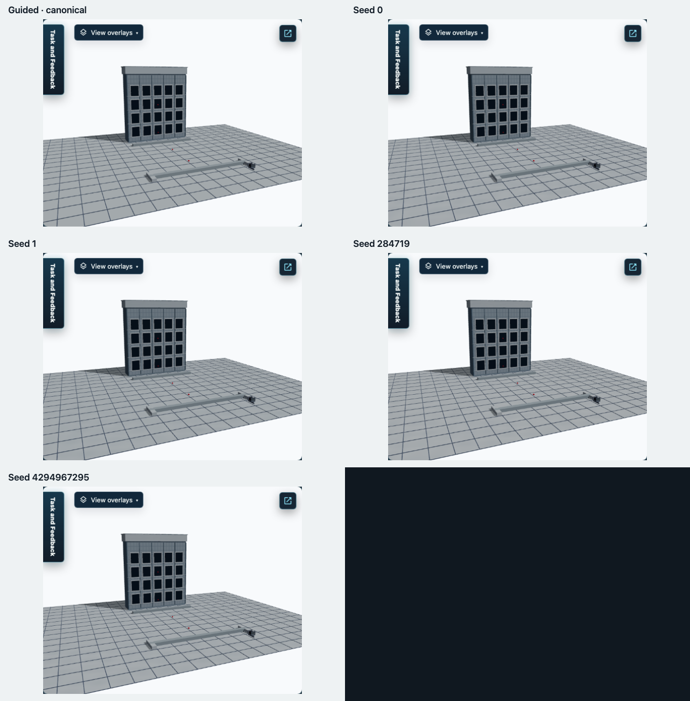

**Architecture + Foreground — the same canonical view and required seeds after the family correction**

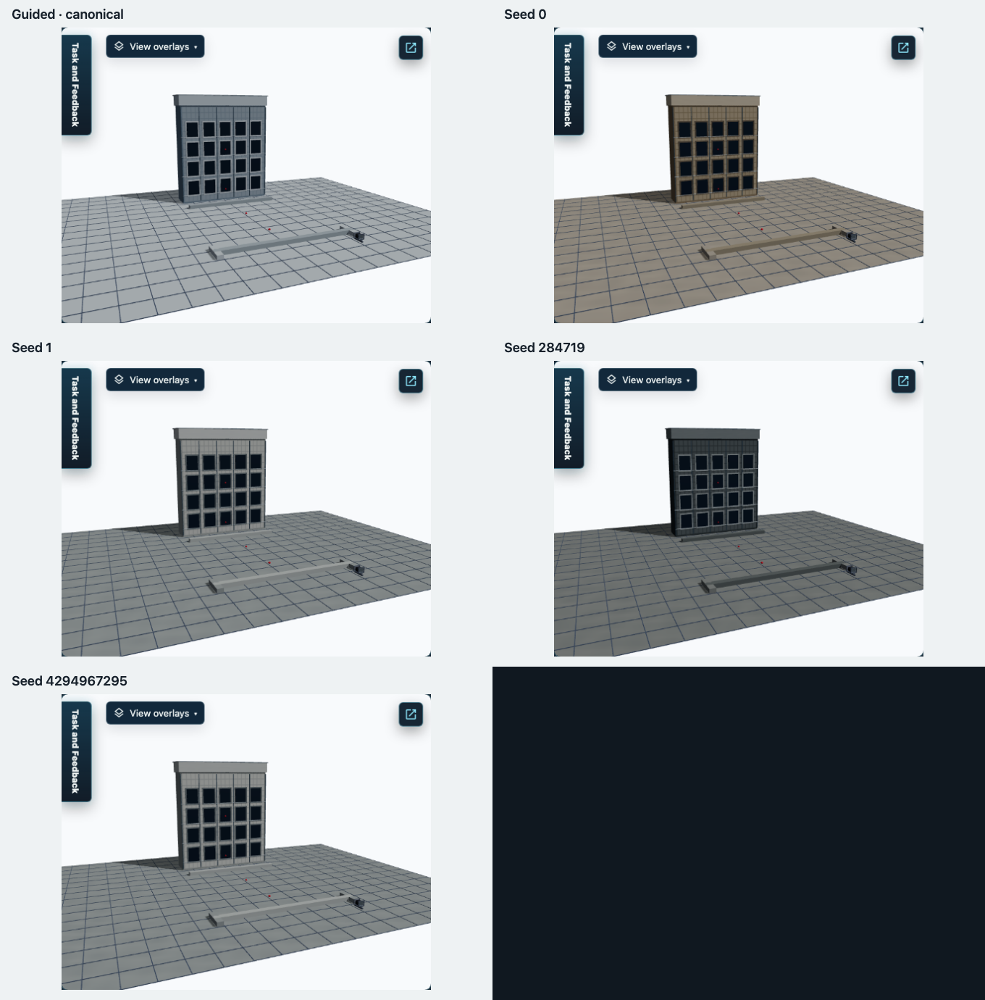

**Architecture + Foreground — frozen twelve-seed grid after the family correction**

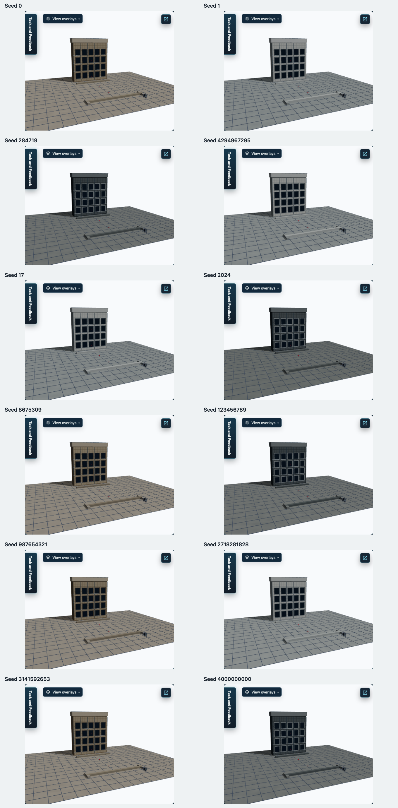

The three sampled Architecture families remain coherent and visibly distinct in the native-size comparison. The building outline, dark windows, frames, parapet and paving seams remain legible. The facade grid is still visible at ordinary Observer size; the separately captured cool-contemporary candidate is also shown at native resolution:

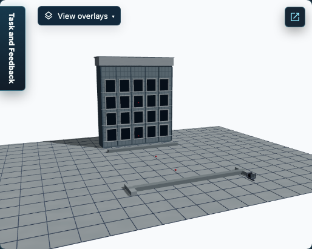

**Table Tilt — canonical and required-seed comparison before the family correction**

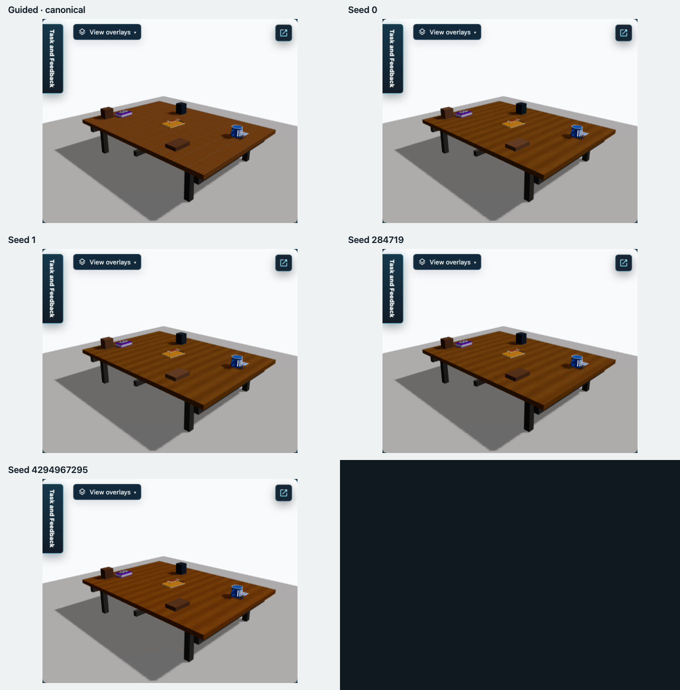

**Table Tilt — the same canonical view and required seeds after the family correction**

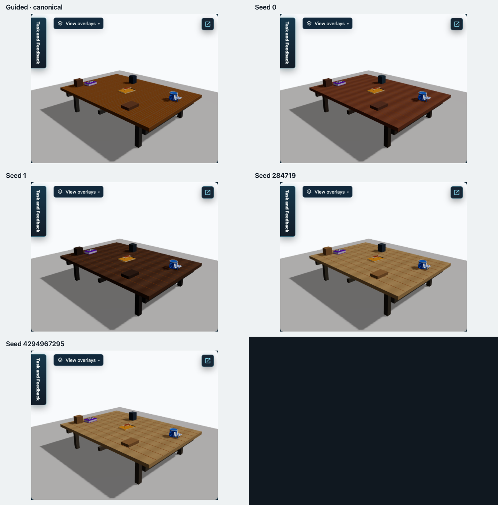

**Table Tilt — frozen twelve-seed grid after the family correction**

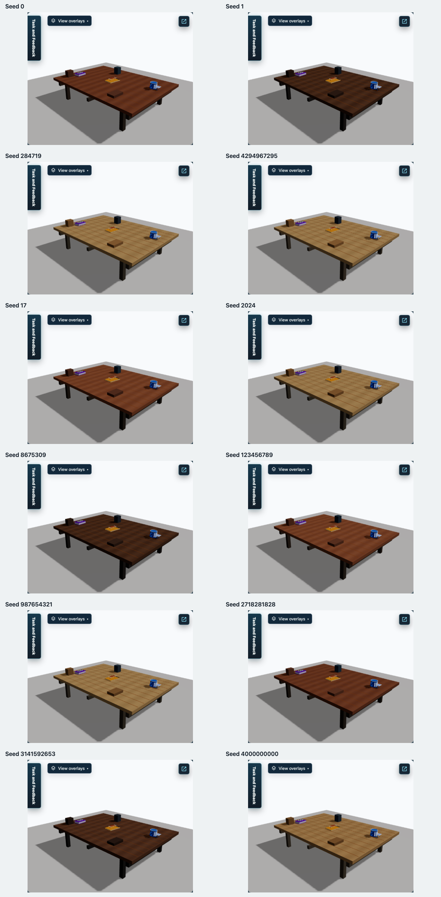

At native size, the three wood families are easy to distinguish by tone while retaining visible grain and the same tabletop inclination. The screenshots show no moiré, clipping change, or loss of the focus cards, measurement stripes, cup details, or other teaching marks. The repeated grain remains stylized and regular, consistent with the unchanged generator; it does not obscure the calibrated teaching subjects in these Observer captures.

The **before** and **after** comparison sheets each contain Guided canonical plus seeds `0`, `1`, `284719`, and `4294967295`. The separate after grids contain all twelve frozen seeds. The cool-family diagnostic remains separate. Each panel uses the original native-size capture; the sheets only arrange panels and add labels. Raw captures and JSON reports remain in `/private/tmp/vcs-wave1-r2-*`; only the compact comparison sheets, the two multi-seed grids, and the one 514×410 candidate check are committed.

### Seeded map signatures and compatibility

Schema v1 remains the contract because this PR is not merged. Seeded outputs intentionally changed for Architecture + Foreground and Table Tilt. New combined SHA-256 signatures below cover the generated role-map bytes for each reference seed; the unchanged canonical subject signatures remain the authoritative no-descriptor hashes recorded earlier.

| Scene | Seed | Family | Combined role-map SHA-256 |
| --- | ---: | --- | --- |
| Architecture + Foreground | `0` | warm stone | `ee85f214380bf156fb4a0ec0db24b53df60b617ca59e28dd9edc0047574ec766` |
| Architecture + Foreground | `1` | light mineral | `0bdfadb9247b6cbf4d6fdd5686ebb70aa6ef53111fd06e27a8a06423799470b7` |
| Architecture + Foreground | `284719` | dark contemporary | `21b76e349cd111557e688783f8d376059537acfb0c4710b42a7cbb16cffbd0fb` |
| Architecture + Foreground | `4294967295` | light mineral | `3d64e0591b746301bf010301fd130cf52c62adc55d9ae16cbb54606d401d8744` |
| Table Tilt | `0` | medium teak-like | `e58e7a31f680a698538cf958bc9f4943db7f8407c343cee5bf745dbf945ae4d4` |
| Table Tilt | `1` | dark walnut-like | `d3cfc73cd1a48c1af0d4d86f49df0cee78f8eb0db0e5bd5a255f57a511723bd2` |
| Table Tilt | `284719` | light oak-like | `be906a80e99b36a0afb0d01a5e6ba14375c7e32b4605b687912b448153fa4614` |
| Table Tilt | `4294967295` | light oak-like | `5a5dc87e5af354e1adb985890cfddfd5290ed9462aac6b06d1bd75150e7390f9` |

The existing canonical subject hashes are unchanged, and all stored default `ProceduralSurfaceMaterials` map hashes remain unchanged because the shared generator was not edited. Table Tilt geometry/focus-target tests and Architecture geometry/focus/composition-target tests remain unchanged across the frozen sample. Existing Interior Corner v1/v2, Shelf Swing v1/v2, Still-Life Studio v1, URL behavior, and PRNG derivation are untouched.

### Ground Glass, resources, and performance

The visual-family capture recorded contentful, completed current-seed RTT frames for all twelve seeds in both scenes. A completed request ID matched its completed request ID, and the RTT scene identity matched the Free Mode route. The existing Round 1 Raw/Upright and normal-DOF/bypass tests remain the orientation and optics regression evidence; Round 2 does not change Ground Glass processing or the inherited Table Tilt framing.

Material construction still creates the same materials and maps per role. Architecture adds no map: its existing seeded front-facade fine-grid map now carries the family colors. Table Tilt continues to create the same three 128×128 maps for each of its two wood roles. Observer and RTT resolve the same role parameters and map bytes while independently owning their subject resources. The existing ten-Regenerate lifecycle test checks that subject replacement disposes old resources while renderer and Ground Glass target generations stay stable; focus, aperture and movement controls do not rebuild materials.

No geometry, mesh count, triangle count, material count, map count, or texture resolution changed from the accepted Wave 1 implementation. No per-frame map generation or shared texture cache was added. The render route remains on the existing WebGL2 backend. Software-rendered Chromium timing is reported only as local test behavior and is not presented as a hardware GPU benchmark.

### Round 2 qualification

- **Materials implementation:** PASS. Recognizable material families are deterministic, role streams remain independent, canonical signatures remain exact, and the original shared map contracts pass.
- **Visual qualification:** IMPROVED. The required seed comparison makes the Architecture finish families and light/medium/dark Table Tilt families perceptibly distinct at normal Observer size, with focus details readable.
- **Manual acceptance:** PENDING_USER_REVIEW. The reviewer-visible screenshots are published for the user's independent final assessment.

Table Tilt's previously documented Ground Glass framing limitation remains **LIMITED** and is not corrected or obscured by this materials-only round. The Ground Glass evidence is regression evidence; the new material-appearance qualification is based on the normal Observer photographs where the relevant surfaces are visible.

Validation for this round: `npm test` passed (345 files / 4,251 tests); typecheck, lint, CSS check, build, and `git diff --check` passed. The focused role/map unit tests passed; the matched twelve-seed family capture suite passed (2/2), the separate cool-family candidate capture passed, and the complete Wave 1 seeded-material browser suite passed (4/4), including calibrated Ground Glass, ten regenerations per scene, and movement-control stability. Root and `/view-camera-simulator/` production-base URL checks passed. The final PR #350 CI result is recorded in the PR handoff.

## Final Integration — Architecture + Foreground v2

### Main integration and source authority

PR #350's reviewed head was `57480375ff4b64368639213853d5e14eb8cf65e2`, based on `62eb670dae6ccaed83beff681b3e9dfac8c22b46`. The first merge integrated `origin/main` at `2fca13103504b6c714979ccfcd853516df0e2ab3`, including PR #355's modular classical Architecture + Foreground v2. During this review-fix, main advanced again through PR #356; `658487f468d14d6129f4ac7091ebd71c32afd5ed` was fetched and merged before final validation.

The conflicts in `playwright.scene-variation.production.config.ts`, `playwright.scene-variation.subpath-production.config.ts`, and `src/render/ArchitectureForegroundSubjectFactory.tsx` were resolved against their current-main behavior. The current modular factory remains authoritative: it builds the v2 elevations, roofline, and forecourt structures, then receives optional role variations through the existing material helpers. `SceneAssetSubjects` and the registered RTT adapter pass the same descriptor to independently owned Observer and Ground Glass subjects. The generalized current-main `publicScenes.test.ts` coverage remains intact. The production publication config matches current main and is unchanged in the final PR diff.

No Architecture + Foreground geometry source, Architecture Rise or Oblique Architecture implementation, camera controls, focus/composition coordinates, lighting, or optics changed relative to current main. The existing simple-building and fine-grid screenshots above remain historical pre-#355 evidence; the v2 screenshots below qualify the current classical building.

### V2 material roles and families

The resolver keeps schema v1, the existing `materials` PRNG domain, and the independent `scene-style` selection. Stable v2 material role IDs map to physical surfaces:

| Role ID | Current v2 surface | Seeded properties |
| --- | --- | --- |
| `plaster` | Main plaster surfaces | Existing plaster realization; family color, fixed repeat `[1, 1]`, bounded roughness `0.89–0.93`, normal strength `0.13–0.18`. |
| `rusticated-limestone` | Rusticated limestone blocks | Existing limestone realization; family color, repeat `[1.12, 2.1]`, bounded roughness `0.89–0.93`, normal strength `0.22–0.27`. |
| `limestone-trim` | Window surrounds and trim | Coordinated limestone color and roughness `0.82–0.88`. |
| `limestone-cap` | Caps and edge stones | Coordinated stone color and roughness `0.80–0.88`. |
| `mullion` | Window mullions | Family-compatible color and roughness `0.76–0.84`. |
| `roof-slate` | Existing roof finish | Restrained slate color and roughness `0.90–0.97`. |
| `paving` | Existing jointed paving | Family color and roughness `0.975–0.995`; the texture's joint network is unchanged. |
| `curb` / `returns` | Existing curb and return stones | Coordinated stone colors and roughness `0.82–0.90`. |

The four coordinated families remain `cool-contemporary`, `warm-stone`, `dark-contemporary`, and `light-mineral`. Reference seeds resolve to: `0` warm stone, `1` light mineral, `284719` dark contemporary, and `4294967295` light mineral. The frozen twelve-seed sample covers warm stone, light mineral, and dark contemporary; a separate deterministic candidate capture at seed `14` covers cool contemporary. Each role still uses its own stable substream, and the shared `createProceduralSurfaceMaterial()` remains the sole procedural map generator.

### Canonical, seeded, and geometry contracts

The current-main no-descriptor Architecture + Foreground subject signature is `57f9feb2d4e3a194d30bc35c526a7409b63994160dcea180e228aedfc5912e68`; the original pre-#355 Wave 1 signature `9df7d060bf087b997143dc8c21767455083f392879b79d59230a13d7be349061` is historical and changed because the current canonical v2 building and surfaces replaced the old subject. Table Tilt's canonical signature remains `f2a65b0dab19898cd2235a17b02c23f04f84982992b5ea909873d31de0291fdc`.

The v2 Architecture seeded material map signatures intentionally use the new physical roles. The current tests pin these values for the four reference seeds:

| Seed | Family | Combined seeded role-map SHA-256 |
| ---: | --- | --- |
| `0` | warm stone | `ef25db0b656897e27ad5895a60bb40b0a83b99787f58a63a7aa73e46b5545a5c` |
| `1` | light mineral | `867459ad05bff7cb84780eb640723baf3f50be0dd18b636b3f5eb23c6386deeb` |
| `284719` | dark contemporary | `96297aced6689cfc1bd4e29f728d987ddaaeba796af5faa3c274eabd411cfde6` |
| `4294967295` | light mineral | `ce734dd2a7c856678a7e6783bfc0fb84ee084973569b4c6f73a83f651c7793b1` |

Table Tilt's accepted seeded signatures remain unchanged: `0` → `e58e7a31f680a698538cf958bc9f4943db7f8407c343cee5bf745dbf945ae4d4`, `1` → `d3cfc73cd1a48c1af0d4d86f49df0cee78f8eb0db0e5bd5a255f57a511723bd2`, `284719` → `be906a80e99b36a0afb0d01a5e6ba14375c7e32b4605b687912b448153fa4614`, and `4294967295` → `5a5dc87e5af354e1adb985890cfddfd5290ed9462aac6b06d1bd75150e7390f9`.

Canonical Guided/no-descriptor output is protected against current main. Seeded and canonical v2 subjects retain equal geometry signatures; the current Architecture + Foreground focus targets and composition bounds match their scene geometry contracts. Paving variation changes only the compatible material color and roughness: the 256×256 DataTexture bytes, slab joints, repeat, and V offset match canonical output for the reference seeds. `ProceduralSurfaceMaterials` and its canonical map hashes were not changed.

### Current-main browser evidence

The new post-#356 captures use genuine Chromium at 1440×1000, DPR 1, Standard quality, fixed Observer pose, and disabled teaching overlays. Observer panels retain their native 514×410 size; Ground Glass panels retain native 514×411 output.

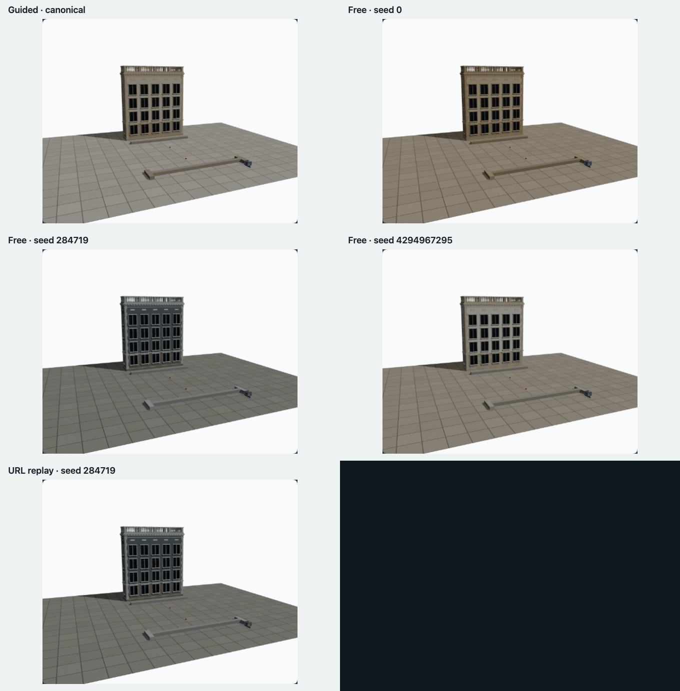

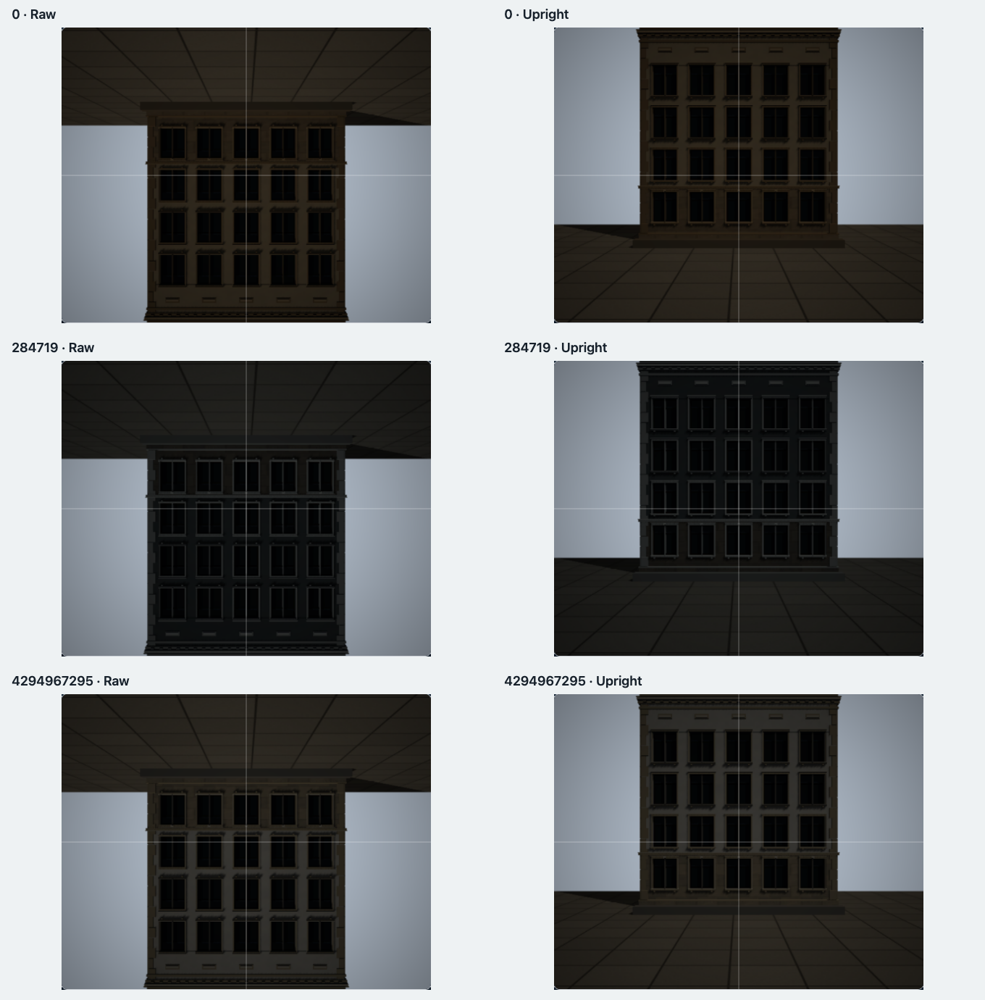

The current-main run verified Guided canonical, seeds `0`, `284719`, and `4294967295`, and same-seed URL replay. Within the run, seed `284719` and its replay produced the same Observer SHA-256 (`56c3a6e34a9107c99ac6ca878a9b5942a31d1f1bb68d57bc377ed20f880106b0`). Ground Glass was captured at the reachable 8000 mm focus and f/11 with Rise and Tilt neutral. For every Raw and Upright request, the current request ID matched completion, the scene ID matched Architecture + Foreground, the frame completed, and normal DOF processing remained enabled. The workflow separately toggled Raw RTT DOF bypass and asserted that bypass disabled normal DOF processing; bypass is not presented as a normal photographic image.

At normal display size, the plaster, limestone, surrounds, mullions, cornice, and paving remain visible. The three seeded families are perceptible while retaining coherent stone and slate colors. Fine map grain is naturally subtle at Ground Glass size; no claim depends on every texture pixel being distinguishable. The twelve-seed grid and matched front, side, window/limestone, roofline, and paving detail sheets were captured against the same v2 subject before the additional PR #356 camera-anatomy-only merge. The current-main three-seed and Ground Glass captures confirm that the scene subject and its material appearance remain consistent after that merge.

The new current-main screenshots, RTT identities, resource data, and browser state are recorded in the [current-main capture report](evidence/free-mode-seeded-materials-wave1/architecture-foreground-v2/current-main-observer-ground-glass-resource-report.json). V2 detail comparisons are available as [front facade](evidence/free-mode-seeded-materials-wave1/architecture-foreground-v2/front-facade-detail.png), [side elevation](evidence/free-mode-seeded-materials-wave1/architecture-foreground-v2/side-elevation-detail.png), [window and limestone](evidence/free-mode-seeded-materials-wave1/architecture-foreground-v2/window-limestone-detail.png), [roofline and cornice](evidence/free-mode-seeded-materials-wave1/architecture-foreground-v2/roofline-cornice-detail.png), and [paving joints](evidence/free-mode-seeded-materials-wave1/architecture-foreground-v2/paving-joints-detail.png). The twelve-seed comparison is [here](evidence/free-mode-seeded-materials-wave1/architecture-foreground-v2/observer-twelve-seed-grid.png), and the separate cool-family candidate is [here](evidence/free-mode-seeded-materials-wave1/architecture-foreground-v2/observer-cool-contemporary-candidate.png).

### Resources, Table Tilt, and known limitation

Current-main canonical and seeded Architecture subjects have the same counts:

| Subject | Objects | Meshes | Geometries | Materials | Textures | Triangles |
| --- | ---: | ---: | ---: | ---: | ---: | ---: |
| Observer | 71 | 68 | 67 | 16 | 7 | 28,574 |
| RTT | 66 | 64 | 63 | 12 | 7 | 27,518 |

The ten-action Regenerate run held renderer resources at 64 geometries / 18 textures, Observer and RTT subject counts stayed flat, and renderer / RTT-resource generations stayed stable while subject generation advanced. The browser's available timing backend is `cpu-fallback`: the Guided p50/p95 frame cadence was 178.6/192.4 ms and seed `284719` was 184.9/197.9 ms. These readings are local software-renderer observations, not hardware GPU benchmarks.

Table Tilt's accepted oak/teak/walnut-like material behavior and all four reference-seed map signatures remain unchanged; no Table Tilt material or geometry was tuned. The current production-base browser workflow still exercises both target scenes, but the inherited Table Tilt Ground Glass framing limit remains: its tabletop is too narrowly framed to qualify the seeded grain photographically. That pre-existing camera/scene-composition issue remains separate from the unchanged, manually accepted Table Tilt material families.

### Final integration validation and decision

- `npm test -- --maxWorkers=4`: 350 files / 4,292 tests passed. This includes the refreshed v2 Architecture baseline and the preserved Architecture Rise v1 contract.
- `npm run typecheck`, `npm run lint`, `npm run check:css`, `npm run build`, and final `git diff --check`: passed.
- Current-main Architecture + Foreground Chromium qualification: 1 passed, including canonical output, three fixed seeds, URL replay, Raw/Upright RTT, DOF-bypass state, ten Regenerates, and stable resource counts.
- Root and `/view-camera-simulator/` production-base workflows: 1 passed each, covering both target scenes, implicit and explicit seeds, replay, Regenerate, browser Back/Forward, Guided query cleanup, and current RTT completion.
- Focus/Aperture/Rise/Tilt subject-stability browser check: 1 passed on the latest-main tree across both scenes; subject generations and texture counts remained stable.
- Current-head GitHub CI status is recorded in the updated PR handoff after publication.

**Technical Qualification:** PASS. **Architecture v2 Visual Qualification:** IMPROVED. **Table Tilt Materials:** ACCEPTED_UNCHANGED. **Architecture v2 Manual User Acceptance:** PENDING_USER_REVIEW.

**Merge recommendation:** Ready for final manual review of the current-main Architecture v2 evidence. Keep the existing Table Tilt photographic-framing follow-up separate. Do not merge until the user accepts the new Architecture v2 presentation.
