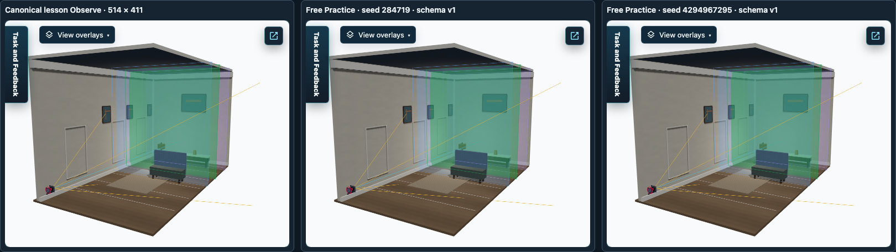
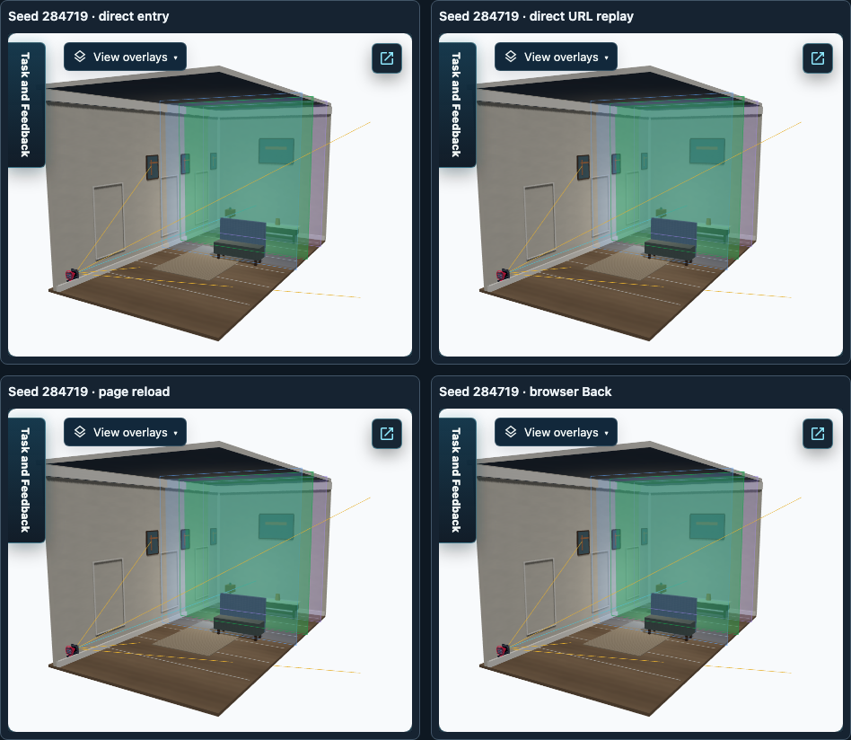
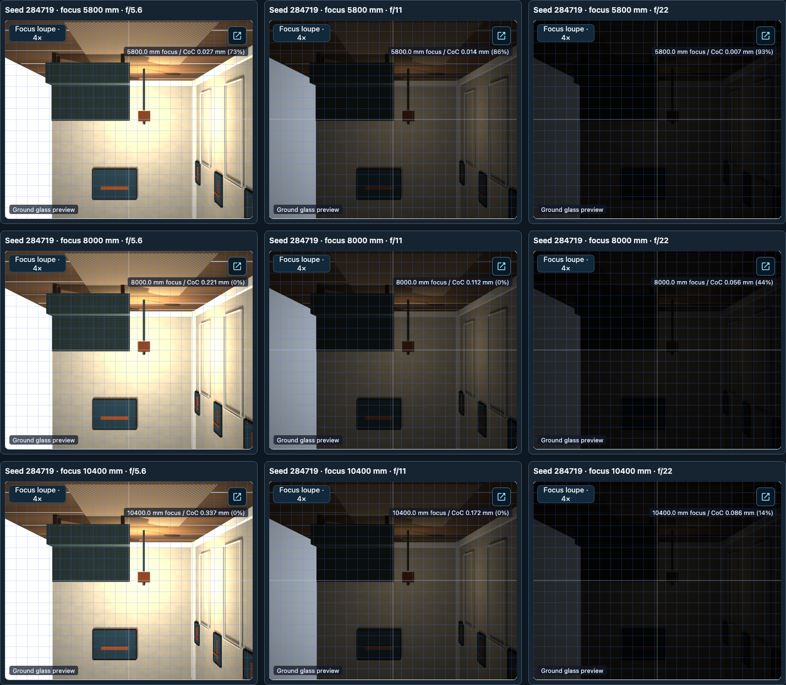
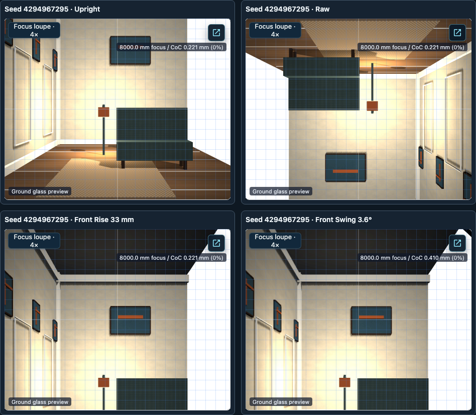

# Interior Corner Seeded Materials Variation Pilot

## Decision

**PASS — first production consumer of the Scene Variation Foundation.**

Interior Corner Free Practice now creates reproducible seeded material maps.
The canonical lesson presentation, scene geometry, teaching targets, optics,
camera behavior, lighting, and existing Ground Glass pipeline remain fixed.
This pilot does not randomize props, geometry, layout, or lighting.

The material differences are restrained at ordinary Observer size. Across
514 × 411 Chromium captures, seeds `284719` and `4294967295` changed 67,306 of
211,254 pixels (31.86%); the mean per-pixel maximum channel delta was 0.394/255
and the maximum was 5/255. The changed pixels are low-amplitude surface detail,
not broad color or composition changes. Exact same-seed direct entry, reload,
and Back captures matched at 450 × 360 (zero differing pixels).

## URL and mode contract

The shareable form is:

```text
/simulator/free/interior-corner?seed=284719&sv=1
```

- `seed` accepts one canonical decimal unsigned 32-bit integer, including `0`
  and `4294967295`.
- `sv` accepts one canonical positive decimal schema version. Schema v1 is the
  only supported version.
- A legacy valid URL with only `seed` is interpreted as v1 and replace-
  normalized to include `sv=1`, preserving the seed, unrelated query
  parameters, and hash.
- A missing or malformed seed creates one fresh seed with
  `crypto.getRandomValues()` and replace-normalizes the URL. Malformed values
  are never interpreted as zero.
- A malformed, duplicated, mismatched, or unsupported `sv` fails closed to
  canonical materials and displays an explanatory status. The requested
  `seed`/`sv` remain in the URL so the app does not claim a different version
  reproduced it.
- Guided routes and the Interior Corner lesson Observe route remain canonical;
  variation parameters are removed from these canonical-only routes.
- Regenerate pushes a new seed URL. Back/Forward restores the earlier identity.
  Reset Movements and camera interaction do not change the active identity.

Only Interior Corner opts in. Guided Mode, lesson Observe, lesson stages and
recovery, calibration, and all other scenes use the canonical material path.

## Material and subject integration

The current schema derives independent material role seeds from stable IDs:

| Role ID | Surface |
| --- | --- |
| `wall-plaster` | room walls |
| `ceiling-plaster` | ceiling |
| `floor-wood` | floor |
| `trim-plaster` | cornices and trim |
| `furniture-wood` | console, bench frame, and furniture |
| `artwork-paper` | artwork panels; authored accents stay fixed |
| `bench-fabric` | bench upholstery, preserving repeat `[0.5, 0.5]` |

The same memoized `SceneVariationDescriptor` reaches the registered Observer
subject and Ground Glass subject. Each factory creates its own Three.js
materials and textures; their per-role map-byte signatures agree and their
resources remain independently disposable. A seed change replaces only the
owned subject. Ground Glass request identity includes the variation identity,
and the renderer does not publish a frame while its mounted subject belongs to
the previous seed. The WebGL renderer and render targets stay mounted.

When `variationSeed` is omitted, the existing procedural material generator
uses its previous noise seeds and formulas. Existing hash locks for limestone,
cut stone, concrete, plaster, and wood remain in the test suite. The
Interior Corner ceiling shadow-caster exclusion from PR #334 remains active.

## Browser evidence

Real Playwright Chromium captures used viewport 1440 × 1000 at DPR 1 for the
ordinary Observer comparison. Each canvas PNG is 514 × 411. The three-panel
sheet compares the canonical lesson with both fixed seeds:



The same-seed replay sheet shows direct entry, a second direct URL entry, page
reload, and browser Back. The 450 × 360 pixels are exactly identical across all
four captures:



The Ground Glass matrix uses seed `284719`, focus 5800/8000/10400 mm and
apertures f/5.6, f/11, and f/22. A second seed (`4294967295`) was captured in
Raw and Upright modes and at Front Rise 33 mm and Front Swing 3.6°.





All matrix captures recorded the requested current Ground Glass frame as
completed. The scene capacity snapshot showed 82 Observer objects/72 meshes
and 81 RTT subject objects/72 meshes, with 10 materials and 22 textures in
each subject. No optical, focus-scoring, movement, image-circle, shader, or DOF
code changed.

`visual-comparison.json` records pixel comparisons, capture hashes, and contact
sheet dimensions. Raw screenshots and full capture reports remain in the
Git-ignored `.interior-corner-seeded-materials-runs/current/` directory. The
contact sheets are browser-generated layouts of the original PNGs at native
panel scale; they do not resize or enhance the captures. Rebuild them after
the focused browser suite with:

```bash
node scripts/build-interior-corner-seeded-materials-evidence.mjs
```

## Resource and timing observations

The real-browser lifecycle check performs ten successive regenerations and
records 11 capacity/profile snapshots. Across the samples:

| Owner | Objects | Meshes | Materials | Textures |
| --- | ---: | ---: | ---: | ---: |
| Observer subject | 82 | 72 | 10 | 22 |
| Ground Glass subject | 81 | 72 | 10 | 22 |
| Renderer resources | — | — | — | 33 textures; 62 geometries |

The counts remained constant through the replacements. Unit disposal spies
also confirm that each Observer and RTT instance disposes its own geometry,
materials, and maps. The renderer generation and RTT resource generation stayed
constant while the RTT subject generation advanced.

The existing profiler reported `cpu-fallback` / `cpu-submit-ms` in Raw Ground
Glass mode. Across its 11 rolling 60-frame samples, frame-cadence p50 ranged
from 296.3–504.3 ms, p95 from 357.6–622.3 ms, and the approximate cadence from
1.99–3.25 FPS. RTT CPU-submit p95 ranged from 0.4–0.5 ms. These are local
headless-browser CPU-fallback observations, not hardware GPU or production FPS
claims. No GPU timer or WebGPU hardware qualification was performed.

Detailed lifecycle snapshots are retained in the ignored
`regeneration-capacity.json` run output.

## Validation

Focused implementation tests cover:

- uint32 seed/schema URL parsing, canonicalization, query/hash preservation,
  and unsupported schema handling;
- capability gating for Free Practice, Guided Mode, lesson Observe, and other
  scenes;
- canonical map hash preservation and seed-distinct deterministic surface
  maps for seeds `0`, `1`, `284719`, and `4294967295`;
- independent Observer/RTT map signatures and resource disposal;
- Ground Glass request identity changes and current-subject frame gating;
- Free Practice UI localization, camera preservation, Reset Movements,
  regeneration, Copy URL, Back/Forward, and ten-replacement capacity plateau.

Real-browser suites:

```bash
npm run test:e2e -- --config=playwright.scene-variation.config.ts --project=chromium --workers=1 --retries=0
npm run test:e2e -- --config=playwright.scene-variation.production.config.ts --project=chromium-scene-variation-production
```

The pilot E2E specs use a dedicated test directory and two small Playwright
configs. The repository's default M7V test inventory is pinned to a historical
source baseline; keeping these new pilot identities outside that inventory
preserves the existing qualification policy while still running the browser
checks directly.

The production-preview run checks that seeded Free Practice and canonical
lesson presentation both mount the production build using the existing WebGL
Ground Glass path. Passing WebGL tests do not establish production WebGPU
readiness.

Validation results from the feature worktree:

- `npm test`: **335 test files and 4,133 tests passed**.
- `npm run typecheck`, `npm run lint`, `npm run check:css`, and
  `npm run build`: passed.
- The focused Chromium route test passed for Free Practice, canonical lesson
  Observe, invalid and unsupported schema URLs, and localized controls.
- The regeneration lifecycle test passed ten consecutive replacements,
  camera preservation, Reset Movements, Copy URL, Back/Forward, capacity
  stability, and the CPU-fallback profile snapshot.
- The ordinary-size comparison passed with 514 × 411 canvases. The split
  visual evidence tests passed the 9-state focus/aperture matrix, exact
  same-seed direct/reload/Back replay, canonical lesson capture, and the
  second-seed Raw/Upright/Rise/Swing captures.
- The production-preview Chromium test passed for seeded Free Practice and
  canonical lesson Observe. The production preview command built the app before
  serving it.
- `git diff --check` passed.

The pilot browser specs live in a dedicated directory and use dedicated
Playwright configs because the repository's default M7V inventory is pinned to
a historical source baseline. No M7V inventory or qualification evidence was
changed. WebGPU visual qualification was not part of this pilot.

## Limitations

- Material differences are intentionally low contrast at normal Observer size;
  the data-level signatures are more distinct than the captured pixel deltas.
- Only variation schema v1 is supported. Other versions fail closed; no
  migration framework exists.
- The guarantee covers `(sceneId, seed, schemaVersion)` and current generated
  material data. It does not promise permanent pixel identity across future
  geometry, shaders, materials, or browser renderers.
- The experimental WebGPU adapter receives the descriptor and replaces its
  owned Interior Corner subject, but this pilot did not qualify WebGPU output or
  performance.
- Props, layout, room dimensions, artwork content, focus targets, lighting, and
  camera presets remain fixed.

This PR establishes the first production consumer of Scene Variation. It does
not implement a general randomized-world system.
