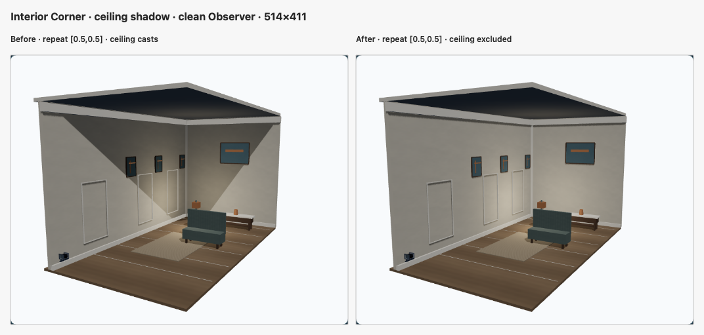
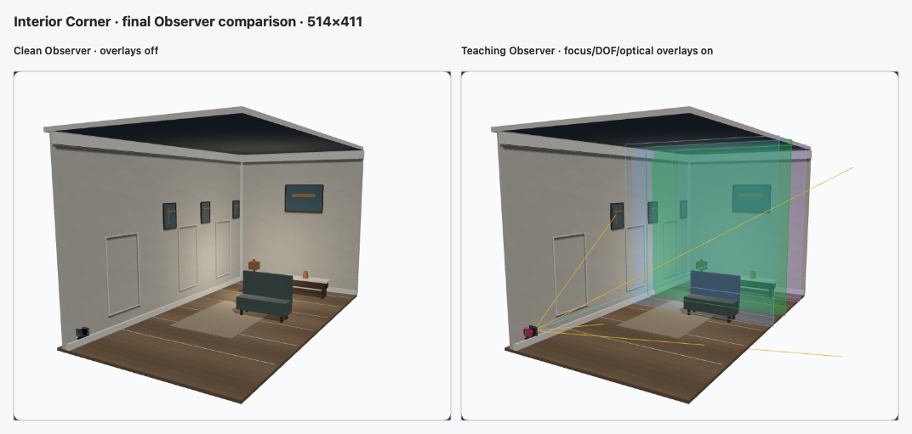
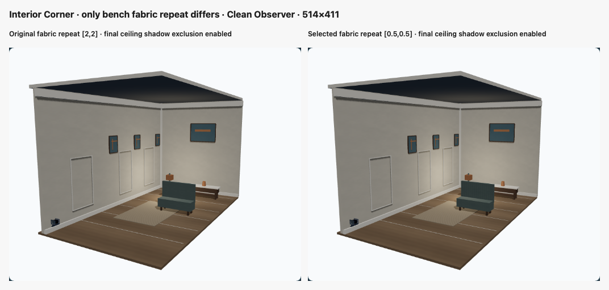

# Procedural Materials v2 — Interior Corner Pilot

## Decision

**PASS**

This is the final decision after reviewing the controlled real-browser A/B on the final implementation and Review-Fix Round 1. At the normal 514 × 411 Observer canvas, `[0.5, 0.5]` adds a subtle, low-contrast surface cue over `[2, 2]`; individual threads are not resolved at this distance. The texture remains plausible and subordinate, with no oversized weave or checker effect. The ceiling shadow comparison confirms the distracting diagonal is removed while the ceiling stays visible and localized shadows remain. Paper, wood, plaster, rug, geometry, camera, optics, lighting rig, and teaching behavior are preserved.

No further material tuning was warranted. The fabric's remaining scale limitation is documented below.

## Source and implementation

| Reference | Commit |
| --- | --- |
| Original `origin/main` baseline | `7d2a5141b6fe9f76ebd30cb5d0c90fec439e0615` |
| A1 shared material library | `43b2f1fb8e82883baea51dcb575cc1eafd904732` |
| A2 Interior Corner integration | `46705e79ea70ed6c1607bd5ecf87604f18f34206` |
| Review-Fix Round 1 implementation | `097c587619641332a364e7198c70aec34d3f0ac6` |

`ProceduralSurfacePattern` now adds `paper` and `fabric`. Both use the existing synchronous, seeded 128 × 128 `DataTexture` path and return `MeshStandardMaterial` with albedo, roughness and normal maps. Albedo remains sRGB; data maps remain untagged. Repeat wrapping, mip filtering and subject-owned disposal are unchanged. No loading, cache, shader, dependency, renderer or lifecycle layer was added.

The five existing map outputs (`limestone`, `cut-stone`, `concrete`, `plaster`, `wood`) match the pre-change albedo, roughness and normal byte hashes. Wood and plaster generator branches were left unchanged.

Interior Corner assignments:

- Art-panel base surfaces use `paper` at the existing teal color (`#66808a`), roughness `0.96`, normal strength `0.035`. Orange artwork accents and wood frames remain unchanged.
- Bench seat and back use `fabric` at the existing muted teal (`#6d7b78`), repeat `[0.5, 0.5]`, roughness `0.98`, normal strength `0.18` after Review-Fix Round 1.
- The rug keeps its former subtle-checker material after the shared fabric sample looked less convincing at the normal Observer size.
- Wall and ceiling plaster, wooden floor and furniture, trim, metal, geometry, light types/positions/intensities, subject registration and disposal ownership are unchanged. The ceiling's shadow-caster participation is the only shadow-policy exception; see Review-Fix Round 1 below.

The new library recipes are suitable for reuse by other registered teaching subjects. `InteriorCornerSubjectFactory` still supplies the one shared subject consumed by Observer and Ground Glass.

## Original Pilot Findings (A2)

This section preserves the findings recorded before Review-Fix Round 1. Its observations, benchmark values, and test counts describe the original A2 pilot stage; the current acceptance is recorded at the end of this report.

Baseline and final captures used `/simulator/free/interior-corner`, 1440 × 1000 viewport, DPR 1, Standard quality, Chromium, WebGL2 and Three.js r187. The browser selected the existing WebGL Ground Glass RTT/GLSL DOF path with no application fallback. The baseline Observer state was scene view, camera `(-6.6, 2.9, -5.6)`, orbit target `(0.45, 0.85, 6.7)`, focus 8000 mm, f/5.6, and neutral movements. The final capture sidecars record matching Before/After camera, focus, aperture, movement, preview, canvas size and renderer identity for each shared capture ID.

- **Observer clean (original finding):** plaster and wood retain their previous appearance; paper stays subordinate to the colored art and accents. The rug retains its prior texture. With the original `[2, 2]` repeat, the bench weave did not read clearly enough at the normal canvas size. That was the original pilot's blocker and is reassessed against the A/B evidence in Review-Fix Round 1 below.
- **Observer teaching:** the same subject and teaching overlays render. Focus, DOF, legends and optical overlays remain available; no overlay or composition changes were made.
- **Ground Glass:** Processed uses Raw orientation with DOF enabled; Raw uses the existing Raw RTT bypass control; Upright uses Upright Assist with DOF enabled. Film-image orientation was not normalized or edited. All three modes render contentfully with the current completed frame request.
- **Movements:** public Front Rise `33 mm` and Front Swing `3.6°` states were captured in Observer and Ground Glass. Swing used its established public focus value, `38140 mm`.

### Focus and aperture matrix

The targets share the receding wall's x/y position at `x = 2392 mm`, `y = 1850 mm`, with z anchors at 5800, 8000 and 10400 mm. The lens datum is at the origin and the neutral optical axis points along +Z. With rise and swing neutral, the existing model's focused plane is parallel to the film plane at the selected object-depth. The values below therefore focus the actual target plane; they were not inferred from z without the optical model. Each focus setting was entered through the public Focus slider, whose range is 4000–40000 mm with 10 mm steps. Each aperture is an existing public radio value.

| Target | Public focus control | f/5.6 | f/11 | f/22 |
| --- | ---: | --- | --- | --- |
| Near | 5800 mm | Captured | Captured | Captured |
| Middle | 8000 mm | Captured | Captured | Captured |
| Far | 10400 mm | Captured | Captured | Captured |

All nine records have distinct image hashes, focus/aperture states that match their labels, and Ground Glass request IDs equal to the last completed request both before and after screenshot capture. All frames were contentful and reported the same `webgl-renderer / webgl2 / r187` identity. Focus and aperture controls did not change any optics, sharpness scoring, movement policy or task code. Fine surface patterns remain low contrast in these views; no prominent moiré or material detail that obscures the focus comparison was observed at the captured size.

The original pilot's full Before/After captures, request metadata, image hashes, and baseline lock remain in the Git-ignored `.dream-loop/interior-corner/` directory. Only the three compact, final review contact sheets are published later in this report; raw captures and the nine-state capture corpus remain ignored.

## Original Pilot Resources and Performance (A2)

These are the original-main-to-A2 comparison values, before the scene-specific repeat and ceiling-caster correction. The final A2-to-Review-Fix comparison appears below.

The repository scene-capacity benchmark ran with 60 fresh samples for Processed and Processed Loupe, and its existing isolated Raw RTT sample. Both runs used Chromium 149, viewport 1440 × 1000 at DPR 1, WebGL with ANGLE/SwiftShader, the CPU-fallback profiler and `cpu-submit-ms` timings.

| Metric | Baseline | Final | Change |
| --- | ---: | ---: | ---: |
| Subject objects / meshes | 82 / 72 | 82 / 72 | — |
| Unique geometries / triangles | 61 / 952 | 61 / 952 | — |
| Unique materials | 10 | 10 | — |
| Unique subject textures | 17 | 22 | +5 |
| Renderer geometries / textures | 62 / 28 | 62 / 33 | +5 textures |

| Ground Glass mode | Frame p95 (ms) | Scene CPU-submit p95 (ms) | RTT CPU-submit p95 (ms) | DOF CPU-submit p95 (ms) |
| --- | ---: | ---: | ---: | ---: |
| Processed, baseline → final | 537.4 → 504.6 | 0.4 → 0.5 | 0.5 → 0.6 | 0.1 → 0.1 |
| Processed Loupe, baseline → final | 672.2 → 632.4 | 0.4 → 0.4 | 0.5 → 0.5 | 0.1 → 0.1 |
| Raw RTT, baseline → final | 75.1 → 66.1 | 0.6 → 0.5 | 0.6 → 0.5 | bypassed |

Approximate frame cadence was 2.05 → 2.10 FPS for Processed, 1.73 → 1.94 FPS for Loupe, and 15.87 → 18.81 FPS for Raw RTT. These are software-rendered frame cadence estimates, not hardware FPS. GPU timers were unavailable, so GPU execution times are `null`. The five extra renderer textures are attributable to the paper maps and the fabric maps replacing the former single upholstery texture; meshes, geometry, triangles and material count did not increase. CPU-submit changes are at most 0.1 ms at p95 in this run.

## Original Pilot Validation (A2)

The following counts and guard result belong to the original A2 validation stage, not the Review-Fix Round 1 final result.

- Procedural material tests: **39 passed**. These cover deterministic bytes, legacy output hashes, distinct signatures, 128 × 128 maps, color spaces, wrapping/filtering, normal construction, restrained variation, boundary continuity and subject-owned disposal.
- Focused scene/render/optics set: **156 passed across 9 files**, including Interior Corner registration/disposal, shared subject remount lifecycle, focus reachability, focus calibration, optics derivation and Ground Glass stage/renderer tests.
- `npm test`: **330 files, 4064 tests passed** on the final full run for the A2 stage. One earlier full run had a temporary synthetic-checkout `ENOENT` in the unrelated M7M readiness test; its file passed alone (63 tests), and the subsequent A2 full run passed.
- `npm run typecheck`, `npm run lint`, `npm run check:css`, `npm run build`: passed.
- `npm run dream-loop:capture -- --pilot interior-corner`: passed for the final Observer clean/teaching pair.
- Ground Glass browser matrix: 16 real-app captures including the 9-state focus matrix, three Ground Glass modes and Rise/Swing Observer plus Ground Glass states; 14 frames validated complete/contentful with no page errors.
- `npm run dream-loop:guard -- --pilot interior-corner --base 43b2f1fb8e82883baea51dcb575cc1eafd904732`: passed with only the A2 scene factory in scope.
- Baseline and final `npm run benchmark:scene-capacity`: passed with matching viewport, DPR, backend and sampling configuration.
- `git diff --check`: passed.

`npm run ci:local:e2e` was not run: renderer selection, shaders, RTT ownership and scene lifecycle were unchanged; the requested Ground Glass states were exercised directly through the public route and controls in the real-browser capture. GPU timing and hardware-renderer performance were unavailable because this environment used SwiftShader.

## Historical A2 Reproduction (Factory-Only Guard)

This command block documents the original isolated A2 scene-factory iteration. Its A1 baseline makes it appropriate for that historical change; it is **not** a cumulative guard pass for the completed PR, because Review-Fix Round 1 adds an explicitly authorized shared shadow-helper exception and this final review package adds documentation evidence.
To reproduce that historical state, use A2 commit `46705e79ea70ed6c1607bd5ecf87604f18f34206`; running the capture command on the current branch produces the Review-Fix Round 1 scene instead.

```bash
npm run dream-loop:capture -- --pilot interior-corner
npm run dream-loop:guard -- --pilot interior-corner --base 43b2f1fb8e82883baea51dcb575cc1eafd904732
npm run benchmark:scene-capacity
npm test -- --run src/tests/unit/proceduralSurfaceMaterials.test.ts
```

The broader A2 suite also ran `npm test`, `npm run typecheck`, `npm run lint`, `npm run check:css` and `npm run build`.

## Review-Fix Round 1

### Previous findings and selected corrections

The previous review identified insufficient ordinary-size bench-weave readability and a broad diagonal shadow from the ceiling mesh. Review-Fix Round 1 kept the procedural library and lighting rig fixed and changed only the bench material repeat plus the ceiling's caster participation.

| Candidate | Fabric repeat | Ceiling state | Ordinary Observer result |
| --- | ---: | --- | --- |
| Original recipe | `[2, 2]` | casts | Fine weave detail mostly disappears on the small, dark bench. |
| First candidate | `[1, 1]` | casts | Slightly larger surface detail, still too subtle at 514 × 411. |
| Second candidate | `[0.75, 0.75]` | casts | The weave continues to filter out at ordinary size. |
| Selected | `[0.5, 0.5]` | casts | Modest additional surface structure is visible; individual threads remain below clear resolution at this scene size. No oversized weave or obvious checker appearance. |
| Final scene | `[0.5, 0.5]` | ceiling excluded | Same selected fabric scale, with the diagonal wall shadow removed. |

Every fabric candidate kept color `#6d7b78`, roughness `0.98`, and normal strength `0.18`; only repeat changed. The first published A/B came from separate capture attempts and its sidecars recorded public UI state, but not live scene caster flags or shadow-camera state. Review reported visibly different wall-shadow boundaries, so that sheet was withdrawn as controlled evidence. The checked-in source PNGs and sheet could not reproduce that background difference in a byte-level audit, and the old runtime state was not recorded well enough to establish a cause. The replacement comparison and findings are in **Final Evidence Correction — Controlled Fabric A/B** below. No additional material tuning was performed.

The shadow cause was the shared `configureTeachingShadowParticipation()` policy, which opts every lit non-helper subject mesh into shadow casting. This round adds an exact-name exclusion for `interior-corner-ceiling` in `TeachingLighting.tsx`. The ceiling remains a visible `MeshStandardMaterial` surface; the lighting rig and all other caster/receiver decisions remain unchanged. A focused unit test proves that the ceiling does not cast while the wall still casts and receives, and that the ceiling remains visible and lit. The same registered subject and helper serve Observer and Ground Glass.

### Observer evidence

The final clean Observer capture at 514 × 411 shows the ceiling shadow removed from the walls. The room reads more evenly while contact shadows under the bench and furniture and shadows around the wall trim/art remain. Teaching Observer overlays remain present and legible.

The published contact sheets below use actual browser canvas captures as panels at their native 514 × 411 pixels (1:1). The ceiling-shadow and Clean/Teaching sheets remain unchanged from the accepted Review-Fix Round 1 evidence. The fabric sheet was replaced with the controlled final-state comparison documented below. Raw captures and sidecars remain in the ignored `.dream-loop/interior-corner/review-fix-1/` directory.

#### Fabric A/B — original `[2, 2]` versus selected `[0.5, 0.5]`

The earlier sidecar-based A/B was superseded after review. The corrected sheet and its runtime and pixel evidence appear in **Final Evidence Correction — Controlled Fabric A/B** below.

#### Ceiling shadow — before versus after



Both panels use the `[0.5, 0.5]` fabric recipe; the right panel excludes the ceiling from shadow casting while retaining the visible, lit ceiling. The diagonal wall shadow is removed and localized furniture/object shadows remain.

#### Clean Observer versus Teaching Observer



The second panel retains the focus-plane, DOF-region, and optical-geometry overlays. Capture sidecars identify the actual public route, viewport, renderer, subject, and active overlay state.

### Focus, aperture, and Ground Glass

The real-browser run used `/simulator/free/interior-corner`, 1440 × 1000 viewport, DPR 1, Standard quality, and WebGL2/r187. The nine publicly reachable states remain unchanged:

| Target | Focus control | f/5.6 | f/11 | f/22 |
| --- | ---: | --- | --- | --- |
| Near | 5800 mm | Completed/contentful | Completed/contentful | Completed/contentful |
| Middle | 8000 mm | Completed/contentful | Completed/contentful | Completed/contentful |
| Far | 10400 mm | Completed/contentful | Completed/contentful | Completed/contentful |

Each matrix capture used neutral Front Rise/Front Swing, the labelled public focus/aperture control values, and a completed current Ground Glass request ID before and after its screenshot. All nine images are distinct; all Ground Glass captures were contentful on the same `webgl-renderer / webgl2 / r187` backend, with no browser page errors. The captured fabric remains subordinate and does not leave high-frequency detail unnaturally sharp in the defocused states. No new moiré or aliasing was visible at ordinary canvas size.

Processed, Raw RTT bypass, and Upright captures have distinct hashes and retain their existing film-image orientation behavior. Front Rise `33 mm` and Front Swing `3.6°` (focus `38140 mm`) were captured in Observer and Ground Glass. The shadow change brightens the wall area in the same way in Ground Glass; no RTT, coordinate, optics, focus, or orientation code changed. The 16 matrix captures and sidecars are in `.dream-loop/interior-corner/review-fix-1/final/`.

### Resource and performance comparison

The scene-capacity benchmark compared A2 commit `46705e79ea70ed6c1607bd5ecf87604f18f34206` with review-fix source commit `097c587619641332a364e7198c70aec34d3f0ac6` using Chromium 149, 1440 × 1000, DPR 1, WebGL/ANGLE SwiftShader, and the same 60-sample scene-capacity settings.

| Metric | A2 | Review-Fix 1 | Change |
| --- | ---: | ---: | ---: |
| Objects / meshes | 82 / 72 | 82 / 72 | — |
| Unique geometries / triangles | 61 / 952 | 61 / 952 | — |
| Unique materials | 10 | 10 | — |
| Unique subject textures | 22 | 22 | — |
| Renderer geometries / textures | 62 / 33 | 62 / 33 | — |

| Ground Glass mode | Frame p95 (ms) | RTT CPU-submit p95 (ms) | DOF CPU-submit p95 (ms) |
| --- | ---: | ---: | ---: |
| Processed, A2 → final | 504.6 → 509.6 | 0.6 → 0.5 | 0.1 → 0.2 |
| Processed Loupe, A2 → final | 632.4 → 559.3 | 0.5 → 0.5 | 0.1 → 0.1 |
| Raw RTT, A2 → final | 66.1 → 60.1 | 0.5 → 0.5 | bypassed |

The benchmark found no additional texture, geometry, material, or renderer-resource allocation from the repeat or caster change. GPU timer queries were unavailable: the reported RTT and DOF values are CPU-submit timing, while frame cadence is from SwiftShader and is not hardware FPS or GPU execution time.

### Validation and write-scope exception

- Focused material, registered-subject, disposal/remount, teaching-shadow, optics, and Ground Glass suites: **164 tests across 10 files passed**.
- `npm test`: **330 files, 4,065 tests passed**.
- `npm run typecheck`, `npm run lint`, `npm run check:css`, `npm run build`, and `git diff --check`: passed.
- Final `npm run dream-loop:capture -- --pilot interior-corner`: passed for Clean and Teaching Observer.
- Final 16-capture browser matrix: passed; 14 Ground Glass requests were completed/contentful and all request IDs matched at screenshot time.
- Final `npm run benchmark:scene-capacity`: passed with 60 samples per principal mode.
- During the fabric-only iteration against reviewed HEAD `865ed077e4414da274a3a10f40d17806220c4890`, the guard passed with only the permitted scene-factory edit. Once the authorized ceiling fix was added, the guard correctly failed closed and reported `src/render/TeachingLighting.tsx` and `src/tests/unit/teachingLighting.test.ts` as outside the existing allowlist. The exact shared-helper/test exception is necessary because the helper reapplies caster state to both Observer and RTT subjects. The manifest was not widened.
- The final report and three image files are also outside the visual-worker allowlist by explicit authorization for this documentation/evidence closeout. The cumulative A1-based guard was not rerun: its diff includes prior report content and cannot isolate the Round 1 correction. Do not treat the historical A2 guard command above as a passing validation for the completed PR or claim that the final cumulative guard passes.
- GitHub Actions on the original reviewed PR head `865ed077e4414da274a3a10f40d17806220c4890` and implementation commit `097c587619641332a364e7198c70aec34d3f0ac6` completed successfully. The implementation run was workflow run `43473665553` (run 2029). The exact current-head checks for this final report/evidence package are recorded in the PR handoff after publication.

## Final Evidence Correction — Controlled Fabric A/B

### Previous mismatch diagnosis

The prior sheet was not accepted as controlled proof because the reviewer observed different wall-shadow shapes while its sidecars contained no actual mesh shadow flags, light placement, or shadow-camera state. Source commits `46705e79ea70ed6c1607bd5ecf87604f18f34206` and `865ed077e4414da274a3a10f40d17806220c4890` differ only by the pilot-report commit; the scene-factory and shadow-policy code is the same in both. A post-hoc byte-level comparison of the tracked prior sheet's two source panels and their saved PNGs found 2,285 changed pixels, all inside the projected bench region, with zero changes among 206,666 pixels outside it (maximum channel difference 4). The reported wall-shadow discrepancy could not be reproduced from those stored bytes, so its runtime cause remains **unestablished**. The old panel is superseded regardless, because the prior capture did not record the live rendering state needed to rule out a stale frame or initialization difference.

### Controlled capture state and provenance

Both replacement panels were captured in one Playwright Chromium page against the final PR source commit `fdb5b6461fecc2effa2c05080f921b626f300b2d`, using the public route `/simulator/free/interior-corner?sceneCapacityProfiling=1`, viewport 1440 × 1000, browser DPR 1, Standard quality, Clean Observer, focus 8000 mm, f/5.6, neutral Rise/Tilt/Swing, camera position `(-6.6, 2.9, -5.6)`, and orbit target `(0.45, 0.85, 6.7)`. The browser-only override changed only the bench material's `map`, `roughnessMap`, and `normalMap` repeats from `[0.5, 0.5]` to `[2, 2]` for panel A, then back to the final `[0.5, 0.5]` for panel B. Color `#6d7b78`, roughness `0.98`, normal strength `0.18`, texture data, geometry, and all other materials remained unchanged; the production source remained at `[0.5, 0.5]` throughout.

The live R3F snapshot confirmed the ceiling remained visible with its `MeshStandardMaterial`, `castShadow: false`, and `receiveShadow: false` for both captures. The same scene had 68 mesh casters and 29 receivers. The teaching fill was a HemisphereLight at intensity `0.55`; the directional key remained at `(-0.108, 5.35, 5.5)`, aimed at `(2.392, 1.85, 8)`, intensity `1.15`, with its 1024 × 1024 PCF shadow map, bias `-0.0002`, normal bias `0.015`, and camera bounds `[-8, 8] × [-8, 8]` / near `0.1` / far `32`. The Interior Corner practical point light remained at `(0.42, -0.09, 8.3)`, intensity `5`, distance `7.5`, decay `2`, with shadow casting disabled. The renderer was active WebGL2 / Three.js r187 with Standard output, ACES Filmic, exposure `1`, sRGB output. The runtime snapshots matched for camera state, object transforms and geometry, all casters/receivers, all lights and shadow-camera settings, renderer configuration, and UI controls; the only intended state difference was the three bench texture repeats. Each saved canvas image stabilized across three consecutive identical captures, was 514 × 411, and the page reported no errors. The final repeat was restored after capture.

The bench ROI is `(x=258, y=230, width=74, height=62)`, derived from the projected bounds of the registered bench seat and back plus 3 px padding. On the two genuine screenshot pixel buffers, 2,282 pixels differ inside that ROI (mean absolute RGB-channel difference `0.46/255`, maximum `4/255`); **0 of 206,666 pixels outside it differ**. Background walls, shadows, object edges, and composition are pixel-aligned. The texture-scale change is subtle but credible at ordinary size: `[0.5, 0.5]` adds a faint surface variation, while individual threads remain unresolved. There is no oversized weave, checker appearance, or visible aliasing. This supports the limited claim of improved surface structure, not resolved yarn detail.



The compact contact sheet is 1072 × 511 and is directly published at [`evidence/pr334/observer-fabric-ab.png`](evidence/pr334/observer-fabric-ab.png). Its two 514 × 411 panels preserve the captured screenshot pixel bytes exactly, with no resizing, crop, reorientation, or image enhancement. Ignored provenance files are `.dream-loop/interior-corner/review-fix-1/controlled-final-shadow/capture-diagnostics.json`, `pixel-difference-raw-bytes.json`, `observer-fabric-repeat-2x2.png`, and `observer-fabric-repeat-0_5x0_5.png`. The browser-only capture harness and pixel comparison script also remain ignored in that directory; no temporary scripts or raw screenshots are committed.

### Reused validation

This correction changes only the report and one compact evidence image. Production code is unchanged, so the accepted nine-state Focus/Aperture matrix, Processed/Raw/Upright and Rise/Swing regressions, ceiling-shadow comparison, scene-capacity benchmark, and Review-Fix Round 1 tests remain the applicable implementation evidence. Current-head GitHub CI is recorded in the PR handoff after publication.

## Final Acceptance

**PASS — ready for final human approval.** This decision uses the ordinary-size fabric A/B and the final ceiling-shadow and Clean/Teaching Observer evidence linked above. It does not require individual yarns to remain visible when the bench occupies only a small part of the canvas.

| Review area | Result | Final finding |
| --- | --- | --- |
| Shared paper/fabric library | PASS | Deterministic shared API and existing ownership remain intact. |
| Legacy pattern preservation | PASS | Existing limestone, cut-stone, concrete, plaster, and wood output hashes remain unchanged. |
| Fabric integration | PASS | The controlled A/B confines all pixel differences to the bench ROI; `[0.5, 0.5]` adds a subtle, low-contrast surface cue without oversized weave, checker pattern, or teaching-scene distraction. Individual threads are not resolved at 514 × 411. |
| Ceiling shadow | PASS | The diagonal wall shadow is removed; the ceiling remains visible/lit and localized furniture/object shadows remain. |
| Observer / Teaching | PASS | Clean Observer remains clear and Teaching Observer retains its focus, DOF, and optical overlays. |
| Ground Glass | PASS | The validated focus/aperture matrix, Processed, Raw, Upright, Rise, and Swing captures remain contentful with expected orientation. |
| Resources / performance | PASS | Scene counts are unchanged from A2; timing changes are small SwiftShader observations, not GPU measurements. |
| Tests / CI | PASS | The Review-Fix implementation validation passed (164 focused tests and 4,065 full tests); final-head hosted CI passed after this report/evidence-only update. Exact current-head runs are listed in the PR handoff. |
| Visual evidence | PASS | The corrected controlled Fabric A/B is checked into `evidence/pr334/`; the accepted ceiling-shadow and Clean/Teaching sheets are unchanged. All three are linked directly in this report and PR description. Raw captures remain ignored. |

The original A2 results (156 focused tests and 4,064 full tests) remain under **Original Pilot Validation (A2)** as historical evidence; they are not the current Review-Fix result. This final evidence correction changes only the pilot report and the Fabric A/B contact sheet. It does not change production rendering or broaden the Dream Loop manifest.
