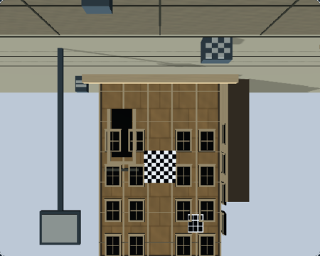
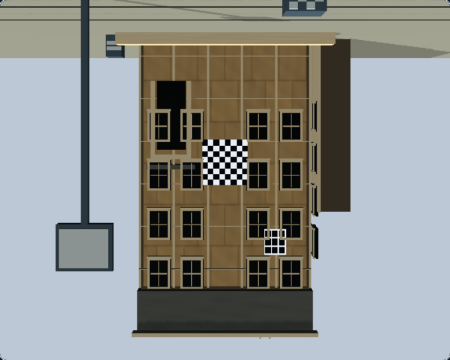
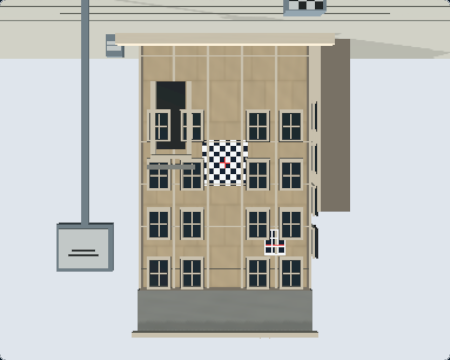
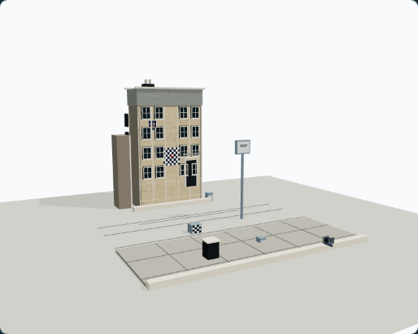
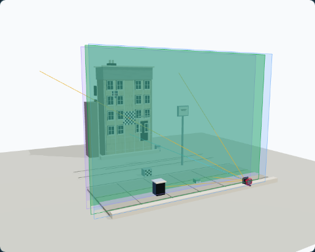
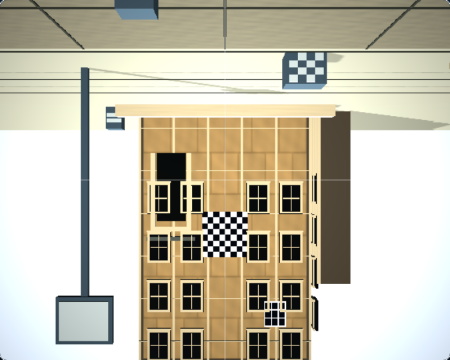

# RQ1 — Render Quality Baseline and Comparison

## Purpose and scope

This evidence set gives RQ2 a repeatable Architecture Rise reference for Observer appearance, Ground Glass WebGL output, and the specifically authorized native WebGPU M3 Raw output. It records the current appearance; it does not optimize it or make a pixel-parity claim.

The source baseline is accepted M7X merge `41a78eaed941bf559ea361bdd2aed4a4ec55cc8c`. Capture sidecars pin the commit containing the RQ1 capture helper and state manifest. The scene-source attestation remains `architecture-rise-raw-rtt-v1`; this PR does not change scene inputs or that revision.

## Reference states

The public route is `/simulator/free/architecture-rise?rttDiagnostics=1`. The capture test starts from the scene's public canonical preset, confirms its initial focus is 8,890 mm and aperture is f/11, then applies values reachable through public controls.

| State | Focal length | Focus | Aperture | Front rise | Other front/rear movements | Ground Glass view |
|---|---:|---:|---:|---:|---|---|
| `architecture-rise-neutral` | 150 mm | 8,900 mm | f/8 | 0 mm | 0 | Raw, grid off |
| `architecture-rise-front-rise` | 150 mm | 8,900 mm | f/8 | 20 mm | 0 | Raw, grid off |

Both use Standard quality, 1280×900 viewport, DPR 1, and a 450×360 CSS-pixel Ground Glass capture. Focus 8,900 mm is one public 10 mm step from the scene's canonical 8,890 mm preset; Front Rise 20 mm is public-control reachable. Shift and rear movement controls are not available on this scene, so those zero values come from the fresh canonical preset. Each Ground Glass sidecar records the observed state and current completed request.

The processed WebGL reference uses the neutral state, Raw preview orientation with Raw RTT disabled, and the standard CoC/gather/composite path. It is a photographic regression reference, separate from both Raw captures.

## Side-by-side references

### Neutral — bounded Raw display comparison

| WebGL Raw Debug | Native WebGPU M3 Raw |
|---|---|
|  |  |

### Front Rise 20 mm — bounded Raw display comparison

| WebGL Raw Debug | Native WebGPU M3 Raw |
|---|---|
|  |  |

### Observer references

The existing Dream Loop Architecture Rise pilot produced these 514×411 Observer canvas images at a 1440×1000, DPR 1 viewport. Dream Loop's original `.dream-loop/` output and retention rules were left intact; these copies are the RQ1 review artifacts.

| Observer clean — appearance reference | Observer teaching — overlays retained |
|---|---|
|  |  |

These Observer frames record the pilot's actual 150 mm, 3,090 mm focus, f/11, zero-movement state. They are intentionally not treated as optically matched Ground Glass captures. The teaching frame preserves the focus plane and optical rays; no teaching overlay was hidden with CSS.

### Processed Ground Glass — WebGL regression reference



This neutral-state image exercises the processed photographic WebGL Ground Glass path, including natural illumination and Image Circle coverage. It is not a WebGPU comparison.

## Runtime identity and capture validity

The WebGL frames report `webgl-renderer` / `webgl2`, Three.js r187, selected backend `webgl`, no internal fallback, and application fallback `not-observed`. Native frames report `webgpu-renderer` / `webgpu`, Three.js r187, selected backend `webgpu`, internal fallback `none`, application fallback `not-observed`, and evidence revision `m3-architecture-rise-raw-rtt-native-r187-v1`.

For each Ground Glass capture, the route mounted Architecture Rise, the host was ready, the current request ID matched the last completed request ID, the existing test diagnostic seam observed that exact result accepted by the host, and decoded screenshot pixels passed the contentfulness check. WebGL captures also record the existing Raw/final contentfulness diagnostics. The native adapter does not expose a Raw-contentful counter; its evidence is decoded displayed-canvas pixels plus mounted adapter identity, ready state, and request identity. These distinctions are retained in each sidecar.

The capture clips the displayed Ground Glass canvas to 450×360 CSS pixels. It temporarily hides only DOM controls that overlap that canvas, the focus label, fixed preview overlays, and the native pilot status; it does not alter canvas pixels. The separate application diagnostics remain available in the metadata sidecars and Playwright attachments.

The native run activates only the existing trusted Architecture Rise M3 Raw pilot. Physical CoC, aperture gather, M6 presentation, M6 qualification, and other research/qualification flags are disabled. The frame-acceptance diagnostic seam is enabled for the capture; no failure is injected, and that seam does not select WebGPU.

Each PNG's SHA-256, dimensions, browser, host OS, camera/optical state, render profile, preview mode, request IDs, pipeline stage, and runtime diagnostics are recorded in `rq1-baseline/captures/*.json`. The browser was Chromium 149 for WebGL and headed Chrome 157 for native WebGPU on macOS arm64, Node v24.3.0. The host OS values are sourced from the capture process, not inferred from the browser user agent.

## What the images show

### Direct observations

- In the neutral Raw pair, the building facade, windows, checker chart, pole, and hanging sign occupy corresponding positions. Both frames show the same broad architecture and scene landmarks.
- In the 20 mm Front Rise pair, those landmarks move downward in the displayed composition; more of the building base is visible and the upper canopy/checker is more tightly clipped. The same direction of composition change appears in both backends.
- The selected WebGPU Raw frames appear lighter and less brown than their WebGL Raw Debug counterparts, including the facade and background. WebGL is darker and more contrasty in those regions.
- At this output size, the facade's fine surface variation is subtle. The checker chart and window pattern are more visually prominent than surface texture.
- Broad shading and shadow regions are visible, while small contact-shadow detail is difficult to distinguish in these tight Ground Glass crops.
- The processed WebGL reference is brighter around the background and scene edges than Raw Debug and retains the photographic presentation path. This is expected to be a separate regression view, not a same-stage comparison.
- The Observer clean view shows the whole tabletop scene and its ground-plane shadow. The teaching view adds the translucent focus plane and optical rays while retaining the scene.
- All seven images are contentful and stable at their recorded dimensions. The capture validity checks accepted current completed frames for both renderers.

### Attribution limits

The WebGL Raw Debug view and M3 native Raw view are bounded Raw display comparisons, not the same literal pipeline. WebGL Raw Debug bypasses CoC and gathers, sets photographic throughput gain to 1, disables natural illumination and coverage, and still uses the WebGL composite/display implementation. M3 Raw displays its own native scene-color target through the WebGPU pilot display implementation. The processed WebGL path runs photographic Ground Glass processing and must not be compared as if it were native pre-composite Raw.

The observed tone/color difference could involve display, color-space, tone-mapping, or scene-rendering differences. Screenshots alone do not establish a cause or a WebGPU lighting defect. No exposure normalization or color correction was applied, and no pixel metric is treated as a quality or parity result. The existing lower-level M7X comparison is separate evidence and is not replaced by these visible-canvas captures.

## Reproduction

Install the repository's pinned dependencies and run from the repository root:

```bash
npm run render-quality:rq1:capture
npm run render-quality:rq1:check
npm run render-quality:rq1:check -- --baseline
```

The first check validates the latest working reproduction under the Git-ignored `docs/render-quality/.rq1-runs/current/` directory. The second explicitly validates the committed RQ1 Before baseline under `docs/render-quality/rq1-baseline/`. Ordinary capture commands cannot write to or replace the committed baseline. An explicit `--output-dir docs/render-quality/<name>` remains available for a separate working destination; the selected destination is treated as the output of the new run.

Capture requires a clean, commit-reproducible source tree before it creates or replaces any output. It records the source HEAD and `sourceTree.status: clean`; ignored capture output is excluded from Git status. Dirty exploratory changes must first be committed before they can become accepted capture evidence. This avoids claiming that an uncommitted render can be reproduced from its base commit.

Each invocation writes a fresh run ID and per-capture/backend provenance. The runner clears the expected output files in the selected working destination before capture, so old PNGs cannot be mistaken for artifacts from a new invocation. Reused Dream Loop Observer images keep their original `sourceCommit`; `capture-run.json` records their source commit separately from the Ground Glass run commit.

The native-required Playwright project runs a bounded WebGPU preflight in the same headed Chrome configuration used for capture. A native environment blocker is recorded only when the secure local page is loaded and `navigator.gpu` is absent or `requestAdapter()` returns `null`. That run must skip native rendering and have no native output artifacts. A browser launch failure, probe rejection or timeout, renderer fallback, assertion failure, process crash, partial capture, missing provenance, or unknown result is invalid and exits nonzero. A valid blocked reproduction means **WebGL evidence valid; native environment unavailable**; it does not validate native rendering.

The checker validates exact capture identities, per-run metadata, runtime and frame identity, contentfulness, PNG dimensions and SHA-256 digests. It rejects unsupported blocked claims, failed native processes, partial native output, stale identities, and capture-run/backend status disagreement. A later working reproduction is validated against its own run ID and source commit; the committed baseline report remains pinned to the accepted baseline run. The baseline check does not require the old RQ1 run record to use the newer working-run source-cleanliness schema.

## RQ2 implementation handoff

### Initial target

Start with Architecture Rise lighting, materials, and surface detail. Evaluate the existing systems before replacing or expanding them:

- World illumination: `src/scenes/illumination/sceneWorldIllumination.ts` defines the Architecture Rise daylight and procedural sky/ground contribution.
- Presentation lighting and shadows: `src/render/presentationLightingContract.ts` defines the shared hemisphere/key-light rig and shadow settings; `src/render/TeachingLighting.tsx` configures caster/receiver participation.
- Registered subject: `src/render/ArchitectureRiseSubjectFactory.tsx` constructs the subject and its materials. `src/render/groundGlassSceneProfiles.ts` and `src/render/sceneSubjectRegistry.tsx` provide the registered scene path and presentation placement.
- Procedural surfaces: `src/render/ProceduralSurfaceMaterials.ts` already supplies deterministic tileable albedo, roughness, and normal maps. The Architecture Rise factory uses it for facade, stone, trim, and sidewalk surfaces.

Prioritize a clearer lighting hierarchy, soft readable contact shadows, plausible roughness response, deterministic normal/roughness variation, visible surface detail, and tonal/spatial separation that supports focus teaching. Keep the canonical geometry, camera model, movement signs, and teaching visibility intact. Do not add DOF, image-circle, new scene, or renderer-selector work to RQ2.

### M3 scene-source attestation

The current native M3 record binds to `architecture-rise-raw-rtt-v1`. Its protected raster inputs include `src/scenes/definitions/architecture-rise.ts`, `src/scenes/architectureRiseGeometry.ts`, `src/scenes/presentation/architectureRise.ts`, `src/render/ArchitectureRiseSubjectFactory.tsx`, Architecture Rise registration/hooks in `src/render/groundGlassSceneProfiles.ts`, `src/render/sceneSubjectRegistry.tsx` and related subject/asset registration, plus relevant materials, textures, presentation-lighting and world-illumination definitions. Adapter-side scene realization, camera setup, target creation, orientation, crop, or display changes are also in scope for invalidation. The authoritative source-binding note is the M3 section of `docs/architecture/GROUND_GLASS_WEBGPU_MIGRATION_ROADMAP.md`.

Before changing any input that can alter the M3 Raw raster, update `ARCHITECTURE_RISE_RAW_RTT_SOURCE_REVISION` in `src/render/webgpu/groundGlassRawWebGpuCompatibility.ts` to a new revision and update the matching compatibility and feature records coherently. Compare the changed files against the protected input list and inspect compatibility checks in `src/render/backend/groundGlassSceneCompatibility.ts`. A missing or mismatched source revision must fail closed as `feature-source-revision-mismatch`; do not leave the old `architecture-rise-raw-rtt-v1` eligibility attached to changed inputs.

Then rerun the bounded native-required Architecture Rise M3 Raw application gate (`src/tests/e2e/ground-glass-webgpu-r187-app-pilot.spec.ts`) and the two-state native capture/check workflow above. Keep M4/M5/M6 disabled and limit requalification to the affected development feature; do not replay all M7/M8 qualification. Preserve the production-preview WebGL-only boundary.

### Matched before/after acceptance

Capture the same neutral and 20 mm Front Rise states at 1280×900, DPR 1, Standard quality, 450×360 output. Compare Observer clean and teaching frames separately, compare each Raw display pair as a bounded display reference, and use processed WebGL only against its own future processed reference. Accept visual changes based on recognizable surface texture, more natural shading transitions, shadows that communicate placement, retained teaching-object visibility, unchanged canonical geometry/orientation, no uncontrolled material incompatibility, and an explained resource/frame-time change. Do not prescribe target pixels or infer a renderer defect from cross-pipeline color alone.

The useful focused regression gates are the RQ1 capture/check scripts, affected Architecture Rise scene tests, the bounded native M3 app-pilot test after raster-source changes, and existing production-preview isolation evidence where applicable. This baseline does not authorize broader WebGPU development or qualification.

## Authorization and PR status

RQ1 changes no qualification or backend authorization: M7 remains partially qualified; M8 entry denied; M9 unauthorized; M7V owner approvals pending; native WebGPU development remains Architecture Rise M3 Raw only; M4/M5 remain separately gated research; M6 photographic quality remains unqualified; production Ground Glass remains WebGL-only; production WebGPU remains disabled.

Local validation results, capture-source commit, and the open pull request are summarized in `RQ1_BASELINE_REPORT.json`. Hosted final-head CI and external review are pending on PR #323.
