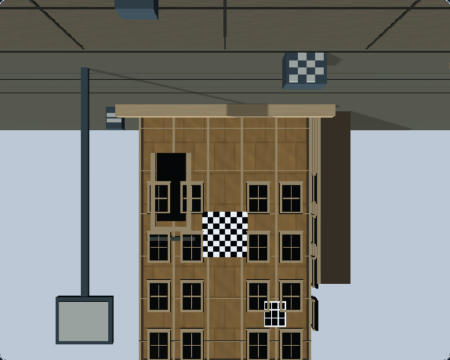
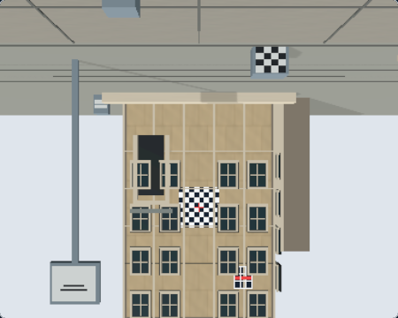
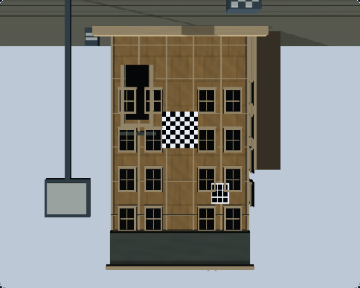
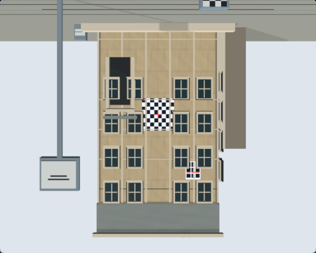

# RQ2.1 — Architecture Rise v2 Native M3 Raw Revalidation

## Result

The active `architecture-rise-raw-rtt-v2` scene passed the bounded native r187 M3 Raw revalidation. The current development policy now enables only Architecture Rise `raw-rtt` under the existing trusted pilot. Production Ground Glass remains WebGL-only; M4/M5/M6 remain separately gated.

Base: `bbb60902e73ecdbc97628c3b604785a871ed0f50` (accepted PR #324 / `origin/main` at worktree creation). The final native application test ran from source commit `887930d73315d9cc64cf37c66385a8a7ddfe4296`.

## v2 source lineage

RQ2 established `architecture-rise-raw-rtt-v2` at source commit [`29947360228f761e6eacbb04e4095532f25086be`](https://github.com/chau-hm/view-camera-simulator/commit/29947360228f761e6eacbb04e4095532f25086be), based on RQ1 `fc01c023ab8621c8f0f796b000a3b82ad137b54c`. The relevant registered raster inputs are:

- `src/render/ArchitectureRiseSubjectFactory.tsx` — registered subject and RQ2 material inputs.
- `src/render/sceneSubjectRegistry.tsx` — registered subject realization.
- `src/scenes/illumination/sceneWorldIllumination.ts` — scene daylight/environment contribution.
- `src/render/webgpu/groundGlassRawWebGpuCompatibility.ts` — source-bound renderer eligibility and evidence.

The source-commit diff to this revalidation contains no later edits to the subject factory, registry, Architecture Rise illumination, adapter scene/material realization, or Ground Glass target/display behavior. Renderer-side changes are limited to the v2 compatibility attestation and a development-only mounted-source diagnostic attribute; there is no scene-raster drift under the v2 identity.

## Two-stage native verification

### Stage 1 — local qualification candidate

The candidate was based on `bbb60902e73ecdbc97628c3b604785a871ed0f50` and used a temporary, unpublished working-tree compatibility candidate for only Architecture Rise v2 `raw-rtt` / r187, plus a temporary v2 expectation in the existing native application pilot. The command used the trusted development configuration:

```bash
GROUND_GLASS_NATIVE_WEBGPU_REQUIRED=1 \
GROUND_GLASS_WEBGPU_FAILURE_INTEGRATION=1 \
VITE_GROUND_GLASS_WEBGPU_RAW_PILOT=true \
GROUND_GLASS_M3_SOURCE_PROFILE=v2 \
npm run test:e2e -- --project=chrome-native-webgpu --workers=1 --retries=0 \
  src/tests/e2e/ground-glass-webgpu-r187-app-pilot.spec.ts
```

The candidate test executed and passed on native `WebGPURenderer` / `webgpu`, with v2 scene identity, contentful Raw output, and no internal or application fallback. It was only a bootstrap experiment: the working-tree candidate was not committed or published, so no commit SHA is claimed for that provisional tree. Its temporary environment selector and test parameterization are absent from the final workflow.

### Stage 2 — final source-bound record

The accepted record is verified in `src/render/webgpu/groundGlassRawWebGpuCompatibility.ts` and binds `architecture-rise-raw-rtt-v2`, `raw-rtt`, r187, and `m3-architecture-rise-raw-rtt-native-r187-v2`. The dedicated v2 application test then passed against that record:

```bash
GROUND_GLASS_NATIVE_WEBGPU_REQUIRED=1 \
GROUND_GLASS_WEBGPU_FAILURE_INTEGRATION=1 \
VITE_GROUND_GLASS_WEBGPU_RAW_PILOT=true \
PLAYWRIGHT_WEB_SERVER_PORT=4174 \
npm run test:e2e -- --config=playwright.rq21.config.ts \
  --project=chrome-native-webgpu --workers=1 --retries=0 \
  scripts/render-quality/rq2.1-native-m3.spec.ts
```

Result: **1 executed, 1 passed, 0 skipped, 0 retries**. The test source commit is recorded in [the runtime result](rq21-native-m3-v2/capture-run/runtime/rq2.1-native-v2-runtime.json). Runtime was Chrome `157.0.8103.40`, Three.js r187, Darwin `27.0.0` arm64. No GPU hardware-acceleration or adapter identity claim is made.

Observed runtime identity:

```text
scene: architecture-rise
scene source: architecture-rise-raw-rtt-v2
selected backend: webgpu
renderer family / execution API: webgpu-renderer / webgpu
renderer revision: r187
policy and mounted evidence: m3-architecture-rise-raw-rtt-native-r187-v2
application fallback: not observed
internal fallback: none
```

The application test changed focus, selected f/8, and applied Front Rise 20 mm while Raw remained contentful. The final request ID equalled the last completed request ID; the host accepted that completed frame. SPA navigation confirmed cleanup for the native generation before the unsupported Interior Corner scene mounted on WebGL2. A separate native Raw fixture passed asymmetric orientation landmarks, off-center crop, and source correspondence.

## Captured states and comparison

Capture run `617cc26b-05c7-4281-b99e-ed835edab1d3` is source-pinned to the clean capture commit `fcd995f04b19a6b434785653cc4833bf28a6e082`. Its [run record](rq21-native-m3-v2/capture-run/captures/capture-run.json), [native status](rq21-native-m3-v2/capture-run/captures/native-status.json), and per-image sidecars record the actual runtime and completed accepted requests. Both native images are 450 × 360 at 1280 × 900 viewport, DPR 1, Standard quality:

| State | WebGL Raw Debug | Native WebGPU M3 Raw |
|---|---|---|
| Neutral, 150 mm / 8,900 mm / f/8 / Front Rise 0 mm |  |  |
| Front Rise, 150 mm / 8,900 mm / f/8 / Front Rise 20 mm |  |  |

Native screenshot SHA-256:

- `neutral-webgpu-raw.png`: `c0215d4854441eae19dbe9163d39267ae970ecea8304e13964f11f0fe14da308`
- `front-rise-webgpu-raw.png`: `12b1adeb3bf5720ec19d7d534251c3c4b1fe10d7d1abfba7ec296975230dd766`

The two implementations show the same scene composition and landmark placement in each matched state. Roofline, facade, windows, lamp post, and checker targets remain visible; the Front Rise state changes composition consistently in both outputs. The native output appears lighter and less contrasty than WebGL Raw, while WebGL Raw appears darker and warmer. These are observations only: WebGL Raw Debug and native M3 Raw use different display implementations, so the pairs are bounded Raw display comparisons, not pixel parity or evidence of a particular color-space, tone-mapping, or lighting defect. Images were not normalized.

The same run also retains the WebGL processed regression view at [`processed-webgl.png`](rq21-native-m3-v2/capture-run/ground-glass/processed-webgl.png) and separate Observer clean and teaching references at [`observer-clean.png`](rq21-native-m3-v2/capture-run/observer/observer-clean.png) and [`observer-teaching.png`](rq21-native-m3-v2/capture-run/observer/observer-teaching.png). Processed WebGL and native pre-composite Raw are not treated as equivalent.

## Scope and retained evidence

- The compatibility resolver still rejects historical r186 v1 and r187 v1 records for the active v2 source. Historical v1 M3/M4/M5/M6 records remain unchanged.
- The verified v2 record authorizes only the development M3 Raw pilot. It does not authorize physical CoC, aperture gather, far reconstruction, composite, or full presentation.
- The accepted RQ2 manifest's earlier `nativeRevalidation.status: not-evaluated` record remains unchanged. This report and the independent capture run record the later revalidation.
- The accepted RQ1 baseline and five accepted RQ2 WebGL/Observer After images remain unchanged. The RQ1 baseline check still validates all seven historical captures.
- M7 remains partially qualified, M8 entry denied, M9 unauthorized, M7V approvals pending, and broad E2E not qualified. Production Ground Glass remains WebGL-only.

## Validation

- `npm run test`: **329 files, 4,006 tests passed**.
- `npm run typecheck`: passed.
- `npm run lint`: passed.
- Dedicated v2 native app test: **1 passed, 0 skipped, 0 retries**.
- Native Raw orientation/correspondence fixture: **1 passed**.
- Production-preview isolation test: **4 passed**; production selected WebGL and did not load WebGPU modules.
- `npm run evidence:check:m7v`: passed policy integrity; approvals remain pending.
- `npm run evidence:check:m7w`: passed evidence integrity; M7 remains partially qualified.
- RQ1 committed-baseline check: passed, seven captures.
- RQ2.1 capture-run check: passed, seven captures including both native v2 states.
- Accepted RQ2 After check: passed, five WebGL/Observer captures; historical native status remains not-evaluated.
- Final-head hosted CI and independent review are reported in the PR handoff after publication.
