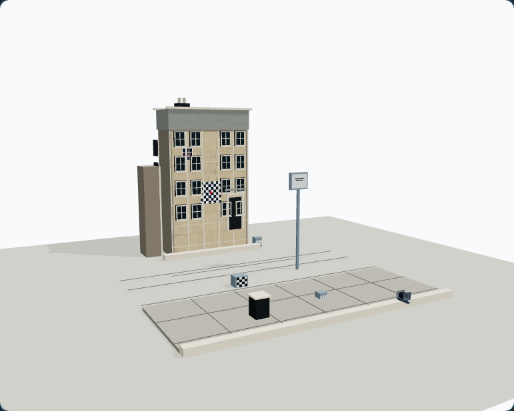
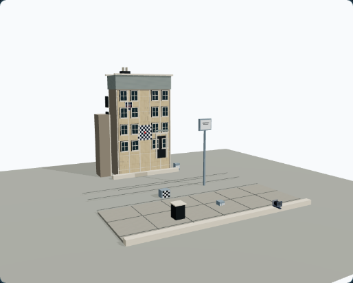
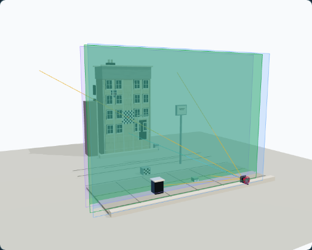
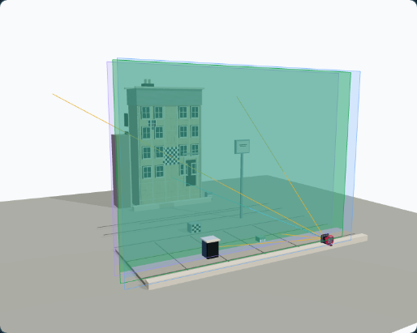
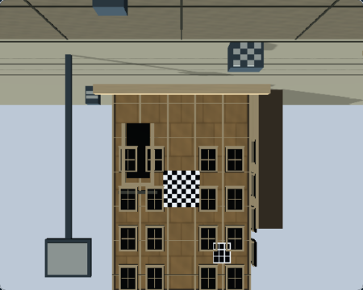
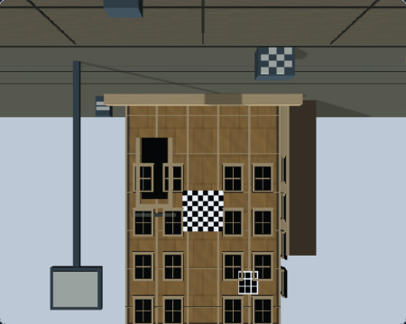
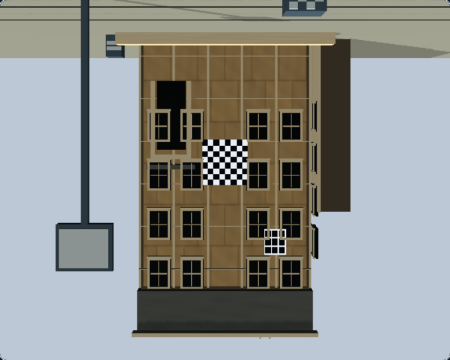
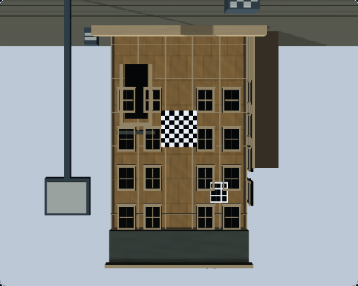
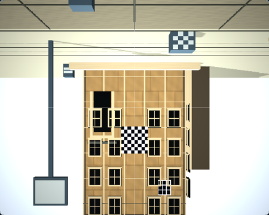
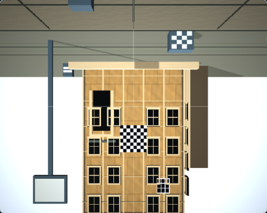

# RQ2 — Architecture Rise Lighting, Materials & Scene Quality

## Result

Architecture Rise now has a clearer daylight hierarchy and more distinct stone, trim, glazing, sidewalk, and street responses. The change uses the existing registered subject, deterministic procedural maps, scene daylight, presentation key, and PCF shadow system. It adds no geometry, textures, render targets, or lighting systems.

The matched Before images remain in the immutable [RQ1 baseline](rq1-baseline/). RQ2 images and per-capture metadata are in [the After evidence directory](rq2-architecture-rise/after/). The source commit recorded by all new captures is `29947360228f761e6eacbb04e4095532f25086be`.

## Implementation decision

- Reused `createProceduralSurfaceMaterial()` and its deterministic albedo, roughness, and normal maps unchanged. The Architecture Rise registered subject still owns and disposes the same 12 textures.
- Changed only Architecture Rise material recipes in `src/render/ArchitectureRiseSubjectFactory.tsx`, daylight/environment values in `src/scenes/illumination/sceneWorldIllumination.ts`, and the Architecture Rise presentation-key direction in `src/render/sceneSubjectRegistry.tsx`.
- Kept the natural daylight as a non-shadow-casting source. The existing presentation key remains the only shadow caster and keeps the shared PCF shadow-map allocation. Its scene-specific direction now follows the daylight ray; no global lighting profile or shadow resolution changed.
- Left camera optics, movements, geometry, object positions, teaching materials, focus targets, and helper shadow participation unchanged.

### Parameter changes

| Surface or light | Before | After | Intent |
| --- | --- | --- | --- |
| Facade limestone | `#d7c19c`, repeat `3×3`, roughness `0.94`, normal `0.30` | `#cfb992`, repeat `4×4`, roughness `0.90`, normal `0.38` | Finer masonry character and more legible relief under angled light |
| Roof cut stone | `#969994`, roughness `0.92`, normal `0.14` | `#8c9693`, roughness `0.90`, normal `0.18` | Separate parapet from the warmer facade while retaining a matte stone response |
| Cut-stone trim | `#f3e8d2`, roughness `0.82`, normal `0.12` | `#e5dac5`, roughness `0.78`, normal `0.09` | Keep trim readable with a smoother, less bright response |
| Glazing | `#182d37`, roughness `0.24`, metalness `0.08` | `#233b43`, roughness `0.30`, metalness `0.12` | Give window surfaces a distinct, restrained material response without fake emissive reflections |
| Sidewalk concrete | `#a6a397`, repeat `10×8`, roughness `0.98`, normal `0.10` | `#9b988e`, repeat `12×10`, roughness `0.96`, normal `0.14` | Improve pavement-scale detail and separation from the street |
| Street and ground | pavement `#73766f` / `0.98`; ground `#c4c4bb` / `0.99` | pavement `#696c68` / `0.94`; ground `#9a9c95` / `0.97` | Reduce the broad pale ground response and clarify the curb/street boundary |
| Architecture Rise daylight | intensity `0.8` | intensity `1.0` | Strengthen the existing single directional daylight contribution |
| Architecture Rise environment | intensity `0.95` | intensity `0.72` | Reduce uniform fill relative to the daylight direction |
| Presentation key offset | `(-2.5, 3.5, -2)` | `(-3, 4, -4.5)` | Align the existing shadow-casting key with the scene daylight direction |

The focus crosshair, checker chart, teaching references, and optical helpers keep their existing materials. The procedural utility implementation and texture dimensions remain unchanged.

## Matched visual comparison

Ground Glass states use the public Architecture Rise preset, 150 mm, focus 8900 mm, f/8, zero other movements, Standard quality, a 1280×900 viewport at DPR 1, and 450×360 Ground Glass output. Front Rise uses 20 mm; all other movements remain zero. Observer captures use the existing Dream Loop state (focus 3090 mm, f/11, zero movements) and are not treated as the same optical state as Ground Glass.

| Reference | Before — accepted RQ1 | After — RQ2 |
| --- | --- | --- |
| Observer clean |  |  |
| Observer teaching |  |  |
| Neutral WebGL Raw |  |  |
| Front Rise WebGL Raw |  |  |
| Processed WebGL Ground Glass |  |  |

### Visual observations

- In both Observer views, the ground plane and facade have more tonal separation. The teaching view retains the focus plane, target markers, and chart visibility; the overlays and composition remain in their prior positions.
- In both Raw states, facade joints and surface variation read more clearly, the roof and trim separate more distinctly from the facade, and the darker street/ground helps the sidewalk and curb read as separate surfaces. The window recesses and projecting details have stronger local shading.
- The processed WebGL capture remains contentful and correctly oriented. The material changes remain visible through the photographic path without changing its optics or image-circle behavior.
- The improvement is perceptible at 450×360, though the scene remains a stylized study model. Glazing remains dark and does not gain real reflections; this change does not add reflection or transmission infrastructure.
- These are direct image observations. They do not establish a renderer root cause or pixel parity with native WebGPU.

## Runtime and image provenance

The After Ground Glass captures ran as `webgl-renderer / webgl2`, Three.js r187, selected WebGL backend, with no application or internal fallback. Every current request was accepted and completed, and each screenshot passed the decoded-pixel contentfulness check. Browser metadata records Chromium `149.0.7827.55` on Darwin. Observer metadata records its actual 1440×1000 viewport and separate Dream Loop camera state.

The seven accepted Before PNG hashes remain the RQ1 values:

| Before image | SHA-256 |
| --- | --- |
| Observer clean | `336936b366c0822b794c570625fde937047b4afa2c165d26a48a7abe7921b4f8` |
| Observer teaching | `cdfd5e3ba0b1714d28b1dc987d3950f41cd3a9a741bcc711e446ec54e905a9ff` |
| Neutral WebGL Raw | `3c46dd7bbc5dc70e0a9615e07cf7cdd210f33e8cbc1b364be6a046ee369e3fbd` |
| Neutral native WebGPU M3 Raw | `bcb56855d243984939bcd9a86080c6c0babc4d96e60cbd959a42203f65adb7e3` |
| Front Rise WebGL Raw | `426d75314ea294f5dccb8c8b1c27a5527c4a6aedd77f09bb8b775cbc191df166` |
| Front Rise native WebGPU M3 Raw | `deca5c9514982e44aaad37e6fd8843e4fec5ff33f15b64a04b86c2b0d662013e` |
| Processed WebGL | `674181db1a39746a1443312c49d82eeb28c64d3698c4fff63923a312e9fedd93` |

| After image | SHA-256 |
| --- | --- |
| Observer clean | `f30e0e0a23e3ce5f94609ae5d20f286c21d7c1905054631a759396c5208a995e` |
| Observer teaching | `c9d9a657c75a5ec1551fc7f837351677286ec2ef175e04ec2810b3da6481bdaf` |
| Neutral WebGL Raw | `74b6a239349cea50e36101a215db938e4ef82a2fbbbd099c944cd18bff4f58bc` |
| Front Rise WebGL Raw | `58222b21e03fe3920b483b93d9a408d452ebdd31457648c6c0cbb0db9bdd5cd5` |
| Processed WebGL | `ff892a522b24723f82fd89b4ffc100ce05169013a6a9ee9c49bbab6908b31c4f` |

The same hashes and complete runtime/camera metadata are recorded in sidecars under `rq2-architecture-rise/after/captures/`; the RQ2 checker verifies each digest against its PNG bytes. No native After PNGs are present.

## Resources and performance

The existing scene-capacity benchmark measured the Architecture Rise processed record. The compact measured output is [performance-comparison.json](rq2-architecture-rise/performance-comparison.json).

| Metric | Before (`fc01c02`) | After (`2994736`) |
| --- | ---: | ---: |
| Viewport subject meshes | 335 | 335 |
| RTT subject meshes | 334 | 334 |
| Unique geometries — viewport / RTT | 3 / 2 | 3 / 2 |
| Unique materials — viewport / RTT | 15 / 14 | 15 / 14 |
| Unique textures — viewport / RTT | 12 / 12 | 12 / 12 |
| Renderer geometries / textures | 3 / 24 | 3 / 24 |
| Viewport / RTT triangles | 4478 / 3998 | 4478 / 3998 |
| Active frame cadence p50 / p95 | 396.1 / 417.6 ms | 378.4 / 401.3 ms |
| Ground Glass CPU-submit p95 | 0.8 ms | 0.8 ms |
| Scene-render CPU-submit p95 | 0.8 ms | 0.7 ms |

The benchmark ran in Chromium using ANGLE/SwiftShader software rendering, with `cpu-fallback` profiling and `cpu-submit-ms`; GPU timing was unavailable. Frame cadence is active R3F cadence with the simulator mounted, not pure GPU render time. The before run selected only Architecture Rise through a temporary selector; the measurement loop was unchanged. The after run used the repository's unchanged full benchmark matrix. Treat the cadence and sub-millisecond differences as environment-specific observations, not a hardware performance claim. Resource counts show no new scene or renderer allocations.

## WebGPU source compatibility

The Architecture Rise Raw source revision advanced from `architecture-rise-raw-rtt-v1` to `architecture-rise-raw-rtt-v2` because the registered subject material inputs, scene daylight, and scene-specific presentation-key direction affect the raster. The revision remains a manually maintained compatibility binding in `src/render/webgpu/groundGlassRawWebGpuCompatibility.ts`; review changes to the registered subject, material recipes/textures, scene illumination, presentation lighting, or adapter realization against that binding. A later change to any of those inputs must advance the source revision again.

The existing r187 M3 v1 evidence remains exported as historical evidence for v1. The active r187 v2 M3 feature is `not-evaluated` and is not eligible for native rendering. The capture manifest and status record identify the exact missing captures:

- `architecture-rise-neutral-webgpu-raw`
- `architecture-rise-front-rise-webgpu-raw`

No native browser/GPU preflight or capture was attempted, so this is **not** an environment-unavailable result and does not validate native WebGPU rendering for v2. The smallest follow-up is a bounded, source-matched M3 Raw revalidation through the existing trusted native test path; only after actual runtime, current-frame acceptance, contentfulness, orientation, and cleanup evidence passes may the v2 feature record become verified. Any further raster-input edits before that revalidation require another source revision. The RQ2 capture/check profile is prepared for native captures once that evidence exists.

M4/M5 historical research remains bound to v1. The historical M7C/M7F/M7G evaluators still validate their v1 artifacts. Existing M6 presentation evidence is also stale for v2 and now fails closed. No M4/M5/M6 feature or production authorization was added; production Ground Glass remains WebGL-only.

## Reproduction

Run from a clean source tree with Node 24 and the locked dependencies:

```bash
npm run render-quality:rq1:check -- --baseline
npm run render-quality:rq2:capture
npm run render-quality:rq2:check
SCENE_CAPACITY_BENCHMARK_OUTPUT_DIR=docs/render-quality/.rq2-runs/performance-after npm run benchmark:scene-capacity
```

The RQ2 capture command reuses the existing Dream Loop Architecture Rise Observer pilot, then the shared RQ1 Playwright capture harness for the two WebGL Raw states and the processed WebGL reference. It writes to the Git-ignored `docs/render-quality/.rq2-runs/current/`; it never writes to the committed RQ1 baseline. For this source revision the runner records native M3 as `not-evaluated` and fails closed if native artifacts appear unexpectedly. The validated review copy is `docs/render-quality/rq2-architecture-rise/after/`.

## Validation

The full `npm run test` passed: 329 test files and 4,006 tests. Focused scene, material, lighting, Ground Glass, resource-lifecycle, compatibility, and capture-provenance tests also passed. `npm run typecheck`, `npm run lint`, `npm run evidence:check:m7v`, `npm run evidence:check:m7w`, the committed RQ1 baseline check, and both working and tracked-copy RQ2 evidence checks passed. Final-head hosted CI is reported in the PR handoff.
