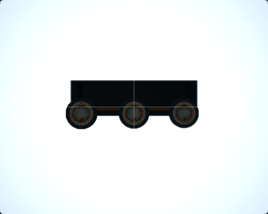
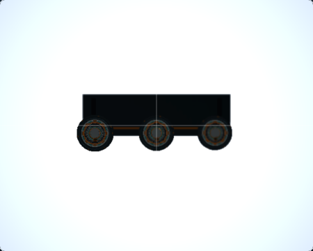
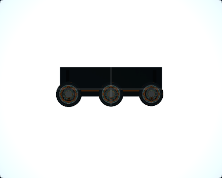
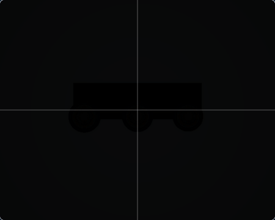
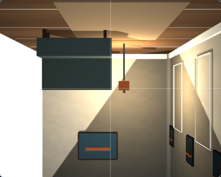
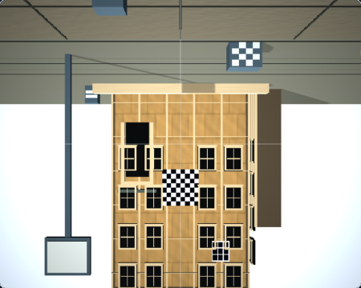

# RQ3A — WebGL Ground Glass DOF Edge Quality

## Result

The WebGL Far gather admitted a nearer surface into a background blur when both samples had nonnegative CoC and their depths were within a fixed 20 mm tolerance. This was reproducible at the Macro scene's 10 mm depth steps. The correction limits that tolerance to two representable depth steps from the actual 16-bit depth target. Near gather behavior and physical CoC are unchanged.

The focused WebGL fixture reduced adjacent-edge foreground red contamination from 82 to 0 levels at the 400/410 mm boundary, while retaining background blur and focused foreground contrast. The 390 mm macro state shows the largest real-scene change around the depth-separated center/far detail. The stopped-down macro, Interior Corner, and Architecture Rise controls remain pixel-identical.

## Reproduced cause and correction

The old shared `depthToleranceMm` rule was `max(20 mm, centerDistance * 0.015)`. At 400–410 mm, the 10 mm depth difference therefore fell inside the Far visibility window. A focused foreground sample (CoC zero) or farther-side defocused sample could contribute to a background gather despite lying in front of its center surface.

The Far gather now uses two depth-code steps for a perspective depth texture:

```text
2 × z² × (far − near) / (near × far × 65535)
```

Here `z`, `near`, and `far` are expressed in millimetres. The value is computed once per Far output pixel, outside the aperture-sample loop. The existing Near tolerance remains unchanged. The correction does not change signed CoC, oriented footprints, near alpha, compositing, camera state, scene content, or the render-target/pass graph.

The fixture renders the production physical CoC and Far/Near gather shaders in WebGL2 with a `DEPTH_COMPONENT16` texture. Its 400 mm red/gold foreground card covers a blue/cyan 410 mm background. The one-pixel edge ROI and contrast ROIs are fixed from fixture geometry. The negative control uses the same input and sample locations but restores the previous 20 mm/1.5% Far tolerance. The rendered fixture image and machine-readable measurements are [here](rq3a-dof-edge-quality/fixture/focus-foreground-400-f2_8.png) and [here](rq3a-dof-edge-quality/fixture/rendered-pixel-evidence.json).

## Matched real-scene captures

The Before run is pinned to accepted base `1ffb9c715012d5d922aa503525eebd3a8e08a490`. The After run was captured from clean commit `e09caad2c08e9fe61c8dbaac45c80a0305924b4e` (run `ebebbfeb-f6bf-4533-9246-f43cbd2c3579`). Both use Chromium 149 on macOS 27 arm64, WebGL2, a 1280×900 viewport at DPR 1, Standard quality, Raw preview with Raw Debug off, and an exact 450×360 Ground Glass crop. Each current frame was completed and accepted by the host. Runtime diagnostics report `webgl-renderer / webgl2`, no internal fallback, and no application fallback. The browser's unmasked renderer string identifies ANGLE/Vulkan SwiftShader; these captures do not establish hardware acceleration or serve as performance measurements.

| State | Before | After |
|---|---|---|
| Macro M1 — 150 mm, focus 400 mm, f/5.6 |  |  |
| Macro M2 — 150 mm, focus 390 mm, f/5.6 |  |  |
| Macro M3 — 150 mm, focus 410 mm, f/5.6 |  |  |
| Macro M4 — 150 mm, focus 400 mm, f/32 |  |  |
| Interior Corner canonical start — 150 mm, focus 8,000 mm, f/5.6 |  |  |
| Architecture Rise RQ2 neutral — 150 mm, focus 8,900 mm, f/8 |  |  |

The M2 difference is localized to the macro subject's center/far edges; the near-focused detail remains stable. M1 changes are also confined to the subject. M3 has a smaller change. M4, Interior Corner, and Architecture Rise produce byte-identical screenshots. No exposure or color normalization was applied.

The whole-image pixel comparison is diagnostic only (450×360 RGB images; a changed pixel has any changed channel; mean absolute difference is averaged over all 8-bit channels):

| State | Changed pixels | Mean absolute RGB difference | Maximum channel delta |
|---|---:|---:|---:|
| Macro M1 | 1,325 (0.82%) | 0.013568 | 39 |
| Macro M2 | 2,504 (1.55%) | 0.030944 | 47 |
| Macro M3 | 346 (0.21%) | 0.001965 | 6 |
| Macro M4 | 0 | 0 | 0 |
| Interior Corner | 0 | 0 | 0 |
| Architecture Rise | 0 | 0 | 0 |

These numbers do not imply a whole-image quality score. Exact image hashes and runtime/camera metadata are in the [Before capture record](rq3a-dof-edge-quality/before/capture-run.json) and [After capture record](rq3a-dof-edge-quality/after/capture-run.json); canonical states are in [states.json](rq3a-dof-edge-quality/states.json).

## Preservation and cost

- `depthToleranceMm` and `calculateNearSampleWeight` retain their previous behavior. The focused near-defocus case still produces a bounded near alpha of 1 and keeps its focused background at source contrast.
- The f/32 zero-blur ROI has zero RGB difference in the fixture; the matched real M4 screenshot is pixel-identical.
- The existing coverage composite, Image Circle state, Raw/Upright mapping, and focus-loupe mapping were not changed. The focused Image Circle regression checks Ground Glass and scene coverage agreement through rise, tilt, preview, and aperture changes.
- `deriveOpticsState`, `computePhysicalBlurFootprint`, canonical movements, scene source, materials, and lighting were not modified.
- The shader remains in the WebGL `GroundGlassRTT` path. The native M3 WebGPU adapter does not import these GLSL sources, and no WebGPU policy, source revision, or feature evidence was changed.
- No pass, render target, sample count, or resource was added. The RQ3A captures use Standard quality, 32 gather samples, internal RTT 574×459, and gather scale 1. The tolerance is evaluated once per Far output pixel rather than once for every gather sample.
- No trustworthy GPU timer or hardware CPU-submit comparison was available in the SwiftShader environment. No GPU-time, hardware-acceleration, or FPS improvement is claimed.

## Reproduction and validation

On a clean source tree, run:

```bash
npm run render-quality:rq3a:capture
```

The command writes a new Playwright run under the Git-ignored `docs/render-quality/.rq3a-runs/current/`; it does not overwrite these committed Before images. Validate the focused rendered-pixel fixture with:

```bash
npm run render-quality:rq3a:verify
```

Both commands use the dedicated `playwright.rq3a.config.ts` test inventory, so these focused checks do not add entries to the ordinary E2E or M7 qualification discovery set.

## Limitations

The gather remains a single-view approximation. It cannot reconstruct background surfaces fully hidden by foreground geometry. The screenshots and fixture do not establish full physical image formation, optical bokeh, or WebGPU photographic parity. The tested browser used SwiftShader software rendering, so hardware behavior and performance remain unmeasured.
