# RQ3B — Non-Parallel Natural Illumination

## Result

The WebGL Ground Glass composite now evaluates a geometric natural-illumination field for non-parallel lens and film planes. The existing parallel `cos⁴` path, finite Image Circle coverage, exposure throughput, and WebGPU authorization boundaries remain separate.

The model is a thin-pupil geometric approximation. It is not a calibrated lens profile and does not model mechanical vignetting, pupil clipping, cat's-eye bokeh, multi-element ray tracing, or measured lens transmission.

## Model and normalization

For lens center `L`, film point `P`, unit image-side optical axis `a`, and `q = P − L`, an unobstructed constant-radiance thin pupil gives the geometric irradiance ratio

```text
I(P) ∝ (a · q)(−s n · q) / |q|⁴
```

Here `n` is the actual unit film-plane normal and `s` selects the normal direction from the film toward the lens. The factors represent projected pupil response, film incidence, and inverse-square distance. The ratio is normalized at `P₀`, where the image-side optical axis intersects the film plane. With `v = |P₀ − L|` and `c₀ = −s(n · a) > 0`:

```text
G(P) = v² (a · q)(−s n · q) / (c₀ |q|⁴)
```

This reference is derived from the canonical geometry; the film center and brightest pixel are not forced to unity. For parallel planes, `q = (x, y, v)`, `a · q = v`, and `−s n · q = v`, so:

```text
G(P) = v⁴ / (v² + x² + y²)²
     = (v² / (v² + x² + y²))²
```

That is the existing parallel `cos⁴` result. Tests compare multiple film points and evaluate both signs of Tilt and Swing down to `0.1°`; direct geometry tests also approach zero from both sides. The legacy branch is retained at the machine-scale parallel tolerance of `1e-10`.

The canonical state stores the lens-to-film-center vector and image-side axis in rear-standard right/up/normal millimetres, the reference image distance and incidence cosine, and the film-normal sign. The CPU evaluator and composite shader apply the same expression to the existing physical-film point. Invalid geometry fails to neutral illumination; points outside the image-side pupil hemisphere receive zero.

## Implementation and boundaries

The field is evaluated in the existing final WebGL composite after the DOF reconstruction, using `resolveGroundGlassFilmPointMm(sampleUv)`. It shares the physical-film coordinates used by coverage, so Raw/Upright orientation, Rise/Shift, inspection crop, and Focus Loupe mapping are not independently re-centered or flipped.

The finite coverage circle/conic and its image-side half-space and one-pixel edge feather are unchanged. Coverage remains a separate mask. Aperture and bellows throughput remain in the existing illuminance factor; neither is folded into the spatial field or applied twice.

The change adds five named composite uniforms (nine scalar components) and a guarded arithmetic branch. It adds no render pass, render target, persistent texture, scene render, or DOF sample. No CPU-submit or GPU-time measurement was available, so no timing claim is made.

Only `GroundGlassRTT` opts into non-parallel illumination. The WebGPU adapter calls the resolver without that opt-in, so the development M3 Raw path remains unchanged; no scene raster inputs, compatibility revision, M4/M5/M6 authorization, backend policy, or production route changed. Production Ground Glass remains WebGL-only.

## Captures and comparison

Before capture run `e7287315-e58e-4d32-9250-a0634b890301` used clean source `8319460dc2556b0f07d04b08a826d54cb6d4fd6e`. After capture run `139213d4-ecbf-46c1-8e90-7fad21ba5298` used clean source `2541f280b08d14ef4be09cd136f8e6f956080c8a`. Both use Chromium 149.0.7827.55 on macOS 27.0.0 arm64, Three.js r187, WebGL2, 1280×900 viewport at DPR 1, Standard quality, Raw preview with Raw Debug off, and a 450×360 Ground Glass crop.

Each After frame was contentful, completed, accepted by the host with matching current and last-completed request IDs, and reported no page or console errors or renderer fallback. The capture harness verifies the applied focal length, focus, aperture, and public movement controls. Exact metadata and SHA-256 values are in [states.json](rq3b-nonparallel-natural-illumination/states.json) and the per-run records.

### Oblique Architecture

| State | Before | After |
|---|---|---|
| A1 · 0 mm Rise, 0° Swing | 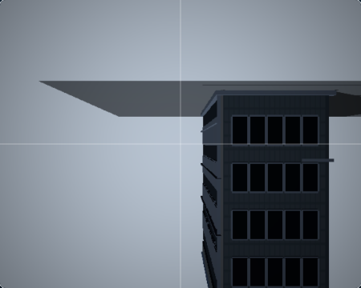 |  |
| A2 · 40 mm Rise, 0° Swing |  | 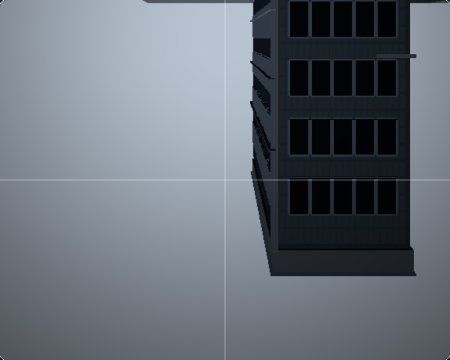 |
| A3 · 40 mm Rise, +5° Swing | 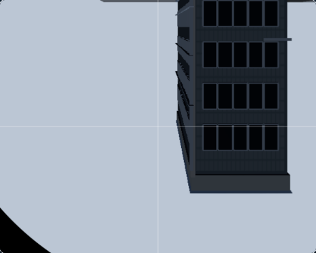 | 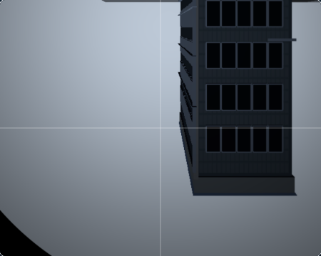 |
| A4 · 40 mm Rise, −5° Swing | 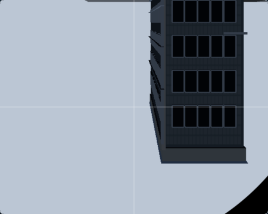 | 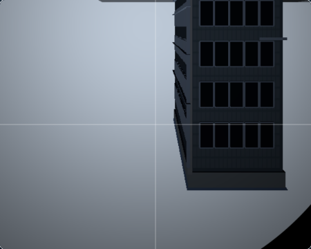 |

The two parallel states are byte-identical to Before. The two opposite Swing states change the spatial field in opposite orientations; the screenshots show a gradual shift across the covered scene, not an added broad coverage-edge feather.

### Macro Oblique Plane

| State | Before | After |
|---|---|---|
| B1 · 0° Tilt | 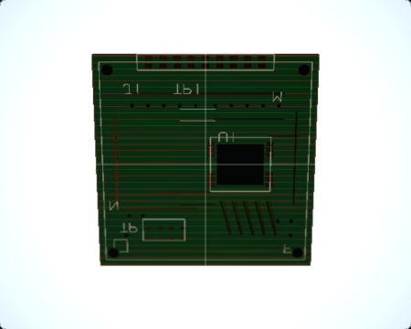 |  |
| B2 · +5° Tilt | 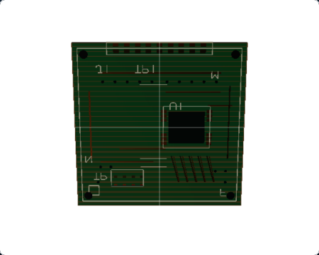 | 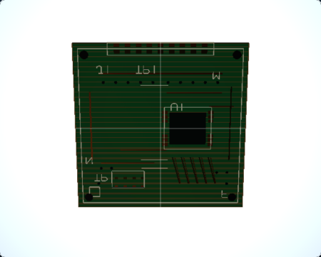 |

B1 is byte-identical. B2 now shows the gradual incidence/distance variation on the tilted plane. The change is visible without adjusting exposure or changing the scene.

### Parallel controls

| State | Before | After |
|---|---|---|
| C1 · Macro Bellows, 900 mm focus |  | 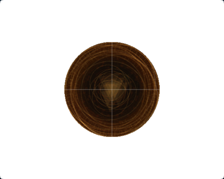 |
| C2 · Macro Bellows, 300 mm focus | 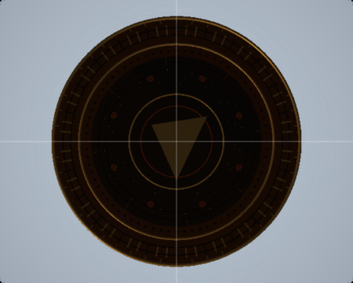 |  |
| D · Architecture Rise RQ2 neutral | 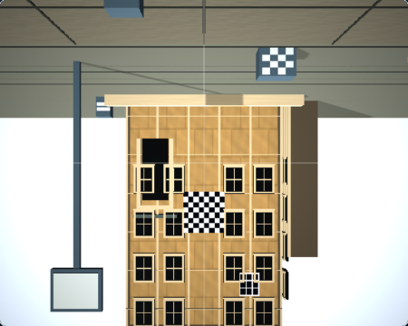 |  |

All three controls are byte-identical to Before. The observed bellows illuminance gains remain `2.6794572` at 900 mm focus and `0.9646046` at 300 mm focus; the associated image distances remain 180 mm and 300 mm.

## Controlled WebGL2 check

[gpu-comparison.json](rq3b-nonparallel-natural-illumination/gpu-comparison.json) records the production composite running in a bounded uniform-radiance WebGL2 fixture. The regenerated v2 record is pinned to clean source `546ee53af090ed594e8cbef5529c2a4e4bf3a4d7`. It covers 39 physical-film samples across parallel, Rise, both Swing signs, non-parallel Tilt, and the RQ2 Architecture Rise control. Samples include corners, optical-axis intersections, opposing gradient points, and conic-boundary points.

For non-parallel states, the film-plane intersection uses `t = lensToFilmCenterLocalMm.z / imageSideAxisLocal.z`; the fixture records that exact point and samples its nearest output pixel. It asserts the sample is within half a pixel diagonal and the normalized natural-illumination gain is approximately one. This corrects the earlier fixture's sign error, which placed the labeled samples across the axis instead of at the plane intersection.

The readback used RGBA8 `readRenderTargetPixels`. All 39 GPU output bytes matched the CPU natural-illumination and coverage calculation exactly (maximum absolute difference: 0 bytes; allowed tolerance: 2 bytes). Runtime identity was Three.js WebGLRenderer/WebGL2 in Chromium 149 on macOS 27 arm64. The reported WebGL renderer string is `WebKit WebGL`; no hardware-acceleration claim is made.

## Validation

- Focused natural-illumination/render unit suite: 107 passed; coverage conic unit suite: 13 passed.
- `npm run test` under Node 24.3.0: 329 files, 4030 passed, 31 skipped.
- `npm run typecheck`: passed.
- `npm run lint`: passed.
- Controlled GPU fixture: 1 passed, 39 sample comparisons; regenerated report schema v2 at clean source `546ee53a` after correcting and asserting the non-parallel optical-axis intersection.
- Nine-state After capture: 1 passed, 9 accepted frames.
- `nonparallel-coverage.spec.ts`: 3 passed.
- Selected Raw/Upright orientation and Focus Loupe crop browser tests: 2 passed.
- `npm run render-quality:rq1:check -- --baseline`: passed; seven committed RQ1 captures remain valid.
- `npm run evidence:check:m7v`: policy integrity passed; 75 owner approvals remain pending and qualification remains not-qualified.
- `npm run evidence:check:m7w`: evidence integrity passed; M7 remains partially-qualified and M8 remains denied.

## Limitations

The model assumes an unobstructed pupil with constant radiance. It does not represent real measured lens falloff, mechanical obstruction, pupil clipping, lens-specific transmission, complex multi-element ray paths, or bokeh. The screenshots demonstrate behavior of this geometric approximation; they do not establish photographic parity with a real lens.

Hosted final-head CI and independent review are reported in the PR handoff after publication.
