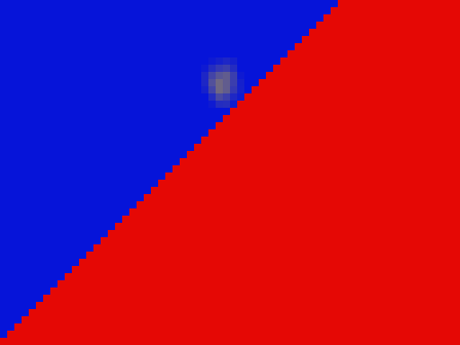
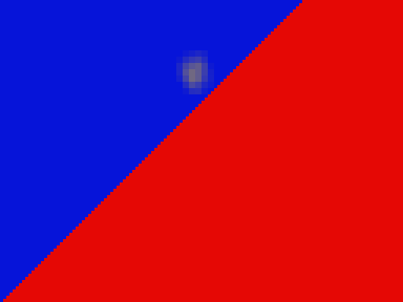

# RQ3C — WebGPU Far Reconstruction Edge Investigation

**Disposition: `NO_VALIDATED_IMPROVEMENT`.** The controlled GPU probe demonstrates a low-resolution Far-layer mismatch analogous to the historical observation in a legacy-style direct mapping. The current shared B1 reconstruction already rejects the selected Near center. The Far target changes; the final research composite does not, because Near coverage masks the probe region. No rendering algorithm or authorization change is proposed.

## Scope and provenance

The worktree started at accepted `origin/main` commit `d5c3b4fe5fb27123347fa09d1d8c1b817bb8b405`. The final clean-source native run used test commit `dc0ea4146b106f205b6d883ad88ff714ac0fa268`; its manifest records `sourceTreeDirty: false`.

The test runs the current shared TSL gather, B1 reconstruction, provenance, and composite nodes in a deterministic synthetic fixture. It is not the registered Architecture Rise application M5 adapter, does not consume the v2 scene or its M4 raster, and records `sceneSourceRevision: null`. Its GPU result is therefore a bounded node-level research observation, not v2 M5 evidence or authorization.

Historical evidence remains relevant but is not treated as a matched rerun:

- Phase G reported 36 half-resolution Far foreground-leak pixels at 128 × 96 source resolution, unchanged across 16/32/64 proposals, and none at Full32.
- Phase H (`GROUND_GLASS_WEBGPU_FAR_RECONSTRUCTION_FEASIBILITY.md`) traced its representative pixel `(68,26)` to half gather texel `(34,13)`, whose observed center was Near source pixel `(69,27)`. Phase G/H used a separate historical fixture/path and Three.js r186; the original GPU input readbacks are not available here. This RQ3C result is analogous evidence, not a reproduction of those exact 36 pixels.

## Controlled native result

The fixture uses 128 × 96 source pixels, a diagonal Near mask `x + y >= 96`, red Near and blue Far source colors, a small yellow Far feature, supplied signed CoC values (Near `−1.5615 mm`, Far `+0.9258 mm`), 36 × 24 mm film, a 12 px radius cap, nearest/clamp sampling, and the current shared native nodes. The supplied CoC is fixture input; the test does not evaluate the M4 optical equation. Readback row origin is established by a GPU identity pass, then converted to top-origin coordinates.

At source pixel `(68,26)` in Half32:

1. The blue source has positive CoC `+0.9258 mm`.
2. The selected gather texel is `(34,13)`.
3. GPU-observed gather-center provenance identifies source pixel `(69,27)`, whose signed CoC is `−1.5605 mm` and whose color is red.
4. The Far gather target at that texel is red, and direct source-grid mapping (B0 diagnostic) carries that red value to the blue Far source pixel.
5. Existing B1 sees the selected center is not Far-eligible (reason code 4, `selectedCenterNotFarEligible`) and returns the source blue instead.

This localizes the controlled mismatch to a low-resolution gather center crossing a depth boundary and its source-grid reconstruction. It does not establish a general gather-kernel error or prove that this is the exact cause of every historical Phase G leak.

| State | Gather | B0 Far leak pixels / energy | Existing B1 Far leak pixels / energy | B0/B1 composite excess pixels / energy | Near spread pixels / alpha energy |
|---|---:|---:|---:|---:|---:|
| Full32 | 128 × 96, 32 | 0 / 0 | 0 / 0 | 0 / 0; 0 / 0 | 192 / 80.0145 |
| Half32 | 64 × 48, 32 | 144 / 126.0639 | 0 / 0.07793 | 0 / 0.06234; 0 / 0.06234 | 332 / 181.1089 |
| Half64 | 64 × 48, 64 | 144 / 126.0468 | 0 / 0.06090 | 0 / 0.04866; 0 / 0.04866 | 378 / 190.1887 |

Far leak pixels count red excess above `0.25` in Far source pixels within two pixels of the diagonal edge; energy sums positive red excess above the uniform blue Far source. The composite metric subtracts the expected red contribution from the same measured Near coverage before counting/extracting excess. These are fixture-specific diagnostics, not universal photographic quality scores. B1 reduces the Half32 Far-target red-excess energy by 99.94% and Half64 by 99.95%. Increasing proposals from 32 to 64 does not fix B0.

The small yellow Far feature retains 99.966% of its Half32 spread energy under B1 in this fixture (14.57664 → 14.57164; 118 spread pixels in both). This does not supersede Phase H's separate result that its tested center-compatible candidate lost 82–86% of Far spread: the fixtures and support differ.

## Composite and Near preservation

The B0 and B1 composite screenshots are byte-identical (same SHA-256 below). At `(68,26)`, Near coverage is 1 and both composites return the same red Near color. In the edge band, both composite excess counts are zero and their excess energies are equal. The controlled Far-target fallback therefore does not establish a visible final-composite improvement here.

The Near gather and coverage are unchanged by B1. The Near-only Half32 output retains 332 spread pixels and alpha energy 181.1089. No Near contribution was removed to improve the Far-layer diagnostic.

### GPU output

The browser screenshots show the 128 × 96 GPU targets at 4× nearest-neighbor display scale (512 × 384 PNG). The two composite files are retained separately to make the matched comparison explicit.

| Direct-mapped Far B0 | Existing B1 Far output |
|---|---|
|  |  |

| Half32 B0 research composite | Half32 B1 research composite |
|---|---|
|  |  |

| Full32 Far reference | Half32 Near preservation |
|---|---|
|  |  |

All readbacks and scenario metrics are in [native-shared-node-readbacks.json](rq3c-far-reconstruction/native-shared-node-readbacks.json). SHA-256 values:

| Artifact | SHA-256 |
|---|---|
| `full32-far-b1.png` | `cb5b51567517343b4ffa8c6ad57692df935fecc8614ab34aab4e3ec367f38320` |
| `half32-far-b0-mapped.png` | `fda22454005b293a60732cba324933c38ea82aae238c115ccb84ce97a9cba8c5` |
| `half32-far-b1.png` | `98a19eeb1fe73e0f634ff0de8de81a4d669c356d5b6ef7bbad654c7093aef44f` |
| `half32-near-preservation.png` | `09af19077df4a5e675b8df69248795989d3c24d95e5deeba77ab5fdcfb1e2c22` |
| `half32-composite-b0.png` | `249d2fc4bda4cbf7c329d87b6347b9e75990eab0a972c88eafc3f17a98e838fb` |
| `half32-composite-b1.png` | `249d2fc4bda4cbf7c329d87b6347b9e75990eab0a972c88eafc3f17a98e838fb` |
| `native-shared-node-readbacks.json` | `6cb6deb41f8aed735c83c2626784790595aeb3e35c2ec99e1324aa164d10f7aa` |

## Runtime, cost, and boundaries

The final focused Playwright command executed (not skipped) with one worker and zero retries using the existing render-quality test tree and `chrome-native-webgpu` project:

```bash
GROUND_GLASS_NATIVE_WEBGPU_REQUIRED=1 npm run test:e2e -- \
  --config=playwright.rq3a.config.ts \
  --project=chrome-native-webgpu --workers=1 --retries=0 \
  src/tests/render-quality/e2e/ground-glass-webgpu-rq3c-current-nodes.spec.ts
```

It ran on Chrome 157.0.8103.40, macOS 27.0 arm64, Three.js r187, with `webgpu-renderer` / `webgpu`, internal fallback `none`, and no page errors. This is a standalone WebGPU fixture, so application fallback is not applicable. Adapter identity and hardware acceleration were not established. GPU timestamps are unavailable; the fixture reports only render/setup/readback wall intervals, which are not shader duration or production frame time.

No persistent product target, production renderer, shader, scene, optics, camera state, lighting, material, backend policy, compatibility record, or evidence authorization was changed. Architecture Rise M3 v2 remains as accepted; M4/M5 remain research-only, M6 separately gated, and production Ground Glass WebGL-only. Historical v1 evidence and the RQ1/RQ2 baselines are untouched.

## Decision and next action

There is no validated RQ3C composite-quality improvement to merge as a rendering change. Existing B1 already blocks this selected Far-center mismatch, while this fixture's Near coverage makes the final composite byte-identical. The PR adds only a bounded native regression probe and its evidence; it does not claim that B1 is a newly implemented fix or that it is generally quality-qualified.

Stop shader changes here. A next edge-quality attempt should first recover the exact historical Phase G input/readback bundle or construct one source-bound native M5 case where the Far leak survives legitimate Near compositing. Do not alter B1 or broaden M5 qualification based on this synthetic result.

## Validation

- Focused B1/reconstruction/M5Q unit tests: 82 passed.
- Focused headed native WebGPU test: 1 passed, 0 skipped, 0 retries on final test commit `dc0ea4146b106f205b6d883ad88ff714ac0fa268`.
- Full unit suite: 329 files and 4,030 tests passed.
- `npm run typecheck`, `npm run lint`, `npm run evidence:check:m7v`, `npm run evidence:check:m7w`, and `npm run render-quality:rq1:check -- --baseline` passed.
- The committed RQ1 baseline checker validated seven captures; the M7 checks preserved `M7: partially-qualified`, `M8 entry: denied`, and broad E2E `not-qualified`.
- `git diff --check` passed. No full native conditional suite or M5/M7 qualification replay was run.
