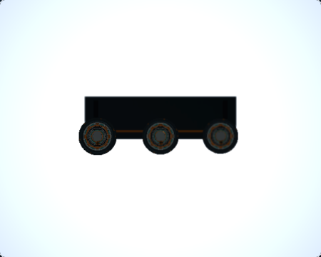
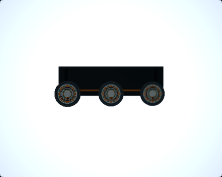
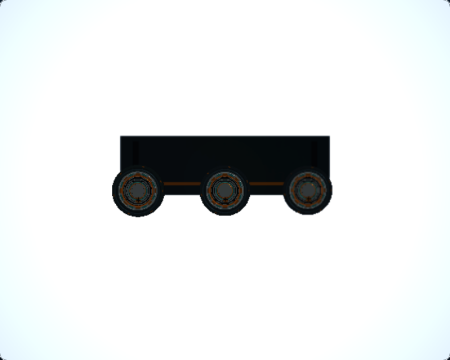
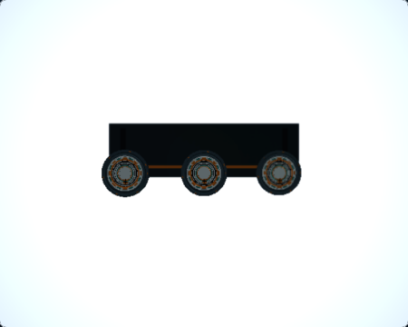
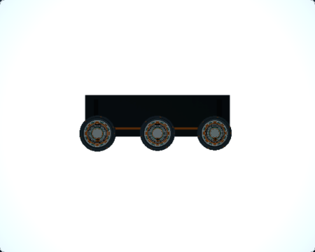

# RQ3D — Macro Depth of Field Visual Readability

## Result

The Macro Depth of Field mechanism is more legible in its normal 450 × 360 Ground Glass view after changing only the three station material recipes. Machined faces and warm detail surfaces now retain more readable shading under the existing teaching light rig. The improvement is visible in all three f/5.6 focus states, with no station-specific lighting or focus-dependent material behavior.

The existing key-light placement already produces a useful top/front-left rake. The limiting factor was the combination of highly metallic station materials and a lighting environment with no broad environment map: body, face, and brass-like details received too little diffuse response to show their relief consistently. No lighting change was needed.

## Matched captures

The images below are direct 450 × 360 Ground Glass captures at the default public camera state, with 150 mm lens, Raw preview, Raw Debug off, Standard quality, zero movements, viewport 1280 × 900, and DPR 1. The production WebGL2 photographic path remained active. Focus and aperture are shown per row.

| State | Before | After |
| --- | --- | --- |
| Near station, 390 mm, f/5.6 |  |  |
| Middle station, 400 mm, f/5.6 |  |  |
| Far station, 410 mm, f/5.6 |  |  |

The finer rings, raised rims, machining marks, and warm fasteners are easier to distinguish at the displayed size. The other two stations remain visibly softer in each state. A 4× inspection capture is also retained in `rq3d-macro-readability/{before,after}/inspection/`.

## Changes and preserved behavior

Only the station materials in `src/render/MacroDepthOfFieldSubjectFactory.tsx` changed:

| Material role | Before metalness / roughness | After metalness / roughness |
| --- | --- | --- |
| Station body | 0.82 / 0.38 | 0.30 / 0.46 |
| Machined face | 0.84 / 0.34 | 0.25 / 0.42 |
| Warm detail and fasteners | 0.88 / 0.36 | 0.60 / 0.44 |

The resulting satin dielectric body and face keep diffuse form shading, while the plated details retain a distinct metallic response. Base colors, deterministic roughness maps and variation, emissive values, chassis, grooves, accent material, and shared Macro material utilities are unchanged. The presentation lighting definition and light placement are unchanged.

There were no geometry, focus target, camera, optical, DOF, movement, or teaching-rule changes. Physical aperture throughput, natural illumination, and the existing Ground Glass gain are unchanged. At f/5.6 the observed gain is `1.5071946747448983` before and after; at f/32 it is `0.0461578369140625` before and after. The f/32 control remains very dark because the aperture is physically stopped down; every sampled station detail ROI remains below the 0.01 linear-luminance near-black threshold. No brightness compensation was applied.

## Detail measurements

The local image-analysis script converts PNG sRGB values to linear Rec.709 luminance and samples a fixed annulus projected from each canonical station center and face radius. The table reports the ROI for the station in focus. These are image readability diagnostics, not a photographic ground-truth or sharpness metric.

| Focus state | Focused detail mean luminance, before → after | Detail P10–P90 range, before → after | Mean luminance gradient, before → after | Near-black pixels, before → after |
| --- | ---: | ---: | ---: | ---: |
| Near, 390 mm | 0.01923 → 0.04104 (+113%) | 0.02842 → 0.07413 (+161%) | 0.00886 → 0.02388 (+170%) | 25.5% → 12.9% |
| Middle, 400 mm | 0.01991 → 0.04182 (+110%) | 0.03161 → 0.07928 (+151%) | 0.00973 → 0.02527 (+160%) | 27.1% → 15.9% |
| Far, 410 mm | 0.02078 → 0.04506 (+117%) | 0.02996 → 0.07827 (+161%) | 0.00943 → 0.02523 (+168%) | 20.6% → 9.3% |

No pixels in the focused detail ROIs crossed the 0.95 clipped-highlight threshold in either set. The broad background ROI is already clipped white in the f/5.6 images, so its background-to-subject difference is not useful as a dynamic-range measure.

The larger material contrast makes defocused details somewhat easier to see too; the gradient metric therefore combines material contrast and optical blur. It is not used to claim increased physical sharpness. Existing focus-distribution and Macro Depth of Field tests still verify the 390 / 400 / 410 mm focus progression. The optical implementation and all input states are unchanged.

## Capture provenance and controls

| Set | Clean source commit | Capture run |
| --- | --- | --- |
| Before | `e48f429cf7786b0cf5a11492dc96e47e6a1362a3` | Ground Glass `e1ee0cf3-767a-499f-a8f2-8f9e6b63f7f5`; Observer/Loupe/secondary `80b986a5-6af0-4151-b570-6ac8cfe7e456` |
| After | `7c62960e6c579c4b03b311239816c819c57fbeca` | Ground Glass `1fa5b29a-c0a3-48fe-84b8-e16192c868c9`; Observer/Loupe/secondary `0f456673-c02b-4f1a-95cc-e41ed1f99710` |

Both runs used Chromium 149.0.7827.55 on macOS 27.0 arm64. Runtime identity was Three.js r187, `webgl-renderer` / `webgl2`, no internal fallback, and no application fallback observed. Every Ground Glass request completed and was accepted by the host; Raw output was contentful. The browser used ANGLE SwiftShader, so this confirms the actual WebGL2 application path in software rendering, not hardware-specific performance.

Before and After use matched camera states and capture code. The only render-source change between their source commits is this scene's three material recipes. The existing RQ1 baseline and RQ2 After artifacts were not modified. The secondary Macro scene screenshots are byte-identical across both runs:

- `macro-bellows-extension`: `7a0a621ae8b7fc47756fcd914774f1902c611b54888c84eaad72ba5fa334439c`
- `macro-oblique-plane`: `265239febfd2ca82ebcf6eb3b10bb634d18c4ddf3e32acea3968a20781d53f91`

The captured subject remains 361 meshes, 28 unique geometries, 6 unique materials, 6 unique textures, and 36,256 triangles. No render pass, target, light, or persistent texture was added. Performance was not measured, and no performance claim is made.

## Reproduction and validation

From a clean source tree, the capture commands are:

```bash
npm run render-quality:rq3a:capture
npm run render-quality:rq3d:capture-support
npm run render-quality:rq3d:measure -- docs/render-quality/rq3d-macro-readability/after/states.json
```

The first command captures the four matched Ground Glass states. The support capture records a fixed Observer view, a 4× focus-loupe view, and the two secondary Macro controls. Each run records its source commit, source cleanliness, actual renderer identity, camera state, accepted frame request, dimensions, and image SHA-256. Captures are retained separately under `before/` and `after/`; do not overwrite the Before set when preparing a later comparison.

Validation completed:

- Focused Macro subject unit test: 3 passed.
- Macro Depth of Field and orientation E2E tests: 3 passed, including focus progression and Raw/Upright mapping.
- Typecheck and lint: passed.
- RQ1 committed baseline check: 7 captures valid.
- M7V policy and M7W evidence checks: passed without changing authorization.
- Before and After screenshot SHA-256 manifests: all files verified.
- Full unit/integration suite: 4,030 tests passed across 329 files; Vitest additionally reported one worker `onTaskUpdate` timeout as an unhandled runner error under suite load. The slow M7M evidence test passed when rerun by itself (22.2 seconds). This is unrelated to the Macro changes and remains noted as a full-suite runner limitation.

The candidate changes only the Macro Depth of Field subject appearance. Production remains WebGL-only, Architecture Rise v2 native M3 authorization is untouched, and no WebGPU photographic feature was enabled.
