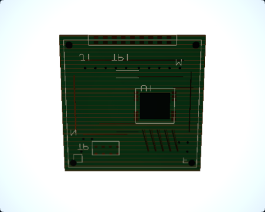
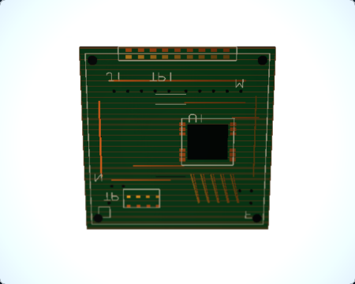
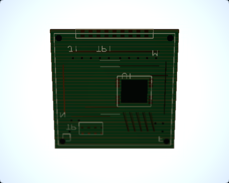
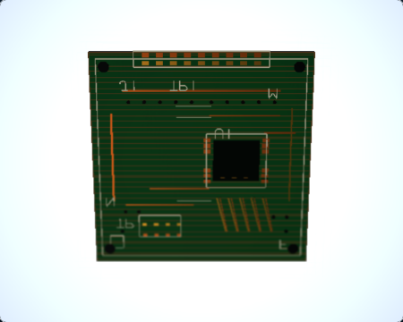
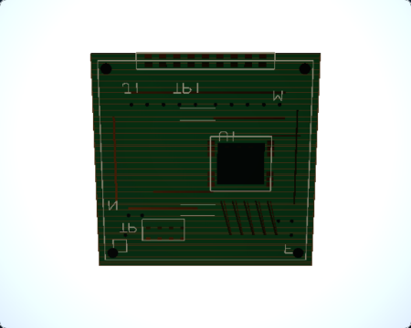
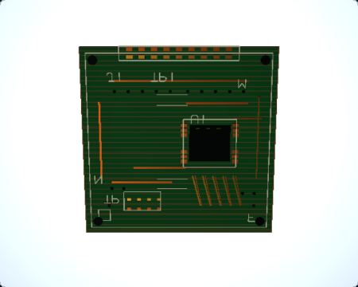
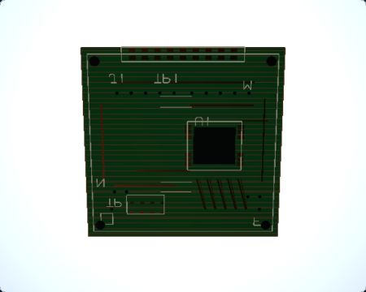
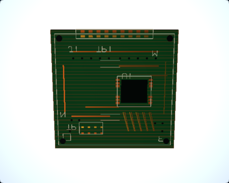

# RQ3E — Macro Oblique Plane Visual Readability

## Result

**Validated visual improvement.** The Macro Oblique Plane PCB is easier to inspect in the 450 × 360 photographic Ground Glass view, with clearer copper routing, plated pads, and silkscreen. The focused lighting/material changes preserve the existing focus lesson and leave the two other macro-scene control captures byte-identical.

## Matched captures

Both runs used the public `macro-oblique-plane` route, Chromium/WebGL2, Three.js r187, Standard quality, 1280 × 900 viewport at DPR 1, a 450 × 360 Ground Glass canvas, Raw preview with Raw Debug disabled, and the scene's fixed f/5.6 aperture. The capture runner verified the mounted renderer, no application or internal fallback, contentful output, and a current request accepted by the render host.

| State | Before | After |
|---|---|---|
| O1 — 400 mm, 0° |  |  |
| O2 — 390 mm, 0° |  |  |
| O3 — 390 mm, +6.2° |  |  |
| O4 — 390 mm, +6.3° |  |  |

The images show a stronger, more distinguishable copper and pad response without changing the PCB's layout or focus state. The 0.1° difference between O3 and O4 remains subtle at this display size; no visual exaggeration was added.

## Diagnosis and implementation

The Before captures showed that the existing high-metalness copper and gold surfaces were very dark under the bounded teaching-light rig. Fine copper paths, small pads, and the white silkscreen consequently had little local separation from the green board at normal display size. This was a material/light interaction, not missing geometry or a focus-alignment defect.

The registered Macro Oblique subject now uses differentiated satin copper (`metalness 0.95 → 0.62`, `roughness 0.38 → 0.46`) and plated gold (`metalness 0.97 → 0.82`, `roughness 0.28 → 0.38`). The PCB dielectric, silkscreen, deterministic roughness textures, geometry, and texture seeds are unchanged. The existing scene key keeps the same target and lighting recipe; its scene-specific offset moves from `(-2.5, 3.5, -2.5)` to `(-2.5, 3.5, -4.5)` to rake the tilted PCB more directly. No light, light power, global exposure, emissive contribution, render pass, or texture was added.

The Oblique Plane subject is registered in both Observer and Ground Glass, so both views use the same lighting intent. The fixed Observer Before/After images are retained at `rq3e-macro-oblique/{before,after}/observer/observer-default-pose.png`. The O4 Focus Loupe references are retained at `rq3e-macro-oblique/{before,after}/inspection/o4-aligned-focus-loupe-4x.png`.

## Readability measurements

The metrics use fixed, geometry-projected ROIs and linear Rec.709 luminance converted from the captured sRGB PNGs. Local gradient and luminance are readability diagnostics; they are not measures of physical sharpness or ground truth. Full per-state distributions, bounds, source identities, image dimensions, and SHA-256 values are in [`comparison-metrics.json`](rq3e-macro-oblique/comparison-metrics.json).

### Feature luminance across the four matched states

Values are ROI mean linear luminance, Before → After.

| ROI | O1 | O2 | O3 | O4 |
|---|---:|---:|---:|---:|
| Copper trace | 0.02074 → 0.03653 (+76.2%) | 0.01919 → 0.03211 (+67.3%) | 0.02028 → 0.03995 (+97.0%) | 0.02032 → 0.04007 (+97.2%) |
| Gold pad | 0.04125 → 0.07220 (+75.0%) | 0.03551 → 0.06648 (+87.2%) | 0.03918 → 0.07161 (+82.8%) | 0.03993 → 0.07321 (+83.3%) |
| Via | 0.01758 → 0.02410 (+37.1%) | 0.01647 → 0.02218 (+34.6%) | 0.01808 → 0.02435 (+34.7%) | 0.01810 → 0.02439 (+34.8%) |
| Silkscreen | 0.02430 → 0.03388 (+39.5%) | 0.02228 → 0.03098 (+39.0%) | 0.02916 → 0.04091 (+40.3%) | 0.02927 → 0.04105 (+40.3%) |

### O4 aligned-state detail

| ROI | Mean luminance | P10–P90 | Mean local gradient | Near-black fraction | Clipped fraction |
|---|---:|---:|---:|---:|---:|
| Copper trace | 0.02032 → 0.04007 | 0.01277–0.02321 → 0.02658–0.07821 | 0.00238 → 0.01032 | 1.1% → 0% | 0% → 0% |
| Gold pad | 0.03993 → 0.07321 | 0.00283–0.06993 → 0.02548–0.09892 | 0.03266 → 0.04744 | 26.1% → 0% | 0% → 0% |
| Via | 0.01810 → 0.02439 | 0.00987–0.02375 → 0.01406–0.03236 | 0.00252 → 0.00350 | 10.7% → 9.9% | 0% → 0% |
| Silkscreen | 0.02927 → 0.04105 | 0.01804–0.02577 → 0.02565–0.03508 | 0.00877 → 0.01245 | 0% → 0% | 0% → 0% |
| Near region | 0.06148 → 0.08634 | 0.00841–0.17136 → 0.02548–0.24152 | 0.02847 → 0.03655 | 11.7% → 0% | 0.6% → 2.3%* |
| Middle region | 0.02067 → 0.03329 | 0.00161–0.03706 → 0.00161–0.08179 | 0.01027 → 0.01461 | 51.2% → 44.7% | 0% → 0% |
| Far region | 0.02225 → 0.03252 | 0.01732–0.02395 → 0.02466–0.03312 | 0.00410 → 0.00647 | 1.7% → 0.3% | 0% → 0% |

\* The Near ROI's clipped-pixel fraction rises because its top two rows include the unchanged white area outside the PCB. Pixel inspection localizes every thresholded sample to that off-board border (y=56–57); the copper, pad, via, and silkscreen feature ROIs have no clipped samples. The separate background control remains unchanged and is already near white. The measured local-gradient increases indicate more visible contrast, not a change to DOF sharpness.

## Focus and scene regressions

The existing `macro-oblique-plane.spec.ts` passed against the final lighting/material candidate. It retains the public control and Focus Distribution contract:

- At 400 mm and 0°, Middle remains strongest.
- At 390 mm and 0°, Near becomes strongest; at 420 mm, Far becomes strongest.
- At 390 mm and +6.2°, the existing teaching stage reports two sharp targets.
- At 390 mm and +6.3°, the existing aligned stage reports all three targets sharp, each with score 100.
- The test observed no page or console errors.

The `macro-depth-of-field` and `macro-bellows-extension` control captures are byte-identical before and after. Both are retained under `rq3e-macro-oblique/{before,after}/controls/` and their hashes are recorded in the run metadata.

Before and after subject snapshots report the same 157 renderable meshes, 88 unique geometries, 7 materials, 7 textures, and 3,324 triangles. No new render target, texture, light, or rendering pass was introduced. GPU timing was not measured.

## Provenance and preserved contracts

- Accepted base: `a0d8b1bc017d816b4951f9204eec2ccc73873f82`.
- Before capture source: `68f51602349769e837de82dac232ad1f65837be8`, clean tree; run `c6941110-2281-48b3-9add-591e025ca859`.
- After capture source: `72faf9b44f73820583cfd9544430821118348492`, clean tree; run `14071243-21e6-4666-b052-fb7ea1ef3554`.
- Runtime: Chromium 149.0.7827.55 on macOS 27.0.0 arm64, Three.js r187, `webgl-renderer` / `webgl2`, application fallback not observed, internal fallback none.
- Every Ground Glass image is 450 × 360. The Observer canvas capture is 450 × 359. Exact request/completion/host-acceptance observations and SHA-256 digests are in each `captures/capture-run.json`.

The change does not touch scene geometry, target positions, camera presets, movement conventions, tilt ranges, Focus Distribution scoring, focus thresholds, physical CoC, Near/Far reconstruction, natural illumination, or Raw/Upright mapping. No WebGPU policy or authorization file changed; production Ground Glass remains WebGL-only.

## Reproduction and validation

The capture helper requires a clean source tree and writes its Playwright artifacts under the ignored `.rq3e-runs/current/` directory. These are the exact capture and measurement commands:

```bash
RQ3E_CAPTURE_PHASE=before npm run render-quality:rq3e:capture
RQ3E_CAPTURE_PHASE=after npm run render-quality:rq3e:capture
npm run render-quality:rq3e:measure -- \
  docs/render-quality/rq3e-macro-oblique/before/captures/capture-run.json \
  docs/render-quality/rq3e-macro-oblique/after/captures/capture-run.json \
  --output=docs/render-quality/rq3e-macro-oblique/comparison-metrics.json
```

Validation results:

- RQ3E Playwright capture: passed, 1 test, 0 retries.
- Focus/alignment Playwright E2E: passed, 1 test, 0 retries.
- Focused Macro Oblique unit tests: passed, 50 tests.
- `npm run typecheck`: passed.
- `npm run lint`: passed.
- `npm run render-quality:rq1:check -- --baseline`: passed; 7 accepted captures.
- `npm run evidence:check:m7v`: passed policy integrity; M7V approvals remain pending and broad E2E remains not-qualified.
- `npm run evidence:check:m7w`: passed evidence integrity; M7 remains partially-qualified and M8 entry remains denied.
- `npm run test -- --maxWorkers=1`: passed, 329 files and 4,032 tests.
- The default parallel `npm run test` run passed 328 files and 4,031 tests but hit one unrelated M7M worktree-snapshot race while a parallel test removed a temporary M7K bundle. The affected M7M file passed alone (63/63), and the complete serial run passed. No M7M/M7K source was changed.
- SHA-256 and PNG dimensions were checked for all 16 retained capture images. Both secondary-scene controls are byte-identical.
- `git diff --check`: passed before evidence staging; final staged diff is checked in the PR handoff.

Hosted CI results are tracked on [PR #330](https://github.com/chau-hm/view-camera-simulator/pull/330); independent review is pending.
