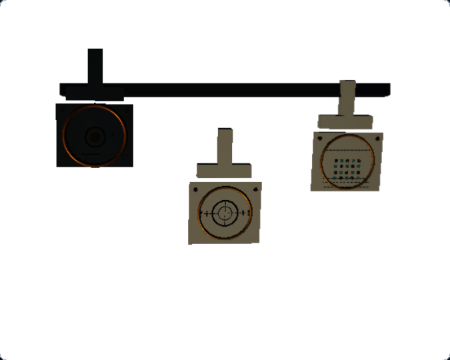
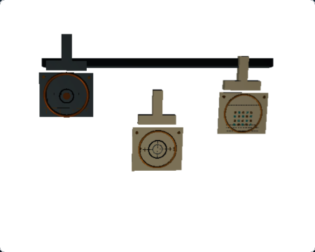
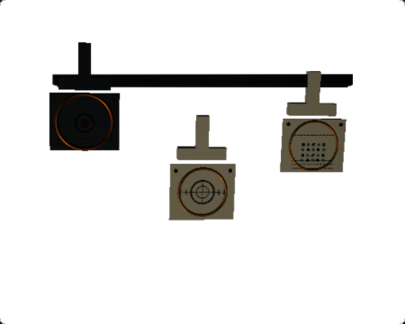
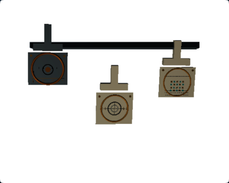
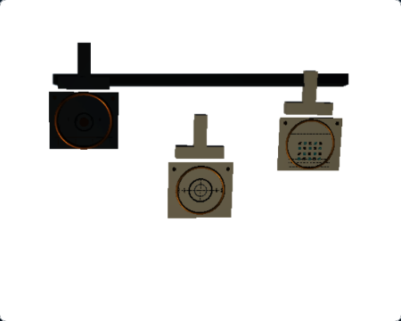

# RQ3F — Macro Compound Movements Visual Readability

## Result

**Validated improvement.** The three precision surfaces are easier to inspect in the production 450 × 360 WebGL Ground Glass. The near-left gear scale, centre target, and far-right array all show higher local luminance gradients in the matched states, while the accepted focus progression and compound alignment remain unchanged.

The correction changes three scene-owned PBR material recipes and moves the existing scene-specific key light to reveal more surface relief. The presentation-light target, shared light recipe, and number of lights remain unchanged. No geometry, focus-plane, optical, DOF, teaching, or renderer-selection code changed.

## Matched Ground Glass captures

Both runs use the public `/simulator/free/macro-compound-movements` route, a 1280 × 900 viewport at DPR 1, Standard quality, a 450 × 360 Raw-orientation Ground Glass display, Raw Debug off, and the photographic composite path. The five states are pinned in [`states.json`](rq3f-macro-compound/states.json).

| State | Before | After |
|---|---|---|
| C1 — 500 mm, Tilt 0°, Swing 0° |  |  |
| C2 — 490 mm, Tilt +3.4°, Swing 0° |  |  |
| C3 — 490 mm, Tilt 0°, Swing −2.8° |  |  |
| C4 — 490 mm, Tilt +3.3°, Swing −2.7° |  |  |
| C5 — 490 mm, Tilt +3.4°, Swing −2.8° |  |  |

The Before images were captured from clean source commit `976a6242800ddb4692bf5238b694068ea78b1be5` (run `5ae55cbb-1ede-49f9-bb4a-5bb3dc70fadf`). The After images were captured from clean source commit `911997b78be30b7b00598fa82dc56c7bb77ad8b6` (run `4f2fa05d-5c76-4d91-8d24-edfb4a4564cc`). Both runs observed Chromium 149.0.7827.55 on macOS 27.0.0 arm64, Three.js r187, `webgl-renderer` / `webgl2`, no internal fallback, no application fallback observed, contentful output, and a host-accepted request matching the last completed request. The retained run records contain the exact camera values, request IDs, dimensions, runtime attributes, and PNG SHA-256 values:

- [Before capture metadata](rq3f-macro-compound/before/captures/capture-run.json)
- [After capture metadata](rq3f-macro-compound/after/captures/capture-run.json)
- [Matched image metrics and hashes](rq3f-macro-compound/comparison-metrics.json)

The fixed Observer and C5 4× Focus Loupe references are retained alongside each set. The three other Macro controls are byte-identical before and after: Macro Depth of Field `5ca722ff…75c3d`, Macro Oblique Plane `c4c54d24…fbbeccb`, and Macro Bellows Extension `7a0a621a…334439c`.

## Diagnosis and change

The Before images contain the expected station geometry, but the near-left bronze gear rim and small marks have weak tonal separation under the bounded teaching-light rig. In the C5 gear ROI, 91.3% of pixels are below linear luminance 0.01 and the P90 luminance is 0.00764. The existing machined, bronze, and brass roles were highly metallic (metalness 0.86, 0.92, and 0.94), which left fine relief dark under this rig. The centre target and far array were also muted at normal display size.

The final scene-local recipes retain their distinct colors and roughness maps while adding a more readable satin response:

| Material role | Before metalness / roughness | After metalness / roughness |
|---|---:|---:|
| Machined surfaces | 0.86 / 0.34 | 0.62 / 0.40 |
| Bronze | 0.92 / 0.30 | 0.62 / 0.38 |
| Brass | 0.94 / 0.28 | 0.72 / 0.36 |

The near gear's first material-only comparison raised luminance but did not improve its local gradient enough. The final candidate therefore moves the registered key-light offset from `(-2.5, 3.5, -2.5)` to `(-2.5, 3.5, -4.5)` in world units, keeping the same canonical target. This uses the existing presentation rig and intensity to reveal relief across all three surfaces. It adds no lights, light power, shadow pass, environment map, emissive contribution, global exposure, render pass, texture, or persistent render target. Chassis, dark engraving, accent and ivory recipes are unchanged.

## Readability measurements

The fixed pixel ROIs are defined in `comparison-metrics.json` and applied identically to all five states. PNG sRGB values are converted to linear Rec.709. These are visual readability diagnostics, not measurements of physical sharpness or photographic ground truth; local gradient includes both material contrast and optical blur.

### C5 — aligned state

| Station ROI | Mean luminance | P10–P90 luminance | Mean local gradient | Near-black fraction | Pixels > 0.95 |
|---|---:|---:|---:|---:|---:|
| Near-left gear scale | 0.01558 → 0.03120 | 0.00187–0.00764 → 0.01023–0.02599 | 0.00994 → 0.01060 | 91.3% → 9.8% | 0% → 0% |
| Centre concentric target | 0.12164 → 0.17290 | 0.01733–0.10521 → 0.03957–0.17343 | 0.02290 → 0.02884 | 6.5% → 2.8% | 3.3% → 4.0% |
| Far-right fine array | 0.07542 → 0.11880 | 0.02460–0.09441 → 0.03980–0.14715 | 0.01385 → 0.02104 | 4.6% → 0.6% | 0% → 0% |

Across C1–C5, mean local luminance gradient increased by 6.2–7.3% for the near-left gear, 24.6–25.9% for the centre target, and 50.1–52.0% for the far-right array. Near-black fractions decreased in every station ROI. The centre ROI's fraction above the diagnostic 0.95 threshold rose by 0.7 percentage points in C5; no such samples were measured in the gear or array ROIs. The fixture-rail control remains dark and does not approach the station contrast gains.

## Optical, teaching, and resource regressions

The existing public-control test `src/tests/e2e/macro-compound-movements.spec.ts` passed. It retains:

- Default 500 mm / 0° / 0°: centre strongest, `focus-exploration`.
- Tilt-only +2°: `tilt-only` stage.
- Swing-only −2°: `swing-only` stage.
- 490 mm / +3.3° / −2.7°: two Sharp targets, `refine-compound`.
- 490 mm / +3.4° / −2.8°: all three targets score 100, `aligned`.
- Moving Tilt to +3.9° exits the aligned stage.

The matched C4 and C5 screenshots also preserve the existing public-state distinction. No optical input, target score, movement control, or teaching threshold changed. The focused non-parallel coverage check passed for Macro Oblique Plane and Macro Compound Movements. Its separate Oblique Architecture control timed out once in the three-test run while locating Swing, then passed when run alone.

Before and After capacity snapshots both report 69 renderable meshes, 69 unique geometries, 7 unique materials, 7 textures, and 8,928 triangles. The subject has zero owned lights; the existing presentation rig still has its hemisphere fill and directional key. The key placement change adds no renderer resources. GPU frame timing was not measured.

## Reproduction and validation

The capture test requires a clean source tree, Node 24, the repository's Playwright Chromium installation, and the local app server. It writes working output below the ignored `docs/render-quality/.rq3f-runs/current/`; explicitly retain approved images under `rq3f-macro-compound/{before,after}/` without replacing the Before set.

```bash
RQ3F_CAPTURE_PHASE=before npm run render-quality:rq3f:capture
RQ3F_CAPTURE_PHASE=after npm run render-quality:rq3f:capture
npm run render-quality:rq3f:measure -- \
  docs/render-quality/rq3f-macro-compound/before/captures/capture-run.json \
  docs/render-quality/rq3f-macro-compound/after/captures/capture-run.json \
  --output=docs/render-quality/rq3f-macro-compound/comparison-metrics.json
```

The metrics command accepts image paths relative to the repository root for retained evidence and paths relative to each `capture-run.json` for fresh Playwright output.

Validation on the implementation source:

- RQ3F WebGL capture: passed, 1 executed test, 0 retries, both matched runs.
- Macro Compound Movements public-control E2E: passed, 1 executed test, 0 retries.
- Non-parallel coverage E2E: Macro Oblique Plane and Macro Compound Movements passed; Oblique Architecture passed on isolated rerun after a transient timeout.
- Focused Macro Compound Movements unit tests: 4 passed.
- `npm run test`: 329 files, 4,033 tests passed.
- `npm run typecheck` and `npm run lint`: passed.
- `npm run render-quality:rq1:check -- --baseline`: passed; 7 accepted captures remain valid.
- `npm run evidence:check:m7v` and `npm run evidence:check:m7w`: integrity checks passed; their existing qualification states are unchanged.
- PNG dimensions and SHA-256 values: verified for all 20 retained images; all three other-scene control images match byte-for-byte.
- `git diff --check`: passed on the final staged change.

PR #331 was subsequently merged to `main` as `a23b437d7ca382bde34ee1de3a88c8f1e40ebd53`. This report retains the original implementation-stage validation; current-main Macro acceptance is recorded in [the consolidated RQ3 review](RQ3_MACRO_SCENES_VISUAL_ACCEPTANCE.md). No WebGPU eligibility or production backend policy changed; production Ground Glass remains WebGL-only.
