# RQ3G — Macro Bellows Extension Visual Readability

## Result

**Validated, scene-local readability improvement at 300 mm / 1:1.** The matched 450 × 360 Ground Glass captures show clearer separation in the raised relief, radial ticks, and small fasteners. The gain is moderate and comes from material response; the background is unchanged. Some of the inset and face plate remain very dark, and the outer-rim gradient is lower after the highlights broaden. The comparison supports high metalness under the existing teaching-light rig as a contributor, not the only limit.

## Matched captures

Both runs used the public `/simulator/free/macro-bellows-extension` route, 1280 × 900 viewport at DPR 1, Standard quality, Raw orientation, Raw Debug off, and the photographic composite. The rendered Ground Glass was 450 × 360. The public scene has fixed zero camera movements; focus and aperture were set through their public controls. The overlay grid was hidden only for the photographs. The focused E2E still checks the unchanged physical grid in Raw and Upright modes.

The Before set was captured from clean accepted source `a23b437d7ca382bde34ee1de3a88c8f1e40ebd53` (run `53b17c83-6611-464e-978a-161da6693461`). The After set was captured from clean source `94e089315636cacf5bd1296a2fac468eabe289e9` (run `3f160981-7e40-45ca-9764-dc182b1336f1`). Both used Chromium 149.0.7827.55 on macOS 27.0.0 arm64, Three.js r187, and `webgl-renderer / webgl2`; no internal fallback or application fallback was observed. All five Ground Glass frames were contentful, completed, and accepted by the current host request. Each image is 450 × 360; image SHA-256 and actual optical/runtime metadata are retained in the capture-run files.

| State | Before | After |
|---|---|---|
| B1 — 900 mm, f/5.6 (intentional defocus) | 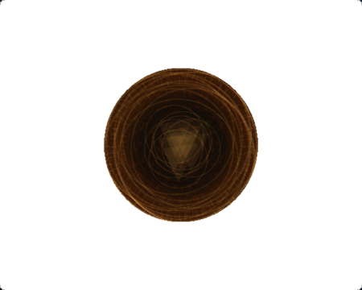 | 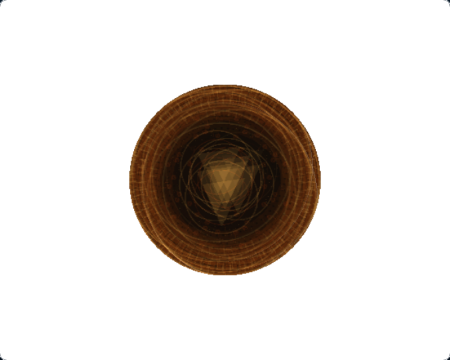 |
| B2 — 450 mm, f/5.6 | 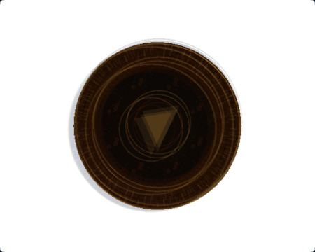 | 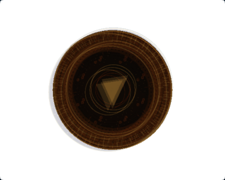 |
| B3 — 300 mm, f/5.6 (1:1) | 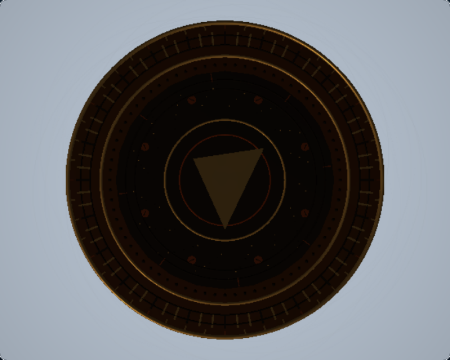 | 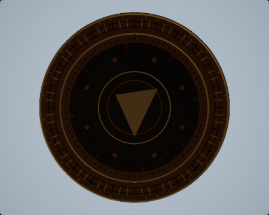 |
| B4 — 300 mm, f/11 | 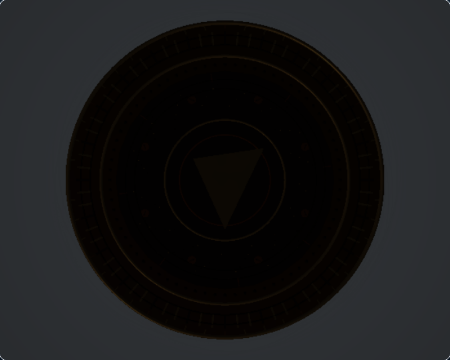 | 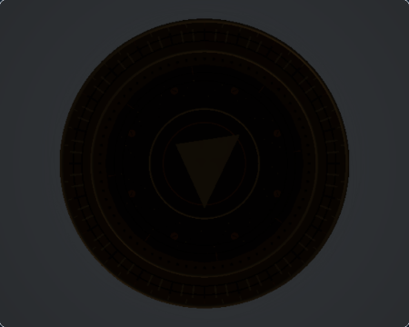 |
| B5 — 300 mm, f/22 | 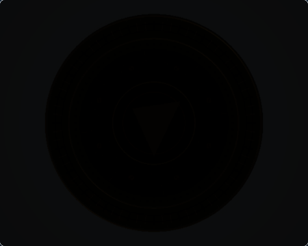 | 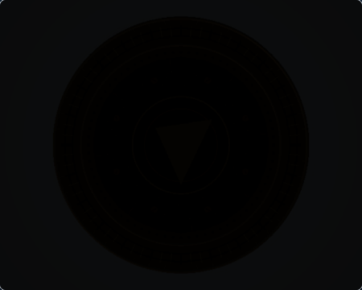 |

The fixed Observer camera sees the reverse side of the medallion. It is retained as a composition reference, not compared as though it showed the same face as Ground Glass. The 4× Focus Loupe is supplementary to B3 at normal size.

| Reference | Before | After |
|---|---|---|
| Fixed Observer, reverse side |  | 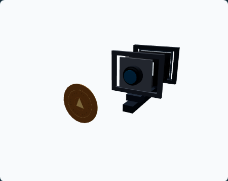 |
| B3 Focus Loupe, 4× | 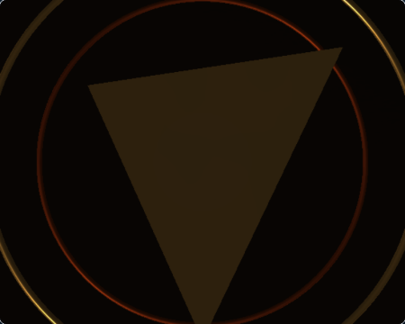 | 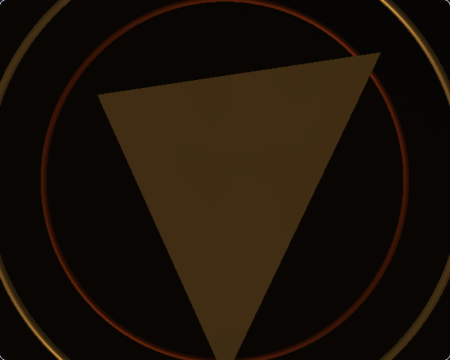 |

## Diagnosis and change

At B3, the accepted image showed dark bronze and bright-metal roles with weak separation in the raised surface details. Reducing the metalness and broadening the satin response produced more useful diffuse/form contribution under the same bounded key and fill. The result does not change the lighting direction or add illumination.

| Material role | Before metalness / roughness / emissive | After metalness / roughness / emissive |
|---|---:|---:|
| Bronze body and face plate | 0.82 / 0.40 / 0.12 | 0.48 / 0.52 / 0.12 |
| Raised metallic relief | 0.86 / 0.32 / 0.16 | 0.58 / 0.42 / 0.16 |
| Copper accents | 0.84 / 0.45 / 0.14 | 0.50 / 0.52 / 0.14 |
| Dark recesses | 0.06 / 0.74 / 0 | unchanged |

Material colors, deterministic roughness-map seeds, variations and repeat settings are unchanged. The existing key offset remains `(-2.5, 3.5, -2.5)` and uses the same presentation rig. Emissive values, scene exposure, film illumination gain and all geometry are unchanged. No renderer, optical or shader code changed.

## B3 readability measurements

Metrics use linear Rec.709 luminance decoded from screenshot sRGB values, with fixed geometry-based regions projected at 1:1 from 450 px / 127 mm. No exposure, contrast, or white-balance normalization was applied. Near-black is linear luminance `< 0.01`; clipped highlight is `> 0.95`. These are readability diagnostics, not optical-sharpness or photographic-ground-truth scores.

| B3 ROI | Mean luminance Before → After | P10–P90 Before → After | Mean local gradient Before → After | Near-black Before → After | Clipped pixels |
|---|---:|---:|---:|---:|---:|
| Whole 90 mm specimen | 0.00663 → 0.00873 (+31.7%) | 0.00160–0.01598 → 0.00160–0.02529 | 0.00270 → 0.00281 | 86.4% → 83.9% | 0% → 0% |
| Outer rim | 0.03981 → 0.04265 (+7.1%) | 0.00658–0.09937 → 0.00969–0.08998 | 0.02543 → 0.02098 | 17.7% → 10.5% | 0% → 0% |
| Raised face plate | 0.00340 → 0.00600 (+76.5%) | 0.00293–0.00384 → 0.00489–0.00690 | 0.00020 → 0.00042 | 100% → 100% | 0% → 0% |
| Dark central inset | 0.00342 → 0.00460 (+34.6%) | 0.00160–0.00879 → 0.00160–0.01174 | 0.00083 → 0.00104 | 90.4% → 89.1% | 0% → 0% |
| Central relief bounds | 0.00681 → 0.01126 (+65.3%) | 0.00167–0.01620 → 0.00167–0.03014 | 0.00087 → 0.00126 | 67.1% → 65.2% | 0% → 0% |
| Radial ticks | 0.00384 → 0.00675 (+75.9%) | 0.00154–0.00628 → 0.00180–0.01119 | 0.00122 → 0.00238 | 93.4% → 89.2% | 0% → 0% |
| Fasteners and slots | 0.00285 → 0.00406 (+42.6%) | 0.00136–0.00645 → 0.00137–0.01122 | 0.00089 → 0.00170 | 100% → 84.7% | 0% → 0% |
| Empty-film background control | 0.42039 → 0.42039 | 0.41071–0.43225 → 0.41071–0.43225 | 0.00057 → 0.00057 | 0% → 0% | 0% → 0% |

The improved relief, radial-tick and fastener gradients support a local detail-contrast gain rather than uniform image brightening. The outer-rim gradient decreases as its highlights broaden; no ROI clips. The face plate remains below the near-black threshold throughout, and the central inset remains mostly dark. The candidate improves visible separation but does not make every fine feature bright or individually resolvable at this display size.

Optics, capture provenance, and screenshot hashes for all five states are in [`comparison-metrics.json`](rq3g-macro-bellows/comparison-metrics.json). Geometry-based ROIs are measured only in the life-size states B3–B5, where the 1:1 screen projection matches the fixed specimen regions. B1 and B2 remain visual and optics controls without ROI measurements because their different magnifications move those regions to different screen coordinates.

## Bellows and camera behavior

The captures record actual displayed readouts and runtime diagnostics:

| Focus | Image distance / bellows extension | Magnification | Image-circle diameter | Ground Glass gain |
|---:|---:|---:|---:|---:|
| 900 mm, f/5.6 | 180 mm | 0.20× | 261.56 mm | 2.6794572 |
| 450 mm, f/5.6 | 225 mm | 0.50× | 326.94 mm | 1.7148526 |
| 300 mm, f/5.6 | 300 mm | 1.00× | 435.93 mm | 0.9646046 |
| 300 mm, f/11 | 300 mm | 1.00× | 435.93 mm | 0.25 |
| 300 mm, f/22 | 300 mm | 1.00× | 435.93 mm | 0.0625 |

The 900 mm image remains intentionally defocused. At 1:1 the +2-stop bellows loss and aperture throughput remain present; f/11 and f/22 are visibly darker and were not normalized. The 10 mm physical grid and Raw/Upright film-origin mapping are unchanged. The focused 4× Loupe control still works.

## Cross-scene and resource checks

The unchanged Macro Depth of Field, Macro Oblique Plane and Macro Compound Movements screenshots are byte-identical before and after (their SHA-256 values are in `comparison-metrics.json`). Before and After subject snapshots match: 383 meshes, 25 unique geometries, 4 materials, 4 textures and 33,156 triangles. The subject owns no lights; the existing hemisphere-fill and directional-key presentation rig remains the same. No extra passes, targets, textures, geometry, shadow maps or DOF samples were added. GPU timing was not measured.

## Validation and reproduction

The capture test requires Node 24, Playwright Chromium, a local development server, and a clean source tree. It writes only to the ignored `.rq3g-runs/current/` directory. The B3 Loupe capture restores 300 mm / f/5.6 before collecting its fresh accepted frame.

```bash
RQ3G_CAPTURE_PHASE=after npm run render-quality:rq3g:capture
npm run render-quality:rq3g:measure -- \
  docs/render-quality/rq3g-macro-bellows/before/captures/capture-run.json \
  docs/render-quality/rq3g-macro-bellows/after/captures/capture-run.json \
  --output=docs/render-quality/rq3g-macro-bellows/comparison-metrics.json
```

Validation on this branch:

- RQ3G capture: 1 executed Playwright test, 0 retries; completed for all ten references with no page or console errors.
- Macro Bellows Extension E2E: 3/3 passed, including canonical Image Circle/gain, aperture, Focus Loupe and Raw/Upright grid checks.
- Focused `macroSpecimenSubject` unit tests: 4 passed; subject bounds, surface probes, material-role distinction and texture ownership preserved.
- Full unit/integration suite: 330 files and 4,034 tests passed.
- `npm run typecheck`, `npm run lint`, and `git diff --check`: passed.
- RQ1 committed-baseline check: 7 captures valid; original RQ1 evidence unchanged.
- M7V policy integrity: passed; owner approvals remain pending and M8 entry remains denied.
- M7W evidence integrity: passed; broad E2E remains not-qualified.

Production Ground Glass remains WebGL-only. No WebGPU authorization or Architecture Rise evidence was changed. Hosted CI and independent PR review are tracked on the PR.
