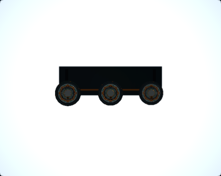
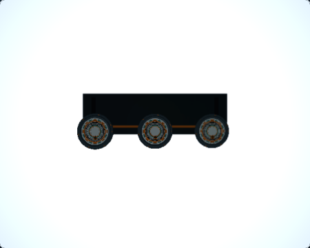
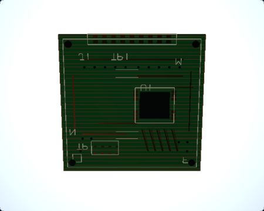
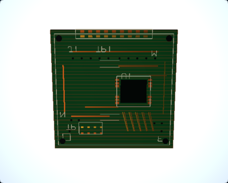
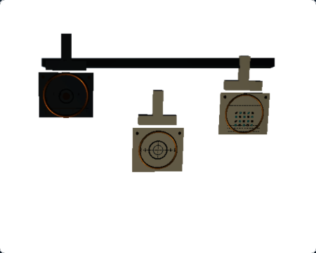
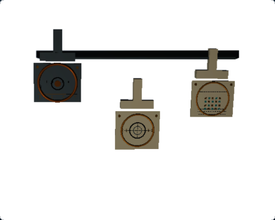
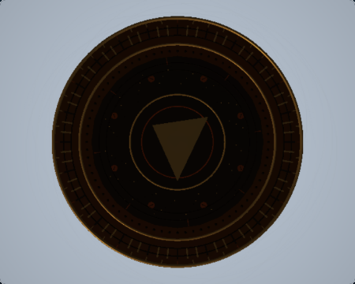
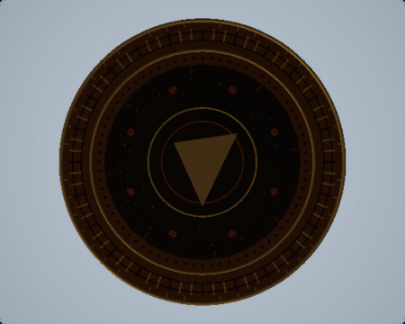

# RQ3 — Four Macro Scene Visual Acceptance Review

## Executive disposition

**ACCEPTED_WITH_LIMITATIONS** — the four Macro Photography scenes meet their existing teaching contracts and their accepted, scene-specific visual refinements remain present on `main`. The matched captures show useful surface-readability gains at the normal 450 × 360 Ground Glass size. The known dark regions, fine-detail resolution limits, and browser-performance limits remain documented below and in each scene report.

This is an acceptance closeout. It records no new rendering implementation or screenshot capture.

## Scope and accepted revisions

The reviewed current-main revision is `d13e502f4bc29459a2648f47e91ec9cde2f87322`. Each accepted scene change is present in its merge ancestry:

| PR | Scene improvement | Accepted merge commit |
|---|---|---|
| [#329](https://github.com/chau-hm/view-camera-simulator/pull/329) | RQ3D — Macro Depth of Field | `a0d8b1bc017d816b4951f9204eec2ccc73873f82` |
| [#330](https://github.com/chau-hm/view-camera-simulator/pull/330) | RQ3E — Macro Oblique Plane | `fd5bc73fd21b752e9251fa135e83a30db704bea9` |
| [#331](https://github.com/chau-hm/view-camera-simulator/pull/331) | RQ3F — Macro Compound Movements | `a23b437d7ca382bde34ee1de3a88c8f1e40ebd53` |
| [#332](https://github.com/chau-hm/view-camera-simulator/pull/332) | RQ3G — Macro Bellows Extension | `d13e502f4bc29459a2648f47e91ec9cde2f87322` |

The visual captures were made at each PR's own source stage. Their source commits differ from one another and from the accepted merge commits; the original capture records remain unchanged. This closeout separately verifies public teaching behavior at current `main`.

| Scene | Before capture source | After capture source | Accepted merge |
|---|---|---|---|
| Depth of Field | `e48f429cf7786b0cf5a11492dc96e47e6a1362a3` | `7c62960e6c579c4b03b311239816c819c57fbeca` | `a0d8b1bc017d816b4951f9204eec2ccc73873f82` |
| Oblique Plane | `68f51602349769e837de82dac232ad1f65837be8` | `72faf9b44f73820583cfd9544430821118348492` | `fd5bc73fd21b752e9251fa135e83a30db704bea9` |
| Compound Movements | `976a6242800ddb4692bf5238b694068ea78b1be5` | `911997b78be30b7b00598fa82dc56c7bb77ad8b6` | `a23b437d7ca382bde34ee1de3a88c8f1e40ebd53` |
| Bellows Extension | `a23b437d7ca382bde34ee1de3a88c8f1e40ebd53` | `94e089315636cacf5bd1296a2fac468eabe289e9` | `d13e502f4bc29459a2648f47e91ec9cde2f87322` |

## Matched appearance references

These are the retained scene-specific Before/After captures at their native 450 × 360 Ground Glass size. Each individual report links the full state matrix, capture metadata, measurements, and SHA-256 records.

| Scene and representative state | Before | After |
|---|---|---|
| Macro Depth of Field — middle station, 400 mm / f/5.6 |  |  |
| Macro Oblique Plane — aligned PCB, 390 mm / +6.3° |  |  |
| Macro Compound Movements — aligned targets, 490 mm / +3.4° / −2.8° |  |  |
| Macro Bellows Extension — 1:1 specimen, 300 mm / f/5.6 |  |  |

The visible changes are local material and, for Compound Movements, presentation-key refinements. The Depth of Field station faces and details are more readable while the other stations remain soft. Oblique Plane's copper routes and pads separate more clearly; the accepted 0.1° alignment difference remains subtle. Compound Movements shows more readable engraving, concentric detail, and fine array contrast. Bellows Extension has a modest improvement in raised relief, radial marks, and fasteners at 1:1.

Metrics are reported within each scene's fixed ROIs. Their values describe local image contrast and luminance; subjects, ROI definitions, and optical states differ, so metrics are not cross-scene scores and do not represent physical sharpness or photographic ground truth.

## Final-main teaching acceptance

The four existing public-control E2E files ran against current `main` (`d13e502f4bc29459a2648f47e91ec9cde2f87322`) in Chromium with one worker and zero retries. **All six discovered tests passed; none were skipped.**

Commands used with Node 24 and the repository's Chromium Playwright project:

```bash
npx playwright test \
  src/tests/e2e/macro-bellows-extension.spec.ts \
  src/tests/e2e/macro-depth-of-field.spec.ts \
  src/tests/e2e/macro-oblique-plane.spec.ts \
  src/tests/e2e/macro-compound-movements.spec.ts \
  --project=chromium --workers=1 --retries=0

npx playwright test src/tests/e2e/nonparallel-coverage.spec.ts \
  --grep 'Macro Oblique Plane|Macro Compound Movements' \
  --project=chromium --workers=1 --retries=0
```

| Scene | Teaching contract checked | Current-main E2E |
|---|---|---|
| Bellows Extension | 900 / 450 / 300 mm focus states retain 0.20× / 0.50× / 1:1; Image Circle growth, bellows exposure, aperture gain, physical grid, Raw/Upright, and Focus Loupe checks | [`macro-bellows-extension.spec.ts`](../../src/tests/e2e/macro-bellows-extension.spec.ts) — 3 passed |
| Depth of Field | Near / middle / far focus progression and aperture-dependent behavior | [`macro-depth-of-field.spec.ts`](../../src/tests/e2e/macro-depth-of-field.spec.ts) — 1 passed |
| Oblique Plane | 390 mm / +6.2° partial alignment and +6.3° full alignment | [`macro-oblique-plane.spec.ts`](../../src/tests/e2e/macro-oblique-plane.spec.ts) — 1 passed |
| Compound Movements | Tilt-only, Swing-only, two-target refinement, and 490 mm / +3.4° / −2.8° three-target alignment with scores of 100 | [`macro-compound-movements.spec.ts`](../../src/tests/e2e/macro-compound-movements.spec.ts) — 1 passed |

The focused non-parallel coverage checks also passed for Macro Oblique Plane and Macro Compound Movements (2 passed). They verified non-parallel Image Circle conics and the expected natural-illumination coverage state. No teaching thresholds or optical inputs were changed.

Local validation on current `main` also passed `npm run typecheck`, `npm run lint`, and the full `npm run test` suite (330 files, 4,034 tests). The RQ1 committed-baseline checker validated all seven accepted captures. M7V policy and M7W evidence integrity checks passed.

## Evidence integrity and capture limits

- All four PR merge commits are ancestors of the current-main revision recorded above. No later main commit supersedes this accepted implementation set.
- The four scene reports, linked captures, and local report references resolve. The retained source SHAs resolve in the repository's commit history.
- The RQ3D Before/After `SHA256SUMS` files pass. The retained manifest checks cover 72 PNG references across the four evidence directories; RQ3D capture-run hashes agree with retained state metadata, and RQ3E–RQ3G metrics tools validate their recorded image paths and digests.
- Historical cross-scene control images remain byte-identical where those controls were captured. They are historical per-PR controls; the six current-main teaching E2E tests provide the separate final-main regression evidence.
- Capture records identify Three.js r187 and the WebGL2 application renderer. RQ3D explicitly records ANGLE SwiftShader software rendering. RQ3E–RQ3G record Chromium 149 on macOS 27 arm64 and actual `webgl-renderer / webgl2` identity. Those images establish visual output through the observed browser renderer paths; they do not establish physical-GPU performance. GPU timing was not measured.
- The current-main checks also passed `npm run typecheck`, `npm run lint`, the RQ1 committed-baseline check (seven accepted captures), `npm run evidence:check:m7v`, and `npm run evidence:check:m7w`. M7 remains partially-qualified, 75 M7V approvals remain pending, broad E2E remains not-qualified, and M8 entry remains denied.

## Preserved technical boundaries

The accepted changes did not alter canonical camera geometry, focus targets, focus-plane math, physical CoC, Far/Near DOF behavior, bellows extension or exposure, Image Circle geometry, natural illumination, physical 10 mm film grid, Raw/Upright mapping, Focus Loupe mapping, or scene resource ownership. Production Ground Glass remains WebGL-only. Architecture Rise v2 native M3 authorization remains development-only; this Macro WebGL review does not establish native WebGPU readiness.

## Known limitations

1. **Simulator model:** Depth-of-field rendering and focus scores are bounded teaching approximations. The scene reports and tests support their stated lessons, not metrological or photographic ground truth.
2. **Visible detail:** Oblique Plane's 0.1° partial/full difference need not be conspicuous at display size. Bellows Extension retains very dark face-plate and central-inset regions, a lower outer-rim gradient after highlight broadening, and fine geometric features below useful 450 × 360 resolution.
3. **Capture platform:** Browser and OS details vary by source-stage capture. RQ3D used software-rendered ANGLE SwiftShader; physical-GPU performance and frame time are unmeasured. No common hardware-performance claim is made across the four image sets.
4. **Separate research:** Native WebGPU photographic parity and M4–M8 qualification remain outside this Macro scene acceptance.

## Final disposition

The current implementation is sufficiently complete for the four scenes' existing educational purposes, with the visible limitations above disclosed. **No additional Macro-specific material or lighting pass is required to close RQ3.** Future substantial work should be selected independently from the simulator roadmap.

The individual accepted evidence remains in [RQ3D](RQ3D_MACRO_DOF_VISUAL_READABILITY.md), [RQ3E](RQ3E_MACRO_OBLIQUE_VISUAL_READABILITY.md), [RQ3F](RQ3F_MACRO_COMPOUND_VISUAL_READABILITY.md), and [RQ3G](RQ3G_MACRO_BELLOWS_VISUAL_READABILITY.md).
