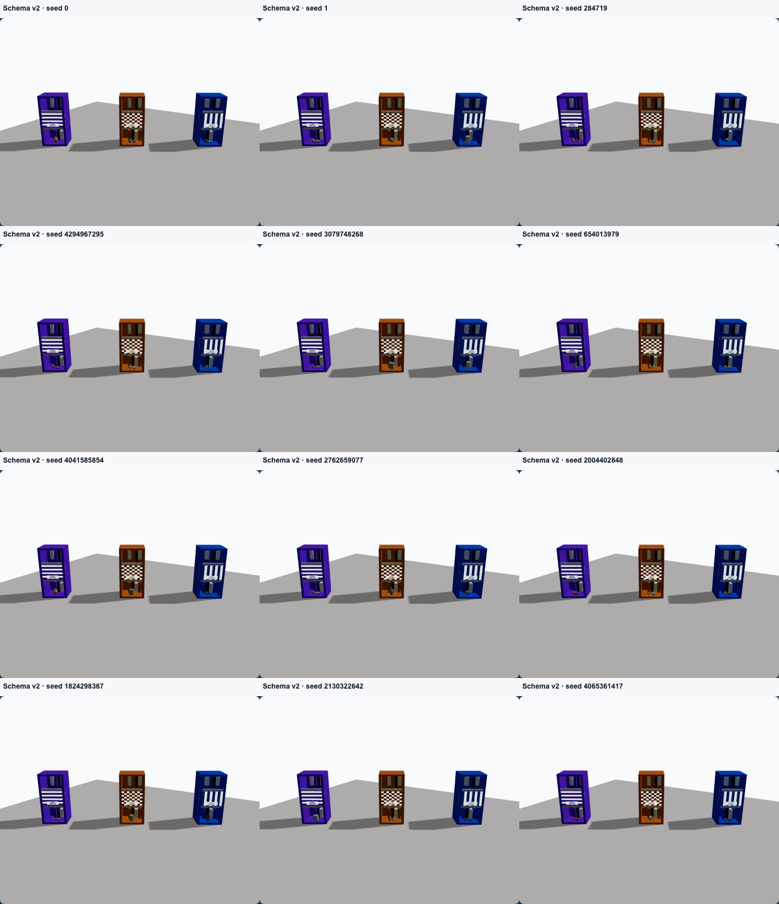
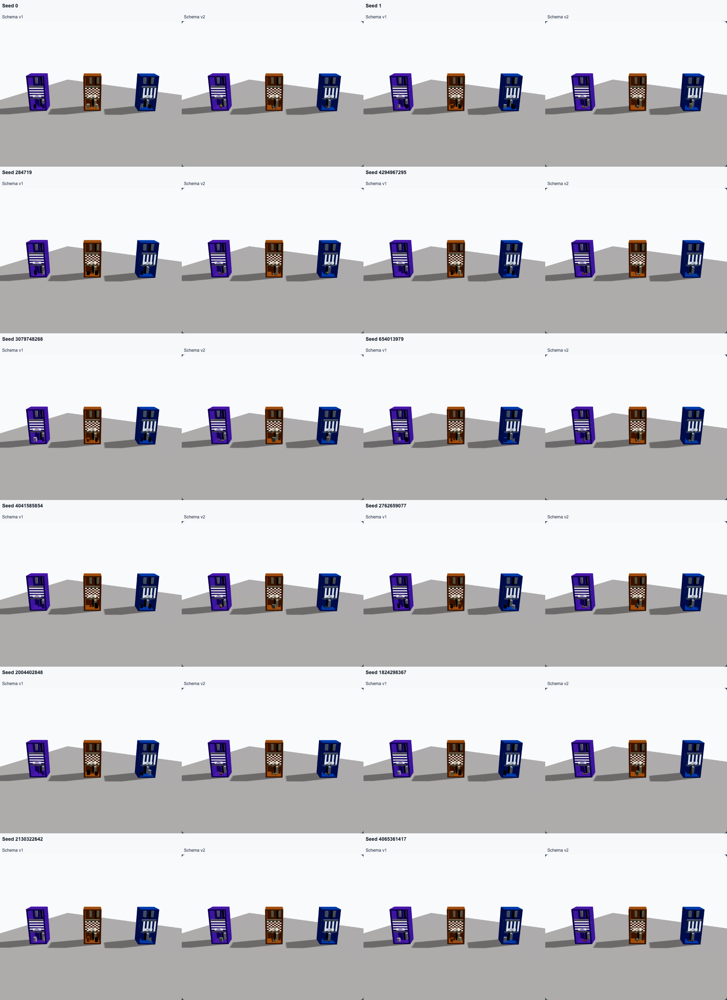
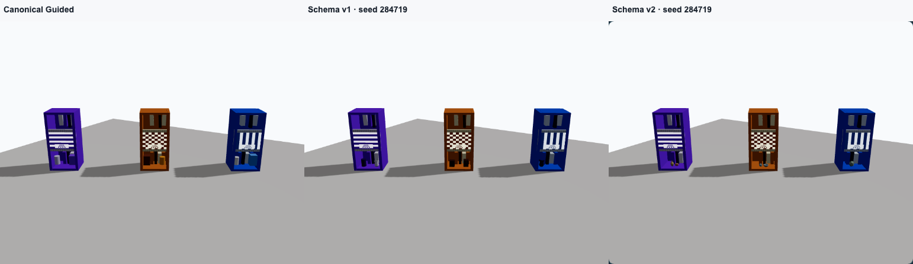
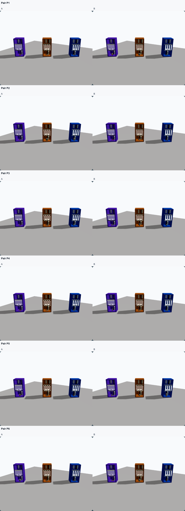
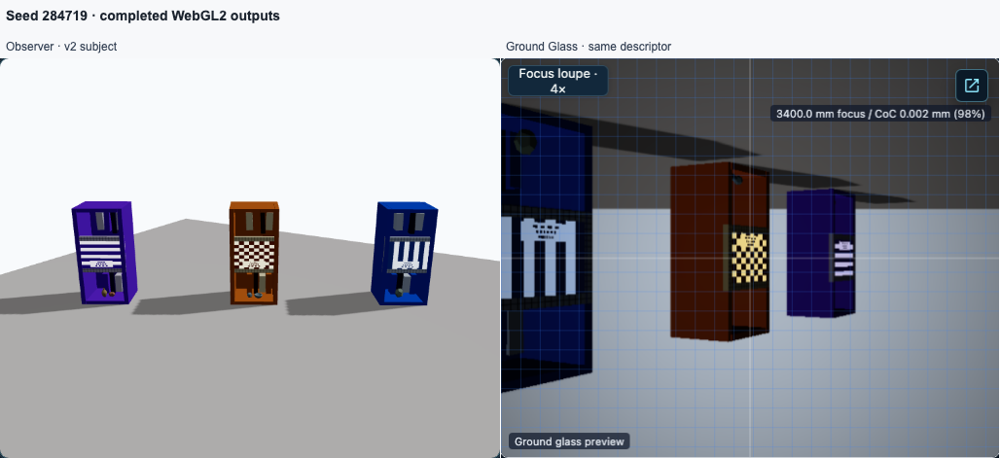

# Shelf Swing Schema v2 Visual Recognition Pilot

## Outcome

| Qualification | Verdict | Evidence |
| --- | --- | --- |
| Technical | **PASS** | Frozen v1 signatures, v2 safety sweep, registered-subject parity, production replay, optics/mode matrix, and regeneration lifecycle checks. |
| Visual | **INCONCLUSIVE** | V2 has more distinct forms and more visible same-seed changes than v1, but the frozen sample's seed-to-seed image changes are smaller than v1 at normal Observer size. No independent human reviewers took part. |

Schema v2 remains explicitly selectable with `sv=2`. Schema v1 remains the current default for new Shelf Swing Free Practice sessions until a revision shows clearer seed-to-seed recognition at normal size. The visual result is a preliminary implementation-agent assessment, not a usability study.

## Objective and baseline

PR #345 found that Shelf Swing schema v1 was deterministic and valid but visually limited. At the standard 514 × 411 Observer display, its twelve-seed sample changed 0.30–0.42% of full-frame pixels relative to seed 284719. Variation stayed on the lower display shelves, while the three focus charts remained dominant.

This pilot tested whether clearer silhouettes, restrained local contrast, and single-versus-paired grouping make decorative changes easier to recognize without enlarging props or changing the chart-safe display region.

The implementation starts from `56b52c337b9f5be235c9ecf71f1c8c542d067988` (`origin/main`, after PR #345). Schema-v1 planner output and canonical no-descriptor subject signatures remain locked to the accepted baseline.

## Version policy

- `?seed=284719&sv=1` and historical seed-only URLs reproduce schema v1.
- `?seed=284719&sv=2` explicitly selects the experiment.
- A route with no seed or schema uses current schema v1. This preserves the accepted public experience while the visual gate is inconclusive.
- Regenerate and browser history retain the active schema.
- Unsupported versions fail closed.
- Guided Mode and the canonical no-descriptor subject remain unchanged.

Schema v2 is supported by the same route, plan, registered factory, Observer, and Ground Glass paths. It does not add a second variation or rendering system.

## V2 design and constraints

V2 adds three compact low-polygon families: wide shallow bowls, necked vessels, and faceted forms. Existing boxes, cylinders, and vessels remain available. Each station uses a stable semantic ID and isolated random substreams. A station resolves to either one hero object or a two-object arrangement. Desaturated station palettes add controlled separation from the shelf without changing station, chart, lighting, or exposure materials.

The existing lower-shelf envelope and shared support, yaw-aware bounds, collision, and protected-region checks remain in force. Invalid candidates use a deterministic validated v2 bowl fallback; they do not fall through to v1. The 256-seed safety suite reported no fallback. No object is placed on a chart or focus target.

The factory constructs bowl and necked-vessel lathe meshes and a faceted dodecahedron. Flat shading is limited to the faceted family. Observer and Ground Glass each own and dispose their own resources while consuming equivalent semantic plans.

No station transform, chart, focus sample/probe, canonical camera, calibration, movement sign, task definition, projection, DOF calculation, or lighting changed.

## Capture method

The capture uses the frozen PR #345 seed set in the original order:

`0, 1, 284719, 4294967295, 3079748268, 654013979, 4041585854, 2762659077, 2004402848, 1824298367, 2130322642, 4065361417`.

Captures use Chromium production Vite preview, WebGL2, a 1440 × 1000 viewport, DPR 1, standard quality, the canonical Observer camera `(4.2, 1.45, 1.4)` targeting `(0, -0.04, 3.85)`, focus 3400 mm, aperture f/11, Front Swing −3.961086726° (public control −4°), zero rise, and clean Observer overlays. The canvas image is captured at 514 × 411; the browser reports its CSS height as approximately 410.39 px.

Historical v1 cells are cropped at native 514 × 411 pixels from the accepted PR #345 contact sheet, excluding its title band. The source path and SHA-256 are recorded in the compact capture diagnostics JSON.

## Visual comparison

### Full v2 sample

### Same-seed v1/v2 comparison

### Canonical, v1, and v2

### Blind v2 pairs

The six pairs are presented as A/B without seed labels. The separate answer key is at [`shelf-swing-schema-v2-blind-pair-answer-key.md`](evidence/shelf-swing-schema-v2-visual-recognition/shelf-swing-schema-v2-blind-pair-answer-key.md). These sheets support review; they do not contain responses from human participants.

### Preliminary normal-size review

The new families and restrained palette differences can be noticed in the matched v1/v2 comparison. Across the within-v2 blind pairs, several pairs show a visible change in form or grouping. At the actual 514 × 411 viewing size, however, individual props occupy only a small part of the lower shelves. In multiple pairs, I could notice a change without confidently naming the shape family. The differences do not read consistently as a stronger seed-to-seed visual identity than v1.

This is why the visual qualification is **INCONCLUSIVE** even though the technical qualification passes. A larger changed-pixel fraction alone would not establish recognition, and this sample does not even show a larger within-schema fraction for v2.

## Supporting image diagnostics

The historical lower-shelf ROI is unchanged: x segments `[70,145]`, `[232,296]`, and `[382,456]`, y `[224,264]`, covering 4.03% of the 514 × 411 canvas. These values are descriptive comparisons, not acceptance thresholds.

| Comparison | Full-frame changed pixels | Historical ROI changed pixels |
| --- | ---: | ---: |
| V1 across seeds vs. v1 seed 284719, mean (range) | 0.380% (0.300–0.424%) | 9.41% (7.43–10.52%) |
| V2 across seeds vs. v2 seed 284719, mean (range) | 0.182% (0.154–0.233%) | 4.52% (3.81–5.79%) |
| Matched v1 vs. v2 for the same seed, mean | 3.022% | 22.09% |

The matched-schema difference confirms that the v2 catalog visibly changes the shelf props relative to v1. Within-schema comparisons show less pixel variation across this v2 seed set than across v1; pixel metrics remain supporting evidence and are not treated as a perceptual score.

The v2 sample produced 16 bowl, 13 necked-vessel, 19 faceted, 3 cylinder, 3 box, and 2 existing-vessel instances across 56 prop instances. It produced 20 paired and 16 single station plans across 36 stations, with zero fallback use. Full per-seed image and plan diagnostics are in [`shelf-swing-schema-v2-capture-and-diagnostics.json`](evidence/shelf-swing-schema-v2-visual-recognition/shelf-swing-schema-v2-capture-and-diagnostics.json).

## Teaching, Ground Glass, and optics

All twelve Observer captures retain the same three fixed stations and readable focus charts. The lower-shelf props remain below the chart faces; chart patterns and depth ordering stay dominant. Existing unit signatures verify unchanged canonical station transforms, focus targets, calibration, and no-descriptor output.

The representative production Ground Glass capture uses v2 seed 284719 at focus 3400 mm, f/11, Front Swing −4°, Raw Ground Glass orientation, and the processed WebGL2 path. Its current frame request equals its last completed request; the canvas is 514 × 412 pixels. Production preview omits the development-only `finalContentful` readback, so this report records that field as unavailable rather than inferring a render-sanity result.

The schema-v2 optics matrix checks neutral and calibrated swing across the three station focus distances and f/5.6, f/11, and f/22, then checks processed, raw RTT-bypass, and Upright Assist modes. It records frame IDs, rendered-image hashes, capacity, and renderer/RTT generation. Only WebGL2 was exercised; this pilot does not qualify WebGPU.

## Routing, replay, and resources

Unit and React Router tests cover explicit v1/v2 identities, seed-only v1 compatibility, current implicit v1, explicit versioned seed generation, unsupported versions, regeneration, and Back/Forward restoration. Production tests cover the frozen v2 sample, exact fixed-seed replay, and the `/view-camera-simulator/` deployment basename.

The production lifecycle test performs ten v2 regenerations with an A → B → A history restoration. It holds focus, Swing, aperture, Upright Assist, orbit pose, renderer generation, and RTT resource generation stable; checks completed RTT frames; and measures scene subject and renderer resources for bounded, non-monotonic growth. A separate client-side variant cycle compares canonical, fixed v1, two v2 seeds, and Guided → Free → Guided. Subject capacities return exactly to their prior snapshots after both v2 A restoration and Guided → Free → Guided. Across that cycle, renderer geometry counts remain 177–178 and textures remain 12; Observer/RTT triangle counts are 1,746 canonical, 1,750 for v1 seed 284719, 2,170 for v2 seed 284719, and 2,774 for v2 seed 4294967295. Renderer and RTT resource generations remain stable. See [`shelf-swing-cross-variant-capacity.json`](evidence/shelf-swing-schema-v2-visual-recognition/shelf-swing-cross-variant-capacity.json).

## Limitations and recommendation

- No independent human reviewers participated. The qualitative verdict is a preliminary visual assessment, not a usability study.
- The normal-size evidence keeps the props small and chart-safe, but the observed within-v2 seed variation is weaker than v1 in the frozen image comparison.
- The next visual iteration should first improve silhouette and grouping visibility at the existing camera and shelf envelope, then repeat this same seed set and capture setup. Do not promote v2 as the default until normal-size reviewers can identify meaningful prop or grouping changes more consistently.
- No changes were made to lighting, exposure, camera framing, or chart geometry to inflate the image difference.

## Validation

The final local checks passed:

- `npm test`: 340 test files, 4,217 tests passed.
- Focused Shelf Swing/route suite: 9 files, 138 tests passed, including the v1 signatures and 256-seed v2 safety sweep.
- `npm run typecheck`, `npm run lint`, `npm run check:css`, and `npm run build` passed.
- Production root preview: v1 reproducible-capture test, full frozen v2 seed capture, v2 Ground Glass optics/mode matrix, 10-regeneration resource lifecycle, and canonical/v1/v2/Guided-Free capacity cycle all passed.
- Production subpath preview: v1 and explicit v2 URL/regeneration/history checks both passed under `/view-camera-simulator/`.
- Existing Shelf Swing physical-focus and solved-geometry Ground Glass regressions: 2 tests passed.
- `git diff --check` passed.

The detailed mode matrix is in [`shelf-swing-focus-aperture-matrix.json`](evidence/shelf-swing-schema-v2-visual-recognition/shelf-swing-focus-aperture-matrix.json); repeated-resource measurements are in [`shelf-swing-regeneration-capacity.json`](evidence/shelf-swing-schema-v2-visual-recognition/shelf-swing-regeneration-capacity.json); and the cross-variant restoration evidence is in [`shelf-swing-cross-variant-capacity.json`](evidence/shelf-swing-schema-v2-visual-recognition/shelf-swing-cross-variant-capacity.json). GitHub CI is checked after the PR is published.
