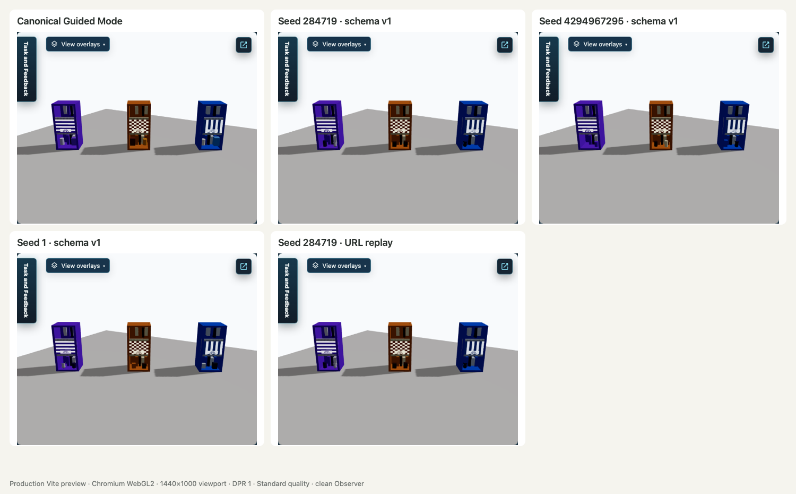

# Shelf Swing Seeded Props Pilot

## Purpose

Shelf Swing is the second production scene to use the Scene Variation
Foundation. The pilot checks that another scene can own a distinct
deterministic prop catalog and placement policy while reusing the accepted
placement geometry and constraint helpers from PR #341. It does not change the
optics engine, station layout, focus targets, or task criteria.

Interior Corner retains its accepted schema-v1 material plan and schema-v2
material/prop plan. Shelf Swing uses scene-scoped schema v1 for props only;
the version number does not imply a shared plan or catalog.

## Schema-v1 arrangement

The pure planner is src/scenes/shelfSwingPropVariation.ts. It resolves a
renderer-neutral plan from (sceneId, seed, schemaVersion). Its catalog contains
low-poly boxes, 16-sided cylinders, and 12-segment ceramic-like vessels. Each
front, middle, and back station receives one or two display objects. Station
colors come from that station's existing primary, secondary, and detail
material hints.

Semantic IDs use the form shelf-<station>-display-<left|right>. Each station
count, slot choice, family, dimensions, position, yaw, and palette has a named
props or layout substream. Changing one station or stream does not advance
another. The planner uses no ambient randomness, browser globals, renderer
state, or module-global PRNG.

Objects sit on the existing lower shelf, whose top is y=38 mm. Their centers
and boxes stay in the bounded display zone x=[-198,198] mm, z=[50,220] mm;
generated boxes are kept inside the station frame with a 12 mm clearance.
The upper shelf and chart-facing region remain unchanged.

## Placement, visibility, and fallback

The Shelf Swing planner directly reuses the shared helpers:

- getYawRotatedBoxBoundsMm and getBoundsXZMm for placement bounds;
- getSupportSurfaceBoundsXZMm, isWithinBoundsXZ, and isSupportedAtHeightMm
  for lower-shelf support;
- isWithinBounds3, intersectsBounds3, and findPairwiseIntersections for
  station, structure, book, and prop checks;
- intersectsProtectedRegionXZ for chart visibility protection.

It also applies Shelf Swing-specific checks for frame uprights, the backdrop,
chart backing, the focus-chart/sample/probe volume, authored book footprints,
the observer's chart-facing side, and canonical sceneBounds. Physical
nonintersection and front-camera visibility are checked separately.

Positions are station-local millimetres. The planner computes world bounds
with subjectLocalToWorld() and includes the station yaw plus prop yaw exactly
once. Subject tests compare mesh world centers with that canonical transform.
Every generated plan is validated once. If a rule fails, the planner uses one
small fixed box on each lower shelf and records the original issue codes; it
does not retry random placements.

## Canonical and teaching invariants

The factory's no-descriptor subject signature remains
c0e91bfcf2721d99ff12c06f748bda06fac6def672bda30b442c462a79ced43f. For each
tested seed, the teaching-only signature remains
40a0d583b6935b0325d1acb934d1e81a3aad32ce3d1a3b1e96a96986e936486e after
excluding only display-object meshes. Station transforms, books, charts,
chart patterns, comparison motifs, probes, samples, and focus data remain
unchanged.

The canonical calibration remains Front Swing = -3.961086726° and focus
distance 3397.409 mm; the public control grid resolves this to -4° and
3400 mm. Calibration, target plane, focus samples, and the existing
three-station sharpness tests are not modified.

## Registered Observer and Ground Glass behavior

Free Practice forwards the same descriptor through the existing Shelf Swing
registered-subject seam to Observer and Ground Glass. Each factory creates its
own meshes, geometries, and materials, and each owner disposes its own
resources. Guided Mode supplies no descriptor and remains canonical. No
second registry, global Three.js cache, shader change, or WebGPU path was added.

The browser lifecycle check confirms that regeneration changes the seed and
RTT frame request without changing the renderer generation or RTT resource
generation. Back and Forward restore the seed and matching subject capacity.
Ten successive regenerations preserve canonical focus, Swing, aperture,
Ground Glass mode, overlay state, and the user-set Observer orbit.

## Real-browser visual evidence

Captures use the production Vite preview and Chromium WebGL2 at viewport
1440×1000, DPR 1, Standard render quality, the canonical control solution,
and a clean Observer with teaching overlays hidden. The contact sheet uses
real browser captures; the fixed-seed replay was pixel-identical.

| Capture | Route identity | Result |
| --- | --- | --- |
| Canonical Guided Mode subject | /simulator/guided/shelf-swing/swing-01 | Unseeded canonical factory path |
| Seed 284719 | /simulator/free/shelf-swing?seed=284719&sv=1 | Seeded arrangement |
| Seed 4294967295 | /simulator/free/shelf-swing?seed=4294967295&sv=1 | Different seeded arrangement |
| Seed 1 | /simulator/free/shelf-swing?seed=1&sv=1 | Additional arrangement |
| Seed 284719 replay | Same share URL | Pixel-identical to seed 284719 |

The three station colors and chart patterns remain distinct in every image.
Props remain below the charts, and the diagonal station arrangement is
unchanged. The visual test records no page errors.

## Resource and regeneration results

In the root production-preview run, the ten regenerated seeds were all
distinct. All ten generated a distinct Observer image and a distinct
Observer/Ground Glass subject-capacity pair. Across the initial seed and ten
regenerated variants, WebGL renderer geometry counts ranged from 175 to 178
and texture counts remained 12. Back restored the initial capacity; Forward
restored the first regenerated capacity. Subject counts stayed bounded, and
renderer and RTT target generations remained stable. The RTT profile recorded
60 completed frames in the lifecycle run.

These renderer resource counts describe the Chromium WebGL2 production-preview
environment used for this pilot. They do not claim hardware-GPU timing or
qualify WebGPU. Explicit disposal of subject-owned geometry and materials is
also checked in factory and registry unit tests.

## Deterministic plan signatures

| Seed | Shelf Swing schema-v1 plan SHA-256 |
| ---: | --- |
| 0 | 0fe4c4e9b4ee3a05411b6e63003ee8b255891ea06091c91aeccf52536ea1d3f8 |
| 1 | 04f3e1c2be8ae8d60b920a27780a4a0a9189dc78465615644e9442ea1ac88104 |
| 284719 | 85bef947291a31cc2f5c61c8884fb771212f1cffbee4d5396201676dbace9aef |
| 4294967295 | adaf776456e9d3e0bb48f385af5121a1c873221aeccd90de80a101a5cdd7a708 |

The planner sweep validates 256 consecutive seeds. That is sampled coverage,
not exhaustive coverage of the full uint32 domain.

## Validation

Validation ran with Node 24, matching the repository's GitHub workflow.

- `npm test`: 340 files and 4,203 unit/integration tests passed.
- `npm run typecheck`, `npm run lint`, `npm run check:css`, and
  `npm run build`: passed.
- Shelf Swing browser regressions for near-sharp focus, guided negative Swing,
  and the public calibrated solution: 3 passed.
- Root production preview: canonical and three seeded Observer captures,
  fixed-seed URL replay, and ten successive regeneration/history lifecycle:
  passed. Replay capture hashes match exactly.
- Root production preview focus/aperture matrix: 12 completed Ground Glass
  frames across front, middle, back, and the calibrated plane at f/5.6, f/11,
  and f/22. Camera readiness, canvas image hashes, subject capacity, renderer
  generation, and RTT resource generation were recorded; all sampled states
  retained the same subject capacity and renderer/RTT generations.
- Subpath production preview: share URL, extra query/hash preservation,
  regeneration, and Back/Forward restoration under `/view-camera-simulator/`:
  passed. Pixel-identical replay is separately asserted on the root route.
- `git diff --check`: passed before publication.
- GitHub CI: triggered by PR #343; see the PR for the current-head result.

Key tests include:

- src/tests/unit/shelfSwingPropVariation.test.ts
- src/tests/unit/shelfSwingSubjectSignature.test.ts
- src/tests/unit/sceneVariationRoute.test.ts
- src/tests/unit/sceneSubjectRegistry.test.tsx
- src/tests/integration/sceneVariationRoute.test.tsx
- src/tests/integration/SimulatorWorkspace.test.tsx
- src/tests/scene-variation-e2e/shelf-swing-seeded-props-production.spec.ts
- src/tests/scene-variation-e2e/shelf-swing-seeded-props-subpath-production.spec.ts

The full repository suite includes the existing Interior Corner schema-v1/v2
compatibility and shared URL normalization regressions. No shared PRNG or
Interior Corner plan code changed.

## Limitations

Placement safety uses the accepted conservative box and Y-axis yaw model, not
mesh physics. The protected visibility region is tied to Shelf Swing's current
canonical camera and chart layout. Browser appearance is evidence for the
current geometry, materials, browser, and renderer, not a permanent pixel
contract. This pilot does not qualify WebGPU and does not change the existing
illustrative sharpness/DOF model.
