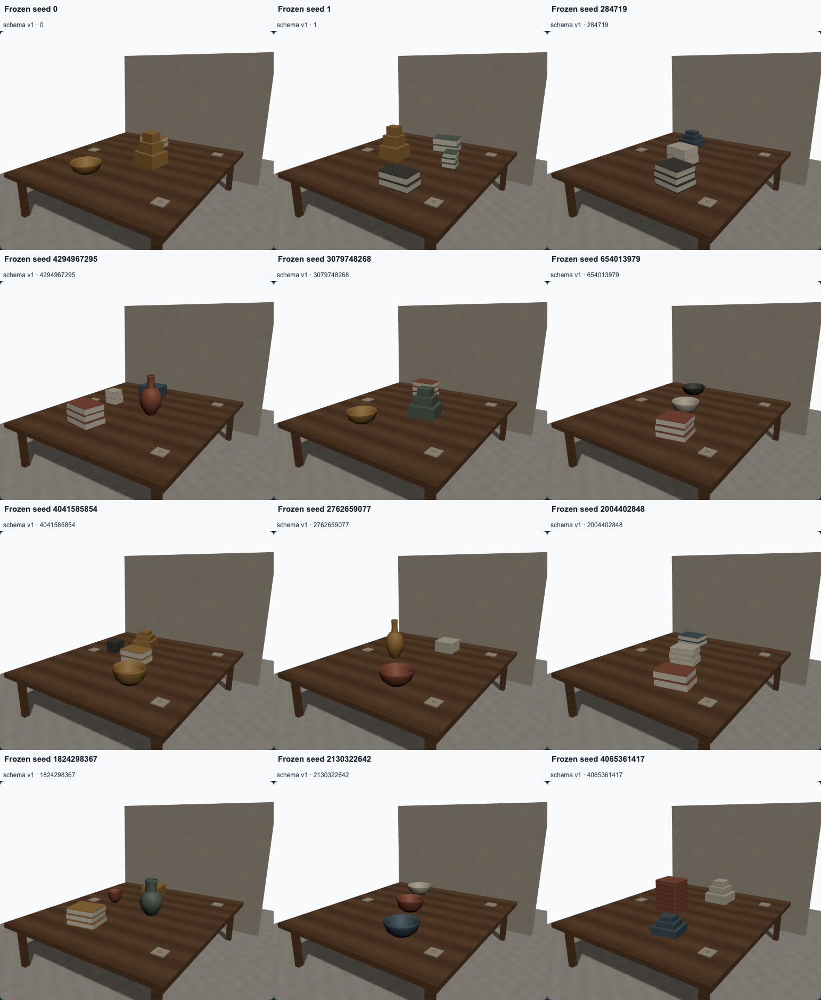

# Still-Life Studio MVP Qualification

## 1. Scene concept and intended user experience

Still-Life Studio is a Free Practice workspace for choosing a composition and exploring focus, aperture, depth of field, material texture, and large-format camera movements across seeded tabletop subjects. It uses the existing camera and optics controls without introducing scoring or a Guided objective.

## 2. Why a purpose-built Free Practice scene

Earlier scenes keep teaching targets or room geometry fixed while smaller props vary. Here the seeded objects are the principal subjects, so a seed changes the photographic arrangement itself. This is a bounded scene-specific planner, not a general procedural-world system. Existing catalog groups organize curriculum foundations, movement lessons, and macro topics; a standalone creative workspace does not fit those tracks, so a small Free Practice group is the appropriate catalog home.

## 3. Difference from existing teaching scenes

The studio has no lesson or task identity. The table, backdrop, focus markers, bounds, lighting, and camera preset stay fixed; the object family, composition, object count, placement, dimensions, palette, and surface realization vary with schema v1.

## 4. Canonical environment geometry

Planning uses canonical millimetres with +Z from the lens datum and Y up. The table is 3000 × 80 × 3400 mm, centred at (0, -40, 4100), with its top at Y=0 and tabletop depth from Z=2400 to 5800 mm. The backdrop is 3600 × 2775 × 100 mm, centred at (0, 562.5, 6200); its near face is Z=6150 mm. The restrained floor is 7000 × 50 × 8000 mm, centred at (0, -850, 4100). Scene bounds include the floor and backdrop. See [canonical geometry](../../src/scenes/stillLifeStudioGeometry.ts).

## 5. Focus reference contract

Three fixed rendered tabletop tiles mark near, middle, and far reference surfaces at (-1120, 3000), (1120, 4150), and (-1120, 5300) mm. Their centers and multi-point samples are independent of the seed. These anchors remain visible and protected from generated placements. Focus Distribution measures these stable anchors; it does not claim to measure arbitrary generated object surfaces.

## 6. Still-life object catalog

The curated catalog has four families: ceramic-style vessels, stacked books/paper, wooden forms, and bowls. Variants include two vessel silhouettes, two bowl profiles, two stack heights, and rounded or stepped wooden forms. There are no external model files or physics simulation.

## 7. Composition strategies

Schema v1 selects one of four fixed slot strategies: `vertical-emphasis`, `horizontal-grouping`, `layered-depth`, or `asymmetric-still-life`. Each valid plan contains three or four objects. These are planning choices, not UI modes.

## 8. Seed and schema contract

The scene uses the existing `(still-life-studio, seed, 1)` identity and `SceneVariationDescriptor`. The planner returns serializable positions, dimensions, rotation, family/variant, palette, per-surface variation seed, and fallback status. It uses semantic streams for composition, props, layout, and materials; it does not use `Math.random()` or renderer state. Existing scene variation URL and history handling are reused.

## 9. Deterministic planning

Fixed-seed unit checks compare both plan values and serialized output. Independent semantic streams keep one object's material decision stable when an unrelated optional object consumes a different stream. The frozen browser sample produced 12 distinct plan signatures across all four composition strategies. Details and signatures are in the [qualification report](evidence/still-life-studio/still-life-studio-qualification.json).

## 10. Placement constraints

The planner composes the shared placement geometry and constraint helpers. It validates positive finite dimensions, tabletop support, table bounds, scene bounds, protected focus regions, pairwise intersections, backdrop clearance, and composition depth. A fixed validated fallback is available. A deterministic 256-seed sweep covered all four strategies and 3/4-object counts with zero fallback use.

## 11. Actual mesh contact

Unit tests construct actual Three.js subject geometry for every family found in a bounded seed search and measure each object's `Box3`. The measured bottom is at the tabletop (Y=0 within 0.01 mm test tolerance), with actual X/Z bounds within 10 mm of the planned box and top height within 1 mm. This checks the meshes rather than relying only on nominal half-height.

## 12. Procedural materials

Wooden forms use the existing procedural surface material path with seeded wood variation; book pages use seeded paper maps. Vessels and bowls use a restrained matte palette. Materials and texture maps are created per registered subject, then disposed by that subject's existing lifecycle owner. The studio-specific wood tabletop is softened so the surface grain does not compete with the objects.

## 13. Observer and Ground Glass parity

Observer and RTT are built from the same plan and canonical presentation data. Unit evidence compares stable mesh names/IDs, transforms, materials, texture signatures, and shadow flags while asserting that geometry, material, and texture instances are independent. The browser captured the same schema-v1 seed in both views after a completed WebGL2 Ground Glass frame. The Ground Glass capture has visibly lower contrast than Observer at the selected camera settings, but the same book grouping and scene silhouette are present; see the [parity capture](evidence/still-life-studio/still-life-studio-observer-ground-glass-parity.png).

## 14. Regenerate and URL behavior

Direct seeded and implicit-seed entry, Copy Share URL, reload, and browser Back/Forward are covered. URL query parameters and fragment are preserved. Seed 284719 produced pixel-identical Observer captures before and after page reload. The [side-by-side replay evidence](evidence/still-life-studio/still-life-studio-same-seed-replay.png) shows both genuine captures; the report records the matching SHA-256 result.

## 15. Camera and optics validation

The existing 150 mm lens, thin-lens strategy, focus range 2600–6500 mm, and camera movement plumbing remain unchanged. Browser coverage checks focus at 3000, 4100, and 5300 mm; f/5.6, f/11, and f/22; processed, raw, and upright Ground Glass states; and all eight existing front/rear rise, shift, tilt, and swing controls using public control steps. The control UI is single-selection: changing movement selects one field at a time and resets the previous field, so these checks exercise each movement separately rather than claiming simultaneous movement stacking.

## 16. Resource lifecycle

Observer and RTT subjects own separate resource graphs and are each disposed once. Browser capacity evidence samples 16 points through seed A/B, history restoration, ten successive regenerations, and scene leave/re-enter. Renderer counts vary with composition size (14–29 geometries and 21–27 textures); renderer-minus-current-subject overhead remained exactly one geometry and nine textures for every sample. A→B→A and scene re-entry returned to the same subject/resource signature. Chromium's WebGL2 path reported CPU-fallback submit diagnostics; no hardware-GPU performance claim is made.

## 17. Frozen seed sample

The complete, unfiltered sample is `0, 1, 284719, 4294967295, 3079748268, 654013979, 4041585854, 2762659077, 2004402848, 1824298367, 2130322642, 4065361417`. Each plan had three or four objects, no fallback, and a distinct signature. Per-seed strategy, families, count, and signature are recorded in the report.

## 18. Normal-size visual assessment

Qualification used Chromium production preview at 1440 × 1000, DPR 1, standard quality, with a 514 × 411 Observer canvas, fixed camera, focus 4100 mm, f/11, and overlays disabled. I rate the result **ACCEPTABLE**: the complete grid shows recognizable changes in silhouettes, count, grouping, height, depth, and balance without zooming. Repeated families occur in some seeds (including books-only and bowls-only samples), so the generator does not promise every pair will look unrelated.

Also see the [four representative captures](evidence/still-life-studio/still-life-studio-four-representatives.png) and [blind A/B comparisons](evidence/still-life-studio/still-life-studio-blind-pairs.png).

## 19. Known limitations

- Focus diagnostics remain anchored to the three fixed reference tiles, not generated surfaces.
- The existing movement selector exposes one movement field at a time.
- The four stylized families and muted palettes are deliberately small; results are not photorealistic.
- Chromium qualification used a software WebGL2 path. CPU-submit numbers describe submission only, not hardware GPU speed.
- The 256-seed planner sweep is a sample, not exhaustive coverage of the 32-bit seed space.
- Ground Glass is darker/lower contrast than Observer in the parity capture, and merits future renderer-specific visual investigation if users find it hard to read.

## 20. Publication recommendation

Technical qualification passed: deterministic plans, zero fallback in the 256-seed sweep, actual mesh support checks, independent subject ownership/disposal, Observer/RTT parity checks, URL/history replay, current Ground Glass frame completion, and bounded resource samples. The visual assessment meets the requested minimum of ACCEPTABLE. Catalog metadata, English and Traditional Chinese labels, and the actual browser-derived WebP thumbnail are complete. The final publication-decision commit enables the manual scene-publication flag in source. This is not a deployment or merge.

The thumbnail is a real Observer capture from frozen seed 4294967295: [still-life-studio.webp](../../public/assets/still-life-studio.webp).

## 21. Next improvement opportunity

A bounded follow-up could add one folded-fabric subject family and evaluate it with the same frozen sample, normal-size view, placement solver, and resource checks. Keep this MVP's fixed studio, optics, focus anchors, and current family set stable until that separate change is qualified.

## Evidence files

- [12-seed grid](evidence/still-life-studio/still-life-studio-12-seed-grid.png)
- [Four representatives](evidence/still-life-studio/still-life-studio-four-representatives.png)
- [Blind pairs](evidence/still-life-studio/still-life-studio-blind-pairs.png)
- [Observer / Ground Glass parity](evidence/still-life-studio/still-life-studio-observer-ground-glass-parity.png)
- [Same-seed reload replay](evidence/still-life-studio/still-life-studio-same-seed-replay.png)
- [Qualification report](evidence/still-life-studio/still-life-studio-qualification.json)

## Technical validation

- `npm test` — passed, 342 test files and 4,231 tests.
- `npm run typecheck` — passed.
- `npm run lint` — passed.
- `npm run check:css` — passed.
- `npm run build` — passed.
- Root Chromium production-preview qualification — passed; one full visual/runtime case, one expected subpath-only skip, zero page errors.
- `/view-camera-simulator/` Chromium production-preview smoke — passed; one subpath case, one expected root-only skip.
- `git diff --check` — passed.

Chromium used WebGL2 with CPU-fallback submit diagnostics. Those values are reported as CPU submission measurements and are not interpreted as hardware GPU performance.
