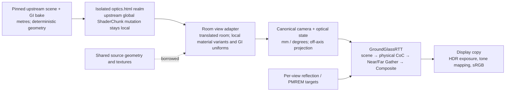

# Room-at-Dawn — Architecture and lessons learned

## Scope and result

This document extracts reusable scene-integration findings from the development-only Room-at-Dawn feasibility experiment. It records demonstrated behavior separately from recommendations and unresolved renderer questions.

- **Established:** the original procedural room and its 302/302 compatible baked-GI mesh matches can render through the simulator's canonical Ground Glass path.
- **Established qualitatively:** the user's browser comparisons show recognizable focus/DOF, Front Tilt, and Front Swing effects.
- **Partial:** complete optical blur calibration, foreground defocus fidelity, custom glass reflection parity, and upstream photographic parity.
- **Deferred:** production scene integration, compound Tilt + Swing, arbitrary camera orientation, and native WebGPU equivalence.

The [experiment README](README.md) contains the final run instructions, evidence links, validation results, and status matrix. The separate [research backlog](RESEARCH_BACKLOG.md) contains future investigation criteria.

## Integration shape

The experiment reuses the existing `GroundGlassRTT`, development scene-profile seam, canonical optics derivation, off-axis camera configuration, CoC pass, Near/Far Gather, Composite, and Raw/Upright presentation. The original upstream perspective camera and film pipeline are used only as historical reference; they do not produce the canonical Ground Glass image.

Canonical finite image-circle coverage is carried separately from focus blur as a parallel circle or nonparallel conic on the active physical film plane, then contributes its own coverage gain in `GroundGlassRTT`. The room demo reuses this state; its human comparisons do not independently calibrate coverage. Raw/Upright changes presentation orientation without changing the canonical optics. Raw RTT Debug bypasses optical illumination and coverage, so it is a source-image diagnostic rather than a processed preview.

The upstream room is built in metres; canonical optics and movement values use millimetres and degrees at their module boundaries. Presets apply translation only and preserve physical scale. The room stays fixed while camera state changes. The development scene adapter selects the existing `optical-axis-conjugate` finite-focus datum for Tilt/Swing; this is a scene configuration choice using established optics, not a rewrite of shared optical mathematics.

The upstream GI module mutates Three.js shader chunks at import time. Loading it in a standalone `optics.html` document gives it a separate JavaScript realm and prevents that mutation from contaminating the production SPA. A material-local adapter translates GI world-position evaluation back into source-room coordinates. The experiment does not register the room in the public scene catalog or guided tasks.

## Scene resources, materials, and GI

The upstream source demonstrates deterministic procedural scene construction: seeded random streams, generated geometry, grouped/instanced repeated parts, and noise-derived color, normal, and roughness textures. The room contains detailed wood, fabric, furniture, decor, foliage, and exterior structures. These are source techniques to evaluate selectively; importing the full environment or its shader patching wholesale is not a production recommendation.

The bake is a binary, scene-specific precomputed GI asset. Its deterministic identity check matched 302 of 302 expected meshes in the verified runs. Matching uses stable hierarchical names plus ordinal and geometry/material compatibility attributes; it does not make this a general-purpose bake format or prove vertex-by-vertex equality. GI data and room geometry are authored in source coordinates. Runtime translation must be reversed where shaders sample source-space GI and box probes. Translating or rotating only geometry would invalidate those coordinate relationships.

The view adapter borrows source geometry and textures, clones material variants, and gives each view independent material objects and GI uniform wrappers. The source owner remains responsible for borrowed geometry and textures. Reflection capture allocates targets and PMREM resources for the renderer that owns them; WebGL textures are not shared across independent renderer contexts. The experiment restores scene and renderer state and disposes resources it created. Browser cleanup evidence verifies selected unmount/remount behavior, but there is no measured GPU-memory reclamation claim, and partial upstream scene-build cancellation remains limited.

The experiment's use of the upstream precomputed bake is not a production GI pipeline. Any future system needs explicit bake provenance, stable geometry identity, coordinate transforms, shader isolation, lifecycle ownership, and failure handling.

## HDR and presentation

Keep these stages distinct:

1. Source material and scene radiance.
2. Canonical optical illumination, including aperture gain.
3. Linear HalfFloat storage for the development HDR scene, Near/Far Gather, and Composite targets.
4. Display-only exposure.
5. Tone mapping.
6. Output color-space encoding.

The development HDR path checks allocated framebuffers and applies its display transform after the optical passes. Normal production requests keep the existing byte color-target default. Synthetic linear readback supports HalfFloat range and the declared transform for the tested synthetic inputs; it does not establish calibrated Room PBR radiance or highlight parity with upstream. A bright display screenshot is not a radiometric measurement. The byte diagnostic path is intentionally lossy and can clip before blur. Native WebGPU and backend equivalence are unvalidated.

The fixed-exposure synthetic aperture comparison measured a linear green composite ratio of about 0.064781 for f/22 versus f/5.6, against the canonical prediction of about 0.064793. This passes within that tested synthetic scope. It does not calibrate aperture-dependent blur transfer in the original room.

## Optical and photographic lessons

The user's A/B comparisons change one stated camera setting at a time:

- **Front Tilt:** 90 mm, 1610 mm focus, f/5.6; 0° versus +9°. Wall decorations and headboard gain detail while the near bed/floor lose clarity.
- **Front Swing:** 90 mm, 1610 mm focus, f/5.6; 0° versus +5°. Sharpness shifts laterally toward the right-side pictures and headboard while the left wall map softens.
- **Focus:** 90 mm, f/5.6, neutral Tilt/Swing; 460 mm versus 5520 mm. Near and far focus visibly change scene sharpness, with focus breathing and imperfect foreground-plant defocus.

These establish qualitative focus-plane redistribution, including a recognizable Scheimpflug-related effect. They do not measure the hinge rule, exact plane intersection, image-space point-spread function, or blur transfer. Original screenshot files and capture identities were not present in the worktree/task attachments at closeout; the recorded observations have unknown source revision. See [human acceptance provenance](evidence/human-acceptance-v9/README.md).

Composition matters to whether an optical result is visible. Useful detail, depth separation, surface orientation, occlusion, pixel scale, focal length, and focus breathing all affect the observed frame. A mathematically suitable plane can be visually unconvincing when its selected surface has little texture, is occluded, is non-planar, or produces subpixel blur. The user's matched A/B comparisons gave clearer movement demonstrations than the earlier automated reference states. Synchronized same-renderer A/B capture helps isolate one changed control while preserving request and frame identities.

The tested High-quality Near Gather proposal uses up to roughly 60 internal pixels, 32 samples, and a first noncentral proposal about 7.5 pixels from center. This may limit some small CoC footprints. It is a plausible sampling limitation, not a demonstrated common cause of the observed foreground ghosting or every weak blur response. No shared Gather algorithm was changed.

The plant source was inspected: foliage uses modeled leaf blades and opaque RGBA color maps; the source material helper does not set alpha testing or transparency. Runtime depth-write state was not read from the user's captured composition, so the cause of the foreground ghosting remains unresolved.

## UI stability lesson

A Focus value label previously changed the slider's measured layout during pointer movement. A fixed-width value/track layout removed measured track drift, and trusted browser drags produced monotonic values while keyboard steps remained functional. Status: `UI_POINTER_INSTABILITY_FIXED / AUTOMATED_BROWSER_VERIFIED`. This supports a general UI rule: keep interactive input geometry stable while its displayed value changes. The user's later optical comparisons do not explicitly confirm that the originally reported slider symptom is fully resolved, so manual symptom confirmation remains separate from the automated result.

The A/B browser closeout now covers the no-frame timeout and renderer-boundary callback, while preserving prior A, releasing pending controls/timeout state, capturing a later valid frame, and rejecting a stale request. It uses a deterministic test-only withheld-frame seam and a React error-boundary throw; it does not claim a real WebGL context-loss or GPU execution-failure test.

## Recommendations for other scenes

Treat the Room as a source of reusable techniques, not a new public teaching scene. A bounded Interior Corner materials/lighting pilot is a reasonable future candidate because it offers an existing teaching objective and enclosed surfaces for controlled material comparisons. Any pilot should preserve the lesson's optical visibility and performance budgets, and should independently test procedural texture, lighting profile, and optional baked GI changes. Production HDR and GI architecture require separate decisions. Future Free World environments remain exploratory.

No existing teaching scene was modified in this closeout.

## Repository footprint and retention decision

The final PR comparison is against current `origin/main`. With closeout documentation included, the experiment subtree contains 486 tracked-or-added files / 49,070,793 bytes in the prospective checkout; 419 evidence files / 34,887,260 bytes are retained. This excludes four ignored diagnostic logs already present in the local worktree. The vendored upstream source is 19 files / 643,293 bytes, the GI bake is 13,064,380 bytes, and the remaining implementation/docs are 46 files / 474,795 bytes. The evidence set contains 202 PNGs / 25,948,311 bytes, one WebM / 701,100 bytes, and 210 JSON files / 8,217,021 bytes. These are checkout byte counts, not compressed Git pack size.

A byte-identical SHA-256 inventory found 38 duplicate groups containing 61 extra file copies (about 5.04 MB). Many are same-state forward/reverse or repeated captures and contribute repeatability context, so none were removed during closeout. A perceptual near-duplicate image analysis was not run. The original source, bake, failed measurements, manifests, and prior rounds remain intact; no external evidence store with durable retrieval was established.

At closeout commit `8d848da58011e1aded8cca05ec8318b8cd4eb2f0`, the branch contained 19 commits, 147 trees, and 479 blobs unique to the feature branch. Git reported 34,774,623 bytes of unique object disk usage and 45,382,450 bytes of raw blob content. The prior pre-closeout measurement was 34,705,713 bytes of unique objects and 45,205,206 raw blob bytes across 18 commits, 142 trees, and 472 blobs. Git-reported object disk usage is not a promise of exact future pack transfer size. Removing evidence in a later commit would not remove its earlier reachable Git objects; no history rewrite or pruning was attempted.

Retention decision: keep the current evidence intact for this reference PoC. If checkout size becomes a maintenance issue, review the 38 duplicate groups against their manifests and retain at least one copy plus enough metadata to preserve distinct run identities. Any later size reduction should be a separate reviewed change; do not rewrite shared history.
